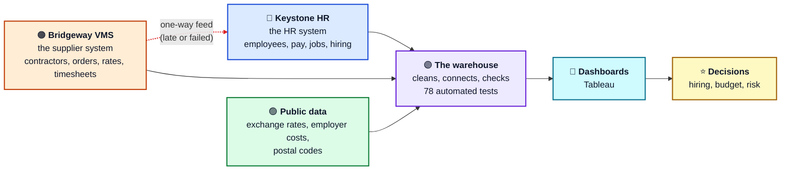
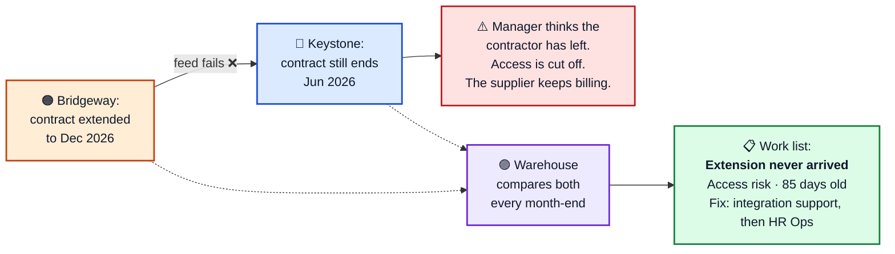
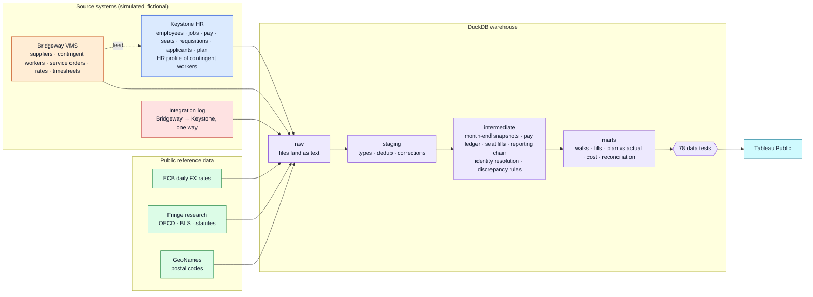
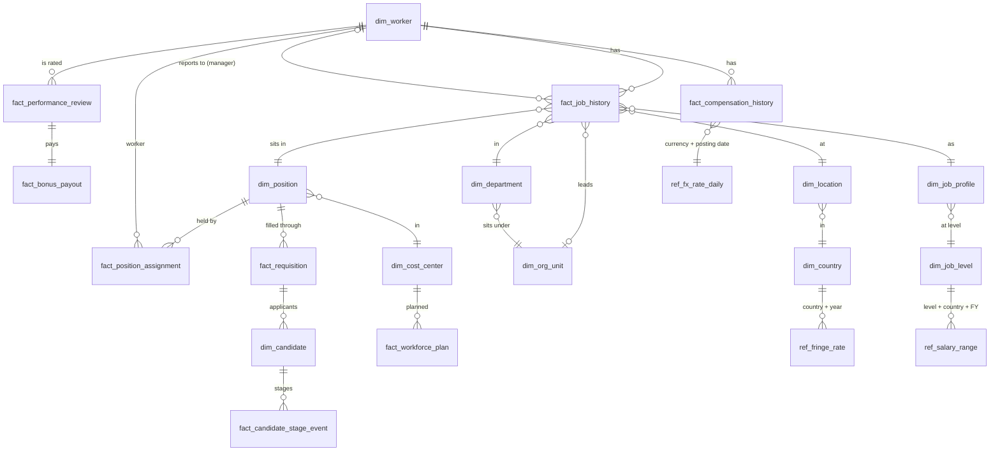
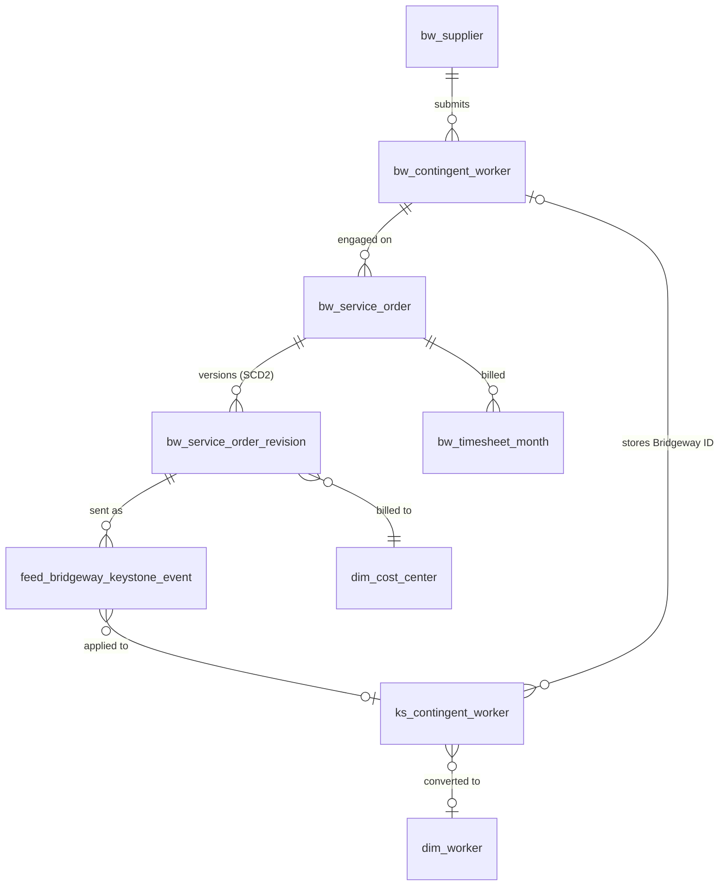
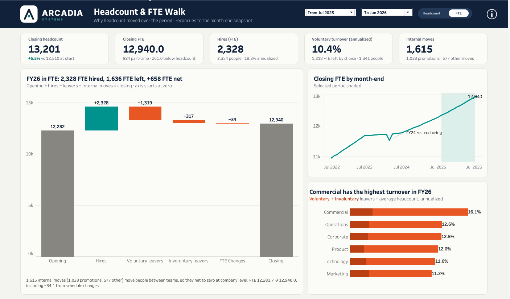
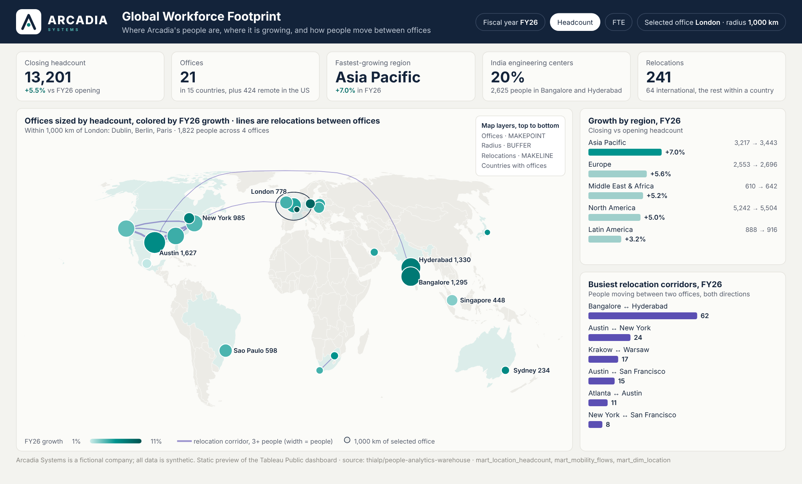
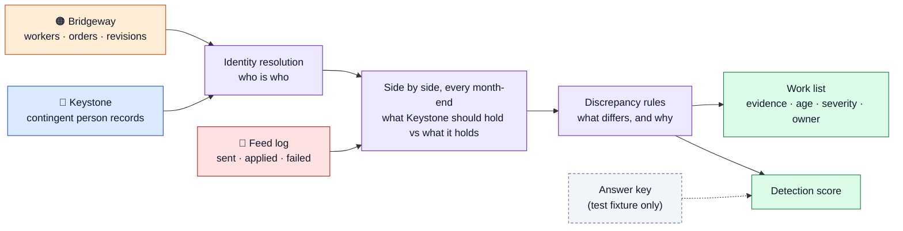

# People Analytics Warehouse


[](https://github.com/thialp/people-analytics-warehouse/actions/workflows/pipeline.yml)

**A complete HR data platform for a made-up 42,000-person company, built end to end to show how enterprise workforce questions get answered with numbers that add up.**

The [executive summary](#executive-summary) is a two-minute read for anyone. The [technical deep dive](#technical-deep-dive) is for people who want the SQL, the data model and the tests.

---

## Executive summary

> [!IMPORTANT]
> **The company is fictional. The numbers behave like real ones.**
> Arcadia Systems, its people, offices, suppliers, salaries and every hire, exit and contract are invented: generated by **Claude Code** from rules I designed with it ([`generator/`](generator/)). No data, logic or screenshots from any employer are used. What *is* real is the public data the simulation is anchored on:
>
> - **Exchange rates:** the European Central Bank's actual daily reference rates, 2021–2026
> - **Employer costs:** fringe rates researched country by country and year by year (OECD, US BLS, national statutes), including real law changes such as the UK's 2025 employer NIC increase
> - **Places:** real postal codes and GeoNames coordinates for every office (street addresses are made up)
> - **Contractor rates:** bill rates sanity-checked against public market ranges by country
>
> So a stronger pound really does raise Arcadia's US-dollar cost in the right month, even though nobody at Arcadia exists.

### Arcadia Systems in numbers (30 June 2026)

| 👥 Employees | 🧰 Contractors | 🌍 Offices | 💱 Currencies | 📅 History |
|:---:|:---:|:---:|:---:|:---:|
| **30,014** | **11,941** | **35** in **22** countries | **17** | **5** fiscal years |
| on Arcadia's payroll | through **23** suppliers | across five regions | real ECB rates | July 2021 – June 2026 |

Total workforce cost: **$4.65 billion a year** at run-rate: $3.41B for employees (pay plus employer costs) and $1.24B at contractors' bill rates.

### The questions it answers

| | Question a leader asks | What the warehouse shows | Dashboard |
|---|---|---|---|
| 🪑 **1. [Workforce Planning](#case-study-1-workforce-planning)** | *Are we hiring into the seats we planned?* | Every hire tied to the seat it filled, who sat there before, and the plan versus what happened | *in design* |
| 📈 **2. [Headcount & FTE Walk](#case-study-2-headcount--fte-walk)** | *How did the workforce change, and why?* | Start + hires − leavers ± moves = end, for employees, contractors and both, for any team | **[Live on Tableau Public](https://public.tableau.com/app/profile/thialp/viz/arcadia_headcount_fte_walk/ExecutiveSummary)** |
| 🗺️ **3. [Global Workforce Footprint](#case-study-3-global-workforce-footprint)** | *Where are our people, and where are they moving?* | Office-level growth and every relocation, on a map | *coming soon* |
| 💵 **4. [Compensation Walk](#case-study-4-compensation-walk)** | *Why did pay in this group change?* | Each dollar of change traced to hires, exits, promotions, raises, employer costs or currency | **[Live on Tableau Public](https://public.tableau.com/app/profile/thialp/viz/ArcadiaCompensationWalk/Summary)** |
| 🧮 **5. [Workforce Cost Bridge](#case-study-5-workforce-cost-bridge)** | *Why did total workforce cost grow?* | More people, pricier people, a different mix, or currency? Split fairly, to the cent | *coming soon* |
| 🔍 **6. [Contingent Workforce](#case-study-6-contingent-workforce-reconciliation)** | *Do our HR system and our supplier system agree on who works here?* | Every disagreement found, explained, aged and routed to who can fix it | *coming soon* |

### How it works, in one picture



Like most large companies, Arcadia runs **two systems that each know part of the truth**:

- 🔵 **Keystone HR** is where employees live, and where managers look up everyone on their team.
- 🟠 **Bridgeway VMS** is where suppliers send contractors. It is the **source of truth for contractors**: who is engaged, on which order, until when, at what rate.
- 🔴 A **one-way feed** copies contractor changes from Bridgeway into Keystone. Sometimes it is late, sometimes it fails, and sometimes someone edits Keystone by hand. Then the two systems disagree.

The warehouse brings both systems and the public data together, checks them against each other, and feeds the dashboards. It never changes either system: when they disagree, it says **what** differs, **why**, **since when**, and **who can fix it**.

### When the two systems disagree



Thirteen kinds of disagreement are tracked, from *a change still on its way* to *one person with two IDs* and *billed after the contract ended*. Because the data is synthetic, the simulation also kept a secret answer key of every problem it planted: **the warehouse finds 100% of them** (28,530 of 28,530), using only what the two systems themselves contain.

### What the data says (fiscal year to June 2026)

- **The workforce grew 7.2%**, from 39,154 to 41,955 people: employees +5.5%, contractors +11.5%.
- **Total cost grew $403M (+9.5%).** A fair split ([Shapley values](#growth-mix-why-did-total-workforce-cost-change)) shows **$307M came from having more people** and **$140M from paying people more**, while currency moves *saved* $52M.
- **270 contractors became employees.** Each conversion lowered run-rate cost: on average $121k a year of supplier billing was replaced by $73k of employee pay and employer costs.
- **416 contractors (3.5%) have a record that disagrees between the two systems.** The largest group: 219 whose details were changed by hand in the HR system only (mostly a manager moving them to another team), so the supplier still bills the cost center on the order.
- **Hiring followed the plan at 79%** for new seats and 93% for backfills, and 29% of new seats were approved while a matching seat sat empty for 90+ days.

### Why it is built this way

| Principle | What it means here |
|---|---|
| ✅ **Every number reconciles** | Start + changes = end, for every team, month and currency, checked by 78 automated tests on every change |
| 🔁 **One company, many questions** | All six case studies read the same people, the same history and the same month-end snapshots, so two dashboards never tell different stories |
| 🏢 **Built like an enterprise stack** | The same model runs on DuckDB (for Tableau Public) and SQL Server (for a live Tableau connection), and is proven identical row for row |
| 🧭 **Explain, don't just report** | Every case study answers *why*, not only *how much* |

| | |
|---|---|
| **Stack** | SQL (DuckDB and SQL Server) · Python · Tableau · Docker · GitHub Actions |
| **Scale** | 46,980 employees and 43,484 contractors over five years · 61 month-ends · 33,359 seats · 31,323 requisitions · 188,982 applicants · 58,276 supplier orders · 632,504 timesheets |
| **Output** | 21 Tableau-ready marts and 7 dimension files in [`data/marts/`](data/marts/); 17 Tableau Custom SQL queries and 13 reporting views on SQL Server |
| **Controls** | 78 automated data tests; the build stops if any fails. The SQL Server build is checked against the same values |

---

# Technical deep dive

**Contents:** [The platform](#the-platform) · [Case study 1](#case-study-1-workforce-planning) · [2](#case-study-2-headcount--fte-walk) · [3](#case-study-3-global-workforce-footprint) · [4](#case-study-4-compensation-walk) · [5](#case-study-5-workforce-cost-bridge) · [6](#case-study-6-contingent-workforce-reconciliation) · [Run it yourself](#run-it-yourself) · [SQL Server](#run-it-on-sql-server-with-tableau) · [Repository layout](#repository-layout)

## The platform

The six case studies share one warehouse. This section covers what they have in common; each case study below covers its question, approach, results and dashboard.

**The company.** Arcadia Systems has 30,014 employees in 35 offices across 22 countries and five regions, organized under a CEO, eight function heads, four sub-function heads and 31 department heads, with every person in one reporting line that ends at the CEO ([org chart](docs/company/org_chart.md)). Every employee sits in a **seat** (position), and every hire since July 2021 came through a requisition on one. Pay follows a 12-level ladder with salary ranges that move every July 1, raises on each hire anniversary, promotions one level at a time and an annual bonus set by the performance rating ([organization and pay model](docs/company/organization_and_pay_model.md)). Beside them work 11,941 **contingent workers** (contractors, consultants and outsourced BPO staff) from 23 suppliers, engaged through service orders in Bridgeway VMS and mirrored into Keystone HR by a one-way feed ([Bridgeway simulation](docs/projects/contingent-workforce/bridgeway_simulation.md), [Keystone and the feed](docs/projects/contingent-workforce/keystone_feed.md)). [Company profile](docs/company/README.md).

### Data architecture



Colors as in the [executive summary](#how-it-works-in-one-picture): 🔵 Keystone HR, 🟠 Bridgeway VMS, 🔴 the feed between them, 🟢 public reference data, 🟣 the warehouse, 🔷 Tableau.

| Layer | What happens there | Files |
|---|---|---|
| **raw** | CSVs load as text, untouched, like a landing zone; every table names its source system ([lineage](docs/warehouse/source_systems.md)) | [`data/raw/`](data/raw/) |
| **staging** | Data types set; same-day pay corrections resolved; job level renamed `grade` once | [`sql/01_staging/`](sql/01_staging/) |
| **intermediate** | Pay valued at its posting-date FX rate; effective-dated history turned into one row per worker (and per seat, and per contingent worker as Bridgeway held it) per month-end; a running pay ledger; seat fills and vacancy chains; the reporting chain walked to the CEO; Keystone people matched to Bridgeway workers and the two systems compared | [`sql/02_intermediate/`](sql/02_intermediate/) |
| **marts** | Business-ready tables for Tableau | [`sql/03_marts/`](sql/03_marts/) |
| **tests** | Each test returns rule-breaking rows; zero rows = pass | [`tests/`](tests/) |

The same model is built in T-SQL on **SQL Server** for a live Tableau connection ([below](#run-it-on-sql-server-with-tableau)).

### Analytical challenges

| Challenge | Why it's hard | How it's handled |
|---|---|---|
| **Effective-dated history** | Job, pay and seat records each change on their own dates (SCD Type 2). A month-end view needs the record in effect *on that day*. | As-of joins per month-end, built once into [`int_worker_month_end_snapshot`](sql/02_intermediate/int_worker_month_end_snapshot.sql) and [`int_position_snapshot`](sql/02_intermediate/int_position_snapshot.sql) |
| **Two views of one workforce** | Recruiting and Finance count seats; HR counts people. If they disagree, nobody trusts either number. | Every worker holds exactly one seat every day, and a test proves filled seats equal the month-end headcount, same people, every month (test 45) |
| **Corrections in the source** | A pay correction adds a second row with the same effective date. Summing both double-counts the worker. | Keep the latest entry per worker + date; flag it `was_corrected` |
| **Multi-currency pay** | Pay is held in 17 local currencies. A stronger pound raises USD cost with no one getting a raise. | Real ECB rates, three ways: revalued at each month-end (nominal), booked at the posting date of each pay record, and at one constant rate set (2026-06-30) |
| **Reporting hierarchy** | "Everyone in Maria's organization" is a recursive question, and it changes every time a manager leaves or a team is split. | Manager on every effective-dated job record; a recursive CTE builds a closure table (worker × every manager above) per month-end, so an org roll-up is one equality join ([`int_worker_reporting_chain`](sql/02_intermediate/int_worker_reporting_chain.sql)) |
| **Fringe that changes by law** | Employer charges differ by country and change on January 1 (the UK raised employer NIC in 2025; Australia's super guarantee rises every July). | A researched rate per country and calendar year with its components and sources, joined on the year of each month-end |
| **Transfers between groups** | If movers are valued at new pay on the way in and old pay on the way out, transfers stop netting to zero for the company. | Transfers move at **prior** pay; any raise shows up as its own driver in the new group |
| **Order of attribution** | A worker can get promoted *and* see FX move in the same month; a re-levelled seat can also move office. The split must not double-count. | Decompositions whose terms always sum exactly to the change, with the rounding absorbed by one named term ([case study 5](#case-study-5-workforce-cost-bridge), [case study 1](#case-study-1-workforce-planning)) |
| **Two systems of record** | Contractors live in the vendor system (Bridgeway); managers see them in the HR system (Keystone), filled by a one-way feed that can be late, fail or be overridden by hand. Their IDs, supplier names and dates disagree. | Identity resolution in three confidence tiers; a side-by-side snapshot of what Keystone *should* hold (everything Bridgeway sent) against what it holds; rules that name the cause of each difference ([case study 6](#case-study-6-contingent-workforce-reconciliation)) |
| **Attribution bias** | Splitting a cost change into volume, mix, rate and currency gives a different answer depending on which factor is moved first. | Shapley values: each factor's average contribution over every order of the six factors, beside the sequential split and its bias ([growth mix](#growth-mix-why-did-total-workforce-cost-change)) |
| **Privacy** | Pay for groups under 5 people can identify individuals, and what counts as a group depends on how a dashboard slices the data. | Suppression applied in Tableau at the level of the view; executive officers excluded from pay in SQL |

### How the data is made

1. **Simulate the company.** [`generator/generate_data.py`](generator/generate_data.py) runs five years of workforce history from June 2021, day by day:
   - **People:** hiring toward a growth target, attrition shaped by tenure, level and rating, raises on every hire anniversary, an annual June review with bonuses and July promotions (and rare demotions), off-cycle promotions, market adjustments, transfers (10% international, with pay re-levelled for the new market), office moves and the opening of six new offices. Every employee is full-time (release 3).
   - **Seats:** when a seat empties it is backfilled as is, re-levelled, relocated within the country, frozen or eliminated. Hires and internal movers fill seats through requisitions with approval lags, time to fill and cancellations; every requisition has an applicant pipeline; a budget and three reforecasts plan each year.
   - **The org stays valid every day:** when a manager leaves, a successor or the next manager up takes the team the next day, and teams over 9 are split by appointing a new manager.
   - **Two events give the history a story:** a **FY24 restructuring** in Commercial and Marketing, and a **FY25 reorganization** that moved data teams into a new *Data & AI Platform* department.
   - **Contingent workers (release 3):** suppliers submit workers on service orders that are approved, extended, renewed, re-rated and closed in Bridgeway VMS, with monthly timesheets. A one-way feed copies each change into Keystone HR, late, partly or not at all, and people edit Keystone by hand. Some contractors are converted into employees. Every planted discrepancy is written to an **answer key** that only the scoring model reads.
   - **Each domain draws from its own seeded random stream** (people, seats, recruiting, plan, contingent workers, the feed), so adding a domain never changes the draws of another.
2. **Land it as a warehouse would.** Forty raw tables from five source systems ([lineage](docs/warehouse/source_systems.md)), with deliberate source quirks: same-day corrections, compensation history that only starts at a March 2021 system conversion, FX that exists only on ECB business days, a pegged currency, hand-typed supplier names and feed failures.
3. **Model in layers** with plain SQL files in run order, so each step can be read and tested on its own.
4. **Test everything that must be true**, and fail the build if it isn't.
5. **Export flat marts** that Tableau Public can read directly, and generate each dashboard's check table from them.

### Data model



The contingent workforce (release 3) comes from Bridgeway VMS and meets Keystone through the Bridgeway worker ID that Keystone stores:



| Raw table | Grain | Rows |
|---|---|---:|
| `dim_worker` | worker (fictional names) | 46,980 |
| `fact_job_history` | worker × effective-dated job record (SCD2), with seat, manager and leadership role | 96,129 |
| `fact_compensation_history` | worker × effective-dated pay record (SCD2), incl. corrections | 186,191 |
| `fact_performance_review` | worker × fiscal year rating | 154,151 |
| `fact_bonus_payout` | worker × fiscal year bonus | 154,151 |
| `dim_position` | seat × effective-dated record (SCD2): status, grade, office, cost center | 99,398 |
| `fact_position_assignment` | who held which seat, from when to when, how they arrived and left | 54,094 |
| `fact_requisition` | requisition: opened, approved, filled or cancelled | 31,323 |
| `dim_candidate` | applicant × requisition | 188,982 |
| `fact_candidate_stage_event` | applicant × stage reached | 531,691 |
| `fact_workforce_plan` | plan version × cost center × fiscal quarter | 29,415 |
| `dim_cost_center` | department × country | 630 |
| `dim_org_unit` | company, functions, sub-functions, departments | 44 |
| `dim_department` | department, with function and sub-function | 32 |
| `dim_location` | office: fictional street, real postal code, GeoNames coordinates, pay zone | 35 |
| `dim_country` | country, with region, currency and pay index | 22 |
| `dim_job_level` | level L1–L12 with the US base salary | 12 |
| `dim_job_profile` | job family × level (IC and people-manager variants) | 165 |
| `ref_job_level_base_salary` | level × country, in local currency | 264 |
| `ref_tenure_increase` | completed years of service → anniversary raise | 7 |
| `ref_performance_bonus` | rating → bonus % | 3 |
| `ref_salary_range` | fiscal year × level × country, moving every July 1 | 1,584 |
| `ref_fx_rate_daily` | currency × ECB publication day (2021-01 to 2026-09) | 24,820 |
| `ref_fx_rate_monthly` | currency × month-end | 1,037 |
| `ref_fx_rate_constant` | currency (latest close, 2026-06-30) | 17 |
| `ref_fringe_rate` | country × calendar year, with components | 132 |
| `ref_fringe_source` | country × year × component × source | 215 |
| `bw_supplier` | supplier (Bridgeway VMS) | 23 |
| `bw_rate_card` | fiscal year × country × worker type × role family × seniority: low, target, high bill rate | 23,408 |
| `bw_contingent_worker` | contingent worker (Bridgeway ID) | 43,484 |
| `bw_service_order` | engagement order: new engagement or renewal | 58,276 |
| `bw_service_order_revision` | order × revision (SCD2): dates, status, cost center, manager, office, rate | 160,499 |
| `bw_timesheet_month` | worker × order × month billed | 632,504 |
| `ks_contingent_worker` | Keystone person × effective-dated version (SCD2), who wrote it (feed, manager, HR Ops) | 141,791 |
| `feed_bridgeway_keystone_event` | change sent from Bridgeway to Keystone: sent, applied, failed, queued | 106,357 |
| `ref_cw_discrepancy_type` | discrepancy type CW00–CW12: what happened, what a manager sees, severity, who fixes it | 13 |
| `gen_cw_discrepancy_truth` | the answer key: every planted discrepancy and its dates (a test fixture) | 28,948 |
| `ref_source_system`, `ref_raw_table_lineage`, `ref_raw_column` | source systems, the source of every raw table, the column contract of the release 3 extracts | 6 / 40 / 128 |

Full column definitions: [`docs/warehouse/data_dictionary.md`](docs/warehouse/data_dictionary.md).

### Validation strategy

Every test is a SQL query that returns the rows breaking a rule. The pipeline runs all 78 after every build and refuses to export if any returns rows.

| # | Test | Guards against |
|---|---|---|
| 01 | Worker IDs are unique | Duplicate people |
| 02 | Job history has no gaps or overlaps | Workers dropping out of, or doubling in, snapshots |
| 03 | Pay history has no gaps or overlaps after corrections | Double-counted pay from correction rows |
| 04 | Job records sit inside employment dates | Records before hire or after termination |
| 05 | One snapshot row per worker per month | Fan-out from the as-of joins |
| 06 | Every snapshot row has pay, FX, fringe and range | Dollars silently dropped by a missing lookup |
| 07 | **Opening + drivers = Closing**, every department and month | A cost walk that doesn't reconcile |
| 08 | Closing of one month = opening of the next | Breaks when walking across a date range |
| 09 | Walk closing = snapshot mart total | Two marts telling different stories |
| 10 | Transfers net to zero company-wide | Transfers creating or destroying cost |
| 11 | Constant currency has no FX effect | FX leaking into constant-currency figures |
| 12 | Executive officers excluded | Restricted pay in reporting |
| 13 | **Opening + movements = Closing** for every slice and month, in headcount and FTE | A headcount walk that doesn't reconcile |
| 14 | Headcount closing of one month = opening of the next, slice by slice | Breaks when walking across a date range |
| 15 | Walk opening and closing = an independent count of the month-end snapshot | Dropped or double-counted people |
| 16 | Internal moves net to zero company-wide, for every reason | Moves creating or destroying headcount |
| 17 | Hires and leavers = a recount from the worker master's hire and termination dates | Snapshot logic drifting from the source of truth |
| 18 | One movement row per worker per month | A worker counted twice in one month |
| 19 | **Opening + hires − leavers ± relocations = Closing** for every office and month | An office walk that doesn't reconcile |
| 20 | Offices add up to the company headcount walk | The map and the walk telling different stories |
| 21 | Relocations net to zero company-wide every month | Relocations creating or destroying people |
| 22 | Flows out of and into each office equal its relocations; no self-loops; every office has coordinates | Map lines that don't match the numbers |
| 23 | Every employee is 1.0 FTE: no job record below full-time, and FTE equals headcount on every walk line | Part-time or an FTE movement slipping back in after release 3 removed them |
| 24 | **Everyone except the CEO reports to a manager employed that day**; exactly one CEO | People with no manager, or reporting to someone who has left |
| 25 | Managers outrank people managers; ICs report at their level or higher; non-leaders report inside their department | Inverted or cross-department reporting lines |
| 26 | Every reporting chain ends at the CEO in under 15 steps | Loops and dead ends in the hierarchy |
| 27 | Every org unit has exactly one leader every month-end | Leaderless or double-led departments |
| 28 | Every country has a fringe rate for every year 2021–2026; components add up; every component cites a source | Missing, inconsistent or unsourced fringe rates |
| 29 | Every pay record finds an ECB rate posted ≤ 5 days before it; month-end rates are complete | Stale or missing FX |
| 30 | Bonus % matches the rating; amount = base × FTE × % × proration | A bonus plan applied wrongly |
| 31 | Level changes only through promotion, demotion, succession or the reorg; a promotion is exactly one level up | Silent level jumps |
| 32 | Offices have valid coordinates and a real postal code (except the UAE); nobody sits in an office before it opened | Unmappable offices, impossible history |
| 33 | Tenure raises land on the hire anniversary and never exceed the schedule | Pay growth that the tenure table doesn't explain |
| 34 | The pay ledger explains every change in every worker's cost, on all four measures | A pay event, FTE, fringe or FX movement missed |
| 35 | **Every compensation walk closes**, for every date pair, view and group | A pay walk that doesn't reconcile |
| 36 | Every group's opening and closing equal the snapshot | Groups that don't tie to the people in them |
| 37 | Transfers net to zero across each view; none at company level | Transfers creating or destroying pay |
| 38 | All six views add up to the same company totals | Views telling different stories |
| 39 | Office moves equal the walk's transfers for every office and country | A map that disagrees with the walk |
| 40 | The six views of office moves tell one story | Movers counted twice or lost |
| 41 | Seat history is one continuous chain per seat | Seats dropped or doubled |
| 42 | A seat never has two incumbents at once | Two people in one seat |
| 43 | Every job record names the seat the worker holds | People and seat histories drifting apart |
| 44 | A seat is Filled exactly when someone holds it; an Open seat has an open requisition | Status that contradicts occupancy |
| 45 | **Filled seats = month-end headcount, same people, every month** | The seat view and the people view disagreeing |
| 46 | Every worker's first seat starts on their hire date | Hires without a seat |
| 47 | Every seat exit is a termination that day or an internal move the next day | Unexplained vacancies |
| 48 | A filled requisition has exactly one fill, same day, same person | Fills without a requisition |
| 49 | Plan versions are unique, dated in order and never overwritten | A plan rewritten after the fact |
| 50 | A filled requisition has exactly one accepted applicant, the person hired | An applicant pipeline that disagrees with the hire |
| 51 | Cost center = department × country on every seat and requisition | Plan lines that can't meet their seats |
| 52 | Salary ranges move once a year by the structure increase | A market effect with nothing behind it |
| 53 | **The seat pay walk adds up for every backfill, to the cent** | A pay walk that doesn't reconcile |
| 54 | Every reuse candidate meets the rule on its approval date | A flag that can't be defended |
| 55 | Vacancy chains link correctly; every seat left by an internal move is accounted for | Lost seats, broken chains |
| 56 | **Plan vs actual ties to company headcount and seat fills every quarter** | Two versions of the actuals |
| 57 | The region walk closes in every row and equals the walk by group | A region card that disagrees with the walk |
| 58 | Promotions and demotions from job history = the walk's, counted from pay | Two sources, two answers |
| 59 | Office moves' opening headcount = the walk's opening | A "share of headcount" on the wrong base |
| 60 | Every raw table names exactly one source system (Keystone HR, Bridgeway VMS, the integration log, public reference data), and every lineage row a loaded table | An extract nobody documented, or lineage left behind for a dropped table |
| 61 | Every release 3 extract carries exactly its documented columns, in order | A source column added, dropped, renamed or reordered before any model reads it |
| 62 | Bridgeway service order revisions chain with no gap or overlap, exactly one current per order | Two versions of an order in force on the same day |
| 63 | Service order dates happen in order; a new engagement starts after approval | A worker counted before anyone approved them |
| 64 | No Contractor or Consultant engagement runs more than six months past the 48-month cap | An extension rule that lets contracts run forever |
| 65 | A bill rate changes only on a rate change revision | A raise slipping into a contract that has no raises |
| 66 | Billed time sits inside the assignment and adds up to the cent; time billed after the last day only if the answer key lists it | Spend for days nobody was working, or amounts that don't foot |
| 67 | Every feed event comes from a revision of the worker's own order, outcomes agree with the dates, events apply first in, first out | A feed log that claims what Bridgeway never sent, or an old change overwriting a newer one |
| 68 | Keystone's contingent worker history chains cleanly and every version is explained: by a feed event applied that day, by Keystone ending the contract, or by hand | A Keystone change nobody can account for; a contingent ID colliding with an employee's |
| 69 | The discrepancy answer key is sound: known types, references that exist, dates inside the extract | Scoring detection against a key that is itself wrong |
| 70 | The contingent side of the walk is the Bridgeway month-end snapshot, moved; one row per worker per month-end | Contractors counted twice, or lost between months |
| 71 | Contingent spend ties to the timesheets to the cent, in every month and currency, and to the month-end run-rate | A spend panel that does not add up to what suppliers invoiced |
| 72 | Employees, Contingent and the Total each close every month; conversions out equal conversions in, so they never move the Total | A conversion that makes a person appear twice, or vanish |
| 73 | The discrepancy rules find every discrepancy the generator seeded, on every month-end (recall 100%); the only false flags are explained name coincidences | Reconciliation rules that look plausible but miss what actually went wrong |
| 74 | Plan versus actual carries exactly the contingent workers Bridgeway counted on each quarter-end, and their run-rate | A plan comparison against the wrong population |
| 75 | Identity resolution keeps every Bridgeway worker and every Keystone person exactly once, and every supplier spelling maps to one supplier | A contractor dropped, or matched twice, while reconciling |
| 76 | The plan's contingent line covers every cost center with contingent workers, in every version, within 20% of the actual | A plan that silently leaves out where contractors work |
| 77 | A conversion to employee agrees across Keystone, recruiting and Bridgeway: same person, hire date, same month as the last contingent day | A conversion counted twice, or a hire claimed as one when it was not |
| 78 | The growth-mix factors (Shapley and sequential) add up to the change in total workforce cost exactly, and tie to both snapshots | An attribution that explains more, or less, than what happened |

Tests were checked against deliberately broken builds, to make sure they fail. Examples:

| Break introduced | Tests that fail |
|---|---|
| Correction logic removed from staging | 11 tests, including 03, 05, 09 and 17 |
| Workers treated as gone on their last day worked (termination off by one day) | 17, 24, 27 |
| 1% of manager links dropped | 24, 26 |
| Job level raised by one on 0.1% of records | 25, 31 |
| One fringe rate moved by 1 point without its component | 28 |

### Lessons learned

- **Decide what a transfer is worth before writing SQL.** Valuing movers at prior pay is a design decision, not a detail. It's what makes the company total of transfers exactly zero and keeps every raise visible as a driver.
- **Corrections are the most common way a pay total goes wrong.** Same-day correction rows look like valid records until two of them add up. Resolving them in staging, with a test that fails without the fix, is cheaper than finding the problem in a dashboard.
- **Pre-compute snapshots, then join on equality.** Joining every month to every record with a date range is easy to write and slow at scale. Building one row per worker per month-end first lets the walks join on `worker_id + month_end_date`, which is fast and simple to test.
- **Give the seat its own history, then prove it equals the people.** A position layer is only trusted if, on every month-end, its filled seats are exactly the people in the headcount. One test (45) turns "Recruiting and HR agree" into a checked fact.
- **Choose thresholds with the data, and write the reason down.** A reuse flag at 30 days called half of all net-new seats waste, when most of the matches were still being recruited for. At 90 days it finds frozen budget. The threshold is one line, and it's documented.
- **Put measure semantics in SQL, not in the BI tool.** Signs, opening and closing balances and constant currency live in the mart. Tableau only sums, so every dashboard gets the same answer.
- **Store history at the grain questions are asked.** A daily scaffold answers month-end questions with 30 times the rows ([benchmark](docs/projects/headcount-fte-walk/performance.md)).
- **Constant currency needs one fixed rate set.** Re-basing the "constant" rate every year adds a fake FX jump at each year boundary.
- **A hierarchy is data that has to be kept valid every day.** Storing the manager on each effective-dated job record and walking it once into a closure table turns "who rolls up to whom" into equality joins.
- **Separate random streams before adding a domain.** Splitting the generator's draws by domain first, and proving the output unchanged, meant seats and requisitions could be added without moving a single existing hire.
- **A translator checks logic, not the engine.** Running the T-SQL through sqlglot on DuckDB caught every logic difference, but not SQL Server's own rules: a primary key compiled in the same batch as its `ALTER COLUMN`, a `PRINT` holding a subquery, two `STRING_AGG`s with different orderings in one `SELECT` (Msg 8711). Those now have static checks, and the real engine still gets the last word. It also gets the last word on speed: a view that took DuckDB under a second ran 18 minutes on SQL Server under emulation, until it was precomputed into a table.
- **Compare with what the source *sent*, not what it holds now.** The first reconciliation compared Keystone with the Bridgeway order in force and found 54 differences no cause could explain: Keystone had applied a renewal on approval, weeks before the new order started. Comparing with everything Bridgeway had sent by the month-end made every difference explainable.
- **Score the rules against an answer key, and keep the false flags honest.** Recall is 100%; the 42 false flags are two different people with the same name at the same supplier and cost center, a day apart. Nothing in either system tells them apart, so the work list says so instead of hiding them.

---

## Case study 1: Workforce Planning

### Business problem

A hiring plan is approved as numbers per cost center and quarter: net-new seats, backfills, an ending headcount and a cost. A year later, "we hired 5,235 people" doesn't say whether hiring followed the plan. Leaders need to know what each hire filled:

- a **net-new** seat (growth the plan paid for) or a **backfill**;
- for a backfill, **who sat there before**: their grade, office and pay, and whether they left by choice, involuntarily or by moving to another seat;
- whether the seat **changed on refill**: re-levelled, or moved to a cheaper office in the same country;
- whether a net-new seat was **needed**, or a matching seat stood empty while it was approved;
- whether hiring **matched the plan**, by quarter and year, against the budget or any reforecast.

### Approach

| Piece | What it does |
|---|---|
| Seat layer (raw) | `dim_position` (seat history), `fact_position_assignment` (who sat where), `fact_requisition`, the applicant pipeline, `dim_cost_center` (department × country) and `fact_workforce_plan` (a budget and three reforecasts per year, never overwritten) |
| [`int_position_snapshot`](sql/02_intermediate/int_position_snapshot.sql) | Every seat at every month-end: status, incumbent, open requisition. Filled seats equal the people headcount (test 45) |
| [`int_seat_fill`](sql/02_intermediate/int_seat_fill.sql) | One row per fill (external hire or internal move): net-new or backfill, the prior incumbent, what happened to the seat, level and location change, pay walk, reuse check |
| [`int_seat_vacancy_chain`](sql/02_intermediate/int_seat_vacancy_chain.sql) | An internal fill empties another seat: each fill is linked to the move that emptied its seat, so one resignation's whole chain carries one `chain_id` |
| [`mart_position_fill`](sql/03_marts/mart_position_fill.sql), [`mart_vacancy_pool`](sql/03_marts/mart_vacancy_pool.sql), [`mart_plan_vs_actual`](sql/03_marts/mart_plan_vs_actual.sql), [`mart_seat_corridors`](sql/03_marts/mart_seat_corridors.sql) | Fills, empty seats by age, plan beside actual per version, cost center and quarter (since release 3 with the contingent line: headcount and run-rate), and where backfilled seats moved |

**Key calculations.**

- **Reuse candidate.** A net-new seat is flagged when, on its approval date, a seat in the same department and job family, a grade within one, in the same country, had stood Open or Frozen for 90 days or more.
- **Seat pay walk.** For every backfill, the change from the prior incumbent's pay to the new one splits into four steps that add up to the cent (test 53). With `mid` = salary range midpoint × office pay zone:

```
level       = mid(new grade, old office, exit FY) − mid(old grade, old office, exit FY)
location    = mid(new grade, new office, exit FY) − mid(new grade, old office, exit FY)
market      = mid(new grade, new office, hire FY) − mid(new grade, new office, exit FY)
positioning = (new pay − prior pay) − level − location − market
```

Full method, a worked vacancy chain and every rule: [`docs/projects/workforce-planning/workforce_planning.md`](docs/projects/workforce-planning/workforce_planning.md).

### Results (FY26)

| Measure | Value |
|---|---:|
| Seat fills: backfills / net-new | 6,849: 4,668 / 2,181 |
| Filled by internal moves | 24% (42% for manager seats) |
| Backfills by why the seat emptied: voluntary / internal move / involuntary | 2,612 / 1,397 / 659 |
| Backfills re-levelled down / up | 567 / 185 |
| Net-new seats approved while a matching seat stood vacant 90+ days | 628 (29%), $55.4M of starting base pay |
| Median days from approval to fill (backfills) | 42 |
| Empty seats at 30 Jun 2026: open / frozen | 725 / 252 |

| FY | Net-new filled (budget) | Attainment | Backfills (budget) | Attainment |
|---|---:|---:|---:|---:|
| FY22 | 2,637 (3,531) | 75% | 3,297 (3,691) | 89% |
| FY23 | 2,484 (3,201) | 78% | 4,441 (4,753) | 93% |
| FY24 | 910 (2,834) | **32%** | 4,105 (4,503) | 91% |
| FY25 | 1,628 (2,236) | 73% | 4,224 (4,737) | 89% |
| FY26 | 2,181 (2,762) | 79% | 4,668 (5,031) | 93% |

- **Backfills save money, mostly by re-levelling.** New incumbents earn $7.0M a year less than the people they replaced: level −$6.8M, location −$0.7M, market +$2.2M, positioning −$1.8M.
- **FY24's budget predates the restructuring.** Net-new hiring stopped at 32% of plan while backfills stayed near it; each reforecast closes the gap (FY26: 79% against the budget, 93% against RF3).
- **Reuse candidates concentrate in Operations**: 44% of its net-new seats, against 11% in People and Legal & Compliance.
- One honest caveat: the generator writes each plan version around what happened, with an error that shrinks per reforecast. Variance and attainment are real calculations; the plan does not drive hiring.

Sixteen tests (41 to 56) guard the seat layer, and [`08_validate_workforce_planning.sql`](sqlserver/08_validate_workforce_planning.sql) checks the SQL Server build against the same values.

### Tableau

Dashboard #3 is in design. Four Tableau Custom SQL data sources are ready, one per grain (fills, vacancy pool, plan vs actual, seat corridors: `tableau/custom_sql_position_fill.sql` and the three beside it), each matching its mart row for row, with a [step-by-step guide from the connection to the first check sheets](docs/projects/workforce-planning/tableau_first_sheets_guide.md) and the [headline values](docs/projects/workforce-planning/headline_values.md).

---

## Case study 2: Headcount & FTE Walk

[](https://public.tableau.com/app/profile/thialp/viz/arcadia_headcount_fte_walk/ExecutiveSummary)

*The Executive Summary, shown here in FTE mode. **[Open the interactive dashboard on Tableau Public](https://public.tableau.com/app/profile/thialp/viz/arcadia_headcount_fte_walk/ExecutiveSummary)**: pick any From/To months and switch between headcount and FTE.*

### Business problem

"How many people do we have?" sounds simple until HR, Finance and Recruiting each bring a different number. A headcount walk settles it by explaining the change, not just the level:

```
Opening headcount
  + Hires
  − Voluntary terminations  − Involuntary terminations
  − Internal moves out  + Internal moves in
= Closing headcount
```

Leaders need it to reconcile for **any** cut they ask for: a department, a country, a job family, a grade, or a combination, over any range of months. A walk that only ties at company level is not good enough, because the questions are always about a part of the company.

Since release 3 the walk covers the **whole workforce**: employees from Keystone HR and contingent workers from Bridgeway VMS (as Bridgeway held it at each month-end), with their own lines (starts, ends) and a **Conversions** line for contractors hired as employees, booked out of one and into the other in the same month so the total never moves.

### Approach

| Step | Model | What it does |
|---|---|---|
| 1 | [`int_worker_month_end_snapshot`](sql/02_intermediate/int_worker_month_end_snapshot.sql) | One row per worker per month-end, from the effective-dated history (shared with the other case studies) |
| 2 | [`int_worker_movement`](sql/02_intermediate/int_worker_movement.sql) | Compares every worker's state at two consecutive month-ends and classifies the change: hire, termination, internal move (with one reason) or no change, plus any FTE change |
| 2b | [`int_cw_movement`](sql/02_intermediate/int_cw_movement.sql), [`int_cw_conversion`](sql/02_intermediate/int_cw_conversion.sql) | The same for contingent workers (start, end, move, conversion; a slice is department × country), and the conversions linked across both systems |
| 3 | [`mart_headcount_fte_walk`](sql/03_marts/mart_headcount_fte_walk.sql) | Books each movement against a **slice** (department × country × job family × grade), by worker type, then aggregates; `walk_step` names the lines the same way for both worker types |
| 4 | `mart_dim_*` | Five small dimension files; the fact carries codes only, so the export is 28 MB instead of 98 MB |

**The design decision that makes it reconcile everywhere:** an internal move is booked *out of* the old slice and *into* the new one, at the worker's prior FTE. A promotion is then a move from grade 2 to grade 3 that nets to zero for the department; a transfer is a move between departments that nets to zero for the company.

| Challenge | How it's handled |
|---|---|
| Several attributes change in one month | One reason is recorded, by precedence: department (Reorganization if a reorg action is on file, otherwise Transfer), then country, then grade, then job family |
| Termination date is the last day worked | A worker terminated on a month-end is still in that month's closing and leaves in the next month; test 17 recounts this from the worker master |
| Hired and gone within one month | Never visible at a month-end, so listed separately in [`int_worker_in_month_hire_and_exit`](sql/02_intermediate/int_worker_in_month_hire_and_exit.sql) rather than lost (one person in this dataset) |
| Executive officers | Counted in headcount (they are excluded only where pay is shown) |

### Results

Company-wide headcount walk by fiscal year, employees:

| Movement | FY22 | FY23 | FY24 | FY25 | FY26 |
|---|---:|---:|---:|---:|---:|
| **Opening** | **23,516** | **25,061** | **26,941** | **27,217** | **28,447** |
| Hires | +4,452 | +5,313 | +3,421 | +4,135 | +4,965 |
| Conversions from contingent | +225 | +225 | +213 | +241 | +270 |
| Voluntary terminations | −2,511 | −2,943 | −2,343 | −2,532 | −2,942 |
| Involuntary terminations | −621 | −715 | −1,015 | −614 | −726 |
| Internal moves (in = out) | 2,870 | 3,069 | 3,327 | 4,432 | 3,633 |
| **Closing** | **25,061** | **26,941** | **27,217** | **28,447** | **30,014** |

Contingent workers (Bridgeway VMS):

| Movement | FY22 | FY23 | FY24 | FY25 | FY26 |
|---|---:|---:|---:|---:|---:|
| **Opening** | **8,564** | **9,288** | **10,228** | **9,910** | **10,707** |
| Starts | +5,376 | +6,029 | +5,076 | +6,144 | +7,033 |
| Ends | −4,427 | −4,864 | −5,181 | −5,106 | −5,529 |
| Conversions to employee | −225 | −225 | −213 | −241 | −270 |
| **Closing** | **9,288** | **10,228** | **9,910** | **10,707** | **11,941** |

- **FY26 grew 5.5%** in employees (+1,567) on 4,965 hires and 270 conversions against 3,668 leavers. Voluntary turnover was 10.1% annualized, highest in Commercial (14.8% including involuntary).
- **Contractors grew faster, +11.5%,** to 11,941: 28% of a 41,955-person workforce. 71% are Contractors, 13% Consultants and 17% outsourced (BPO) staff; India hosts 41%.
- **FY24's restructuring shows twice:** involuntary terminations rose to 1,015, the highest of the five years, and hires fell to 3,421, so employee headcount barely moved (+276). It is also the one year the contingent workforce shrank.
- **FY25's internal moves jumped to 4,432** with the reorganization into Data & AI Platform: a large shift between departments with no effect on the company total, which test 16 checks every month.
- **FTE equals headcount** (30,014 at FY26 close): every Arcadia employee is full-time, and a contingent worker counts 1.0. Tests 13 and 72 hold every slice, worker type and month to opening + movements = closing.

### Performance: choosing the grain of history

[`benchmarks/benchmark_headcount_walk.py`](benchmarks/benchmark_headcount_walk.py) compares three ways to build the walk, at the real size and at 10 times the size (469,800 workers). Full write-up: [`docs/projects/headcount-fte-walk/performance.md`](docs/projects/headcount-fte-walk/performance.md).

| Design (at 469,800 workers) | Rows stored | Seconds |
|---|---:|---:|
| Daily scaffold (one row per worker per day) | 497,892,680 | 46.35 |
| As-of date-range join, recomputed for both month-ends | none | 4.57 |
| **Month-end snapshot built once, then an equality join** | **16,396,870** | **3.75** (1.93 build + 1.83 walk) |

The daily scaffold stores 30 times more rows than the month-end snapshot, is 12 times slower, and is past Tableau Public's 15-million-row limit even at the real size (49.8M rows). The snapshot is built once and reused by every downstream model; after that, each walk runs 2.5 times faster than recomputing the date-range joins, and the two SQL designs return identical results. At 10x and five years even the snapshot passes the limit, which is why Tableau gets the aggregated walk mart (597,097 rows with contingent workers), not the snapshot.

### Tableau

**Published:** [Executive Summary on Tableau Public](https://public.tableau.com/app/profile/thialp/viz/arcadia_headcount_fte_walk/ExecutiveSummary).

| Part | What it does |
|---|---|
| Header | From / To month dropdowns, a Headcount \| FTE capsule toggle (parameter action on custom shapes), an info button that opens a definitions panel |
| KPI band | Five cards drawn as text on map layers (`MAKEPOINT`), so one sheet and one query draw every title, value and note; cards beside the waterfall follow the toggle and name their unit |
| Waterfall | A Gantt-bar walk whose title states the finding ("FY26: 5,235 hires outpaced 3,668 leavers, adding 1,567 people") and whose tooltip bridges people to FTE ("5,235 people = 5,187.8 FTE") |
| Trend | Closing headcount or FTE for every month-end, with the selected period shaded |
| Turnover by function | Voluntary + involuntary annualized turnover, groups under 20 people hidden, title naming the top function |

The dashboard reads the CSVs today and is moving to one SQL Server Custom SQL with the same field names ([`custom_sql_headcount_fte_walk.sql`](tableau/custom_sql_headcount_fte_walk.sql), identical to the CSVs row for row). How it was built, with every worksheet, calculated field, color, position, tooltip and design decision: [`docs/projects/headcount-fte-walk/executive_summary_build_book.md`](docs/projects/headcount-fte-walk/executive_summary_build_book.md). The check table for every number on the page is generated from the marts: [`expected_values.md`](docs/projects/headcount-fte-walk/expected_values.md). The map-layer KPI technique has its own guide ([`tableau_kpi_cards_guide.md`](docs/projects/headcount-fte-walk/tableau_kpi_cards_guide.md), also as a [PDF](docs/projects/headcount-fte-walk/tableau_kpi_cards_guide.pdf), with a [config workbook](docs/projects/headcount-fte-walk/Arcadia_KPI_Cards_Config.xlsx)).

---

## Case study 3: Global Workforce Footprint



*Static preview drawn from the marts by [`docs/brand/build/`](docs/brand/build/). The interactive office-level map is on Tableau Public (coming soon); a version of it also runs as the office-moves panel of the [Compensation Walk](https://public.tableau.com/app/profile/thialp/viz/ArcadiaCompensationWalk/Summary).*

### Business problem

Location strategy questions (where to hire next, which hubs are growing, whether people are moving toward engineering centers or away from headquarters) are usually answered from a country column. A country hides the difference between two offices in the same country, and it can't show movement. This case study answers them at the office level, with every number tied back to the headcount walk.

### Approach

| Model | What it does |
|---|---|
| [`int_worker_movement`](sql/02_intermediate/int_worker_movement.sql) | Carries each worker's office at both month-ends |
| [`mart_location_headcount`](sql/03_marts/mart_location_headcount.sql) | One row per office per month and worker type (Employee, Contingent since release 3): opening, hires or contingent starts, leavers by type or contingent ends, conversions, relocations in and out, closing (headcount and FTE) |
| [`mart_mobility_flows`](sql/03_marts/mart_mobility_flows.sql) | Origin and destination office for every relocation, with both ends' coordinates, so Tableau can draw `MAKELINE` without relating the location table twice |
| [`mart_dim_location`](sql/03_marts/mart_dim_location.sql) | 35 offices with real postal codes and their GeoNames coordinates (street addresses are fictional), the pay zone and the date each office opened |

A relocation is any change of office between two month-ends, including between two offices in the same country, which the slice-level walk in case study 2 can't see (Bengaluru to Hyderabad is the busiest corridor, and both are in India). Four tests (19 to 22) tie the office walk to the company walk and the flows to the office walk.

### Results (FY26)

| Finding | Number |
|---|---|
| Fastest-growing region | Latin America, +5.9% (2,225 → 2,356), against +5.5% company-wide; Europe next at +5.7% |
| Share in the three India engineering centers | 23% of the company (6,967 people in Bengaluru, Hyderabad and Pune), more than twice headquarters in Austin (3,224) |
| New offices | Six opened since 2022; Manila, Guadalajara and Pune passed 200 people each |
| Relocations | 857 office moves month by month (146 between countries); 725 people were in a different office at the end of the year than at the start |
| Busiest corridor | Bengaluru ↔ Hyderabad, 122 moves |
| Within 1,000 km of London | Paris, Amsterdam, Dublin, Zurich, Munich and Berlin: 4,240 people across seven offices, London included |

### Tableau

Step-by-step build: [`docs/projects/workforce-footprint/tableau_workforce_map_guide.md`](docs/projects/workforce-footprint/tableau_workforce_map_guide.md). One map with four layers (countries, relocation paths with `MAKELINE`, a `BUFFER` radius around the selected office, offices with `MAKEPOINT`), a parameter action that moves the radius when an office is clicked, `DISTANCE` to count the people inside it, and the 2025 viewport parameter and dynamic color range where Tableau Public supports them.

---

## Case study 4: Compensation Walk

**Published:** [Compensation Walk on Tableau Public](https://public.tableau.com/app/profile/thialp/viz/ArcadiaCompensationWalk/Summary) (interactive; every control drives every card).

### Business problem

"Average pay went up 3.3% but cost went up 8.8%. Why?" Answering it means pricing every change in pay between two dates and attributing it to a cause (who joined, who left, who moved, who was promoted, who got an anniversary raise, what the fringe rates and exchange rates did), for any group and any pair of dates, in totals **and** averages. In Tableau that becomes a tangle of LOD expressions that has to stay right under every filter. Here it is pre-computed once, in the data source, and tested.

### Approach

| Piece | What it does |
|---|---|
| [`int_worker_pay_ledger`](sql/02_intermediate/int_worker_pay_ledger.sql) / `dw.WorkerPayLedger` | A running total, per worker and month-end, of every pay event (by reason), FTE change, fringe change and FX movement. Between **any** two month-ends a driver is `cum(To) − cum(From)`, a prefix sum that turns a date-range scan into two equality joins |
| [`tableau/custom_sql_compensation_walk.sql`](tableau/custom_sql_compensation_walk.sql) | One `SELECT` (no CTEs) that pairs every worker across 88 date pairs (month, quarter, year over year and fiscal year to date), **aggregates early**, then **expands late** with `CROSS APPLY (VALUES …)` into six views (Company, Function, Sub-function, Department, Office, Country) and fifteen walk steps, and puts each group's opening and closing beside every line for the average walk |
| [`mart_compensation_walk`](sql/03_marts/mart_compensation_walk.sql) | The same result for the CSV (Tableau Public), identical to the cent |
| [`tableau/custom_sql_office_moves.sql`](tableau/custom_sql_office_moves.sql) / [`mart_office_moves`](sql/03_marts/mart_office_moves.sql) | Who changed office between two dates, from which office to which, under the walk's own date pairs, views and group names, with the group's opening headcount so a share can be shown ([field reference](docs/projects/compensation-walk/office_moves.md)) |
| [`tableau/custom_sql_region_walk.sql`](tableau/custom_sql_region_walk.sql), [`tableau/custom_sql_career_moves.sql`](tableau/custom_sql_career_moves.sql) | A headcount walk by region inside every group, and promotions and demotions by grade (16 into Director and above in FY26), keyed like the walk so one set of parameters drives all four queries ([field reference](docs/projects/compensation-walk/region_walk_and_career_moves.md)) |

Three rules make the walk close in every group, under any filter: each line is priced on one side of the pair (**transfers move at their opening value**, so a mover's raise lands in the group they joined under the driver that caused it); drivers come from the ledger; and transfers are decided **per view**. Full field reference and calculations: [`docs/projects/compensation-walk/compensation_walk.md`](docs/projects/compensation-walk/compensation_walk.md).

### Results (FY26, loaded cost at constant FX)

| | Total | Average per FTE |
|---|---:|---:|
| Opening (30 Jun 2025) | $3,130.0M | $110,062.73 |
| Hires − exits | +$142.6M | −$996.76 |
| Tenure increases | +$108.1M | +$3,601.77 |
| Promotions − demotions | +$20.8M | +$694.70 |
| Fringe rate changes | +$8.5M | +$283.76 |
| Market, same-country and cross-border pay resets | +$0.5M | +$17.61 |
| Closing (30 Jun 2026) | $3,410.5M | $113,663.81 |

Hiring is the cost story (+$143M), while tenure raises are the average-pay story. New hires join below the average, so hires and exits together pull the average down by $997 per FTE, a little over a quarter of what anniversary raises add.

Ten tests (34 to 40 and 57 to 59) prove the ledger explains every worker's change, that every one of the 9,126 group walks closes, ties to the snapshot, nets its transfers to zero and agrees across views, and that office moves, the region walk and career moves tie to the walk. Month-over-month department walks match the cost bridge of case study 5 to the cent on opening, closing, hires (the bridge's hires plus conversions) and exits (the two split a promotion month's pay change differently by design).

### Tableau

One dashboard, **1400 x 850**, built on Custom SQL data sources and published as extracts to **[Tableau Public](https://public.tableau.com/app/profile/thialp/viz/ArcadiaCompensationWalk/Summary)**:

| Card | What it does |
|---|---|
| Rail | Period (valid From/To pairs only), View by (six views), group picker, pay lens (average per FTE or total payroll), cost (loaded or base), currency (constant or nominal), reset; all parameter actions, so one click drives every data source |
| KPI band | Opening, closing, change in dollars and percent, and people, all following the lens |
| Waterfall | Compact (hires and exits, promotions, raises, fringe and other) with an Expand button that opens all 12 steps; a trimmed value axis that stays a true running total |
| Top drivers | The four largest individual steps, ranked, each with a one-line reason |
| Office moves | A map of who changed office, the five busiest routes, and headcount growth by region |

Build guides: [`docs/projects/compensation-walk/`](docs/projects/compensation-walk/) (build status, rail controls, Top drivers card, map guide, publishing notes and the generated [check table](docs/projects/compensation-walk/expected_values.md)).

---

## Case study 5: Workforce Cost Bridge

### Business problem

Finance sees that the annual pay run-rate rose **$238.8M (+7.5%) in FY2026**, from $3,171.7M to $3,410.5M. The number alone doesn't help anyone decide anything. Leaders need to know:

- How much came from **more people** versus **paying people more**?
- How much was **promotions** versus **tenure raises**?
- How much was real growth versus **currency movement** that will reverse on its own?
- Which **departments** drove it, and did **transfers** or a **reorganization** shift cost between them?

### Key calculations

**Measures are annualized run-rates at each month-end** (not monthly spend):

```
base   = annual base salary (full-time rate, local) × FTE × FX
loaded = base × (1 + fringe rate)
```

**The walk.** For each department and month:

```
Opening Run-Rate
  + Hires  + Conversions  − Terminations  + Transfers In  − Transfers Out
  + Promotions  − Demotions  + Tenure & Market Adjustments  + International Mobility
  + Fringe Rate Changes  + FX Rate Changes
= Closing Run-Rate
```

**Splitting a continuing worker's change.** With `B` = local salary, `F` = FTE, `X` = USD per local unit, `R` = fringe rate, `0` = prior month-end, `1` = current month-end, and `X1p` = the current currency at the prior month-end rate:

```
pay    = (B1·X1p − B0·X0) · F0 · (1 + R0)
FTE    =  B1·X1p · (F1 − F0) · (1 + R0)      always 0 since release 3 (every employee is 1.0 FTE)
fringe =  B1·X1p · F1 · (R1 − R0)
FX     =  B1 · F1 · (1 + R1) · (X1 − X1p)
```

The four terms telescope, so they always sum to exactly `value₁ − value₀`. In constant currency `X` never moves and the FX term is zero by construction. The pay term is labelled **International Mobility** when the country changed, **Promotions** when the job level went up, **Demotions** when it went down, and **Tenure & Market Adjustments** otherwise.

A worked example with real rows from the data is in [`docs/projects/workforce-cost-bridge/methodology.md`](docs/projects/workforce-cost-bridge/methodology.md). The SQL is [`mart_workforce_cost_bridge.sql`](sql/03_marts/mart_workforce_cost_bridge.sql).

### Results

Company-wide walk of **loaded** run-rate by fiscal year, USD millions, nominal (month-end FX); executive officers excluded:

| Driver | FY22 | FY23 | FY24 | FY25 | FY26 |
|---|---:|---:|---:|---:|---:|
| **Opening run-rate** | **2,387.6** | **2,482.5** | **2,761.8** | **2,868.9** | **3,171.7** |
| Hires | +405.3 | +484.4 | +339.4 | +405.1 | +524.0 |
| Conversions from contingent | +13.1 | +11.7 | +13.0 | +16.5 | +19.7 |
| Terminations | −311.3 | −358.1 | −351.4 | −330.8 | −409.0 |
| Transfers in / out (net) | 0.0 | 0.0 | 0.0 | 0.0 | 0.0 |
| Promotions | +16.7 | +17.5 | +21.3 | +21.2 | +24.8 |
| Demotions | −0.7 | −0.6 | −0.8 | −0.7 | −0.9 |
| Tenure & market adjustments | +93.4 | +95.8 | +106.5 | +109.9 | +116.0 |
| International mobility | +0.3 | −1.3 | +0.2 | −0.9 | −0.8 |
| Fringe rate changes | 0.0 | −2.4 | +2.6 | +6.1 | +9.5 |
| FX rate changes | −121.9 | +32.2 | −23.6 | +76.5 | −44.7 |
| **Closing run-rate** | **2,482.5** | **2,761.8** | **2,868.9** | **3,171.7** | **3,410.5** |
| Closing in constant currency | 2,519.9 | 2,771.1 | 2,902.5 | 3,130.0 | 3,410.5 |

- **FY26 growth was half people, half pay.** Net hiring (hires and conversions, less terminations) added $134.7M; tenure raises and promotions, net of demotions, added $139.9M. Currency took back $44.7M, which a constant-currency budget would never see.
- **Tenure raises are the steady engine.** $93–116M every year, close to 4% of the opening run-rate, whatever happens to hiring.
- **FY22 shows what a strong dollar does.** FX took $121.9M off the run-rate as the euro, pound and yen fell against the dollar in 2022, more than the year's tenure raises added.
- **FY24 was the restructuring year.** Hires and conversions fell to 3,634 and terminations nearly matched them, so headcount grew by only 276. Run-rate still grew $107.1M because anniversary raises kept going.
- **Fringe moves with the law.** The UK's 2025 employer NIC increase, Australia's annual superannuation steps and Ireland's 2026 pension auto-enrolment show up as fringe-rate changes in the year they take effect. FY22 shows none, because 2021 reuses each country's 2022 rates.
- **FY25's transfers doubled** ($236.0M each way against $100–157M in other years) because of the reorganization into Data & AI Platform: a large move between departments with zero company-level effect, as test 10 checks.
- **Constant currency equals nominal at FY26 close** because the constant rate set is the 2026-06-30 ECB rates, which test 11 checks.

**The contingent workforce** has its own bridge (`worker_type = Contingent`): its annualized bill run-rate (hourly rate × contracted hours × 52, or monthly rate × 12), with no fringe. USD millions, nominal:

| Driver | FY22 | FY23 | FY24 | FY25 | FY26 |
|---|---:|---:|---:|---:|---:|
| **Opening run-rate** | **749.4** | **825.5** | **962.1** | **948.5** | **1,073.5** |
| Contingent starts | +577.4 | +670.9 | +589.3 | +722.8 | +872.5 |
| Contingent ends | −469.1 | −528.6 | −583.8 | −589.4 | −674.4 |
| Rate changes (renegotiated extensions, repriced renewals) | +7.1 | +9.3 | +7.5 | +8.4 | +6.6 |
| Conversions to employee | −23.6 | −21.5 | −23.7 | −28.6 | −32.7 |
| FX rate changes | −15.6 | +6.4 | −2.8 | +11.8 | −7.7 |
| **Closing run-rate** | **825.5** | **962.1** | **948.5** | **1,073.5** | **1,237.6** |

A conversion leaves Contingent at the contractor's bill rate and arrives in Employee at loaded pay: in FY26 the 270 conversions took $32.7M of billing out and added $19.7M of employee cost, a $13.0M saving at run-rate. Suppliers actually invoiced $1,087.9M in FY26 ([`mart_cw_spend`](sql/03_marts/mart_cw_spend.sql), tied to the timesheets to the cent by test 71): less than the run-rate, because timesheets carry time off and part months.

### Growth mix: why did total workforce cost change?

The bridge explains cost line by line. Finance often asks the question one level up: *did total workforce cost grow because we have more people, a different mix of people, or pricier people?* [`mart_workforce_cost_growth_mix`](sql/03_marts/mart_workforce_cost_growth_mix.sql) splits each year-over-year change in total workforce cost (employees' loaded pay + contingent bill run-rate) into six factors:

```
C = N × Σ_k  a_t × b_c|t × g_l|t,c × r_k × f_k

Volume          N         people
Workforce mix   a_t       share of employees and contingent workers
Location mix    b_c|t     share of each country within the worker type
Level mix       g_l|t,c   share of each grade (or contingent type) within type and country
Rate            r_k       cost per head at constant FX: pay and bill rates
Currency        f_k       nominal ÷ constant: what exchange rates did
```

Moving the factors from one date to the other one at a time gives effects that add up exactly, but the answer depends on the **order**: the factor moved first is valued at old levels of the others. The **Shapley value** removes that bias by averaging each factor's contribution over all 720 orders (64 subsets per pair and group), and the sequential split is kept beside it so the bias can be seen. FY26 (June 2025 → June 2026), company, USD millions:

| Factor | Shapley | Sequential | Order bias |
|---|---:|---:|---:|
| **Opening cost** | **4,245.2** | | |
| Volume | +307.1 | +303.8 | −3.3 |
| Workforce mix | −4.8 | −5.3 | −0.5 |
| Location mix | −9.3 | −9.1 | +0.1 |
| Level mix | +22.4 | +23.5 | +1.1 |
| Rate | +139.8 | +145.2 | +5.5 |
| Currency | −52.2 | −55.2 | −2.9 |
| **Closing cost** | **4,648.1** | | |

Three quarters of the $402.9M growth was **more people**; a third was **pricier people** (raises and bill rates), partly offset by a stronger dollar. Location mix is negative every year: growth goes to lower-cost offices (India, Mexico, the Philippines). Test 78 checks that the factors add up to the change exactly. Method: [methodology](docs/projects/workforce-cost-bridge/methodology.md#release-3-total-workforce-cost-and-the-growth-mix).

### Tableau

The marts connect directly from Tableau Public:

| Mart | Grain | Answers |
|---|---|---|
| [`mart_workforce_cost_bridge.csv`](data/marts/mart_workforce_cost_bridge.csv) | month × department × worker type × driver | *Why* did cost change? Waterfall by driver, filterable by department, worker type and period, with nominal/constant and base/loaded switches |
| [`mart_workforce_cost_growth_mix.csv`](data/marts/mart_workforce_cost_growth_mix.csv) | quarter-end pair × view × group × factor | *Was it more people, a different mix or pricier people?* Shapley and sequential effects |
| [`mart_cw_spend.csv`](data/marts/mart_cw_spend.csv) | month × cost center × supplier × type × role × currency | What contingent workers were billed, beside their run-rate |
| [`mart_workforce_cost_snapshot.csv`](data/marts/mart_workforce_cost_snapshot.csv) | month × department × country × grade × job family | *Where* is the cost? Mix, trend, compa-ratio and FX impact by country |
| [`mart_fringe_rate.csv`](data/marts/mart_fringe_rate.csv) | country × calendar year | The researched fringe rate and its components |
| [`mart_org_leader_summary.csv`](data/marts/mart_org_leader_summary.csv) | org leader × fiscal year-end | The org chart: leaders, direct and total reports |
| [`mart_reporting_line.csv`](data/marts/mart_reporting_line.csv) | worker × fiscal year-end | Manager, skip-level manager, department and function head for every person |

Step-by-step connection guide: [`docs/setup/tableau_public_guide.md`](docs/setup/tableau_public_guide.md).

---

## Case study 6: Contingent Workforce reconciliation

### Business problem

*Who is actually working for Arcadia through a supplier today, and where does the system managers use disagree with the system suppliers use?*

Bridgeway VMS is the source of truth for contractors; managers only ever see Keystone HR, which a one-way feed fills from Bridgeway. When the feed is late or fails, or someone edits Keystone by hand, a manager may think a contractor has left who is still working (and still billing), or keep access open for someone who left weeks ago. The warehouse cannot fix either system. It **finds every disagreement, says why it happened and who can fix it**, from the two systems and the feed log alone.

### Approach



| Step | Model | What it does |
|---|---|---|
| Who is who | [`int_cw_supplier_alias`](sql/02_intermediate/int_cw_supplier_alias.sql), [`int_cw_identity_resolution`](sql/02_intermediate/int_cw_identity_resolution.sql) | Keystone's 59 spellings of 23 suppliers mapped to Bridgeway's; people matched in three tiers: **High** (the stored Bridgeway ID, last names agree) 41,900, **Medium** (same name and supplier, starts within 7 days) 130, **Low** (same name, within 30 days) 0. Every record kept, matched or not |
| Side by side | [`int_cw_reconciliation_snapshot`](sql/02_intermediate/int_cw_reconciliation_snapshot.sql) | For every person and month-end either system shows them working: what Keystone *should* hold (everything Bridgeway had sent by then, via an `ASOF` join on the feed) beside what it holds, on four field groups |
| Why they differ | [`int_cw_discrepancy`](sql/02_intermediate/int_cw_discrepancy.sql) | For each difference, the most recent recorded cause names it: a change in transit or late (CW00, CW01), a failed extension, early end or attribute change (CW02, CW03, CW12), a hand edit (CW05). Structural rules find broken links (CW06), one person with two IDs (CW07), records that never reached Keystone (CW08) or exist only there (CW09), the 48-month cap (CW10), orders not closed (CW04) and billing after the end (CW11) |
| Marts | [`mart_cw_discrepancy_detail`](sql/03_marts/mart_cw_discrepancy_detail.sql), [`mart_cw_reconciliation`](sql/03_marts/mart_cw_reconciliation.sql), [`mart_cw_engagement_cap`](sql/03_marts/mart_cw_engagement_cap.sql), [`mart_cw_detection_score`](sql/03_marts/mart_cw_detection_score.sql) | The work list (evidence sentence, age, severity, owner), the monthly trend beside each system's population, engagements against the cap, and the score |

### Results (30 June 2026)

**416 of 11,941 contingent workers (3.5%)** carry a discrepancy beyond a change in transit; the share has run 3.1% to 3.5% every June since 2021.

| Discrepancy | Severity | Open | Median age |
|---|---|---:|---:|
| Changed in Keystone only | Cost risk | 219 | 107 days |
| Ended but not closed in Bridgeway | Cost risk | 99 | 111 days |
| Extension never arrived | Access risk | 65 | 85 days |
| Link ID missing or mistyped | Data hygiene | 49 | 309 days |
| One person, two IDs | Data hygiene | 27 | 729 days |
| Change arrived late | Data hygiene | 26 | 4 days |
| Never reached Keystone | Access risk | 25 | 462 days |
| Attribute change never arrived | Data hygiene | 16 | 110 days |
| Early end never arrived · Keystone-only · Over the cap · Billed after the end | Access, compliance, cost | 6 · 6 · 1 · 1 | |

**Detection score.** On every month-end from June 2021 to June 2026, each planted discrepancy open that day is *injected*; it is *detected* if the rules flag the same type on the same worker. **28,530 injected, 28,530 detected (100%), 42 false flags**, all two different people with the same name at the same supplier and cost center, one starting the day after the other ended: nothing in either system tells them apart, so the work list asks HR Ops to look. Tests 73 and 75 hold this. Full write-up, including what scoring the rules uncovered while building them: [`case_study_6.md`](docs/projects/contingent-workforce/case_study_6.md).

### Tableau

Dashboard #6 (work list, trend, cap and score) is next. On SQL Server the four marts are views (`rpt.vw_cw_*`, [`04b`](sqlserver/04b_create_reporting_views_contingent.sql)).

---

## Run it yourself

Requires Python 3.11+.

```bash
git clone https://github.com/thialp/people-analytics-warehouse.git
cd people-analytics-warehouse
pip install -r requirements.txt

python generator/generate_data.py      # optional: rebuild the raw data (same seed, same output)
python pipeline/run_pipeline.py        # build the warehouse, run the 78 tests, export the marts,
                                       # the org chart and the dashboards' check tables

python benchmarks/benchmark_headcount_walk.py   # optional: the grain benchmark (case study 2)
bash docs/brand/build/build.sh                  # optional: rebuild the logo and both dashboard previews (needs Node)
```

The warehouse is written to `warehouse/arcadia.duckdb`. Open it with the [DuckDB CLI](https://duckdb.org/docs/installation/) or any SQL client to explore the tables.

Every push runs the same build and tests on GitHub Actions ([`.github/workflows/pipeline.yml`](.github/workflows/pipeline.yml)), regenerates the data and fails if anything differs from what is committed.

## Run it on SQL Server with Tableau

The same warehouse also builds on **SQL Server** (in Docker) for a live Tableau connection, the way enterprise BI teams usually work:

- [`sqlserver/`](sqlserver/) holds T-SQL scripts that load the CSVs with `BULK INSERT` and build typed `dw` tables, the pay history in USD at its posting-date rate (`OUTER APPLY TOP 1` as the as-of join), an indexed worker month-end snapshot, a running pay ledger, a recursive reporting-chain table and the reporting views. The load script is generated from the CSV headers ([`make_load_raw.py`](sqlserver/make_load_raw.py)).
- [`03b_build_dw_workforce_planning.sql`](sqlserver/03b_build_dw_workforce_planning.sql) builds the seat layer (positions, seat assignments, requisitions, the workforce plan, candidates, a seat month-end snapshot, seat fills with the pay walk, vacancy chains with a recursive CTE, plan vs actual) and four reporting views; [`08_validate_workforce_planning.sql`](sqlserver/08_validate_workforce_planning.sql) checks it.
- [`03c_build_dw_contingent.sql`](sqlserver/03c_build_dw_contingent.sql) (release 3) brings in the contingent workforce: Bridgeway VMS and Keystone HR's contingent records, the contingent month-end snapshot, conversions and movement, and case study 6's identity resolution and discrepancy rules, where DuckDB's `ASOF JOIN` becomes a range join on each feed change and the date of the next one. [`04b`](sqlserver/04b_create_reporting_views_contingent.sql) adds six views (contingent spend, the Shapley growth mix in T-SQL, precomputed in `dw.WorkforceCostGrowthMix`, and the case study 6 marts), each with a matching Tableau Custom SQL file (`tableau/custom_sql_cw_*.sql`, `custom_sql_workforce_cost_growth_mix.sql`); [`12_validate_contingent_workforce.sql`](sqlserver/12_validate_contingent_workforce.sql) checks them.
- [`tableau/custom_sql_workforce_cost_bridge.sql`](tableau/custom_sql_workforce_cost_bridge.sql) is the cost bridge as **Tableau Custom SQL**: one `SELECT` with no CTEs, using derived tables and `CROSS APPLY (VALUES …)` to unpivot each employee and contingent worker into walk lines.
- [`tableau/custom_sql_headcount_fte_walk.sql`](tableau/custom_sql_headcount_fte_walk.sql) is the headcount & FTE walk for Dashboard #1: the walk rebuilt from the SQL Server snapshot with the five dimensions joined in, keeping every CSV column name so the workbook moves over with *Replace Data Source* ([field mapping](docs/projects/workforce-planning/release_2_replace_references.md)); [`10_validate_headcount_fte_walk.sql`](sqlserver/10_validate_headcount_fte_walk.sql) runs it and checks it.
- [`tableau/custom_sql_compensation_walk.sql`](tableau/custom_sql_compensation_walk.sql) is the compensation walk, built on `dw.WorkerPayLedger`; [`06_validate_compensation_walk.sql`](sqlserver/06_validate_compensation_walk.sql) runs that exact file inside SQL Server (about 45 seconds), times it and checks it.
- [`tableau/custom_sql_office_moves.sql`](tableau/custom_sql_office_moves.sql), [`custom_sql_region_walk.sql`](tableau/custom_sql_region_walk.sql) and [`custom_sql_career_moves.sql`](tableau/custom_sql_career_moves.sql) are keyed like the walk, so one set of dashboard parameters drives all four queries; [`07`](sqlserver/07_validate_office_moves.sql) and [`09`](sqlserver/09_validate_region_walk_and_career_moves.sql) run them and tie them to the walk.
- All the Custom SQL files and the 13 reporting views reproduce their DuckDB marts row for row, to the cent, and [`05_validate.sql`](sqlserver/05_validate.sql) checks the SQL Server build's row counts and control totals against the DuckDB values. Release 3 on SQL Server: [run guide and results](docs/projects/contingent-workforce/sql_server_release_3_run.md).
- [`check_tsql_in_duckdb.py`](sqlserver/check_tsql_in_duckdb.py) checks all of the above without a SQL Server: it translates the T-SQL to DuckDB with sqlglot, runs it on the same CSVs and compares every view and Custom SQL with the pipeline's marts, row for row. It also checks the SQL Server rules DuckDB doesn't enforce (key columns made `NOT NULL` in an earlier batch, text that fits its column, no subquery in `PRINT`, one ordering for every `STRING_AGG` in a `SELECT`). Views and marts share column names, so a workbook can switch between SQL Server and the CSVs with *Replace Data Source*.

Step-by-step setup, with expected output at each step: [`docs/setup/sql_server_local_setup.md`](docs/setup/sql_server_local_setup.md).

Or bring up the whole environment with Docker Compose. [`compose.yaml`](compose.yaml) starts SQL Server, waits for its healthcheck and builds and validates the warehouse:

```bash
cp .env.example .env   # set your own password
docker compose up -d
```

Details: [`docs/setup/docker_compose_guide.md`](docs/setup/docker_compose_guide.md).

## Repository layout

```
├── generator/            synthetic company simulation (people, seats, recruiting, plan, contingent workers,
│                         the Bridgeway → Keystone feed), fringe research, FX loader (Python)
├── reference/            public reference data: ECB daily FX extract and the script that builds it
├── data/
│   ├── raw/              raw warehouse tables (CSV)
│   └── marts/            Tableau-ready outputs (CSV)
├── sql/                  DuckDB pipeline
│   ├── 01_staging/       typing, corrections
│   ├── 02_intermediate/  calendar, pay in USD, worker, seat and contingent month-end snapshots, pay ledger,
│   │                     movement, conversions, seat fills, vacancy chains, reporting chain and line,
│   │                     supplier alias, identity resolution, reconciliation snapshot, discrepancy rules
│   └── 03_marts/         fills, vacancy pool, plan vs actual, seat corridors, headcount & FTE walk, office walk,
│                         mobility flows, compensation walk, region walk, career moves, cost bridge,
│                         growth mix, contingent spend, discrepancy work list, reconciliation trend,
│                         engagement cap, detection score, cost snapshot, org chart, fringe, dimensions
├── tests/                78 data-quality and reconciliation tests (SQL)
├── pipeline/             build runner, control totals, org chart and dashboard check-table writers
├── benchmarks/           grain benchmark for the headcount walk
├── sqlserver/            SQL Server (T-SQL) build: raw → dw → rpt, validation, and the DuckDB checker
├── compose.yaml          SQL Server + warehouse build as a Docker Compose stack
├── tableau/              Tableau Custom SQL and connection settings
└── docs/                 documentation, grouped by project (see docs/README.md)
    ├── company/          Arcadia profile, org chart, organization and pay model
    ├── warehouse/        data dictionary, source systems and lineage
    ├── setup/            SQL Server, Docker Compose and Tableau Public guides
    ├── projects/         one folder per case study: workforce-planning, headcount-fte-walk,
    │                     workforce-footprint, compensation-walk, workforce-cost-bridge, contingent-workforce
    ├── brand/            Arcadia logo, color palettes (Tableau Preferences.tps), style rules
    └── images/           dashboard previews
```

---

## About the author

**Thiago Alpoin** is a People Analytics leader in Austin, Texas, who builds workforce, compensation and finance data products: SQL pipelines that reconcile to the cent, and Tableau dashboards that leaders use to decide.

- **Tableau Public:** [public.tableau.com/app/profile/thialp](https://public.tableau.com/app/profile/thialp)
- **Figma:** [figma.com/@thialp](https://www.figma.com/@thialp)
- **GitHub:** [github.com/thialp](https://github.com/thialp)
- **LinkedIn:** [linkedin.com/in/thiagoalpoin](https://www.linkedin.com/in/thiagoalpoin)

**Skills:** SQL · Tableau · Python · Figma · Claude Code · Workday · Alteryx · Data modeling · Agile delivery · PMP
