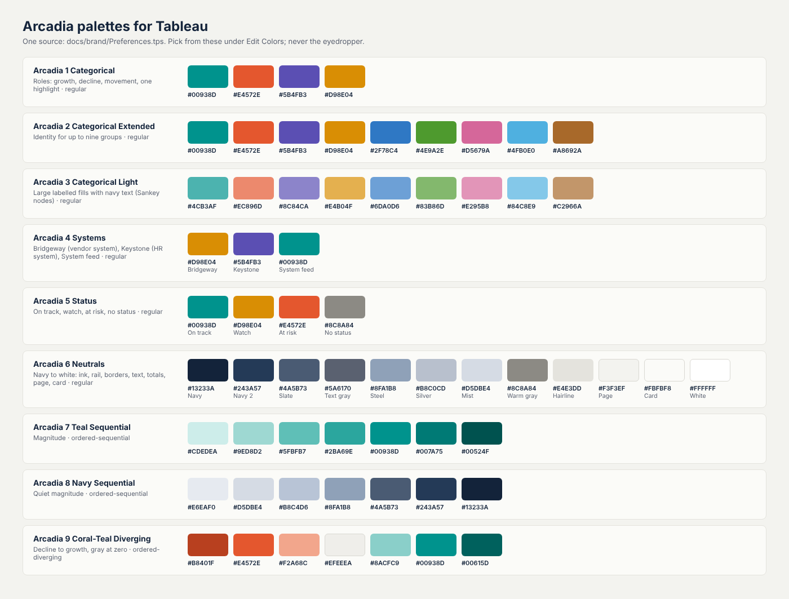

# Arcadia Systems: brand and dashboard style

Arcadia Systems is the fictional company behind every dataset in this repository. This folder gives it one look, so the Tableau Public dashboards read as a single product, not as separate exercises.

## Logo

The mark is a capital **A** drawn as a peak, with a teal node where the crossbar would be: a point on a map, and a data point on a chart. The wordmark is set in Inter. Every file is drawn from code ([`build/logo.js`](build/logo.js)), with the letters converted to outlines so the SVGs look the same on any machine.

| File | Use it for |
|---|---|
| [`arcadia_logo_horizontal.svg`](arcadia_logo_horizontal.svg) / [`.png`](arcadia_logo_horizontal.png) | Dashboard headers on light backgrounds |
| [`arcadia_logo_horizontal_reverse.svg`](arcadia_logo_horizontal_reverse.svg) / [`.png`](arcadia_logo_horizontal_reverse.png) | Dashboard headers on the navy band (transparent background) |
| [`arcadia_logo_mark.svg`](arcadia_logo_mark.svg) / [`.png`](arcadia_logo_mark.png) | Small spaces: the corner of a dashboard, a favicon-sized tile |

In Tableau: drag an **Image** object into the header container, choose the PNG, tick **Fit image** and **Center image**. Keep at least the width of the teal dot as clear space around the logo.

The logo is original, so it is safe to publish; Tableau Public's Viz of the Day guidance asks authors not to use logos they don't own.

## Colors

**One source:** [`Preferences.tps`](Preferences.tps). Every Arcadia color lives there as a Tableau palette; pick colors from those palettes under **Edit Colors**, never with the eyedropper or a typed shade. The three published workbooks show why: picked by eye, the navy drifted into nine near-copies (`#13223A`, `#13243A`, `#122137`, `#14213A`, ...), the slate into two, the coral into three. The palettes are numbered so Tableau lists them together and in order.

| Palette | Use it for |
|---|---|
| **Arcadia 1 Categorical** | Roles that mean the same on every dashboard: teal growth and hires, coral decline and leavers, violet internal moves, amber one highlight (label it: under 3:1 on the page) |
| **Arcadia 2 Categorical Extended** | Identity for up to nine groups: the four roles, then blue, green, rose, sky, brown. More than nine: fold into "Other" |
| **Arcadia 3 Categorical Light** | The same nine as light fills for large labelled areas with navy text on them (Sankey nodes, treemaps). Navy text is at least 4.7:1 on every one. Always labelled: as fills they are harder to tell apart than the full colors |
| **Arcadia 4 Systems** | Bridgeway (vendor system) amber, Keystone (HR system) violet, the system feed teal. Color follows the system on every dashboard |
| **Arcadia 5 Status** | On track, watch, at risk, no status. Always with a word |
| **Arcadia 6 Neutrals** | Dark to light: navy (brand ink, the rail, titles), navy 2 (controls on the rail), slate (borders on navy), text gray (subtitles, axis labels), steel, silver (dividers on navy), mist, warm gray (Opening and Closing totals), hairline (gridlines), page (behind the cards), card (chart backgrounds), white |
| **Arcadia 7 Teal Sequential** | Magnitude on one hue (growth %, headcount on a map) |
| **Arcadia 8 Navy Sequential** | Magnitude that should stay quiet (counts, age bands) |
| **Arcadia 9 Coral-Teal Diverging** | Decline to growth, gray at zero |

Every categorical order was checked for color-blind separation (protanopia, deuteranopia, tritanopia) in this order against the card color, so keep the order. Regenerate the picture after any change: `python3 docs/brand/build/make_palette_sheet.py`.

**Dashboard #4, Contingent Workforce Reconciliation:** Sankey flags 01 to 09 in *Arcadia 3 Categorical Light* (in order), risks in steel (*Arcadia 6 Neutrals*), places in *Arcadia 4 Systems*; the ticket card's rows in *Arcadia 4 Systems* too.

### Install the palettes

1. Download [`Preferences.tps`](Preferences.tps) (or copy it from your clone of this repository).
2. Save it as `Documents/My Tableau Repository/Preferences.tps` for Tableau Desktop, and `Documents/My Tableau Public Repository/Preferences.tps` for Tableau Public. It replaces an older Arcadia file; if the file holds palettes of your own, copy only the `<color-palette>` blocks into it.
3. Restart Tableau. The nine palettes appear under **Edit Colors**, from *Arcadia 1 Categorical* to *Arcadia 9 Coral-Teal Diverging*.

Older workbooks keep their colors: a workbook stores the colors themselves, not the palette name.

### Save the look as a theme

Once the first dashboard is styled, use **Format → Workbook** to set fonts (Tableau's default sans is fine), then export the styling as a custom theme (Tableau 2025.1 and later) and apply it to every other workbook. All Arcadia dashboards then share fonts, sizes and colors without restyling by hand.

## Layout rules

These follow what Tableau Public's Viz of the Day team says it selects for: a clear key insight, color-blind-safe color, honest charts, new features used well, and downloadable workbooks.

1. **Lead with the answer.** The title states the finding ("Asia Pacific grew fastest in FY26"), not the topic ("Headcount by region"). The subtitle says how to read the chart.
2. **One navy header band** with the reverse logo on the left, the dashboard title, and the controls on the right. Same position on every dashboard.
3. **KPI band of five tiles** under the header: label, big number, one line of context with the change in teal or coral.
4. **Cards on a stone page.** Each chart sits on an off-white card with a 1px light-gray border and 12px gaps. No drop shadows, no gradients.
5. **Bars start at zero, waterfalls included.** A truncated axis makes a 5% change look like a doubling.
6. **Label directly, use few legends.** Label the bars and the few points that matter instead of numbering every mark.
7. **Color means the same thing everywhere.** Teal is always growth, coral always loss, violet always movement between groups.
8. **Every dashboard ends with a Methodology page** and allows the workbook to be downloaded.

The source for both dashboard previews is in [`build/`](build/); `bash docs/brand/build/build.sh` rebuilds the logos and the previews after `python pipeline/run_pipeline.py --no-export`.
