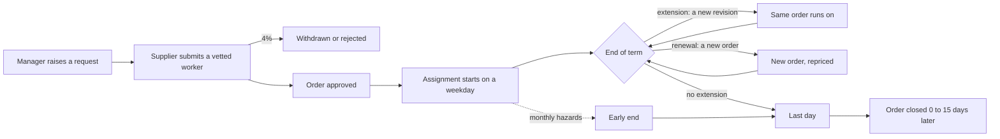

# Bridgeway VMS: how the contingent workforce is simulated

Arcadia Systems, Bridgeway VMS and every supplier and person here are fictional; all data is synthetic.

Release 3, phase 3. [`generator/contingent_workforce.py`](../../../generator/contingent_workforce.py) simulates Arcadia's contingent workforce program month by month and writes the six Bridgeway VMS tables the warehouse loads. Every parameter is in [`generator/reference_data.py`](../../../generator/reference_data.py) under *Contingent workforce*. The simulation draws from its own random stream, after the employee simulation, so no employee number moves.

This is the **clean** program: what Bridgeway knows is true. Phase 4 adds the disagreements between Bridgeway and Keystone HR, the system managers use, and three hygiene problems inside Bridgeway: orders closed late or never, time billed after the last day, and renewals submitted as a new worker. The counts below are the clean program's; the extract differs slightly (61 more workers, 112 fewer revisions, 139 more timesheets). See [Keystone and the feed](keystone_feed.md).

## The life of an engagement

| Rule | Contractor | Consultant | BPO |
|---|---|---|---|
| Share of new engagements | 70% | 22.5% | 7.5% (they stay longest) |
| Initial term | 6 to 24 months, mostly 12 | 3 to 12 months, mostly 6 | to the next June 30 |
| Extensions | 66% chance at each term end, a little less each time; 3 to 12 months each | 45% chance | none: renewed as a new order every July 1 (82%) |
| Cap | 48 months from the original start (24 initial + 24 extension) | 48 months | none |
| Past the cap anyway | 1.2% of those who reach it get 3 or 6 more months | same | n/a |
| Early end | 0.55% a month | 0.9% a month | 0.35% a month |

- **Extensions** are a new revision of the same order, approved 5 to 40 days before the old end; 6% are approved **after** the old end (the worker keeps working while Bridgeway still shows the old date).
- **Rates.** 30% of extensions renegotiate the rate (−5% to +8%), as a separate *Rate change* revision effective the first day of the extension. 12% of extensions are processed as a **renewal**: a new service order, repriced on the current rate card. Nothing else ever changes a rate (test 65).
- **Attribute changes** while working: cost center (0.4% a month), manager (0.6%), office in the same country (0.2%). When the hiring manager stops being a people manager in that department, the order gets a manager change the next day.
- **The February 2024 restructuring** ends 35% of Commercial and Marketing contingent workers that month.
- **Placement.** Country by type (Contractors weighted to India, Poland, Mexico, the Philippines and Portugal; Consultants to the US, India and the UK; BPO in proportion to Arcadia's own workforce), only where an Arcadia office is open; then the department by function share and size, so the cost center is always one Keystone knows (department × country).
- **Who they report to.** A people manager of that department, in the same country when there is one, read from Keystone's job history. Bridgeway stores the manager's **email**, not an ID.

## Rates

The rate card holds a target and a band (88% to 115%) per fiscal year, country, CW type, role family and seniority. Mid-level Contractor developer, FY26, in USD per hour:

| Country | Target | | Country | Target |
|---|---:|---|---|---:|
| Philippines | 28 | | Poland | 63 |
| India | 31 | | Canada | 78 |
| Portugal | 50 | | United States | 80 |
| Mexico | 53 | | United Kingdom | 93 |

These were sanity-checked against aggregate public market ranges; countries without an anchor use `20 + 70 × pay index`. Seniority multiplies the target (Junior 0.75, Senior 1.30, Lead 1.55), as do type (Consultant 1.35) and role (Architecture 1.30 … Operations 0.75). BPO is billed **per worker per month** (168 hours × 30% of the country anchor × role and seniority factors). Cards rise 3% every July 1 (2 points more in India and Brazil, 1 more in Mexico and the Philippines). Each order lands on its card with a ±7% scatter; 23% of active workers bill in local currency, converted from the USD target at the approval date's ECB rate.

## What came out (extract of 30 June 2026)

| FY | Active CW on June 30 | Contractor | Consultant | BPO | Engagements started | Billed spend |
|---|---:|---:|---:|---:|---:|---:|
| FY22 | 9,288 | 6,646 | 1,128 | 1,514 | 5,280 | $739.9M |
| FY23 | 10,228 | 7,281 | 1,293 | 1,654 | 5,935 | $836.4M |
| FY24 | 9,910 | 7,020 | 1,191 | 1,699 | 4,966 | $894.7M |
| FY25 | 10,707 | 7,611 | 1,265 | 1,831 | 6,047 | $941.5M |
| FY26 | **11,941** | 8,443 | 1,508 | 1,990 | 6,902 | **$1,087.9M** |

(8,564 were active on 30 June 2021, the first day of the warehouse history. Spend is at month-end ECB rates.)

- **FY24 is the only year the contingent workforce shrank** (−3%): the restructuring year cut contractors too.
- **Spend is about a quarter of workforce cost.** FY26 billed spend of $1.09B sits beside $3.41B of employee loaded run-rate. The run-rate on 30 June 2026 is $1.24B: Contractors $802M, Consultants $355M, BPO $81M.
- **Where they are.** India 41%, US 13%, Poland 10%, Mexico 8%, Philippines 5%. Technology 64%, Operations 17% (most of the BPO), the rest spread across every function.
- **How long they stay.** Contractor engagements run a median 21 months, Consultants 9, BPO 29 (some BPO workers stay for years). 14 closed engagements went past the 48-month cap, and 1 active worker is past it today.
- **The paperwork.** 58,276 service orders (14,853 of them renewals) and 160,611 revisions: 33,108 extensions, 9,791 rate changes, 9,547 manager changes, 3,645 early ends, 43,011 closures. 1,328 submitted workers never started (withdrawn or rejected). 743 renewals were approved after their first day. 124 orders were still pending approval on the extract date.

## Checks

| Test | Rule |
|---|---|
| 62 | Revisions chain: numbered without gaps, each starting the day after the previous one ends, exactly one current per order |
| 63 | Opened ≤ submitted ≤ approved; a new engagement starts after approval; no assignment ends before it starts |
| 64 | No Contractor or Consultant engagement runs more than 6 months past the 48-month cap |
| 65 | The rate changes only on a *Rate change* revision; currency and rate type never change inside an order |
| 66 | Billed time sits inside the assignment, at a rate the order carried, never more hours than the month's weekdays × 8, and the amount is units × rate to the cent. Since phase 4, time billed after the last day passes only if the answer key lists it (CW11) |

Each test was run against a deliberately broken copy of the data and caught the break. Writing test 66 found two real bugs on the way: Python's `round()` goes half to even (2,594.625 became 2,594.62) and binary floats land 0.3 × 1,670.75 on 501.22499…, so amounts are now multiplied in decimals and rounded half up, as invoices are; and staging had cut BPO's fractional months to two decimals.
