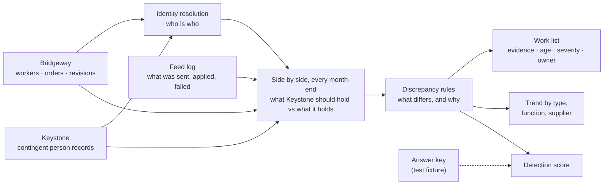

# Case study 6: Contingent Workforce reconciliation

Arcadia Systems, Keystone HR, Bridgeway VMS and every supplier and person here are fictional; all data is synthetic.

**Business question.** *Who is actually working for Arcadia through a supplier today, and where does the system managers use disagree with the system suppliers use?*

Arcadia runs its contingent workforce in **Bridgeway VMS**, the vendor management system and source of truth: who is engaged, on which order, until when, at what rate. Managers never open Bridgeway. They see contractors in **Keystone HR**, which a one-way feed fills from Bridgeway. When the feed is late or fails, or someone edits Keystone by hand, the two disagree. A manager may then think a contractor has left who is still working (and still billing), or still has access when they left weeks ago.

The warehouse cannot fix either system. It **finds every disagreement, says why it happened and who can fix it**, from the two systems and the feed log alone. Because the data is synthetic, the generator also wrote an answer key of everything it seeded ([Keystone and the feed](keystone_feed.md)), and the warehouse's findings are scored against it.

**Release 4** recasts these findings as Finance meets them at a month-end close: 12 comparisons, 6 risks, 3 places to fix them, the warehouse's own load log and a ticket system, for Dashboard #6. See the [release 4 plan](release_4_plan.md).

## How it works

### 1. Who is who: identity resolution (`int_cw_identity_resolution`)

Keystone stores the Bridgeway worker ID it received on the feed, and that is the main key. But it is blank when a load dropped it, mistyped when someone typed it by hand, and absent for a contractor created in Keystone with no Bridgeway order at all. So matching runs in tiers, each on what the earlier ones left:

| Tier | Confidence | Rule | Matches |
|---|---|---|---:|
| 1 | High | Keystone's stored ID is the Bridgeway worker, and the last names agree | 41,900 |
| 2 | Medium | Same name, same supplier, contract starts within 7 days | 130 |
| 3 | Low | Same name, contract starts within 30 days | 0 |
| – | – | Keystone only (no Bridgeway worker) / Bridgeway only (no Keystone record) / never started | 68 / 126 / 1,328 |

Keystone has no supplier table: hand-typed records name the supplier their own way (*Quorlan Digital*, *VANTRELL TECHNICAL STAFFING INC*). `int_cw_supplier_alias` maps every spelling to a Bridgeway supplier on a normalized key (first four letters and digits). Keystone holds 59 spellings of 23 suppliers. A spelling that maps to nothing fails the build, rather than silently not matching (test 75).

**Scored against the answer key:** every one of the 206 Keystone records with a blank or mistyped Bridgeway ID is matched to the right worker, and all 50 contractors created in Keystone by hand are correctly left unmatched.

### 2. Side by side (`int_cw_reconciliation_snapshot`)

For every person and month-end on which either system shows them working:

- **Bridgeway:** what Keystone should hold, meaning *everything Bridgeway had sent by then, applied the day it was sent*.
- **Keystone:** what it actually holds.

The two are compared on four field groups: status and contract dates, cost center, manager, and office.

The definition of "what Keystone should hold" matters. The first version compared Keystone with the Bridgeway order covering the month-end. It produced 54 differences no cause could explain: a renewal approved weeks before the old order ends carries the worker's latest details, and Keystone applies them on approval, so for a few weeks Keystone was legitimately ahead of the order then in force. Comparing with what Bridgeway had *sent* removed them all.

Bridgeway names a contingent worker's manager by email; `dim_worker` gained `work_email` so the warehouse can compare managers.

### 3. Why they differ: the rules (`int_cw_discrepancy`)

For each field group that differs, the rules collect the recorded causes that could have produced it and name the discrepancy after the most recent one:

| Recorded cause | Discrepancy |
|---|---|
| A feed change sent but not applied by the month-end | CW00 *Change in transit* (it took 2 days or less), CW01 *Change arrived late* (3 or more, or still queued) |
| A feed change that failed | CW02 *Extension never arrived* (extension or renewal), CW03 *Early end never arrived*, CW12 *Attribute change never arrived* |
| A hand edit in Keystone (Manager or HR Ops) | CW05 *Changed in Keystone only* |

A change "touches" the fields whose value differs from the change sent before it. A failure Keystone reported as *Worker not found* gets a root cause: the record was never created (CW08) or its stored ID is wrong (CW06). Whoever fixes the root fixes both. A difference with no recorded cause is flagged *Unexplained*: there are none.

The structural types have rules of their own:

| Type | Rule |
|---|---|
| CW06 Link ID missing or mistyped | A matched person whose stored Bridgeway ID is not theirs |
| CW07 One person, two IDs | A Bridgeway worker who starts, as a new engagement, the day after another with the same name and supplier ended, on the same cost center |
| CW08 Never reached Keystone | Working in Bridgeway, no Keystone record, no new-worker change in transit |
| CW09 Keystone-only contingent worker | Working in Keystone, no Bridgeway worker |
| CW10 Over the duration cap | A Contractor or Consultant still working 48 months after starting |
| CW04 Ended but not closed | The order is still open 16 days or more after the last day, and was not later extended (a late approval, not a missing closure) |
| CW11 Billed after the assignment | Time billed for a month that starts after the last day |

Each row carries an **evidence** sentence naming the values compared and the cause, the **age** in days, and from the catalogue a **severity** (Access risk, Cost risk, Compliance risk, Data hygiene) and **who can fix it**.

## What it finds (30 June 2026)

**416 of 11,941 contingent workers (3.5%)** carry at least one discrepancy beyond a change in transit. The share has run 3.1% to 3.5% every June since 2021.

| Discrepancy | Severity | Open | Median age |
|---|---|---:|---:|
| Changed in Keystone only | Cost risk | 219 | 107 days |
| Ended but not closed in Bridgeway | Cost risk | 99 | 111 days |
| Extension never arrived | Access risk | 65 | 85 days |
| Link ID missing or mistyped | Data hygiene | 49 | 309 days |
| One person, two IDs | Data hygiene | 27 | 729 days |
| Change arrived late | Data hygiene | 26 | 4 days |
| Never reached Keystone | Access risk | 25 | 462 days |
| Attribute change never arrived | Data hygiene | 16 | 110 days |
| Early end never arrived | Access risk | 6 | 120 days |
| Keystone-only contingent worker | Access risk | 6 | 162 days |
| Over the duration cap | Compliance risk | 1 | 69 days |
| Billed after the assignment ended | Cost risk | 1 | 29 days |

- **Cost risk is the biggest bucket (319 people).** It's mostly cost centers changed in Keystone only: the manager moved the contractor to another team in the system they can see, but the supplier still bills the cost center on the order.
- **Access risk (102 people).** 65 contractors whose extension never reached Keystone, so Keystone ended someone still working (they lose access and the manager thinks they left); 6 whose early end never arrived (still active after leaving); 25 never in Keystone at all.
- **Some problems are old.** Mistyped links and missing records sit for a median of 309 and 462 days. The work list sorts by severity, then age.
- **Suppliers:** Vantrell (114) and Quorlan (100), the two largest suppliers, carry the most.
- **The cap:** 132 working contractors and consultants are within 6 months of the 48-month cap, 241 within 6 to 12; one is over it.

## The detection score (`mart_cw_detection_score`)

On every month-end from June 2021 to June 2026, each seeded discrepancy open that day is *injected*. It is *detected* if the rules flag the same type on the same worker that month-end; a flag with nothing seeded behind it is a *false flag*.

| | Injected | Detected | Recall | False flags |
|---|---:|---:|---:|---:|
| All 13 types | 28,530 | 28,530 | **100%** | 42 |

Every type is found on every month-end (test 73). The **42 false flags** are all *One person, two IDs*: two different people with the same name, at the same supplier and cost center, one starting the day after the other ended. Nothing in either system can tell them from a real duplicate, so the rule flags them and the work list asks HR Ops to look. That is the honest limit of a rule that sees only the systems.

**What scoring the rules found while building them**, every one fixed at the root:

1. **Keystone ahead of the order in force:** comparing with what Bridgeway had *sent* fixed it (54 unexplained differences).
2. **A hand edit on the day the feed created the record** is merged into its first version (one version per day), so first versions count as possible edits.
3. **Orders that looked unclosed** were extensions approved after the old end date: excluded when the order was later extended (25 false flags).
4. **Name collisions on second IDs:** the rule now requires the next day and the same cost center (664 false flags down to 42).
5. **Two answer-key definitions** were corrected in the generator, not in the rules. A second ID counts from its first working day, like every other type. And a change that alters nothing cannot cause a difference.

## The marts

| Mart | Grain | For |
|---|---|---|
| `mart_cw_discrepancy_detail` | month-end × discrepancy × worker (latest 13 month-ends) | The work list: evidence, age, severity, owner, function, supplier |
| `mart_cw_reconciliation` | month-end × function × supplier × type | The trend, beside the population each system shows |
| `mart_cw_engagement_cap` | engagement | Months engaged, extensions, renewals, months left before the cap |
| `mart_cw_detection_score` | month-end × type | Injected, detected, missed, false flags, recall, precision |

Tests: 73 (every seeded case found; only the explained false flags), 75 (identity resolution keeps everyone, once).
