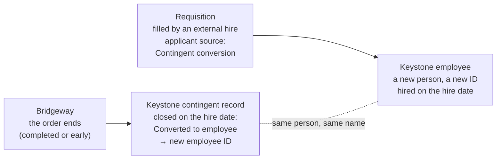

# Conversions to employee and the contingent line of the plan

Arcadia Systems, Keystone HR, Bridgeway VMS and every person here are fictional; all data is synthetic.

Release 3, phase 5. Two ways the contingent workforce now touches the employee side of the warehouse: some contingent workers are **hired as employees** when their engagement ends, and the **workforce plan** carries a contingent line beside the employee plan. Neither changes an employee number. Every hire, termination, salary and employee plan figure is exactly what it was; the plan file gained two columns and 615 rows that are zero on the employee side.

## Conversions

A contractor finishes an engagement and starts as an Arcadia employee a few days later. In the systems that is three records telling the same story:

**How they are made.** The employee simulation is untouched: its external hires into requisitions are the pool. When a Contractor or Consultant engagement ends (completed or early, not in the restructuring), 6.5% look for a requisition to fill. The match must meet three conditions:

- **Same place:** a hire in the same country and department, or failing that the same function.
- **Same month:** the hire falls in the calendar month of the first day after the engagement.
- **Close in time:** the hire is at most 21 days after the last day.

When a match is found, that hire *is* the contingent worker. Bridgeway's worker takes the employee's name, the applicant's source becomes *Contingent conversion*, and HR closes the contingent record in Keystone on the hire date. Conversions draw from their own random stream, so nothing else in Bridgeway moves.

**Why the same month.** A conversion moves a person from one worker type to the other; it should never change the total workforce. If the contingent worker left in June and the employee started in July, the June month-end would count one person fewer. Keeping both in the same month means the headcount walk in phase 6 can show conversions out of the contingent column and into the employee column with the total unchanged (test 72).

| FY | Conversions | Contingent exits | % of exits | External hires | % of hires |
|---|---:|---:|---:|---:|---:|
| FY22 | 226 | 4,618 | 4.9% | 4,677 | 4.8% |
| FY23 | 226 | 5,038 | 4.5% | 5,539 | 4.1% |
| FY24 | 213 | 5,272 | 4.0% | 3,634 | 5.9% |
| FY25 | 244 | 5,283 | 4.6% | 4,376 | 5.6% |
| FY26 | 273 | 5,356 | 5.1% | 5,235 | 5.2% |

1,182 conversions in all: 79% Contractors, 21% Consultants. The median gap between the last contingent day and the first employee day is 7 days (1 to 21). FY24 has fewer external hires (the restructuring year), so conversions are a larger share of them.

**What the data gets wrong, on purpose.** Conversions inherit the discrepancies from [phase 4](keystone_feed.md):

- **A failed early end.** If the early end never reached Keystone, the worker was still active there until HR ran the conversion, which closes it (the answer key records that as *Fixed by hand*).
- **No Keystone record.** Two converted workers had none, because the new-worker event never arrived. Recruiting still knows them as conversions, but Keystone has nothing to close.
- **Changes arriving after the conversion.** A feed change that arrives after the conversion is rejected: Keystone will not reopen a closed, converted record. It happened once.

## The contingent line of the plan

`fact_workforce_plan` gains two columns, per plan version × cost center × fiscal quarter:

| Column | Meaning |
|---|---|
| `planned_cw_headcount` | Contingent workers planned at the quarter end |
| `planned_cw_spend_usd` | Their planned annualized bill run-rate: hourly rate × contracted hours × 52, or monthly rate × 12, in USD at the version date's FX (the same basis as the employee `planned_cost_usd`) |

Each version is written around what Bridgeway held on the quarter end, with a planning error that shrinks from the budget (set in May) to the third reforecast (April). Contingent plans are looser than employee plans, because managers bring contractors in as work appears: budgets run about 4% above the year-end contingent headcount. The FY24 budget did not foresee the February 2024 contractor cuts. The line uses its own random stream, so no employee plan number moved (checked column by column).

Cost centers with contingent workers but no employee plan that year get plan rows of their own: 615 rows, zero on every employee measure. In the plan-versus-actual mart they appear as zero rows too, so every employee total is unchanged.

| FY | Contingent workers on June 30 | Budget (Q4) | RF1 | RF2 | RF3 | Budget spend | RF3 spend |
|---|---:|---:|---:|---:|---:|---:|---:|
| FY22 | 9,288 | 9,742 | 9,515 | 9,466 | 9,303 | $902M | $837M |
| FY23 | 10,228 | 10,210 | 10,596 | 10,317 | 10,253 | $964M | $963M |
| FY24 | 9,910 | **10,746** | 10,166 | 10,148 | 9,926 | $1,043M | $948M |
| FY25 | 10,707 | 11,312 | 10,730 | 10,790 | 10,816 | $1,134M | $1,067M |
| FY26 | 11,941 | 12,673 | 12,182 | 12,020 | 11,977 | $1,314M | $1,251M |

The planned run-rate is above billed spend (FY26: $1.09B billed) because it assumes every contracted hour is billed; actual timesheets carry time off.

## Checks

| Test | Rule |
|---|---|
| 68 | (Extended) A conversion names the employee the worker became, and only a conversion does |
| 76 | Every cost center with contingent workers on a quarter end has a plan line in every version covering it; never negative; spend is zero exactly when headcount is; each version's total within 20% of the actual |
| 77 | A conversion is told consistently: Keystone closes the record on the employee's hire date under the same name; the employee was the accepted external hire with source *Contingent conversion*; every such applicant has the Keystone record, unless Keystone never had the worker (CW08); and the hire is in the month after the last Bridgeway day, within 21 days |

Each was run against a deliberately broken copy and caught the break: a conversion without the employee ID, a cost center's plan line dropped, headcount planned with no spend, a version double the actual, a conversion hire relabelled as a referral, a conversion dated a day before the hire, and a job-board hire claimed as a conversion.

Two problems were found and fixed while building it:

- **A closed record reopened.** A late early-end change overwrote a converted worker's closed record, flipping it from *Converted to employee* back to *Ended early* (test 68 caught it). Keystone now rejects changes to a converted record.
- **A column too short for SQL Server.** *Contingent conversion* is 21 characters and the SQL Server build held the applicant source in 20; the T-SQL checker caught it before it reached your Mac.

## What it sets up

Phase 6 brings the contingent workforce into the marts of case studies 1–3, 5 and 6:

- **Headcount walk:** worker type, with conversions moving between columns.
- **Plan versus actual:** the contingent line beside the employee plan.
- **Cost bridge:** contingent spend beside employee cost.
