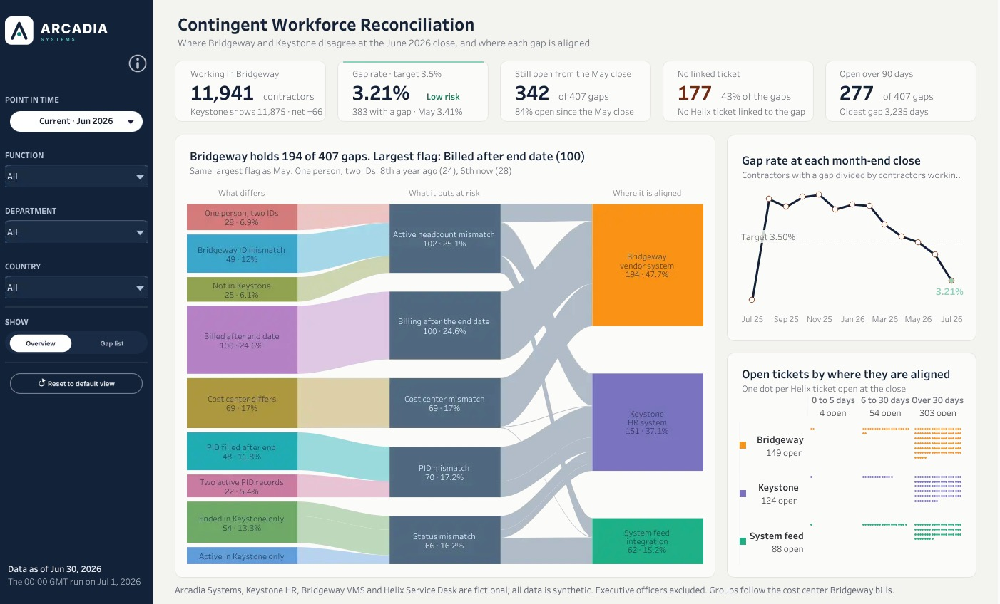

# Dashboard #4, Contingent Workforce Reconciliation: build guide

**Live:** [Contingent Workforce Reconciliation on Tableau Public](https://public.tableau.com/app/profile/thialp/viz/ContingentWorkforceReconciliationArcadiaSystems/Dashboard) · published 2026-10-26

This is the as-built guide for the fourth Arcadia dashboard. It rebuilds the published workbook from an empty Tableau Desktop in the order you would build it by hand: the data source, the parameters, the calculations, each sheet, the dashboard, the actions and the checks. Every formula, colour, font, size and position below was read from the published workbook, and every expected value was recomputed from the warehouse mart, so a step either matches or tells you exactly what differs.

Arcadia Systems, Keystone HR, Bridgeway VMS and Helix Service Desk are fictional; all data is synthetic.



## Contents

0. What you are building
1. Decisions
2. The data source
3. Parameters
4. Core calculations (close, scope, multi-select)
5. **The native Sankey** (the scaffold, the layout maths, every `Sk` calculation, the sheet)
6. The KPI band (numbers, text, geometry, the KPI 2 strip, hover covers)
7. The main card title
8. The gap list (Tableau Table extension) and the Overview · Gap list swap
9. The timeline card
10. The ticket card
11. The rail controls
12. The popovers
13. Assembling the dashboard
14. Actions
15. Checks and click tests
16. Publishing
17. What the build taught us
18. Known limits and next steps

---

## 0. What you are building

**The question on the page:** *where do Bridgeway (the vendor system) and Keystone (the HR system) disagree at the month-end close, what does each difference put at risk in Finance's report, and where is it aligned?*

```
x 0      216  246                                          1004 1020              1370 1400
y 0  ┌────────┬──────────────────────────────────────────────────────────────────────────┐
     │  RAIL  │  Contingent Workforce Reconciliation                                     │ 14–74
     │  navy  │  Where Bridgeway and Keystone disagree at the June 2026 close, …         │
  88 │        │ ┌card 1─┐ ┌card 2─┐ ┌card 3─┐ ┌card 4─┐ ┌card 5─┐                        │ KPI band
     │        │ └───────┘ └───────┘ └───────┘ └───────┘ └───────┘                        │ 88–174
 190 │        │ ┌ Main card: Sankey  or  Gap list ──────────┐ ┌ Gap rate timeline ─┐    │ 190–480
     │        │ │ title 44                                   │ └────────────────────┘    │
     │        │ │ Sankey 724 × 544                           │ ┌ Open tickets ───────┐   │ 496–812
     │        │ │                                            │ │                     │   │
 812 │        │ └────────────────────────────────────────────┘ └─────────────────────┘   │
 822 │        │  footnote                                                                │
 850 └────────┴──────────────────────────────────────────────────────────────────────────┘
```

| Where | What it answers | Current (Jun 2026 close), no group chosen |
|---|---|---|
| Title | Which close? | **Contingent Workforce Reconciliation** · "Where Bridgeway and Keystone disagree at the June 2026 close, and where each gap is aligned" |
| KPI 1 | How many contractors are working? | **11,941** contractors · Keystone shows 11,875 · net +66 |
| KPI 2 | How clean is the close? | **3.21%** Low risk · gap rate, target 3.5% · 383 with a gap · May 3.41% |
| KPI 3 | Do the same problems come back? | **342** of 407 gaps · still open from the May close · 84% |
| KPI 4 | Is anyone working on them? | **177** · 43% of the gaps · no Helix ticket linked |
| KPI 5 | How old are they? | **277** of 407 gaps open over 90 days · oldest 3,235 days |
| Main card | What differs, what it puts at risk, where it is aligned | Sankey: 9 flags, 5 risks, 3 places, 407 gaps. "Bridgeway holds 194 of 407 gaps. Largest flag: Billed after end date (100)" |
| Right top | Is the rate improving? | Gap rate at the last 13 closes against the 3.5% target, the selected close marked |
| Right bottom | Who is working on it? | 361 open Helix tickets as dots: Bridgeway 149, Keystone 124, System feed 88 |
| Gap list (toggle) | Which contractors, exactly? | The 407 gaps, one row each, exportable to Excel |

**How the numbers tie together.** Flags = risks = places = gap list rows = 407. KPIs 3, 4 and 5 count the gaps in the rate (`is_counted`), which equals the Sankey total whenever no gap clears on its own by the next run (0 in June; 1 in May, so May reads 417 in the KPIs and 418 on the Sankey, and the Sankey subtitle says so). KPI 2 counts contractors (383), not gaps: one contractor can carry several gaps. Open tickets by place add up to the card total (149 + 124 + 88 = 361).

**The palette.** Navy `#13233A` (rail, titles), slate `#5A6170` (secondary text), page `#F3F3EF`, cards `#FBFBF8` with a 1 px `#E4E3DD` border. Places: Bridgeway amber `#F89216`, Keystone violet `#7873C0`, System feed teal `#1FB087`. Risk boxes slate `#4F6980`. Good versus target: mint `#86D4BC`; above target: peach `#EE9A74`. Tooltip accents: coral `#B8401F` (worse), teal `#0E7D5F` (better), Bridgeway text `#B86400`, Keystone text `#5650A0`, System feed text `#0E7D5F`. No red and green pair, no blue and orange pair.

---

## 1. Decisions

| # | Decision | Why |
|---|---|---|
| D1 | **One data source**, the Custom SQL `custom_sql_cw_reconciliation_dashboard.sql` on SQL Server, extracted | The three group filters must reach every card, and a parameter filter works across sheets only when they share one source. Four row types live side by side in it (section 2) |
| D2 | **Executive officers excluded** (department `D-901`) | The same people on every Arcadia dashboard; the SQL views already do it |
| D3 | **The page grid of Dashboard #2**: 1400 × 850, 216 px navy rail, cards from x 246 to 1370, KPI cards 212 × 86 at y 88 with 16 px between them | Every Arcadia dashboard reads the same way, and the KPI band image and geometry carry over |
| D4 | **Multi-select by string parameters, not sets.** `p_Functions` holds `|Commercial|Technology|`; a click toggles one name in or out; empty means all | A set action can add or remove, but not toggle in one click. A string parameter can, and it works on Tableau Public |
| D5 | **No context filters.** Every LOD tests the close and the scope inside its own formula (`Gap Now`, `Pop Now`) | A FIXED LOD runs before ordinary filters; putting the conditions inside the formula makes the counts right with no filter order to remember |
| D6 | **A native Sankey**, drawn with polygons on a 2,805-row scaffold, instead of the Sankey viz extension | The extension could not size its boxes, colour a ribbon by its path, or keep a small selection at a readable scale. Native gives every one of those, and the path highlight |
| D7 | **Every Sankey LOD reads raw rows only (one level deep)** | Tableau builds each FIXED LOD as a subquery and nests the LODs it references inside it. An early version nested 12 deep and never finished drawing; at one level the sheet draws in about a second (section 5.8) |
| D8 | **Ranks and year-ago comparisons are company-wide** and show only when no group is chosen | `flag_rank` is computed for all of Arcadia; under a filter it would mislead |
| D9 | **Target 3.5%**, provisional; "Known risk" above it, "Low risk" at or below | The target flags risk; it does not certify the report (the KPI 2 hover says so) |
| D10 | **Every text on the page is a calculation**, and every empty state has words ("No gaps in this selection", "N/A") | A text that follows the selection never goes stale; an empty state never looks broken |
| D11 | **Neutral words.** A flag says what differs ("Ended in Keystone only"), never which system is right | Both systems are someone's system of record for something |
| D12 | **Tooltip command buttons off on every sheet; every clickable sheet has a deselect action** | Nothing stays highlighted after a click |
| D13 | **The gap list is the Tableau Table extension** with an Excel download | Recruiters and managers expect to take the list away; the extension exports what the reader sees |
| D14 | **A Sankey click does not open the gap list** | Clicking a box is how a reader explores the chart; switching the main card away on every click broke that. The toggle in the rail opens the list |

---

## 2. The data source

### 2.1 What the Custom SQL returns

One `SELECT` of four `UNION ALL` blocks, about 68,000 rows, about a second on SQL Server. Every row carries `row_type`, `month_end_date` and the group (`function_name`, `department_name`, `country_name`), so one scope calculation filters every card.

| `row_type` | Rows | Grain | Feeds | Count with |
|---|---:|---|---|---|
| Gap | 21,665 | close × contractor × flag | Sankey, gap list, KPI 5's oldest gap | 1 per row |
| Population | 27,324 | close × cost center | KPIs 1 to 5, timeline, rail lists | `contractors_working`, `contractors_with_gap`, `gaps_counted`, `gaps_open_prior_close`, `gaps_no_ticket`, `gaps_over_90_days` |
| Ticket | 16,446 | close × open Helix ticket | Ticket card, one dot at (`dot_x`, `dot_y`) | 1 per row |
| Sankey | 2,805 | the Sankey scaffold, no close, no group | The Sankey's polygons and labels (section 5) | never counted |

61 closes, Jun 30, 2021 to Jun 30, 2026; 8 functions, 31 departments, 22 countries. The columns a reader sees:

| Column | On Gap rows |
|---|---|
| `flag_code`, `flag_name`, `flag_short`, `flag_label` | What differs: code `F01`–`F09`, full wording, the short name every viewer reads, and a sortable label |
| `flag_rank`, `flag_count`, `…_prior_close`, `…_year_ago` | The flag's company-wide rank and count now, at the prior close and a year ago |
| `risk`, `risk_order` | What it puts at risk (5 values, ordered 1 to 5) |
| `place`, `place_order`, `place_label` | Where it is aligned: Bridgeway (1), Keystone (2), System feed (3) |
| `is_counted`, `days_open`, `since_date`, `timing_class` | In the rate or not; age; start; the feed cause |
| `keystone_shows`, `bridgeway_has`, `evidence`, `next_step` | The evidence the gap list and tooltips show |
| `ticket_number`, `ticket_title`, `ticket_status`, `has_ticket` | The linked Helix ticket, if any |

The nine flags, the risk each puts at risk, and where most of its gaps are aligned at Jun 2026:

| Code | Short name (on the page) | Risk | Mostly aligned in |
|---|---|---|---|
| F01 | One person, two IDs | Active headcount mismatch | Bridgeway |
| F02 | Bridgeway ID mismatch | Active headcount mismatch | Keystone |
| F03 | Not in Keystone | Active headcount mismatch | System feed |
| F04 | Billed after end date | Billing after the end date | Bridgeway |
| F05 | Cost center differs | Cost center mismatch | Bridgeway |
| F06 | PID filled after end | PID mismatch | Keystone |
| F07 | Two active PID records | PID mismatch | Keystone |
| F08 | Ended in Keystone only | Status mismatch | System feed, Keystone |
| F09 | Active in Keystone only | Status mismatch | Keystone |

Each flag has exactly one risk; a flag's gaps can be aligned in more than one place.

### 2.2 Connect and extract

1. **File > New.** Connect > To a Server > **Microsoft SQL Server**: server `localhost, 1433`, database `ArcadiaHR`, authentication *Use a specific username and password*, user `sa`, the password from the repo's `.env`, **Require SSL** unchecked.
2. Drag **New Custom SQL** onto the canvas and paste `tableau/custom_sql_cw_reconciliation_dashboard.sql` in full. OK.
3. Rename the data source **CW Reconciliation** (double-click its name top left).
4. **Extract** (Connection: Extract). Tableau Public needs an extract, and every click on the page would otherwise wait for SQL Server. Save as `Arcadia CW Reconciliation.twb`; the extract goes in a `Data Source Hyper` folder beside it.

**Types** (right-click each in the Data pane): `month_end_date` and `since_date` **Date**; `flag_rank`, `flag_rank_prior_close`, `flag_rank_year_ago`, `risk_order`, `place_order`, `age_band_order`, `sk_level`, `sk_point` **Convert to Dimension**; `is_latest_close`, `is_counted`, `has_ticket`, `was_open_prior_close`, `fixed_day_after_close` stay Boolean. Every count stays a measure.

**Checkpoint 2.** A sheet `CHK Rows`: `row_type` on Rows, `CNT(row_type)` on Text. Expected **Gap 21,665 · Population 27,324 · Sankey 2,805 · Ticket 16,446**. Keep it (hidden before publishing): it is the first thing to look at if a number moves.

---

## 3. Parameters

Create each with right-click in the Data pane > Create Parameter. None is shown on the dashboard: the rail controls and actions set them.

| Name | Type | Allowable | Current value | What sets it |
|---|---|---|---|---|
| `p_Close` | Date | All | **Jun 30, 2026** | The close grid, Reset |
| `p_Functions` | String | All | empty | The function list, Clear all, Reset |
| `p_Departments` | String | All | empty | Same pattern |
| `p_Countries` | String | All | empty | Same pattern |
| `p_ShowList` | Boolean | True / False | False | The Overview · Gap list toggle, Reset |
| `p_CloseOpen`, `p_FunctionOpen`, `p_DepartmentOpen`, `p_CountryOpen`, `p_InfoOpen` | Boolean | True / False | False | The rail controls, ✕, Reset (one popover open at a time) |
| `p_SkFlag`, `p_SkRisk`, `p_SkPlace` | String | All | empty | A Sankey click (section 14; read by nothing yet, see section 18) |

`p_Close` is a plain date with **All** allowed: the close grid only offers the 61 closes in the data, so the page cannot reach a close with no rows. When the data moves on a month, set the current value to the new latest close before publishing.

The 16 KPI geometry parameters (all Float, Allowable All) place the KPI text on the band (section 6.3):

| Parameter | Value | | Parameter | Value |
|---|---:|---|---|---:|
| `kpi_Scale` | 0.010986328125 | | `kpi_CardW` | 212 |
| `kpi_SheetW` | 1400 | | `kpi_CardH` | 86 |
| `kpi_SheetH` | 110 | | `kpi_GapX` | 16 |
| `kpi_FitX` | 1.1 | | `kpi_PadX` | 16 |
| `kpi_FitY` | 1.1 | | `kpi_TitleDY` | 17 |
| `kpi_ShiftX` | 0 | | `kpi_ValueDY` | 44 |
| `kpi_ShiftY` | 0 | | `kpi_SubDY` | 71 |
| `kpi_GridLeft` | 246 | | `kpi_GridTop` | 10 |

---

## 4. Core calculations

All calculations live on **CW Reconciliation**. Field names in the formulas are the SQL columns exactly as Tableau shows them (`month_end_date`); calculations keep the names below, and each formula starts with a `//` line naming it, so it pastes as written. Create them in this order: later ones use earlier ones.

### 4.1 Close

```
// Latest Close
{ MAX([month_end_date]) }

// First Close
{ MIN([month_end_date]) }

// Prior Close
DATEADD('day', -1, DATETRUNC('month', [p_Close]))

// Is Selected Close
[month_end_date] = [p_Close]

// Is Prior Close
[month_end_date] = [Prior Close]

// Is Current
[p_Close] = [Latest Close]

// Has Prior
[p_Close] > MIN([First Close])
```

`Has Prior` is an aggregate (it compares with `MIN`), so it can sit beside the KPI strings, which are aggregates too.

```
// Close Month
DATENAME('month', [p_Close])

// Close Name
DATENAME('month', [p_Close]) + " " + STR(YEAR([p_Close]))

// Close Short
LEFT(DATENAME('month', [p_Close]), 3) + " " + STR(YEAR([p_Close]))

// Prior Month
DATENAME('month', [Prior Close])

// Prior Short
LEFT(DATENAME('month', [Prior Close]), 3)

// Close Day Text
LEFT(DATENAME('month', [p_Close]), 3) + " " + STR(DAY([p_Close])) + ", " + STR(YEAR([p_Close]))

// Run Day Text
LEFT(DATENAME('month', DATEADD('day', 1, [p_Close])), 3) + " " + STR(DAY(DATEADD('day', 1, [p_Close]))) + ", " + STR(YEAR(DATEADD('day', 1, [p_Close])))
```

Expected at Current: Close Name "June 2026", Close Short "Jun 2026", Prior Month "May", Close Day Text "Jun 30, 2026", Run Day Text "Jul 1, 2026".

### 4.2 Row types and scope

```
// Is Gap
[row_type] = "Gap"

// Is Pop
[row_type] = "Population"

// Is Ticket
[row_type] = "Ticket"

// In Function
[p_Functions] = "" OR CONTAINS([p_Functions], "|" + [function_name] + "|")

// In Department
[p_Departments] = "" OR CONTAINS([p_Departments], "|" + [department_name] + "|")

// In Country
[p_Countries] = "" OR CONTAINS([p_Countries], "|" + [country_name] + "|")

// In Scope
[In Function] AND [In Department] AND [In Country]

// Scope Is All
[p_Functions] = "" AND [p_Departments] = "" AND [p_Countries] = ""
```

```
// Gap Now
[Is Gap] AND [Is Selected Close] AND [In Scope]

// Pop Now
[Is Pop] AND [Is Selected Close] AND [In Scope]

// Pop Prior
[Is Pop] AND [Is Prior Close] AND [In Scope]

// Ticket Now
[Is Ticket] AND [Is Selected Close] AND [In Scope]

// Sankey Gap Row
[Gap Now]

// Sankey Gap
IIF([Sankey Gap Row], 1, 0)
```

These six are the heart of D5: every count on the page is a sum over one of them, so the close and the three group filters apply inside the formula and no context filter is needed. A ticket with no linked contractor has no function, so it leaves the ticket card as soon as a function is chosen.

### 4.3 Scope words (rail capsules, subtitles)

```
// Function Count
IF [p_Functions] = "" THEN 0 ELSE LEN([p_Functions]) - LEN(REPLACE([p_Functions], "|", "")) - 1 END

// Department Count
IF [p_Departments] = "" THEN 0 ELSE LEN([p_Departments]) - LEN(REPLACE([p_Departments], "|", "")) - 1 END

// Country Count
IF [p_Countries] = "" THEN 0 ELSE LEN([p_Countries]) - LEN(REPLACE([p_Countries], "|", "")) - 1 END

// Function Field Text
IF [Function Count] = 0 THEN "All"
ELSEIF [Function Count] = 1 THEN MID([p_Functions], 2, LEN([p_Functions]) - 2)
ELSE STR([Function Count]) + " selected" END

// Department Field Text
IF [Department Count] = 0 THEN "All"
ELSEIF [Department Count] = 1 THEN (IF LEN(MID([p_Departments], 2, LEN([p_Departments]) - 2)) > 20 THEN LEFT(MID([p_Departments], 2, LEN([p_Departments]) - 2), 19) + "…" ELSE MID([p_Departments], 2, LEN([p_Departments]) - 2) END)
ELSE STR([Department Count]) + " selected" END

// Country Field Text
IF [Country Count] = 0 THEN "All"
ELSEIF [Country Count] = 1 THEN (IF LEN(MID([p_Countries], 2, LEN([p_Countries]) - 2)) > 20 THEN LEFT(MID([p_Countries], 2, LEN([p_Countries]) - 2), 19) + "…" ELSE MID([p_Countries], 2, LEN([p_Countries]) - 2) END)
ELSE STR([Country Count]) + " selected" END

// Scope Text
IF [Scope Is All] THEN ""
ELSE " · " + (IF [Function Count] = 0 THEN "" ELSEIF [Function Count] = 1 THEN [Function Field Text] ELSE STR([Function Count]) + " functions" END)
   + (IF [Department Count] = 0 THEN "" ELSE (IF [Function Count] > 0 THEN ", " ELSE "" END)
        + (IF [Department Count] = 1 THEN [Department Field Text] ELSE STR([Department Count]) + " departments" END) END)
   + (IF [Country Count] = 0 THEN "" ELSE (IF [Function Count] + [Department Count] > 0 THEN ", " ELSE "" END)
        + (IF [Country Count] = 1 THEN [Country Field Text] ELSE STR([Country Count]) + " countries" END) END)
END
```

`Count` counts the pipes: `|Commercial|Technology|` has 3, so 3 − 1 = 2 names. Expected `Scope Text`: nothing chosen "", Technology " · Technology", Commercial and Technology " · 2 functions", Technology and India " · Technology, India".

### 4.4 Multi-select toggles (D4)

```
// Function Toggle
IF CONTAINS([p_Functions], "|" + [function_name] + "|")
THEN (IF [p_Functions] = "|" + [function_name] + "|" THEN "" ELSE REPLACE([p_Functions], "|" + [function_name] + "|", "|") END)
ELSE (IF [p_Functions] = "" THEN "|" + [function_name] + "|" ELSE [p_Functions] + [function_name] + "|" END) END

// Department Toggle
IF CONTAINS([p_Departments], "|" + [department_name] + "|")
THEN (IF [p_Departments] = "|" + [department_name] + "|" THEN "" ELSE REPLACE([p_Departments], "|" + [department_name] + "|", "|") END)
ELSE (IF [p_Departments] = "" THEN "|" + [department_name] + "|" ELSE [p_Departments] + [department_name] + "|" END) END

// Country Toggle
IF CONTAINS([p_Countries], "|" + [country_name] + "|")
THEN (IF [p_Countries] = "|" + [country_name] + "|" THEN "" ELSE REPLACE([p_Countries], "|" + [country_name] + "|", "|") END)
ELSE (IF [p_Countries] = "" THEN "|" + [country_name] + "|" ELSE [p_Countries] + [country_name] + "|" END) END
```

Walk-through: with `|A|B|`, a click on B gives `|A|`, on A gives `|B|`, on C gives `|A|B|C|`; a click on the only member gives empty, which means all.

```
// Function Is On
CONTAINS([p_Functions], "|" + [function_name] + "|")

// Department Is On
CONTAINS([p_Departments], "|" + [department_name] + "|")

// Country Is On
CONTAINS([p_Countries], "|" + [country_name] + "|")

// Dept In Functions
[p_Functions] = "" OR CONTAINS([p_Functions], "|" + [function_name] + "|")

// Function State
IF [Function Is On] THEN "on" ELSE "off" END

// Department State
IF [Department Is On] THEN "on" ELSEIF [Dept In Functions] THEN "off" ELSE "dim" END

// Country State
IF [Country Is On] THEN "on" ELSE "off" END

// Function Tick Shape
IF [Function Is On] THEN "d4_tick_on" ELSE "d4_tick_off" END

// Department Tick Shape
IF [Dept In Functions] AND ([p_Departments] = "" OR [Department Is On]) THEN "d4_tick_on" ELSE "d4_tick_off" END

// Country Tick Shape
IF [Country Is On] THEN "d4_tick_on" ELSE "d4_tick_off" END
```

The Department tick is on when the department sits inside the chosen functions (or no function is chosen) and either it is chosen or no department is chosen. So with nothing chosen every department is ticked, and choosing Technology leaves exactly Technology's departments ticked: a reader sees which departments a function choice covers.

### 4.5 Helpers for actions and deselect

```
// zzTrue
TRUE

// zzFalse
FALSE

// Close Panel
FALSE

// Empty Text
""

// Default Close
[Latest Close]

// Toggle Close Panel
NOT [p_CloseOpen]

// Toggle Function Panel
NOT [p_FunctionOpen]

// Toggle Department Panel
NOT [p_DepartmentOpen]

// Toggle Country Panel
NOT [p_CountryOpen]

// Toggle Info
NOT [p_InfoOpen]

// Show List On Click
TRUE

// Show Overview
NOT [p_ShowList]

// Hover Cell
"."
```

`zzTrue` and `zzFalse` make the deselect trick (section 14.2). `Close Panel` is the value every "close the other popovers" action writes. `Hover Cell` gives the transparent hover sheets and the KPI 2 strip one mark.

---

## 5. The native Sankey

### 5.1 The idea in one paragraph

A Sankey is boxes (nodes) joined by bands (ribbons) whose width is a count. Tableau has no Sankey mark, so the chart is drawn with the **Polygon** mark: every box and every ribbon is a polygon, and a polygon is a list of points joined in order (the `Path` shelf). The points do not exist in the data, so the Custom SQL adds a **scaffold**: rows that carry only a polygon's identity (which flag, risk or place, which part, which point along its outline) and no numbers. Tableau then computes every point's x and y from the gap counts of the current selection with FIXED LODs, so the same scaffold draws June 2026, December 2024 or Marketing alone. Nothing is a table calculation, so nothing depends on Compute Using.

### 5.2 The scaffold (the `Sankey` rows)

| `sk_part` | `sk_level` | Keys it carries | `sk_point` | Rows |
|---|---|---|---|---:|
| `Link` | 1 = flag to risk | `flag_code`, `risk`, `place` (one ribbon per flag × place) | 0 to 49: 0–24 along the top edge left to right, 25–49 back along the bottom edge | 9 × 3 × 50 = 1,350 |
| `Link` | 2 = risk to place | the same keys (one ribbon per flag × place, so a flag's whole path can light up) | 0 to 49 | 1,350 |
| `Node` | 1 flag · 2 risk · 3 place | the node's key | 0 to 3, the four corners clockwise from top left | 17 × 4 = 68 |
| `Label` | 1 · 2 · 3 | the node's key | 0 the name, 1 the count | 17 × 2 = 34 |
| `Header` | 1 · 2 · 3 | nothing | 0 | 3 |
| | | | | **2,805** |

Ribbons from risk to place are cut by flag too (not just risk × place) so that hovering a flag lights its ribbon all the way to the place: the highlight action matches `flag_code`, and a ribbon that carried no flag could not be matched.

### 5.3 The geometry

The sheet is a 724 × 544 tile drawn on fixed axes: x from 0 to 726, y from 0 to 540, **reversed** (0 at the top).

```
 x:   0 ─ 156          285 ─ 441          570 ─ 726
      │ flags │ ribbons │ risks │ ribbons │ places │
 y:  36 ┬ first box top (Sk Top)
        │ boxes and gaps fill the available height
538  ┴ last box bottom (540 − Sk Bottom)
```

| Constant | Value | Meaning |
|---|---:|---|
| `Sk H` | 540 | The drawing height |
| `Sk Top` | 36 | Room for the three column headers (drawn at y 20) |
| `Sk Bottom` | 2 | Space under the last box |
| `Sk Avail` | 502 | `Sk H − Sk Top − Sk Bottom`: the height the boxes and gaps share |
| `Sk Node W` | 156 | Box width (the label sits inside) |
| `Sk X1`, `Sk X3` | 0, 570 | Left edge of the flag and place columns; `Sk X2` (285) centres the risk column |
| `Sk Min H` | 14 | The smallest box, so a flag with one gap still shows its name |
| `Sk Pad` | 6 | The smallest gap between boxes in the fullest column |
| `Sk Max Scale` | 12 | At most 12 px per gap, so a small selection keeps its own size instead of filling the tile |
| `Sk Count Min H` | 28 | A box shows its count line only if at least this tall |
| `Sk Points` | 25 | Points per ribbon edge |
| `Sk Label DY` | 0 | Nudge for every label, if a font sits high |

**The scale (px per gap).** A box is `Sk Min H + gaps × scale`. A column of *n* boxes fits exactly when
*n* × 14 + 6 × (*n* − 1) + total gaps × scale = 502, so scale = (508 − 20 *n*) / total gaps.
The column with the most boxes is the one that must fit, so *n* is the largest of the three columns' box counts. That is `Sk Fit Scale`, with the constants written in as numbers (508 = `Sk Avail + Sk Pad`; 20 = `Sk Min H + Sk Pad`); `Sk Scale` caps it at 12.

Worked example, Jun 2026, all groups: 407 gaps; flags 9 boxes, risks 5, places 3, so *n* = 9 and scale = (508 − 180) / 407 = **0.806 px per gap**. The Billed after end date box (100 gaps) is 14 + 100 × 0.806 = 94.6 px. Marketing alone: 6 gaps, *n* = 4, (508 − 80) / 6 = 71.3, capped at **12**, so Marketing sits at the top at its own size.

**The gaps between boxes.** Each column spreads its boxes over the full height: gap = (502 − 14 *n* − scale × total) / (*n* − 1). The fullest column gets exactly `Sk Pad`; the others get wider gaps, so the risk and place columns are spaced out and the ribbons slant (Jun 2026: flags 6 px, risks 26 px, places 66 px). When the scale is capped, every column uses `Sk Pad`.

**A box's top.** Boxes stack top to bottom in code order (`F01`…`F09`, risk order 1 to 5, Bridgeway, Keystone, System feed). A box's top = `Sk Top` + (14 + column gap) × non-empty boxes above it + scale × gaps above it. Empty boxes take no space.

**A ribbon.** Each ribbon leaves its source box at an offset (the gaps of the boxes' earlier ribbons) and arrives at its target at another offset, with a height of its gaps × the box's px-per-gap (`Sk F Unit`, `Sk R Unit`, `Sk P Unit`: a box's height over its gaps, so the 14 px minimum is shared out among its ribbons). The edges follow the smoothstep curve 3t² − 2t³ (`Sk Ease`): flat at both ends, so a ribbon meets its box square.

### 5.4 The calculations, in build order

**Constants** (each one a number; edit the number to tune):

```
// Sk H
540

// Sk Top
36

// Sk Bottom
2

// Sk Avail
[Sk H] - [Sk Top] - [Sk Bottom]

// Sk Node W
156

// Sk X1
0

// Sk X3
570

// Sk X2
([Sk X1] + [Sk Node W] + [Sk X3]) / 2 - [Sk Node W] / 2

// Sk Min H
14

// Sk Pad
6

// Sk Max Scale
12

// Sk Count Min H
28

// Sk Points
25

// Sk Label DY
0
```

**Which rows draw.** `Sk Row` keeps the scaffold; `Sk Show` drops what has nothing to draw (an empty node, a ribbon with no gaps, the count line of a short box). `Sk Fi` is the flag's number. `Sk Mark` names each polygon or label uniquely, and is what Tableau draws one mark per.

```
// Sk Row
[row_type] = "Sankey"

// Sk Fi
INT(MID([flag_code], 2, 2))

// Sk Mark
[sk_part] + "|" + STR([sk_level]) + "|" + IIF([sk_part] = "Link" OR [sk_part] = "Node", "", STR([sk_point])) + "|" + IFNULL([flag_code], "") + "|" + IFNULL([risk], "") + "|" + IFNULL([place], "")

// Sk Show
[Sk Row] AND [Sk N] > 0 AND NOT ([sk_part] = "Label" AND [sk_point] = 1 AND NOT [Sk Show Count])

// Sk Show Count
[Sk Lines] >= 2

// Sk Lines
IF [sk_level] = 3 THEN IIF([Sk Node H] >= 40, 3, 1) ELSE IIF([Sk Node H] >= [Sk Count Min H], 2, 1) END
```

**Counts per node** (FIXED LODs over the selection's gap rows; one level deep, D7). The taxonomy is fixed at 9 flags, 5 risks and 3 places, so the counts before a node can be written as sums of named counts instead of a running total:

```
// Total Gaps
{ FIXED : SUM([Sankey Gap]) }

// Flag Gaps
{ FIXED [flag_label] : SUM([Sankey Gap]) }

// Risk Gaps
{ FIXED [risk] : SUM([Sankey Gap]) }

// Place Gaps
{ FIXED [place] : SUM([Sankey Gap]) }

// Sk F1
{ FIXED : SUM(IF [Sankey Gap Row] AND [flag_code] = "F01" THEN 1 ELSE 0 END) }

// Sk F2
{ FIXED : SUM(IF [Sankey Gap Row] AND [flag_code] = "F02" THEN 1 ELSE 0 END) }

// Sk F3
{ FIXED : SUM(IF [Sankey Gap Row] AND [flag_code] = "F03" THEN 1 ELSE 0 END) }

// Sk F4
{ FIXED : SUM(IF [Sankey Gap Row] AND [flag_code] = "F04" THEN 1 ELSE 0 END) }

// Sk F5
{ FIXED : SUM(IF [Sankey Gap Row] AND [flag_code] = "F05" THEN 1 ELSE 0 END) }

// Sk F6
{ FIXED : SUM(IF [Sankey Gap Row] AND [flag_code] = "F06" THEN 1 ELSE 0 END) }

// Sk F7
{ FIXED : SUM(IF [Sankey Gap Row] AND [flag_code] = "F07" THEN 1 ELSE 0 END) }

// Sk F8
{ FIXED : SUM(IF [Sankey Gap Row] AND [flag_code] = "F08" THEN 1 ELSE 0 END) }

// Sk R1
{ FIXED : SUM(IF [Sankey Gap Row] AND [risk_order] = 1 THEN 1 ELSE 0 END) }

// Sk R2
{ FIXED : SUM(IF [Sankey Gap Row] AND [risk_order] = 2 THEN 1 ELSE 0 END) }

// Sk R3
{ FIXED : SUM(IF [Sankey Gap Row] AND [risk_order] = 3 THEN 1 ELSE 0 END) }

// Sk R4
{ FIXED : SUM(IF [Sankey Gap Row] AND [risk_order] = 4 THEN 1 ELSE 0 END) }

// Sk P1
{ FIXED : SUM(IF [Sankey Gap Row] AND [place_order] = 1 THEN 1 ELSE 0 END) }

// Sk P2
{ FIXED : SUM(IF [Sankey Gap Row] AND [place_order] = 2 THEN 1 ELSE 0 END) }

// Sk NF
{ FIXED : COUNTD(IF [Sankey Gap Row] THEN [flag_code] END) }

// Sk NR
{ FIXED : COUNTD(IF [Sankey Gap Row] THEN [risk] END) }

// Sk NP
{ FIXED : COUNTD(IF [Sankey Gap Row] THEN [place] END) }
```

(F9, R5 and P3 are never needed: nothing sits below the last box.)

**Gaps and non-empty boxes above each box:**

```
// Sk F Before
CASE [Sk Fi]
  WHEN 1 THEN 0
  WHEN 2 THEN [Sk F1]
  WHEN 3 THEN [Sk F1] + [Sk F2]
  WHEN 4 THEN [Sk F1] + [Sk F2] + [Sk F3]
  WHEN 5 THEN [Sk F1] + [Sk F2] + [Sk F3] + [Sk F4]
  WHEN 6 THEN [Sk F1] + [Sk F2] + [Sk F3] + [Sk F4] + [Sk F5]
  WHEN 7 THEN [Sk F1] + [Sk F2] + [Sk F3] + [Sk F4] + [Sk F5] + [Sk F6]
  WHEN 8 THEN [Sk F1] + [Sk F2] + [Sk F3] + [Sk F4] + [Sk F5] + [Sk F6] + [Sk F7]
  WHEN 9 THEN [Sk F1] + [Sk F2] + [Sk F3] + [Sk F4] + [Sk F5] + [Sk F6] + [Sk F7] + [Sk F8]
END

// Sk R Before
CASE [risk_order]
  WHEN 1 THEN 0
  WHEN 2 THEN [Sk R1]
  WHEN 3 THEN [Sk R1] + [Sk R2]
  WHEN 4 THEN [Sk R1] + [Sk R2] + [Sk R3]
  WHEN 5 THEN [Sk R1] + [Sk R2] + [Sk R3] + [Sk R4]
END

// Sk P Before
CASE [place_order]
  WHEN 1 THEN 0
  WHEN 2 THEN [Sk P1]
  WHEN 3 THEN [Sk P1] + [Sk P2]
END

// Sk F NE Before
CASE [Sk Fi]
  WHEN 1 THEN 0
  WHEN 2 THEN IIF([Sk F1] > 0, 1, 0)
  WHEN 3 THEN IIF([Sk F1] > 0, 1, 0) + IIF([Sk F2] > 0, 1, 0)
  WHEN 4 THEN IIF([Sk F1] > 0, 1, 0) + IIF([Sk F2] > 0, 1, 0) + IIF([Sk F3] > 0, 1, 0)
  WHEN 5 THEN IIF([Sk F1] > 0, 1, 0) + IIF([Sk F2] > 0, 1, 0) + IIF([Sk F3] > 0, 1, 0) + IIF([Sk F4] > 0, 1, 0)
  WHEN 6 THEN IIF([Sk F1] > 0, 1, 0) + IIF([Sk F2] > 0, 1, 0) + IIF([Sk F3] > 0, 1, 0) + IIF([Sk F4] > 0, 1, 0) + IIF([Sk F5] > 0, 1, 0)
  WHEN 7 THEN IIF([Sk F1] > 0, 1, 0) + IIF([Sk F2] > 0, 1, 0) + IIF([Sk F3] > 0, 1, 0) + IIF([Sk F4] > 0, 1, 0) + IIF([Sk F5] > 0, 1, 0) + IIF([Sk F6] > 0, 1, 0)
  WHEN 8 THEN IIF([Sk F1] > 0, 1, 0) + IIF([Sk F2] > 0, 1, 0) + IIF([Sk F3] > 0, 1, 0) + IIF([Sk F4] > 0, 1, 0) + IIF([Sk F5] > 0, 1, 0) + IIF([Sk F6] > 0, 1, 0) + IIF([Sk F7] > 0, 1, 0)
  WHEN 9 THEN IIF([Sk F1] > 0, 1, 0) + IIF([Sk F2] > 0, 1, 0) + IIF([Sk F3] > 0, 1, 0) + IIF([Sk F4] > 0, 1, 0) + IIF([Sk F5] > 0, 1, 0) + IIF([Sk F6] > 0, 1, 0) + IIF([Sk F7] > 0, 1, 0) + IIF([Sk F8] > 0, 1, 0)
END

// Sk R NE Before
CASE [risk_order]
  WHEN 1 THEN 0
  WHEN 2 THEN IIF([Sk R1] > 0, 1, 0)
  WHEN 3 THEN IIF([Sk R1] > 0, 1, 0) + IIF([Sk R2] > 0, 1, 0)
  WHEN 4 THEN IIF([Sk R1] > 0, 1, 0) + IIF([Sk R2] > 0, 1, 0) + IIF([Sk R3] > 0, 1, 0)
  WHEN 5 THEN IIF([Sk R1] > 0, 1, 0) + IIF([Sk R2] > 0, 1, 0) + IIF([Sk R3] > 0, 1, 0) + IIF([Sk R4] > 0, 1, 0)
END

// Sk P NE Before
CASE [place_order]
  WHEN 1 THEN 0
  WHEN 2 THEN IIF([Sk P1] > 0, 1, 0)
  WHEN 3 THEN IIF([Sk P1] > 0, 1, 0) + IIF([Sk P2] > 0, 1, 0)
END
```

**Scale, column gaps, box tops and heights:**

```
// Sk Fit Scale
{ FIXED : IF SUM([Sankey Gap]) > 0
  THEN (508 - 20 * (IF COUNTD(IF [Sankey Gap Row] THEN [flag_code] END) >= COUNTD(IF [Sankey Gap Row] THEN [risk] END) AND COUNTD(IF [Sankey Gap Row] THEN [flag_code] END) >= COUNTD(IF [Sankey Gap Row] THEN [place] END) THEN COUNTD(IF [Sankey Gap Row] THEN [flag_code] END) ELSEIF COUNTD(IF [Sankey Gap Row] THEN [risk] END) >= COUNTD(IF [Sankey Gap Row] THEN [place] END) THEN COUNTD(IF [Sankey Gap Row] THEN [risk] END) ELSE COUNTD(IF [Sankey Gap Row] THEN [place] END) END)) / SUM([Sankey Gap]) END }

// Sk Capped
[Sk Fit Scale] > [Sk Max Scale]

// Sk Scale
IF [Sk Fit Scale] > [Sk Max Scale] THEN [Sk Max Scale] ELSE [Sk Fit Scale] END

// Sk Gap F
IF [Sk Capped] THEN [Sk Pad] ELSEIF [Sk NF] > 1
THEN ([Sk Avail] - [Sk Min H] * [Sk NF] - [Sk Scale] * [Total Gaps]) / ([Sk NF] - 1) ELSE 0 END

// Sk Gap R
IF [Sk Capped] THEN [Sk Pad] ELSEIF [Sk NR] > 1
THEN ([Sk Avail] - [Sk Min H] * [Sk NR] - [Sk Scale] * [Total Gaps]) / ([Sk NR] - 1) ELSE 0 END

// Sk Gap P
IF [Sk Capped] THEN [Sk Pad] ELSEIF [Sk NP] > 1
THEN ([Sk Avail] - [Sk Min H] * [Sk NP] - [Sk Scale] * [Total Gaps]) / ([Sk NP] - 1) ELSE 0 END

// Sk Y Flag
[Sk Top] + ([Sk Min H] + [Sk Gap F]) * [Sk F NE Before] + [Sk Scale] * [Sk F Before]

// Sk Y Risk
[Sk Top] + ([Sk Min H] + [Sk Gap R]) * [Sk R NE Before] + [Sk Scale] * [Sk R Before]

// Sk Y Place
[Sk Top] + ([Sk Min H] + [Sk Gap P]) * [Sk P NE Before] + [Sk Scale] * [Sk P Before]

// Sk FH This
IF [Flag Gaps] > 0 THEN [Sk Min H] + [Flag Gaps] * [Sk Scale] ELSE 0 END

// Sk RH This
IF [Risk Gaps] > 0 THEN [Sk Min H] + [Risk Gaps] * [Sk Scale] ELSE 0 END

// Sk PH This
IF [Place Gaps] > 0 THEN [Sk Min H] + [Place Gaps] * [Sk Scale] ELSE 0 END

// Sk F Unit
IF [Flag Gaps] > 0 THEN [Sk FH This] / [Flag Gaps] END

// Sk R Unit
IF [Risk Gaps] > 0 THEN [Sk RH This] / [Risk Gaps] END

// Sk P Unit
IF [Place Gaps] > 0 THEN [Sk PH This] / [Place Gaps] END
```

**Where each ribbon leaves and arrives.** Inside a flag box, its ribbons are stacked by place (Bridgeway on top); inside a risk box, by place then flag; inside a place box, by flag. `PB1`/`PB2` are "gaps in places 1 / 1–2" per flag or risk; `FB1`…`FB8` are "gaps in flags up to F0n" per place; `RB1`…`RB4` "gaps in risks up to n" per place.

```
// Sk FP
{ FIXED [flag_label], [place] : SUM([Sankey Gap]) }

// Sk F PB1
{ FIXED [flag_label] : SUM(IF [Sankey Gap Row] AND [place_order] <= 1 THEN 1 ELSE 0 END) }

// Sk F PB2
{ FIXED [flag_label] : SUM(IF [Sankey Gap Row] AND [place_order] <= 2 THEN 1 ELSE 0 END) }

// Sk R PB1
{ FIXED [risk] : SUM(IF [Sankey Gap Row] AND [place_order] <= 1 THEN 1 ELSE 0 END) }

// Sk R PB2
{ FIXED [risk] : SUM(IF [Sankey Gap Row] AND [place_order] <= 2 THEN 1 ELSE 0 END) }

// Sk P FB1
{ FIXED [place] : SUM(IF [Sankey Gap Row] AND [flag_code] <= "F01" THEN 1 ELSE 0 END) }

// Sk P FB2
{ FIXED [place] : SUM(IF [Sankey Gap Row] AND [flag_code] <= "F02" THEN 1 ELSE 0 END) }

// Sk P FB3
{ FIXED [place] : SUM(IF [Sankey Gap Row] AND [flag_code] <= "F03" THEN 1 ELSE 0 END) }

// Sk P FB4
{ FIXED [place] : SUM(IF [Sankey Gap Row] AND [flag_code] <= "F04" THEN 1 ELSE 0 END) }

// Sk P FB5
{ FIXED [place] : SUM(IF [Sankey Gap Row] AND [flag_code] <= "F05" THEN 1 ELSE 0 END) }

// Sk P FB6
{ FIXED [place] : SUM(IF [Sankey Gap Row] AND [flag_code] <= "F06" THEN 1 ELSE 0 END) }

// Sk P FB7
{ FIXED [place] : SUM(IF [Sankey Gap Row] AND [flag_code] <= "F07" THEN 1 ELSE 0 END) }

// Sk P FB8
{ FIXED [place] : SUM(IF [Sankey Gap Row] AND [flag_code] <= "F08" THEN 1 ELSE 0 END) }

// Sk P RB1
{ FIXED [place] : SUM(IF [Sankey Gap Row] AND [risk_order] <= 1 THEN 1 ELSE 0 END) }

// Sk P RB2
{ FIXED [place] : SUM(IF [Sankey Gap Row] AND [risk_order] <= 2 THEN 1 ELSE 0 END) }

// Sk P RB3
{ FIXED [place] : SUM(IF [Sankey Gap Row] AND [risk_order] <= 3 THEN 1 ELSE 0 END) }

// Sk P RB4
{ FIXED [place] : SUM(IF [Sankey Gap Row] AND [risk_order] <= 4 THEN 1 ELSE 0 END) }

// Sk FP Before
CASE [place_order] WHEN 1 THEN 0 WHEN 2 THEN [Sk F PB1] ELSE [Sk F PB2] END

// Sk RP Before
CASE [place_order] WHEN 1 THEN 0 WHEN 2 THEN [Sk R PB1] ELSE [Sk R PB2] END

// Sk PF Before
CASE [Sk Fi] WHEN 1 THEN 0 WHEN 2 THEN [Sk P FB1] WHEN 3 THEN [Sk P FB2] WHEN 4 THEN [Sk P FB3] WHEN 5 THEN [Sk P FB4] WHEN 6 THEN [Sk P FB5] WHEN 7 THEN [Sk P FB6] WHEN 8 THEN [Sk P FB7] WHEN 9 THEN [Sk P FB8] END

// Sk PR Before
CASE [risk_order] WHEN 1 THEN 0 WHEN 2 THEN [Sk P RB1] WHEN 3 THEN [Sk P RB2] WHEN 4 THEN [Sk P RB3] ELSE [Sk P RB4] END
```

**Ribbon ends, heights and the curve:**

```
// Sk Link X0
IF [sk_level] = 1 THEN [Sk X1] + [Sk Node W] ELSE [Sk X2] + [Sk Node W] END

// Sk Link X1
IF [sk_level] = 1 THEN [Sk X2] ELSE [Sk X3] END

// Sk Link Y0
IF [sk_level] = 1 THEN [Sk Y Flag] + [Sk FP Before] * [Sk F Unit]
ELSE [Sk Y Risk] + ([Sk RP Before] + [Sk PF Before] - [Sk PR Before]) * [Sk R Unit] END

// Sk Link Y1
IF [sk_level] = 1 THEN [Sk Y Risk] + ([Sk F Before] - [Sk R Before] + [Sk FP Before]) * [Sk R Unit]
ELSE [Sk Y Place] + [Sk PF Before] * [Sk P Unit] END

// Sk Link H0
[Sk FP] * IIF([sk_level] = 1, [Sk F Unit], [Sk R Unit])

// Sk Link H1
[Sk FP] * IIF([sk_level] = 1, [Sk R Unit], [Sk P Unit])

// Sk Link N
[Sk FP]

// Sk T Along
IF [sk_point] < [Sk Points] THEN FLOAT([sk_point]) / ([Sk Points] - 1)
ELSE FLOAT(2 * [Sk Points] - 1 - [sk_point]) / ([Sk Points] - 1) END

// Sk Is Bottom
[sk_point] >= [Sk Points]

// Sk Ease
[Sk T Along] * [Sk T Along] * (3 - 2 * [Sk T Along])
```

For a level-1 ribbon (flag to risk), Y0 is the flag box top plus the ribbons above it in that box; Y1 is the risk box top plus the risk's gaps from earlier flags (`Sk F Before − Sk R Before`, which works because flags feed risks in code order) plus this ribbon's place offset. For a level-2 ribbon (risk to place), the offsets are the reverse.

**Nodes and the final coordinates:**

```
// Sk Node N
CASE [sk_level] WHEN 1 THEN [Flag Gaps] WHEN 2 THEN [Risk Gaps] ELSE [Place Gaps] END

// Sk Node X
CASE [sk_level] WHEN 1 THEN [Sk X1] WHEN 2 THEN [Sk X2] ELSE [Sk X3] END

// Sk Node Y
CASE [sk_level] WHEN 1 THEN [Sk Y Flag] WHEN 2 THEN [Sk Y Risk] ELSE [Sk Y Place] END

// Sk Node H
CASE [sk_level] WHEN 1 THEN [Sk FH This] WHEN 2 THEN [Sk RH This] ELSE [Sk PH This] END

// Sk N
CASE [sk_part] WHEN "Link" THEN [Sk Link N] WHEN "Header" THEN 1 ELSE [Sk Node N] END

// Sk X
CASE [sk_part]
  WHEN "Link"   THEN [Sk Link X0] + ([Sk Link X1] - [Sk Link X0]) * [Sk T Along]
  WHEN "Node"   THEN [Sk Node X] + IIF([sk_point] = 1 OR [sk_point] = 2, [Sk Node W], 0)
  ELSE [Sk Node X] + [Sk Node W] / 2
END

// Sk Y
CASE [sk_part]
  WHEN "Link"   THEN IF [Sk Is Bottom] THEN [Sk Link Y0] + [Sk Link H0] + ([Sk Link Y1] + [Sk Link H1] - [Sk Link Y0] - [Sk Link H0]) * [Sk Ease]
                     ELSE [Sk Link Y0] + ([Sk Link Y1] - [Sk Link Y0]) * [Sk Ease] END
  WHEN "Node"   THEN [Sk Node Y] + IIF([sk_point] >= 2, [Sk Node H], 0)
  WHEN "Label"  THEN [Sk Node Y] + [Sk Node H] / 2 + [Sk Label DY]
                     + CASE [Sk Lines] WHEN 1 THEN 0 WHEN 2 THEN IIF([sk_point] = 0, -6, 7) ELSE IIF([sk_point] = 0, -12, 0) END
  WHEN "Header" THEN 20
END

// Sk Y Shape
IF [sk_part] = "Link" OR [sk_part] = "Node" THEN [Sk Y] END

// Sk Y Text
IF [sk_part] = "Label" OR [sk_part] = "Header" THEN [Sk Y]
ELSEIF [sk_part] = "Node" AND [sk_level] = 3 AND [Sk Lines] = 3 THEN [Sk Node Y] + [Sk Node H] / 2 + 12 + [Sk Label DY] END

// Sk Draw
IF [sk_part] = "Link" THEN -[Sk Link N] ELSE 100000 END
```

`Sk Y Shape` carries the polygons (links and nodes) and `Sk Y Text` the labels and headers, so they can be two mark types on one dual axis. The place boxes are tall enough for three lines, so their label is drawn in the node's middle as one block (the `Sk Y Text` clause for level 3).

**Colour, labels, counts:**

```
// Sk Colour
IF [sk_part] = "Link" THEN (IF [sk_level] = 1 THEN [flag_code] + " ribbon" ELSE "Risk ribbon" END)
ELSEIF [sk_level] = 1 THEN [flag_code]
ELSEIF [sk_level] = 2 THEN "Risk"
ELSE [place] END

// Sk Node B
CASE [sk_level] WHEN 1 THEN [Sk F PB1] WHEN 2 THEN [Sk R PB1] END

// Sk Node K
CASE [sk_level] WHEN 1 THEN [Sk F PB2] - [Sk F PB1] WHEN 2 THEN [Sk R PB2] - [Sk R PB1] END

// Sk Node S
CASE [sk_level] WHEN 1 THEN [Flag Gaps] - [Sk F PB2] WHEN 2 THEN [Risk Gaps] - [Sk R PB2] END

// Sk Pct Str
IF [Total Gaps] > 0 THEN STR(ROUND(100 * [Sk Node N] / [Total Gaps], 1)) + "%" END

// Sk Count Str
STR([Sk Node N]) + " · " + [Sk Pct Str]

// Sk Box Text
IF [sk_part] = "Label" THEN
  IF [sk_point] = 0 THEN CASE [sk_level] WHEN 1 THEN [flag_short] WHEN 2 THEN [risk] ELSE [place] END
  ELSEIF [sk_level] = 3 THEN CASE [place] WHEN "Bridgeway" THEN "vendor system" WHEN "Keystone" THEN "HR system" ELSE "integration" END
  ELSE [Sk Count Str] END
ELSEIF [sk_part] = "Node" AND [sk_level] = 3 THEN [Sk Count Str]
END

// Sk Lbl Header
IF [sk_part] = "Header" THEN CASE [sk_level] WHEN 1 THEN "What differs" WHEN 2 THEN "What it puts at risk" ELSE "Where it is aligned" END END

// Sk Lbl Dark
IF [sk_level] <> 2 THEN [Sk Box Text] END

// Sk Lbl White
IF [sk_level] = 2 THEN [Sk Box Text] END
```

**Tooltip fields** (each one empty unless it applies to the hovered mark, so one tooltip layout serves flags, risks, places and ribbons):

```
// Sk Is Flag Node
[sk_part] = "Node" AND [sk_level] = 1

// Sk Tip Aligned
[sk_part] = "Node" AND [sk_level] < 3

// Sk Tip Ranked
[Sk Is Flag Node] AND [Scope Is All]

// Sk Flag Rank
{ FIXED [flag_label] : MIN(IF [Sankey Gap Row] THEN [flag_rank] END) }

// Sk Flag Rank Prior
{ FIXED [flag_label] : MIN(IF [Sankey Gap Row] THEN [flag_rank_prior_close] END) }

// Sk Flag Rank YA
{ FIXED [flag_label] : MIN(IF [Sankey Gap Row] THEN [flag_rank_year_ago] END) }

// Sk Flag Count Prior
{ FIXED [flag_label] : MIN(IF [Sankey Gap Row] THEN [flag_count_prior_close] END) }

// Sk Flag Count YA
{ FIXED [flag_label] : MIN(IF [Sankey Gap Row] THEN [flag_count_year_ago] END) }

// Sk Flag Next Step
{ FIXED [flag_label] : MIN(IF [Sankey Gap Row] THEN [next_step] END) }

// Sk Risk Flags
{ FIXED [risk] : COUNTD(IF [Sankey Gap Row] THEN [flag_code] END) }

// Sk Place Flags
{ FIXED [place] : COUNTD(IF [Sankey Gap Row] THEN [flag_code] END) }

// Sk Feed Event
{ FIXED [place] : SUM(IF [Sankey Gap Row] AND [timing_class] = "Feed event failed" THEN 1 ELSE 0 END) }

// Sk Feed Load
{ FIXED [place] : SUM(IF [Sankey Gap Row] AND [timing_class] = "Load failed" THEN 1 ELSE 0 END) }

// Sk Feed Stuck
{ FIXED [place] : SUM(IF [Sankey Gap Row] AND [timing_class] = "Feed stuck" THEN 1 ELSE 0 END) }

// Sk No Ticket 1
{ FIXED [flag_label] : SUM(IF [Sankey Gap Row] AND NOT [has_ticket] THEN 1 ELSE 0 END) }

// Sk No Ticket 2
{ FIXED [risk] : SUM(IF [Sankey Gap Row] AND NOT [has_ticket] THEN 1 ELSE 0 END) }

// Sk No Ticket 3
{ FIXED [place] : SUM(IF [Sankey Gap Row] AND NOT [has_ticket] THEN 1 ELSE 0 END) }

// Sk Over 90 1
{ FIXED [flag_label] : SUM(IF [Sankey Gap Row] AND [days_open] > 90 THEN 1 ELSE 0 END) }

// Sk Over 90 2
{ FIXED [risk] : SUM(IF [Sankey Gap Row] AND [days_open] > 90 THEN 1 ELSE 0 END) }

// Sk Over 90 3
{ FIXED [place] : SUM(IF [Sankey Gap Row] AND [days_open] > 90 THEN 1 ELSE 0 END) }

// Sk Node No Ticket
CASE [sk_level] WHEN 1 THEN [Sk No Ticket 1] WHEN 2 THEN [Sk No Ticket 2] ELSE [Sk No Ticket 3] END

// Sk Node Over 90
CASE [sk_level] WHEN 1 THEN [Sk Over 90 1] WHEN 2 THEN [Sk Over 90 2] ELSE [Sk Over 90 3] END
```

```
// Sk Tip Title
CASE [sk_part]
  WHEN "Link" THEN [flag_short] + ", aligned in " + [place]
  WHEN "Node" THEN CASE [sk_level] WHEN 1 THEN [flag_short] WHEN 2 THEN [risk] ELSE [place_label] END
END

// Sk Tip Full
IF [Sk Is Flag Node] THEN [flag_name] END

// Sk Tip N
IF [sk_part] = "Link" THEN [Sk Link N] ELSE [Sk Node N] END

// Sk Tip Share
IF [Total Gaps] > 0 THEN [Sk Tip N] / [Total Gaps] END

// Sk Tip Rank
IF [Sk Tip Ranked] THEN "Rank " + STR([Sk Flag Rank]) + " of 9" END

// Sk Tip Rank Worse
IF [Sk Tip Ranked] AND [Sk Flag Rank] < [Sk Flag Rank Prior]
THEN "up from " + STR([Sk Flag Rank Prior]) + " at the prior close (" + STR([Sk Flag Count Prior]) + ")" END

// Sk Tip Rank Better
IF [Sk Tip Ranked] AND [Sk Flag Rank] > [Sk Flag Rank Prior]
THEN "down from " + STR([Sk Flag Rank Prior]) + " at the prior close (" + STR([Sk Flag Count Prior]) + ")" END

// Sk Tip Rank Same
IF [Sk Tip Ranked] AND [Sk Flag Rank] = [Sk Flag Rank Prior]
THEN "same rank as the prior close (" + STR([Sk Flag Count Prior]) + ")" END

// Sk Tip Year Ago
IF [Sk Tip Ranked] AND NOT ISNULL([Sk Flag Rank YA])
THEN "A year ago: " + STR([Sk Flag Count YA]) + " gaps, rank " + STR([Sk Flag Rank YA]) END

// Sk Tip Puts At Risk
IF [Sk Is Flag Node] THEN "Puts at risk: " + [risk] END

// Sk Tip From
IF [sk_part] = "Node" AND [sk_level] = 2 THEN "From " + STR([Sk Risk Flags]) + IIF([Sk Risk Flags] = 1, " flag", " flags")
ELSEIF [sk_part] = "Node" AND [sk_level] = 3 THEN "From " + STR([Sk Place Flags]) + IIF([Sk Place Flags] = 1, " flag", " flags") END

// Sk Tip Aligned In
IF [Sk Tip Aligned] THEN "Aligned in:" END

// Sk Tip Bridgeway
IF [Sk Tip Aligned] AND [Sk Node B] > 0 THEN "Bridgeway (vendor system) " + STR([Sk Node B]) END

// Sk Tip Keystone
IF [Sk Tip Aligned] AND [Sk Node K] > 0 THEN "Keystone (HR system) " + STR([Sk Node K]) END

// Sk Tip System Feed
IF [Sk Tip Aligned] AND [Sk Node S] > 0 THEN "System feed (integration) " + STR([Sk Node S]) END

// Sk Tip Feed Causes
IF [sk_part] = "Node" AND [sk_level] = 3 AND [place] = "System feed"
THEN STR([Sk Feed Event]) + " failed feed events, " + STR([Sk Feed Load]) + " failed loads, " + STR([Sk Feed Stuck]) + " stuck" END

// Sk Tip No Ticket
IF [sk_part] = "Node" AND [Sk Node No Ticket] > 0 THEN STR([Sk Node No Ticket]) + " with no ticket" END

// Sk Tip Over 90
IF [sk_part] = "Node" AND [Sk Node Over 90] > 0 THEN STR([Sk Node Over 90]) + " open more than 90 days" END

// Sk Tip Next Step
IF [Sk Is Flag Node] THEN "Next step: " + [Sk Flag Next Step]
ELSEIF [sk_part] = "Node" AND [sk_level] = 3 THEN "Worked by " + CASE [place] WHEN "Bridgeway" THEN "Vendor Management" WHEN "Keystone" THEN "HR Operations" ELSE "Data Engineering" END
ELSEIF [sk_part] = "Node" THEN "Next steps differ by gap: see the gap list" END
```

Format `Sk Tip Share` as Percentage, 0 decimals (Default Properties > Number Format).

**Click fields** (the three Sankey parameter actions write them; section 14):

```
// Sk Pick Flag
IF [sk_part] = "Link" OR ([sk_level] = 1 AND [sk_part] <> "Header") THEN [flag_code] ELSE "" END

// Sk Pick Risk
IF [sk_level] = 2 AND ([sk_part] = "Node" OR [sk_part] = "Label") THEN [risk] ELSE "" END

// Sk Pick Place
IF [sk_part] = "Link" OR ([sk_level] = 3 AND [sk_part] <> "Header") THEN [place] ELSE "" END
```

### 5.5 The sheet `Sankey Native`

1. New worksheet **Sankey Native**.
2. **Filters:** `Sk Show` = True.
3. **Columns:** `Sk X` (AVG). **Rows:** `Sk Y Shape` (AVG), then `Sk Y Text` (AVG). Right-click the second pill > **Dual Axis**, then right-click its axis > **Synchronize Axis**.
4. **Axes.** `Sk X`: Edit Axis > Fixed **0 to 726**. `Sk Y Shape`: Fixed **0 to 540**, **Reversed**. Then right-click each axis > Show Header off. Format > Lines: grid lines, zero lines and axis rulers None. Worksheet > Show null warning off.
5. **Marks card `AVG(Sk Y Shape)`: Polygon.**
   - Detail: `Sk Mark`, `flag_code`, `Sk Pick Flag`, `Sk Pick Risk`, `Sk Pick Place`, `Show List On Click`.
   - Path: `sk_point` (dimension).
   - Color: `Sk Colour`, opacity **100%**, border **white** `#FFFFFF`.
   - On `Sk Mark`: right-click > Sort > Field **`Sk Draw`**, Minimum, Ascending. Wide ribbons draw first and thin ones on top; boxes draw last, over every ribbon.
6. **Marks card `AVG(Sk Y Text)`: Circle**, size smallest, opacity **0%**, no border. Detail: `Sk Mark`, `flag_code`. Label: `Sk Lbl Header`, `Sk Lbl Dark`, `Sk Lbl White`, written on one line as `<Sk Lbl Header><Sk Lbl Dark><Sk Lbl White>`, all Tableau Book **8**, centred (the text dialog's centre button): header `#6B7079`, dark `#2E3A48`, white `#FFFFFF`. Alignment: horizontal **Center**, vertical **Middle**. Allow labels to overlap other marks: on. Tooltip: empty.
7. Worksheet shading None; rows and columns banding None; borders None.

**Colours of `Sk Colour`** (Color > Edit Colors, assign each value; the hex can be typed in the picker):

| Value | Hex | | Value | Hex |
|---|---|---|---|---|
| F01 | `#D47B7C` | | F01 ribbon | `#ECC4C4` |
| F02 | `#3AA6CB` | | F02 ribbon | `#A6D7E8` |
| F03 | `#90A250` | | F03 ribbon | `#CDD5B0` |
| F04 | `#B582C4` | | F04 ribbon | `#DEC7E4` |
| F05 | `#AE9740` | | F05 ribbon | `#DBD0A9` |
| F06 | `#20ACB3` | | F06 ribbon | `#9BDADD` |
| F07 | `#CB7BA2` | | F07 ribbon | `#E8C4D5` |
| F08 | `#70A969` | | F08 ribbon | `#BFD8BC` |
| F09 | `#619DDA` | | F09 ribbon | `#B8D3EE` |
| Risk | `#4F6980` | | Risk ribbon | `#B1BCC7` |
| Bridgeway | `#F89216` | | Keystone | `#7873C0` |
| System feed | `#1FB087` | | | |

Nine flag hues at one strength, each ribbon the same hue at about 40% on white; the risk column is slate so the flags and places carry the colour. The three place colours are reused by the ticket card (section 10), so a reader learns them once.

**Tooltip** (the polygon card; Insert the fields; command buttons off):

```
<Sk Tip Title>                                         Tableau Semibold 13, navy #13233A
<Sk Tip Full>                                          Tableau Book 10 italic, #5A6170 (the flag's full wording)
<Sk Tip N> gaps, <Sk Tip Share> of all gaps            numbers Semibold 10 navy; words Book 9 #4A5B73
<Sk Tip Rank> <Sk Tip Rank Worse><Sk Tip Rank Better><Sk Tip Rank Same>
                                                       Rank Book 10 #5A6170; worse Semibold 10 coral #B8401F;
                                                       better Semibold 10 teal #0E7D5F; same Book 10 #5A6170
<Sk Tip Year Ago>                                      Book 10 #5A6170
<Sk Tip Puts At Risk>                                  Semibold 10 #2B2F36
<Sk Tip From>                                          Book 10 #5A6170
<Sk Tip Aligned In> <Sk Tip Bridgeway>  <Sk Tip Keystone>  <Sk Tip System Feed>
                                                       label Book 10 #5A6170; Bridgeway Semibold 10 #B86400;
                                                       Keystone Semibold 10 #5650A0; System feed Semibold 10 #0E7D5F
<Sk Tip Feed Causes>                                   Book 10 #5A6170
<Sk Tip No Ticket>  <Sk Tip Over 90>                   Semibold 10 coral #B8401F
<Sk Tip Next Step>                                     Book 10 italic #5A6170
```

An empty field leaves an empty line that Tableau collapses, so a ribbon's tooltip is just its title and count, and a place's has no rank.

### 5.6 The highlight

Dashboard > Actions > Add Action > **Highlight**: name `Sankey Native`, source sheet `Sankey Native`, run on **Hover**, target `Sankey Native`, **Selected Fields: `flag_code`**. Hovering a flag box or any of its ribbons lights the flag's whole path to its risk and place; everything else fades. Hovering a risk or place box (which has no `flag_code`) highlights nothing, by design.

### 5.7 Expected

| State | Flags F01 to F09 | Risks (order 1 to 5) | Places B / K / S | Scale |
|---|---|---|---|---|
| Jun 2026, all groups | 28 · 49 · 25 · 100 · 69 · 48 · 22 · 54 · 12 | 102 · 100 · 69 · 70 · 66 | 194 · 151 · 62 | 0.806 |
| Dec 2024 | 22 · 36 · 18 · 126 · 66 · 33 · 30 · 50 · 5 | 76 · 126 · 66 · 63 · 55 | 210 · 118 · 58 | 0.850 |
| Jun 2026, Marketing | F02 1 · F04 2 · F05 1 · F06 2 | 1 · 2 · 1 · 2 (no Status) | 3 · 3 · none | 12 (capped) |
| Jun 2026, Technology | 10 · 31 · 17 · 73 · 44 · 31 · 12 · 40 · 5 | 58 · 73 · 44 · 43 · 45 | 125 · 93 · 45 | 1.247 |

Boxes read top to bottom in code order in every state, and an empty box takes no space. Hover tooltips at Jun 2026, all groups:

- **Flag box Bridgeway ID mismatch:** "Bridgeway ID mismatch / Bridgeway ID missing or different / 49 gaps, 12% of all gaps / Rank 4 of 9 up from 5 at the prior close (47) / A year ago: 40 gaps, rank 4 / Puts at risk: Active headcount mismatch / Aligned in: Keystone (HR system) 49 / 24 with no ticket  39 open more than 90 days / Next step: Align the Bridgeway ID stored in Keystone".
- **Place box System feed:** "System feed (integration) / 62 gaps, 15% of all gaps / From 4 flags / 60 failed feed events, 0 failed loads, 2 stuck / 22 with no ticket  43 open more than 90 days / Worked by Data Engineering".
- **A ribbon:** its title ("Not in Keystone, aligned in System feed") and its count only.
- With Technology chosen, the same flag reads 31 gaps and shows no rank or year-ago line (D8).

### 5.8 Performance: the rule that made it draw

Tableau pastes a referenced calculation's formula in again wherever it is used, and builds every FIXED LOD as its own subquery, with the LODs it references nested inside it. An early version computed the scale in two fitting passes, each box position built on the previous one: `Sk Y` expanded to about 168 million terms and the refresh hung. The next version made every intermediate its own LOD: the extract refreshed, but LODs nested 12 deep, and opening the sheet ran at 200% CPU and never finished.

The version that works keeps **every LOD one level deep**: an LOD reads only raw columns and row-level fields (`Sankey Gap Row`, `flag_code`, `risk`, `place`), never another LOD, and everything built on the LODs is row-level arithmetic. The fitting loop became the closed form of 5.3 (one LOD of aggregates, with the constants written in). The largest formula is now about 1,700 terms with no nested subqueries, and the sheet draws in about a second. Rule for every later calculation on this page: an LOD may not reference another LOD; measure a formula's depth before opening Tableau.

---

## 6. The KPI band

### 6.1 Numbers

```
// K Working
SUM(IF [Pop Now] THEN [contractors_working] END)

// K Keystone
SUM(IF [Pop Now] THEN [contractors_working_keystone] END)

// K BW Only
SUM(IF [Pop Now] THEN [working_bridgeway_only] END)

// K KS Only
SUM(IF [Pop Now] THEN [working_keystone_only] END)

// K Net
[K Working] - [K Keystone]

// K With Gap
SUM(IF [Pop Now] THEN [contractors_with_gap] END)

// K Rate
IF ZN([K Working]) = 0 THEN NULL ELSE [K With Gap] / [K Working] END

// K Rate Prior
IF ZN(SUM(IF [Pop Prior] THEN [contractors_working] END)) = 0 THEN NULL
ELSE SUM(IF [Pop Prior] THEN [contractors_with_gap] END) / SUM(IF [Pop Prior] THEN [contractors_working] END) END

// K Target
MIN(IF [Is Pop] THEN 0.035 END)

// K Gaps
SUM(IF [Pop Now] THEN [gaps_counted] END)

// K Clear Own
SUM(IF [Pop Now] THEN [gaps_clear_on_own] END)

// K Carry
SUM(IF [Pop Now] THEN [gaps_open_prior_close] END)

// K No Ticket
SUM(IF [Pop Now] THEN [gaps_no_ticket] END)

// K Over 90
SUM(IF [Pop Now] THEN [gaps_over_90_days] END)

// K Oldest
MAX(IF [Gap Now] AND [is_counted] THEN [days_open] END)
```

Format `K Rate`, `K Rate Prior` and `K Target` as Percentage, 2 decimals. The target is written in (`0.035`), not read from the data, so a change of target is one edit.

### 6.2 Text

Tableau has no number-format function in strings, so each text is whole-number arithmetic: `DIV` is integer division and `%` the remainder.

**Comma pattern** (counts):

```
// K Working Str
IF ISNULL([K Working]) THEN "N/A"
ELSEIF [K Working] >= 1000 THEN STR(DIV(INT([K Working]), 1000)) + "," + RIGHT("00" + STR(INT([K Working]) % 1000), 3)
ELSE STR(INT([K Working])) END

// K Keystone Str
IF ISNULL([K Keystone]) THEN "N/A"
ELSEIF [K Keystone] >= 1000 THEN STR(DIV(INT([K Keystone]), 1000)) + "," + RIGHT("00" + STR(INT([K Keystone]) % 1000), 3)
ELSE STR(INT([K Keystone])) END

// K BW Only Str
IF ISNULL([K BW Only]) THEN "N/A"
ELSEIF [K BW Only] >= 1000 THEN STR(DIV(INT([K BW Only]), 1000)) + "," + RIGHT("00" + STR(INT([K BW Only]) % 1000), 3)
ELSE STR(INT([K BW Only])) END

// K KS Only Str
IF ISNULL([K KS Only]) THEN "N/A"
ELSEIF [K KS Only] >= 1000 THEN STR(DIV(INT([K KS Only]), 1000)) + "," + RIGHT("00" + STR(INT([K KS Only]) % 1000), 3)
ELSE STR(INT([K KS Only])) END

// K With Gap Str
IF ISNULL([K With Gap]) THEN "N/A"
ELSEIF [K With Gap] >= 1000 THEN STR(DIV(INT([K With Gap]), 1000)) + "," + RIGHT("00" + STR(INT([K With Gap]) % 1000), 3)
ELSE STR(INT([K With Gap])) END

// K Gaps Str
IF ISNULL([K Gaps]) THEN "N/A"
ELSEIF [K Gaps] >= 1000 THEN STR(DIV(INT([K Gaps]), 1000)) + "," + RIGHT("00" + STR(INT([K Gaps]) % 1000), 3)
ELSE STR(INT([K Gaps])) END

// K Carry Str
IF ISNULL([K Carry]) THEN "N/A"
ELSEIF [K Carry] >= 1000 THEN STR(DIV(INT([K Carry]), 1000)) + "," + RIGHT("00" + STR(INT([K Carry]) % 1000), 3)
ELSE STR(INT([K Carry])) END

// K No Ticket Str
IF ISNULL([K No Ticket]) THEN "N/A"
ELSEIF [K No Ticket] >= 1000 THEN STR(DIV(INT([K No Ticket]), 1000)) + "," + RIGHT("00" + STR(INT([K No Ticket]) % 1000), 3)
ELSE STR(INT([K No Ticket])) END

// K Over 90 Str
IF ISNULL([K Over 90]) THEN "N/A"
ELSEIF [K Over 90] >= 1000 THEN STR(DIV(INT([K Over 90]), 1000)) + "," + RIGHT("00" + STR(INT([K Over 90]) % 1000), 3)
ELSE STR(INT([K Over 90])) END

// K Oldest Str
IF ISNULL([K Oldest]) THEN "N/A"
ELSEIF [K Oldest] >= 1000 THEN STR(DIV(INT([K Oldest]), 1000)) + "," + RIGHT("00" + STR(INT([K Oldest]) % 1000), 3)
ELSE STR(INT([K Oldest])) END
```

**Rate pattern** (two decimals), **share pattern** (no decimals), signed net, points from target:

```
// K Rate Str
IF ISNULL([K Rate]) THEN "N/A" ELSE
STR(DIV(INT(ROUND([K Rate] * 10000, 0)), 100)) + "." + RIGHT("0" + STR(INT(ROUND([K Rate] * 10000, 0)) % 100), 2) + "%" END

// K Rate Prior Str
IF ISNULL([K Rate Prior]) THEN "N/A" ELSE
STR(DIV(INT(ROUND([K Rate Prior] * 10000, 0)), 100)) + "." + RIGHT("0" + STR(INT(ROUND([K Rate Prior] * 10000, 0)) % 100), 2) + "%" END

// K Carry Pct Str
IF ZN([K Gaps]) = 0 THEN "N/A" ELSE STR(INT(ROUND([K Carry] / [K Gaps] * 100, 0))) + "%" END

// K No Ticket Pct Str
IF ZN([K Gaps]) = 0 THEN "N/A" ELSE STR(INT(ROUND([K No Ticket] / [K Gaps] * 100, 0))) + "%" END

// K Net Str
(IF [K Net] > 0 THEN "+" ELSEIF [K Net] < 0 THEN "−" ELSE "" END) + STR(ABS(INT([K Net])))

// K Points Str
IF ISNULL([K Rate]) THEN "" ELSE
  STR(DIV(INT(ROUND(ABS([K Rate] - [K Target]) * 10000, 0)), 100)) + "." + RIGHT("0" + STR(INT(ROUND(ABS([K Rate] - [K Target]) * 10000, 0)) % 100), 2)
  + (IF ROUND([K Rate] - [K Target], 4) > 0 THEN " pts above" ELSEIF ROUND([K Rate] - [K Target], 4) < 0 THEN " pts below" ELSE " pts: on" END) END

// K Target Str
STR(ROUND([K Target] * 100, 1)) + "%"
```

**The card texts:**

```
// KPI 1 Title
MIN("Working in Bridgeway")

// KPI 1 Value
[K Working Str]

// KPI 1 Unit
"contractors"

// KPI 1 Note
"Keystone shows " + [K Keystone Str] + " · net " + [K Net Str]

// KPI 2 Title
"Gap rate · target " + [K Target Str]

// KPI 2 Value
[K Rate Str]

// KPI 2 Known
IF [K Rate] > [K Target] THEN "Known risk" END

// KPI 2 Low
IF [K Rate] <= [K Target] THEN "Low risk" END

// KPI 2 Note
[K With Gap Str] + " with a gap · " + (IF [Has Prior] THEN [Prior Short] + " " + [K Rate Prior Str] ELSE "first close in the data" END)

// KPI 3 Title
IF [Has Prior] THEN "Still open from the " + [Prior Month] + " close" ELSE "Still open from the prior close" END

// KPI 3 Value
IF [Has Prior] THEN [K Carry Str] ELSE "N/A" END

// KPI 3 Unit
"of " + [K Gaps Str] + " gaps"

// KPI 3 Note
IF [Has Prior] THEN [K Carry Pct Str] + " open since the " + [Prior Month] + " close" ELSE "No prior close in the data" END

// KPI 4 Title
MIN("No linked ticket")

// KPI 4 Value
[K No Ticket Str]

// KPI 4 Unit
[K No Ticket Pct Str] + " of the gaps"

// KPI 4 Note
"No Helix ticket linked to the gap"

// KPI 5 Title
MIN("Open over 90 days")

// KPI 5 Value
[K Over 90 Str]

// KPI 5 Unit
"of " + [K Gaps Str] + " gaps"

// KPI 5 Note
"Oldest gap " + [K Oldest Str] + " days"
```

Some titles are wrapped in `MIN()`. A constant text is a dimension; the hover sheets (6.5) put the title on the Tooltip shelf, where a dimension would split the single mark. `MIN("…")` makes it an aggregate, so it sits on the tooltip of one mark. The KPI 2 title is an aggregate already (it uses `K Target Str`).

**Hover texts:**

```
// KPI 1 Tip
[K BW Only Str] + " working in Bridgeway but not active in Keystone, " + [K KS Only Str] + " the other way. Contractors, not gaps."

// KPI 2 Tip
"Contractors with at least one gap in the rate, divided by contractors working in Bridgeway. " + [K Points Str]
+ " a provisional " + [K Target Str] + " target. The target flags risk; it does not certify the report."
+ (IF ZN([K Clear Own]) > 0 THEN " " + STR([K Clear Own]) + " gaps clear on their own by the next run and are left out." ELSE "" END)

// KPI 2 Pts Good
IF [K Rate] <= [K Target] THEN [K Points Str] END

// KPI 2 Pts Bad
IF [K Rate] > [K Target] THEN [K Points Str] END

// KPI 2 Clear Own
IF ZN([K Clear Own]) > 0 THEN " " + STR([K Clear Own]) + " gaps clear on their own by the next run and are left out." END

// KPI 3 Tip
MIN("A gap open at the " + [Prior Month] + " close and still open now, as one continuous episode. A flag that cleared and came back is a new gap.")

// KPI 4 Tip
MIN("No Helix ticket carries an ID that links it to the gap. A ticket may exist without one: 'no linked ticket' does not mean nobody is working on it.")

// KPI 5 Tip
MIN("Days since the gap began, strictly over 90. Gap age, not ticket age: a gap can be older than its ticket.")
```

`KPI 2 Pts Good` and `Pts Bad` are the same text, only one non-empty at a time, so the hover can colour "0.29 pts below" teal and "0.16 pts above" coral.

### 6.3 Geometry: text on a map

The five cards are drawn by one background image; the text on them is one sheet, `KPI Cards`, 1400 × 110, floated over the image. The text is **map labels**: each card's title, value and note is a point (`MAKEPOINT`) at a computed position, and a label sits right of its point. A map draws a point exactly where its latitude and longitude say, which a normal axis would not (axes pad and rescale), so the text lands on the card to the pixel.

```
// kpi_lat Title
-([kpi_GridTop] + [kpi_TitleDY] + [kpi_ShiftY] - [kpi_SheetH] / 2) * [kpi_Scale] * [kpi_FitY]

// kpi_lat Value
-([kpi_GridTop] + [kpi_ValueDY] + [kpi_ShiftY] - [kpi_SheetH] / 2) * [kpi_Scale] * [kpi_FitY]

// kpi_lat Sub
-([kpi_GridTop] + [kpi_SubDY] + [kpi_ShiftY] - [kpi_SheetH] / 2) * [kpi_Scale] * [kpi_FitY]

// kpi_lon C1 (i = 0)
([kpi_GridLeft] + 0 * ([kpi_CardW] + [kpi_GapX]) + [kpi_PadX] + [kpi_ShiftX] - [kpi_SheetW] / 2) * [kpi_Scale] * [kpi_FitX]

// kpi_lon C2 (i = 1)
([kpi_GridLeft] + 1 * ([kpi_CardW] + [kpi_GapX]) + [kpi_PadX] + [kpi_ShiftX] - [kpi_SheetW] / 2) * [kpi_Scale] * [kpi_FitX]

// kpi_lon C3 (i = 2)
([kpi_GridLeft] + 2 * ([kpi_CardW] + [kpi_GapX]) + [kpi_PadX] + [kpi_ShiftX] - [kpi_SheetW] / 2) * [kpi_Scale] * [kpi_FitX]

// kpi_lon C4 (i = 3)
([kpi_GridLeft] + 3 * ([kpi_CardW] + [kpi_GapX]) + [kpi_PadX] + [kpi_ShiftX] - [kpi_SheetW] / 2) * [kpi_Scale] * [kpi_FitX]

// kpi_lon C5 (i = 4)
([kpi_GridLeft] + 4 * ([kpi_CardW] + [kpi_GapX]) + [kpi_PadX] + [kpi_ShiftX] - [kpi_SheetW] / 2) * [kpi_Scale] * [kpi_FitX]

// kpi_Corner TL
MAKEPOINT([kpi_SheetH] / 2 * [kpi_Scale], -[kpi_SheetW] / 2 * [kpi_Scale])

// kpi_Corner BR
MAKEPOINT(-[kpi_SheetH] / 2 * [kpi_Scale], [kpi_SheetW] / 2 * [kpi_Scale])
```

```
// kpi_pt Title 1
MAKEPOINT([kpi_lat Title], [kpi_lon C1])

// kpi_pt Value 1
MAKEPOINT([kpi_lat Value], [kpi_lon C1])

// kpi_pt Note 1
MAKEPOINT([kpi_lat Sub], [kpi_lon C1])

// kpi_pt Title 2
MAKEPOINT([kpi_lat Title], [kpi_lon C2])

// kpi_pt Value 2
MAKEPOINT([kpi_lat Value], [kpi_lon C2])

// kpi_pt Note 2
MAKEPOINT([kpi_lat Sub], [kpi_lon C2])

// kpi_pt Title 3
MAKEPOINT([kpi_lat Title], [kpi_lon C3])

// kpi_pt Value 3
MAKEPOINT([kpi_lat Value], [kpi_lon C3])

// kpi_pt Note 3
MAKEPOINT([kpi_lat Sub], [kpi_lon C3])

// kpi_pt Title 4
MAKEPOINT([kpi_lat Title], [kpi_lon C4])

// kpi_pt Value 4
MAKEPOINT([kpi_lat Value], [kpi_lon C4])

// kpi_pt Note 4
MAKEPOINT([kpi_lat Sub], [kpi_lon C4])

// kpi_pt Title 5
MAKEPOINT([kpi_lat Title], [kpi_lon C5])

// kpi_pt Value 5
MAKEPOINT([kpi_lat Value], [kpi_lon C5])

// kpi_pt Note 5
MAKEPOINT([kpi_lat Sub], [kpi_lon C5])
```

Card *i*'s text starts at x = 246 + i × (212 + 16) + 16, its title 17 px, value 44 px and note 71 px below the band's card top (10 px into the 110 px sheet). `kpi_Scale` turns pixels into degrees small enough that the map projection is flat; the two corner points pin the map's extent to the sheet, so the map cannot zoom. `kpi_FitX` and `kpi_FitY` (1.1) correct for the map's own margin; nudge `kpi_ShiftX` or `kpi_ShiftY` by a pixel or two if the text drifts.

### 6.4 The sheet `KPI Cards`

1. New worksheet **KPI Cards**. Drag `kpi_Corner TL` to Detail: Tableau draws a map and puts Latitude (generated) on Rows and Longitude (generated) on Columns.
2. Map > Background Maps > **None**. Map > Map Options: uncheck everything (no search, no toolbar, no pan or zoom). Format > Shading: Worksheet **None**.
3. Add each further point as a **map layer**: drag `kpi_Corner BR` onto the map and drop it on *Add a Marks Layer*. Then the 15 text points, in any order: `kpi_pt Title 1`, `kpi_pt Value 1`, `kpi_pt Note 1`, … through card 5. Every layer: mark **Circle**, size smallest, opacity **0%**, no border, nothing else on its Marks card except its Label.
4. Labels (Label > Text, then the alignment):

| Layer | Label text | Font | Alignment |
|---|---|---|---|
| Title 1–5 | `<KPI n Title>` | Tableau Book 9, `#5A6170` | Right, Middle |
| Value 1, 3, 5 | `<KPI n Value>` then a space and `<KPI n Unit>` | value Tableau Bold 20 navy `#13223A`; unit Tableau Book 10 `#5A6170` | Right, Middle |
| Value 2 | `<KPI 2 Value>`, two spaces, `<KPI 2 Known><KPI 2 Low>` | value Bold 20 navy; Known risk Semibold 9 coral `#B8401F`; Low risk Semibold 9 teal `#0E7D5F` | Right, Middle |
| Value 4 | `<KPI 4 Value>` then a space and `<KPI 4 Unit>` | value Tableau Bold 20 **`#712B13`** (the one card in a warm tone: work nobody has picked up); unit Book 10 `#5A6170` | Right, Middle |
| Note 1–5 | `<KPI n Note>` | Tableau Book 9, `#5A6170` | Right, Middle |

   "Right" places the text to the right of its point, so it reads left-aligned from the point. Label options: allow overlap, show mark labels on.
5. No filter: every K calculation already tests `Pop Now`.
6. Tooltip off on every layer.

### 6.5 The KPI 2 strip

A 4 px bar along the top edge of card 2, peach when the rate is above target and mint at or below. It is a worksheet, not an image swap: dashboard visibility can follow only a parameter, not a calculation over the data, so a sheet coloured by a calculation is the way to make the page change colour with the data.

```
// KPI 2 Strip One
1
```

```
// TL Rate
IF SUM([contractors_working]) = 0 THEN NULL ELSE SUM([contractors_with_gap]) / SUM([contractors_working]) END

// TL Target
MIN(0.035)

// TL Is Selected
MIN([month_end_date]) = [p_Close]

// TL Dot
IF [TL Is Selected] THEN (IF [TL Rate] > [TL Target] THEN "selected above" ELSE "selected below" END) ELSE "other" END

// Timeline Row
[Is Pop] AND [In Scope] AND DATEDIFF('month', [month_end_date], [p_Close]) >= 0
AND DATEDIFF('month', [month_end_date], [p_Close]) <= 12
```

Sheet **KPI 2 Strip**: Filters `Timeline Row` = True. Rows `Hover Cell` (header hidden). Columns `MIN(KPI 2 Strip One)`, axis Fixed **0 to 1**, header hidden. Marks **Bar**, size slider at full, opacity 100%, no border; Detail `month_end_date` (continuous, exact date); Color `TL Dot` with **selected above `#EE9A74`**, **selected below `#86D4BC`**, other `#FFFFFF`. Shading None, every line None.

`TL Dot` tests `TL Is Selected` over the closes `Timeline Row` keeps, which is why the strip needs that filter (without it the colour never changes). `KPI 2 Strip One` must be a plain `1`: the pill aggregates it, and `MIN(1)` inside the formula would be an aggregate of an aggregate. The colours are the timeline's, so the strip and the timeline's selected dot always agree.

On the dashboard: floating at **x 481, y 86, 198 × 4** (8 px inside each side of card 2, so it ends where the card's 10 px corner starts).

### 6.6 Hover covers

Five transparent sheets over the cards carry the tooltips (the map sheet's own tooltips would only show over a label).

Sheets **KPI Hover 1** to **KPI Hover 5**, each: Columns and Rows `Hover Cell` (headers hidden), Marks **Square**, size slider far right, opacity **0%**, no border; Detail `Hover Cell`, `zzTrue`, `zzFalse`; Tooltip shelf `KPI n Title` and `KPI n Tip` (card 2 also `KPI 2 Pts Good`, `KPI 2 Pts Bad`, `KPI 2 Clear Own`, `K Target Str`). Shading None. Command buttons off.

| Sheet | Tooltip |
|---|---|
| 1, 3, 4, 5 | `<KPI n Title>` Tableau Semibold 11 navy `#13233A` / `<KPI n Tip>` Tableau Book 10 `#2B2F36` |
| 2 | `<KPI 2 Title>` Semibold 12 navy / "Contractors with at least one gap in the rate, divided by contractors working in Bridgeway. " Book 10 `#2B2F36` + `<KPI 2 Pts Good>` Semibold 10 teal `#0E7D5F` + `<KPI 2 Pts Bad>` Semibold 10 coral `#B8401F` + " a provisional " Book 10 + `<K Target Str>` Semibold 10 navy + " target. " Book 10 + "The target flags risk; it does not certify the report." Book 10 `#5A6170` + `<KPI 2 Clear Own>` Book 10 `#5A6170` |

On the dashboard: floating at x 246, 474, 702, 930, 1158; y 88; 212 × 86 each; above `KPI Cards`.

### 6.7 Expected

| State | Card 1 | Card 2 | Card 3 | Card 4 | Card 5 |
|---|---|---|---|---|---|
| Jun 2026 | 11,941 contractors · Keystone shows 11,875 · net +66 | 3.21% **Low risk** · 383 with a gap · May 3.41% | Still open from the May close: 342 of 407 gaps · 84% open since the May close | 177 · 43% of the gaps | 277 of 407 gaps · Oldest gap 3,235 days |
| May 2026 | 11,489 · 11,430 · +59 | 3.41% Low risk · 392 · Apr 3.51% | April: 358 of 417 · 86% | 192 · 46% | 287 of 417 · 3,205 |
| Jun 2025 | 10,707 · 10,644 · +63 | 3.05% Low risk · 327 · May 3.16% | May: 286 of 346 · 83% | 152 · 44% | 225 of 346 · 2,870 |
| Dec 2024 | 10,011 · 9,954 · +57 | 3.66% **Known risk** · 366 · Nov 3.53% | November: 324 of 386 · 84% | 199 · 52% | 253 of 386 · 2,689 |
| Jun 2021 (first close) | 8,564 · 8,532 · +32 | 2.94% Low risk · 252 · first close in the data | "Still open from the prior close": N/A · No prior close in the data | 170 · 64% | 166 of 264 · 2,191 |
| Jun 2026, Technology | 7,660 · 7,608 · +52 | 3.20% Low risk · 245 · May 3.33% | 218 of 263 · 83% | 113 · 43% | 174 of 263 · 2,921 |
| Jun 2026, India | 4,883 · 4,861 · +22 | 3.36% Low risk · 164 · May 3.40% | 148 of 173 · 86% | 75 · 43% | 120 of 173 · 2,556 |

Hovers at Jun 2026: card 1 "79 working in Bridgeway but not active in Keystone, 13 the other way. Contractors, not gaps." Card 2 "… **0.29 pts below** a provisional 3.5% target …" (teal). Dec 2024: "**0.16 pts above**" (coral), and the strip turns peach.

---

## 7. The main card title

```
// Top Place Gaps
{ FIXED : MAX(IF [Sankey Gap Row] THEN [Place Gaps] END) }

// Top Place
{ FIXED : MIN(IF [Sankey Gap Row] AND [Place Gaps] = [Top Place Gaps] THEN [place] END) }

// Top Flag Gaps
{ FIXED : MAX(IF [Sankey Gap Row] THEN [Flag Gaps] END) }

// Top Flag
{ FIXED : MIN(IF [Sankey Gap Row] AND [Flag Gaps] = [Top Flag Gaps] THEN [flag_name] END) }

// Sk Top Flag
{ FIXED : MIN(IF [Sankey Gap Row] AND [Flag Gaps] = [Top Flag Gaps] THEN [flag_short] END) }

// Top Flag Prior Rank
{ FIXED : MIN(IF [Sankey Gap Row] AND [flag_name] = [Top Flag] THEN [flag_rank_prior_close] END) }

// Clear Own Gaps
{ FIXED : SUM(IF [Sankey Gap Row] AND NOT [is_counted] THEN 1 ELSE 0 END) }

// Move
ABS([flag_rank_year_ago] - [flag_rank])

// Max Move
{ FIXED : MAX(IF [Sankey Gap Row] THEN [Move] END) }

// Mover
{ FIXED : MIN(IF [Sankey Gap Row] AND [Move] = [Max Move] THEN [flag_label] END) }

// Ordinal Now
STR([flag_rank]) + (CASE [flag_rank] WHEN 1 THEN "st" WHEN 2 THEN "nd" WHEN 3 THEN "rd" ELSE "th" END)

// Ordinal YA
STR([flag_rank_year_ago]) + (CASE [flag_rank_year_ago] WHEN 1 THEN "st" WHEN 2 THEN "nd" WHEN 3 THEN "rd" ELSE "th" END)

// Sk Mover Text
{ FIXED : MIN(IF [Sankey Gap Row] AND [flag_label] = [Mover] THEN
  [flag_short] + ": " + [Ordinal YA] + " a year ago (" + STR([flag_count_year_ago]) + "), "
  + [Ordinal Now] + " now (" + STR([Flag Gaps]) + ")" END) }

// Total Gaps Str
IF ISNULL([Total Gaps]) THEN "N/A"
ELSEIF [Total Gaps] >= 1000 THEN STR(DIV(INT([Total Gaps]), 1000)) + "," + RIGHT("00" + STR(INT([Total Gaps]) % 1000), 3)
ELSE STR(INT([Total Gaps])) END

// Top Place Gaps Str
IF ISNULL([Top Place Gaps]) THEN "N/A"
ELSEIF [Top Place Gaps] >= 1000 THEN STR(DIV(INT([Top Place Gaps]), 1000)) + "," + RIGHT("00" + STR(INT([Top Place Gaps]) % 1000), 3)
ELSE STR(INT([Top Place Gaps])) END

// Top Flag Gaps Str
IF ISNULL([Top Flag Gaps]) THEN "N/A"
ELSEIF [Top Flag Gaps] >= 1000 THEN STR(DIV(INT([Top Flag Gaps]), 1000)) + "," + RIGHT("00" + STR(INT([Top Flag Gaps]) % 1000), 3)
ELSE STR(INT([Top Flag Gaps])) END

// Sk Main Title
IF ZN([Total Gaps]) = 0 THEN "No gaps in this selection"
ELSE [Top Place] + " holds " + [Top Place Gaps Str] + " of " + [Total Gaps Str] + " gaps. Largest flag: " + [Sk Top Flag] + " (" + [Top Flag Gaps Str] + ")" END

// Sk Main Subtitle
(IF ZN(MIN([Total Gaps])) = 0 THEN "Choose another close or fewer groups"
ELSEIF NOT [Scope Is All] THEN "Ranks and year-ago comparisons cover all of Arcadia: choose All in the rail to see them"
ELSEIF NOT [Has Prior] THEN "First close in the data"
ELSE (IF MIN([Top Flag Prior Rank]) = 1 THEN "Same largest flag as " ELSE "New largest flag since " END) + [Prior Month] + ". "
   + (IF ZN(MIN([Max Move])) = 0 THEN "No flag changed rank since a year ago" ELSE MIN([Sk Mover Text]) END)
END)
+ (IF MIN([Clear Own Gaps]) > 0 THEN " · " + STR(MIN([Clear Own Gaps])) + " clear on their own by the next run" ELSE "" END)
```

`Sk Main Subtitle` is an aggregate (every LOD inside `MIN()`) so it can use `Has Prior`.

Sheet **Main Title**: Marks Text; Text `Sk Main Title` and `Sk Main Subtitle` as two lines: line 1 Tableau Semibold 12 navy `#13243A`, line 2 Tableau Book 9 `#5A6171`; alignment Left, Middle. Detail `zzTrue`, `zzFalse`. Tooltip off. Shading None.

Expected: Jun 2026 "Bridgeway holds 194 of 407 gaps. Largest flag: Billed after end date (100)" / "Same largest flag as May. One person, two IDs: 8th a year ago (24), 6th now (28)". Technology "Bridgeway holds 125 of 263 gaps. Largest flag: Billed after end date (73)" / "Ranks and year-ago comparisons cover all of Arcadia: choose All in the rail to see them". May 2026's subtitle ends " · 1 clear on their own by the next run".

---

## 8. The gap list and the Overview · Gap list swap

### 8.1 Calculations

```
// Gap List Row
[Gap Now]

// Where aligned
[place]

// WHAT DIFFERS
[flag_name]

// Contractor
[bw_worker_id] + " · " + [contractor_name]

// KEYSTONE SHOWS
[keystone_shows]

// BRIDGEWAY HAS
[bridgeway_has]

// TICKET
IFNULL([ticket_number], "No ticket")

// DAYS OPEN
[days_open]

// GT Place BW
IF [place] = "Bridgeway" THEN "Bridgeway (vendor system)" END

// GT Place KS
IF [place] = "Keystone" THEN "Keystone (HR system)" END

// GT Place SF
IF [place] = "System feed" THEN "System feed (integration)" END

// GT Days Hot
IF [days_open] > 90 THEN "Open " + STR([days_open]) + " days" END

// GT Days Ok
IF [days_open] <= 90 THEN "Open " + STR([days_open]) + " days" END

// GT Ticket Hot
IF ISNULL([ticket_number]) THEN "No linked ticket" END

// GT Ticket Ok
IF NOT ISNULL([ticket_number]) THEN [ticket_number] + " " + IFNULL([ticket_title], "") + " · " + IFNULL([ticket_status], "") END

// Gap List Title
IF ZN([Total Gaps]) = 0 THEN "No gaps in this selection"
ELSE [Total Gaps Str] + " gaps at the " + [Close Month] + " close, by where they are aligned" END

// Gap List Subtitle
"Oldest first. Hover a row for the evidence and next step. Click a node in the Overview to narrow the list."
```

The column calculations exist to give the table clean headers (WHERE ALIGNED, WHAT DIFFERS, CONTRACTOR, KEYSTONE SHOWS, BRIDGEWAY HAS, TICKET, DAYS OPEN). The `GT` fields split the tooltip into coloured pieces: exactly one of each pair is non-empty.

### 8.2 The sheet `Gap List` (Tableau Table extension)

1. New worksheet **Gap List**. Marks dropdown > **Add Extension** > *Tableau Table* (by Tableau; it is allowed on Tableau Public).
2. Filters: `Gap List Row` = True.
3. On the extension's Marks card, Detail, in this order: `SUM(Days open)`, `Where aligned`, `What differs`, `Contractor`, `Keystone shows`, `Bridgeway has`, `Ticket`, `gap_id`.
4. Tooltip shelf: `contractor_name`, `bw_worker_id`, `person_id`, `supplier_name`, `flag_name`, `risk`, `keystone_shows`, `bridgeway_has`, `evidence`, `next_step`, `ticket_title`, `ticket_status`, `days_open`, and the seven `GT` fields.
5. Format Extension (the extension's own settings):

| Column (order) | Width | Format |
|---|---:|---|
| DAYS OPEN (0) | 90 | Tableau Medium, `#1B1B1B`; highlighter: greater than 90 → background coral `#B8401F` at 25% |
| WHERE ALIGNED (1) | 108 | Tableau Medium, black; highlighters: matches "Bridgeway" → `#F89217` at 25%, "Keystone" → `#7873C0` at 25%, "System feed" → `#21B087` at 25% |
| WHAT DIFFERS (2) | 145 | 8 pt |
| CONTRACTOR (3) | 173 | 8 pt |
| KEYSTONE SHOWS (4) | 160 | 8 pt |
| BRIDGEWAY HAS (5) | 160 | 8 pt |
| TICKET (6) | 147 | 8 pt |
| gap_id (7) | 90 | 8 pt |

   Table settings: toolbar off, **column filters on** (type *contains*), search off, tooltips on, **Excel download on**, column reorder off, show fields off, totals off.
6. Tooltip:

```
<contractor_name>                                         Tableau Semibold 10, navy #13233A
<bw_worker_id> · <person_id> · <supplier_name>            Book 9 #5A6171
Aligned in: <GT Place BW><GT Place KS><GT Place SF>       label Book 9 navy; Bridgeway Semibold 9 #B86400,
                                                          Keystone Semibold 9 #5650A0, System feed Semibold 9 #0E7D5F
<flag_name> · puts at risk <risk>                         flag and risk Semibold 9 navy; words Book 9 #5A6171
Keystone shows: <keystone_shows>                          Book 9 navy
Bridgeway has: <bridgeway_has>                            Book 9 navy
Evidence: <evidence>                                      Book 9 navy
<GT Days Hot><GT Days Ok>                                 over 90 Semibold 9 coral #B8401F; otherwise Semibold 9 navy
<GT Ticket Hot><GT Ticket Ok>                             no ticket Semibold 9 coral; ticket Book 9 navy
Next step: <next_step>                                    Book 9 #5A6171
```

Expected at Jun 2026: 407 rows; WHERE ALIGNED reads Bridgeway 194, Keystone 151, System feed 62; 277 rows have DAYS OPEN shaded (over 90).

### 8.3 The gap list title and export hint

Sheet **Gap List Title**: Marks Text; `Gap List Title` (Tableau Semibold 12 navy `#13243A`) and `Gap List Subtitle` (Book 9 `#5A6171`) on two lines; Left, Middle; Detail `zzTrue`, `zzFalse`; tooltip off. Expected: "407 gaps at the June close, by where they are aligned".

The dashboard also carries a small text object, "Export to Excel:" (Tableau Book 8, `#6B7079`), floated just left of the extension's own download icon (section 13.4).

### 8.4 The swap

The main card holds both views; dashboard visibility shows one:

| Shown when | Items |
|---|---|
| `Show Overview` is True (`p_ShowList` False) | `Main Title`, the `Main Panel` container holding `Sankey Native` |
| `p_ShowList` is True | `Gap List`, `Gap List Title`, the "Export to Excel:" text |

Select each item > Layout > **Control visibility using value** > the field. A hidden tiled item collapses, so the visible one takes the card. (Visibility by value works with a parameter or a calculation of parameters only; a calculation over the data is not offered, which is why the KPI 2 strip is a coloured sheet instead.)

---

## 9. The timeline card

```
// TL Rate 2 (second copy for the dot axis)
[TL Rate]

// TL Label
IF [TL Is Selected] THEN [TL Rate Str] END

// TL Rate Str
IF ISNULL([TL Rate]) THEN "N/A" ELSE
STR(DIV(INT(ROUND([TL Rate] * 10000, 0)), 100)) + "." + RIGHT("0" + STR(INT(ROUND([TL Rate] * 10000, 0)) % 100), 2) + "%" END

// Timeline Title
"Gap rate at each month-end close"

// Timeline Subtitle
"Contractors with a gap divided by contractors working in Bridgeway · last 13 closes" + [Scope Text]
```

(`TL Rate`, `TL Target`, `TL Is Selected`, `TL Dot` and `Timeline Row` are in 6.5.) Format `TL Rate`, `TL Rate 2` and `TL Target` as Percentage, 2 decimals.

Sheet **Timeline**:

1. Filters: `Timeline Row` = True (the selected close and the 12 before it, in the chosen groups).
2. Columns: `month_end_date`, **continuous, Exact Date**. Axis: ticks every month from Jun 2021 (major origin Jun 1, 2021, spacing 1 month); tick labels `mmm yy`, Tableau Book 8 `#6B7079`; no title.
3. Rows: `TL Rate`, then `TL Rate 2`. Dual Axis, Synchronize. Hide both value axes (Show Header off); the y axis does not include zero.
4. Marks `TL Rate`: **Line**, navy `#13233A`, opacity 100%. Detail `month_end_date`, `TL Target`.
5. Marks `TL Rate 2`: **Circle**, size small, opacity 100%, border on `#9A3C1C`; Color `TL Dot` (selected above `#EE9A74`, selected below `#86D4BC`, other `#FFFFFF`); Label `TL Label`, Tableau Semibold 10, colour **Match Mark Color**, alignment Center, Bottom, label all marks. Detail `month_end_date`, `TL Target`.
6. Reference line on `TL Rate`: Analytics > Reference Line > Per Pane, value **`TL Target`, Maximum**, label Custom `Target <Value>`, tooltip none; line dashed, 1 px, `#8C8A84`; label background `#FBFBF8` at 80%.
7. Grid lines, zero lines and row and column dividers None. Null warning off.
8. Tooltip (all three cards): `<month_end_date> close: <TL Rate>` Semibold 10 navy `#13243A` / `<SUM(contractors_with_gap)> of <SUM(contractors_working)> contractors` Book 9 `#5A6171`.

Sheet **Timeline Title**: Text, `Timeline Title` (Semibold 12 navy) / `Timeline Subtitle` (Book 9 `#5A6171`); Left, Middle; Detail `zzTrue`, `zzFalse`; tooltip off.

Expected at Jun 2026: Jun 25 3.05% · Jul 3.85% · Aug 3.79% · Sep 3.87% · Oct 3.89% · Nov 3.77% · Dec 3.81% · Jan 26 3.80% · Feb 3.65% · Mar 3.56% · Apr 3.51% · May 3.41% · **Jun 26 3.21%** (mint dot, label in mint). At Dec 2024: Dec 23 3.56% … Jul 24 3.88% … Nov 3.53% · **Dec 24 3.66%** (peach). Before Jun 2022 the line starts at Jun 2021 with fewer than 13 points. The selected point always equals KPI 2.

---

## 10. The ticket card

```
// Ticket Card Row
[Ticket Now]

// Ticket Row Y
3.5 - [place_order]

// Ticket Row X (squares sit at the left of the label column)
0.05

// Band X
[age_band_order] - 0.5

// Place Open
MIN({ FIXED [place] : SUM(IF [Ticket Card Row] THEN [tickets] END) })

// Band Open
MIN({ FIXED [age_band] : SUM(IF [Ticket Card Row] THEN [tickets] END) })

// Place Sub
CASE [place] WHEN "Bridgeway" THEN "vendor system" WHEN "Keystone" THEN "HR system" ELSE "integration" END

// Tickets Title
"Open tickets by where they are aligned"

// Tickets Subtitle
"One dot per Helix ticket open at the close" + [Scope Text]
```

`Place Open` and `Band Open` wrap the FIXED LOD in `MIN()`: they sit on Text next to aggregates, and a bare FIXED LOD there is a row-level value that Tableau rejects ("requires a user-defined aggregation").

Each ticket row in the data already carries its dot position (`dot_x`, `dot_y`): the SQL packs the open tickets of a close into a grid, three age bands across (0 to 5 days, 6 to 30 days, over 30 days) and three places down, so the dots need no table calculation.

| Sheet | Build |
|---|---|
| **Ticket Rows** (row labels) | Filter `Ticket Card Row` = True. Columns `MIN(Ticket Row X)`, axis Fixed 0 to 1; Rows `MIN(Ticket Row Y)`, Fixed 0 to 3; both hidden. Marks **Square**, size small, Color `Sk Colour` (it returns the place name on these rows, so the place colours carry over), Detail `place`. Label `<place>` Tableau Semibold 10 `#2B2F36` / `<Place Open> open` Book 9 `#2B2F36`, alignment Right, Middle, label all marks. Tooltip off |
| **Ticket Bands** (column headers) | Filter `Ticket Card Row` = True. Columns `MIN(Band X)`, Fixed 0 to 3, hidden. Marks Text: `<age_band>` Semibold 9 `#6B7079` / `<Band Open> open` Book 9 `#2B2F36`; Center, Middle. Detail `age_band`. Tooltip off |
| **Ticket Dots** | Filter `Ticket Card Row` = True. Columns `AVG(dot_x)`, Rows `AVG(dot_y)`, both Fixed 0 to 3 and hidden. Marks **Circle**, size small (about 2.5 px), opacity 100%, border on; Color `Sk Colour`; Detail `ticket_number`. Reference lines at constant 1 and 2 on both axes, solid 1 px `#E4E3DD`. Tooltip: `<ticket_title>` Semibold navy `#13243A` / `<ticket_number>` Book 9 `#5A6171` / `<current_group> · <age_days> days open · <ticket_state>` Book 9 navy / `Linked by <link_tier>` Book 9 `#5A6171` |
| **Tickets Title** | Text: `Tickets Title` (Semibold 12 navy) / `Tickets Subtitle` (Book 9 `#5A6171`); Detail `zzTrue`, `zzFalse`; tooltip off |

Expected at Jun 2026: 361 dots; Bridgeway 149, Keystone 124, System feed 88; 0 to 5 days 4, 6 to 30 days 54, over 30 days 303. Dec 2024: 294 (140 / 86 / 68; 9 / 30 / 255). With a group chosen, dots keep their places (the grid is packed for the whole close), so a filtered cell gets sparser, not repacked.

---

## 11. The rail controls

Every control is a one-mark worksheet: a **Shape** mark draws the control (custom shapes from the palette folder `Arcadia D4`, in `My Tableau Repository/Shapes/Arcadia D4`), its text is the mark's label, and the action fields ride on Detail. Every control sheet: Filters `Is Selected Close` = True and `Is Pop` = True (with the next line, one mark), plus the deselect filter (section 14.2); Fit **Entire View**; shading None; headers hidden; tooltip command buttons off.

To make one mark, a control's shelves hold only constants and parameter calculations; the two filters reduce the rows to one close's Population rows, and constants on Detail do not split them.

| Sheet | Shape (size) | Label | Detail | Tooltip |
|---|---|---|---|---|
| **Close Field** | `d4_field_capsule.png`, white capsule with a navy chevron, sized to fill the 200 × 32 tile | `Close Field Text`, Tableau Semibold 9 navy `#13233A`, Center | `Toggle Close Panel`, `Close Panel`, `zzTrue`, `zzFalse` | "Choose the close" |
| **Function Field** | `d4_field_capsule_dark.png`, `#1B2D45` capsule, `#4A5B73` outline, light chevron, sized to fill the tile | `Function Field Text`, Tableau Medium 9 `#E4E9F0`, Left | `Toggle Function Panel`, `Close Panel`, `zzTrue`, `zzFalse` | "Choose function" |
| **Department Field** | dark capsule | `Department Field Text` | `Toggle Department Panel`, … | "Choose department" |
| **Country Field** | dark capsule | `Country Field Text` | `Toggle Country Panel`, … | "Choose country" |
| **Show Toggle** | `Show Shape` (below) | none | `Show Pick`, `Close Panel`, `zzTrue`, `zzFalse` | "Overview or gap list" |
| **Reset** | `d4_reset.png`, outlined capsule reading "Reset to default view" | none | `Default Close`, `Empty Text`, `zzFalse`, `Close Panel`, `zzTrue` | "Reset to default view" |
| **Info Button** | `Info Shape`: `d2_info_open.png` / `d2_info_close.png` (small) | none | `Toggle Info`, `Close Panel`, `zzTrue`, `zzFalse` | "What this page shows" |

```
// Info Shape
IF [p_InfoOpen] THEN "d2_info_close" ELSE "d2_info_open" END
```

Shape assignments (Shape > More Shapes > palette **Arcadia D4**): `Info Shape` d2_info_close → `d2_info_close.png`, d2_info_open → `d2_info_open.png`; `Show Shape` each value to the file of the same name.

**The Overview · Gap list toggle.** Two marks, one per option. The data has no two-row list, so the sheet borrows two values of `place` on Gap rows:

```
// Toggle Option
IF [place] = "Bridgeway" THEN "Overview" ELSEIF [place] = "Keystone" THEN "Gap list" END

// Toggle Row
[Is Gap] AND [month_end_date] = [Latest Close] AND NOT ISNULL([Toggle Option])

// Show Pick
[Toggle Option] = "Gap list"

// Show Shape
IF [Toggle Option] = "Overview" THEN (IF [p_ShowList] THEN "d4_show_overview_off" ELSE "d4_show_overview_on" END)
ELSE (IF [p_ShowList] THEN "d4_show_gaplist_on" ELSE "d4_show_gaplist_off" END) END
```

Sheet **Show Toggle**: Filters `Toggle Row` = True (plus deselect). Columns `Toggle Option`, sorted **Manual: Overview, Gap list**, header hidden, field labels hidden. Marks Shape on `Show Shape` (four files: `d4_show_overview_on/off`, `d4_show_gaplist_on/off`, 100 × 32 each; on is a white pill with navy text, off is `#B9C3D1` text on the navy track), size slider so each pill fills its half of the 200 × 32 tile. On the dashboard the item's background is `#1B2D45`, the track.

**The data date at the foot of the rail:**

```
// Close Field Text
IF [Is Current] THEN "Current · " + [Close Short] ELSE [Close Short] + " close" END

// Rail As Of Line 1
IF [Is Current] THEN "Data as of " + [Close Day Text] ELSE "Replaying the " + [Close Short] + " close" END

// Rail As Of Line 2
"The 00:00 GMT run on " + [Run Day Text]
```

Sheet **Rail As Of**: Text, `Rail As Of Line 1` Tableau Semibold 9 `#E4E9F0` / `Rail As Of Line 2` Tableau Book 9 `#B9C3D1`; Left, Middle; filters `Is Selected Close`, `Is Pop` True; Detail `zzTrue`, `zzFalse`. Expected: Current "Data as of Jun 30, 2026" / "The 00:00 GMT run on Jul 1, 2026"; Dec 2024 "Replaying the Dec 2024 close" / "The 00:00 GMT run on Jan 1, 2025".

**Page title:**

```
// Page Title Text
"Contingent Workforce Reconciliation"

// Page Subtitle
"Where Bridgeway and Keystone " + (IF [Is Current] THEN "disagree" ELSE "disagreed" END)
+ " at the " + [Close Name] + " close, and where each gap is aligned" + [Scope Text]
```

Sheet **Page Title**: Text, `Page Title Text` Tableau Bold 18 navy `#13243A` / `Page Subtitle` Tableau Book 10 `#5A6171`; Left, Middle; Detail `zzTrue`, `zzFalse`; tooltip off.

---

## 12. The popovers

Every popover hangs from the rail's right edge (x 216): a navy `#13233A` vertical container, padding 0, no border, shown by its open flag. Four bands top to bottom: **header** 44 px (title text Tableau Bold 12 white, inner padding top 12, left 16; then Clear all and ✕ where there are), **line** 9 px (image `d2_popover_line_wide.png`, Fit Image; the Info popover uses `d2_popover_line_info.png`), **body**, **footer** 28 px (Tableau Book 9 `#8FA0B8`, inner padding top 6, left 16).

The list rows sit on **fixed slots**: the row position is a continuous number on odd values (1, 3, 5 …) on an axis fixed from 0 to twice the number of rows, reversed, so every row has the same height whatever the list's length, and the popover's height can be fixed in pixels.

### 12.1 Shared sheets

```
// Popover X Text
"✕"

// Popover Clear Text
"Clear all"
```

**Close Close**, **Function Close**, **Department Close**, **Country Close** (the ✕): Marks Automatic (Text), Text `Popover X Text`, Tableau Book 12 `#B8C0CC`, Center, Middle; Detail `zzFalse`, `zzTrue`, `Close Panel`; filters `Is Selected Close`, `Is Pop` True; tooltip "Close". 44 × 44 on the page.

**Function Clear**, **Department Clear**, **Country Clear**: Text `Popover Clear Text`, Tableau Book 9 `#B8C0CC`, Right, Middle; Detail `Empty Text`, `Close Panel`, `zzTrue`, `zzFalse`; same filters; tooltip off. 80 × 44.

### 12.2 Point in time (`Close Popover`)

A grid: years down (2026 on top), months across; 61 closes, Jun 2021 to Jun 2026.

```
// Close Grid Row
[Is Pop] AND { FIXED [month_end_date] : MIN([cost_center_id]) } = [cost_center_id]

// Close Slot
2 * (2026 - YEAR([month_end_date])) + 1

// Close Col
2 * MONTH([month_end_date]) - 1

// Close Cell
LEFT(DATENAME('month', [month_end_date]), 3)

// Close State
IF [month_end_date] = [p_Close] THEN "current" ELSE "on" END

// Close Pick
[month_end_date]

// Close Year Label
STR(YEAR([month_end_date]))
```

| Sheet | Build |
|---|---|
| **Close Years** | Filter `Close Grid Row` = True. Rows `MIN(Close Slot)`, axis Fixed 0 to 12, **reversed**, hidden. Text `Close Year Label`, Tableau Book 9 `#8FA0B8`, Left. Detail `Close Year Label`, `Close Panel`, `zzTrue`, `zzFalse`. Tooltip off |
| **Close Grid** | Filter `Close Grid Row` = True (plus deselect). Rows `MIN(Close Slot)` (same axis); Columns `MIN(Close Col)`, Fixed 0 to 24, hidden. Text `Close Cell`, Tableau Book 10, Center; Color `Close State`: current `#FFFFFF`, on `#B8C0CC`. Detail `Close Pick` (exact date, discrete), `Close Cell`, `Close State`, `Close Panel`, `zzTrue`, `zzFalse`. Tooltip off |

| Item | Size | Notes |
|---|---|---|
| Header | 624 × 44 | "Choose the close" 580 wide; `Close Close` 44 × 44 |
| Line | 624 × 9 | |
| Body | 624 × 208 | horizontal: `Close Years` 72 (padding top 8, bottom 8, left 16), `Close Grid` 552 (padding top 8, right 16, bottom 8) |
| Footer | 624 × 28 | "Each close is the 00:00 GMT run on the 1st. Dec 2024 replays a Keystone outage; Sep 2023 a Bridgeway one." |

Expected: 61 cells; 2021 shows Jun to Dec, 2026 Jan to Jun; "Jun" in the 2026 row white.

### 12.3 Function (`Function Popover`)

```
// Function List Row
[Is Pop] AND { FIXED [function_name] : MIN([cost_center_id]) } = [cost_center_id]

// Function Slot
2 * (INDEX() - 1) + 1

// Tick X
MIN(0.6)
```

Sheet **Function List**: Filter `Function List Row` = True (plus deselect). Rows `Function Slot` (continuous), axis Fixed 0 to 16, reversed, hidden; Columns `Tick X`, Fixed 0 to 10, hidden. Marks **Shape** on `Function Tick Shape` (`d4_tick_on.png` filled teal square with a white tick, `d4_tick_off.png` outlined `#B8C0CC`), size small. Label `  <function_name>` (two leading spaces in the same run as the field), Tableau Book 10 `#E4E9F0`, Left, Middle. Detail `function_name`, `Function Toggle`, `Function State`, `Function Tick Shape`, `Close Panel`, `zzTrue`, `zzFalse`. **Compute Using** (right-click `Function Slot` > Edit Table Calculation > Specific Dimensions): every dimension in the view checked, `function_name` first.

| Item | Size |
|---|---|
| Header | 312 × 44: title "Choose functions" 188, `Function Clear` 80, `Function Close` 44 |
| Line | 312 × 9 |
| `Function List` | 312 × 224 (8 rows of 26 + 8 top + 8 bottom), padding top 8, bottom 8, left 16 |
| Footer | 312 × 28: "Choose one or more. None chosen means all functions." |

A click toggles the function and keeps the popover open, so several can be ticked in a row; ✕, another control or Reset closes it.

### 12.4 Department and Country (`Department Popover`, `Country Popover`)

Three columns on fixed slots:

```
// Department List Row
[Is Pop] AND { FIXED [department_name] : MIN([cost_center_id]) } = [cost_center_id]

// Country List Row
[Is Pop] AND { FIXED [country_name] : MIN([cost_center_id]) } = [cost_center_id]

// Pick Rows
INT((SIZE() + 2) / 3)

// Pick Col
INT((INDEX() - 1) / [Pick Rows])

// Pick Row
2 * ((INDEX() - 1) - [Pick Col] * [Pick Rows]) + 1
```

Sheets **Department List** and **Country List**: Filter `Department List Row` (or `Country List Row`) = True, plus deselect. Columns `Pick Col` (discrete, header hidden) then `Tick X` (Fixed 0 to 10, hidden); Rows `Pick Row` (continuous), Fixed **0 to 22** for departments, **0 to 16** for countries, reversed, hidden. Shape `Department Tick Shape` / `Country Tick Shape`, size small; Label `  <department_name>` / `  <country_name>`, Tableau Book 9 `#E4E9F0`, Left. Detail the name, its `Toggle`, `State`, `Tick Shape`, `Close Panel`, `zzTrue`, `zzFalse`. Compute Using on `Pick Col` and `Pick Row`: every dimension checked, the name first.

| Item | Department | Country |
|---|---|---|
| Header | 624 × 44: "Choose departments" 500, Clear 80, ✕ 44 | "Choose countries", same |
| Line | 624 × 9 | 624 × 9 |
| List | 624 × 302 (11 rows), padding 8 top and bottom, 16 left and right | 624 × 224 (8 rows) |
| Footer | "Dim: outside the chosen functions. None chosen means all." | "None chosen means all countries." |

Expected: departments 31 names in 3 columns (11, 11, 9); countries 22 (8, 8, 6).

### 12.5 Info (`Info Popover`)

Header "How to read this page" 591 × 44 (no ✕: the ⓘ toggles it), line 591 × 9, body a Text object 591 × 440, inner padding top 4, left 16, right 16. Lead-ins Tableau Semibold 10 white, body Tableau Book 10 `#B8C0CC`, an empty line between paragraphs:

> **The close.** Finance reports contractors from Keystone, Arcadia's HR system. Bridgeway, the vendor system, holds every contractor's order. At 00:00 GMT on the 1st, the close run reads both and compares them, contractor by contractor.
>
> **Gaps.** A gap is one difference for one contractor: Keystone shows one thing, Bridgeway another. Nine flags say what differs, five risks say what it puts at risk in the report, and three places say where it is aligned: Bridgeway (Vendor Management), Keystone (HR Operations) or the system feed between them (Data Engineering). The words say what differs, not which system is wrong.
>
> **Gap rate.** Contractors with at least one gap, divided by contractors working in Bridgeway. A change still in the feed that will land by the next run is left out. The 3.5% target is provisional: it flags risk, it does not certify the report.
>
> **Tickets.** Open Helix tickets at the close, by the group working them now. A ticket links to a gap through the contractor's ID; a name alone is not enough when two contractors share it, so some tickets link to no gap and, without a contractor, to no group.
>
> **What a flag proves.** "Active in Keystone, not working in Bridgeway" means Keystone still shows the contractor active after Bridgeway ended them, not that they used any access.
>
> **Data.** Arcadia Systems, Keystone, Bridgeway and Helix are fictional. All data is synthetic.

---

## 13. Assembling the dashboard

### 13.1 The page

1. New dashboard **Dashboard**. Size **Fixed, 1400 × 850**. Dashboard Title off.
2. Format > Dashboard: shading **`#F3F3EF`**.
3. Every item below is **floating** unless it is inside a container; show title off; inner and outer padding 0 unless stated. Type x, y, w, h in the Layout pane.

### 13.2 The floating items, back to front

| # | Item | x | y | w | h | Format |
|---:|---|---:|---:|---:|---:|---|
| 1 | `Page Title` | 246 | 14 | 1000 | 60 | |
| 2 | Image `arcadia_kpi_cards_bg_summary.png` | 0 | 76 | 1400 | 110 | Fit Image. Draws the five cards at x 246 + 228 i, y 88, 212 × 86, white, 10 px corners |
| 3 | `KPI 2 Strip` | 481 | 86 | 198 | 4 | |
| 4 | `KPI Cards` | 0 | 76 | 1400 | 110 | |
| 5–9 | `KPI Hover 1`–`5` | 246, 474, 702, 930, 1158 | 88 | 212 | 86 | |
| 10 | Container `Card: Main` (vertical) | 246 | 190 | 758 | 622 | background `#FBFBF8`, border solid 1 px `#E4E3DD`, inner padding 16 |
| 11 | Container `Rail` (vertical) | 0 | 0 | 216 | 850 | background `#13243A`, inner padding left 8, right 8 |
| 12 | `Gap List Title` | 263 | 207 | 596 | 40 | visibility `p_ShowList` |
| 13 | Text "Export to Excel:" | 865 | 209 | 90 | 16 | Tableau Book 8 `#6B7079`; visibility `p_ShowList` |
| 14 | Container `Card: Timeline` (vertical) | 1020 | 190 | 350 | 290 | as the main card |
| 15 | Container `Card: Tickets` (vertical) | 1020 | 496 | 350 | 316 | as the main card |
| 16 | Footnote text | 246 | 822 | 1124 | 16 | "Arcadia Systems, Keystone HR, Bridgeway VMS and Helix Service Desk are fictional; all data is synthetic. Executive officers excluded. Groups follow the cost center Bridgeway bills." Tableau Book 9 `#5A6171` |
| 17 | `Close Popover` | 216 | 92 | 624 | 289 | visibility `p_CloseOpen` |
| 18 | `Function Popover` | 216 | 170 | 312 | 305 | visibility `p_FunctionOpen` |
| 19 | `Department Popover` | 216 | 248 | 624 | 383 | visibility `p_DepartmentOpen` |
| 20 | `Country Popover` | 216 | 326 | 624 | 305 | visibility `p_CountryOpen` |
| 21 | `Info Popover` | 216 | 24 | 591 | 493 | visibility `p_InfoOpen` |

The order matters twice. The rail must be **in front of `KPI Cards`**: that map sheet is 1400 wide and would otherwise sit over the rail and take its clicks. The popovers must be in front of everything.

### 13.3 Inside the rail (tiled, 200 wide)

| Item | h | Notes |
|---|---:|---|
| Blank | 24 | |
| Container `Rail Top` (vertical) | 80 | the logo `arcadia_logo_horizontal_reverse.png` 200 × 40 (Fit Image); Blank 12; container `Info Row` (horizontal) 28: Blank 172 + `Info Button` 28 × 28 |
| Blank | 28 | |
| Text POINT IN TIME | 16 | Tableau Semibold 8 `#B8C4D6` (all four headings and SHOW the same) |
| Blank | 6 | |
| `Close Field` | 32 | |
| Blank | 24 | |
| Text FUNCTION · Blank 6 · `Function Field` 32 · Blank 24 | | |
| Text DEPARTMENT · Blank 6 · `Department Field` 32 · Blank 24 | | |
| Text COUNTRY · Blank 6 · `Country Field` 32 | | |
| Image `arcadia_rail_divider.png` | 24 | Fit Image |
| Text SHOW · Blank 6 | | |
| `Show Toggle` | 32 | background `#1B2D45` |
| Image `arcadia_rail_divider.png` | 24 | |
| `Reset` | 32 | |
| Blank (flexible) | rest | the only item without a fixed height: 236 |
| `Rail As Of` | 36 | |
| Blank | 24 | |

Mark every item except the flexible blank as fixed height (Layout > Fixed height), so the rail always sums to 850. The popovers' tops line up with the headings: Point in time y 92, Function 170, Department 248, Country 326, Info 24.

### 13.4 Inside the cards (tiled)

| Container | Items |
|---|---|
| `Card: Main` (inner 724 × 588) | `Main Title` 724 × 44 (fixed) · container `Main Panel` (horizontal) 724 × 544 holding `Sankey Native` (Fit Entire View) · `Gap List` 724 × 588 (visibility `p_ShowList`) |
| `Card: Timeline` (inner 316 × 256) | `Timeline Title` 316 × 56 (fixed) · `Timeline` 316 × 200 |
| `Card: Tickets` (inner 316 × 282) | `Tickets Title` 316 × 44 (fixed) · container `Ticket Body` (horizontal) 316 × 238: container `Ticket Labels` (vertical, 96 wide) = Blank 28 + `Ticket Rows` 210 (padding top 8, right 4); container `Ticket Grid` (vertical, 220) = `Ticket Bands` 28 + `Ticket Dots` 210 (padding top 8) |

Visibility on `Main Title` and `Main Panel`: `Show Overview`. On `Gap List`: `p_ShowList`.

---

## 14. Actions

### 14.1 Parameter actions

All: Dashboard > Actions > Add Action > **Change Parameter**; run on **Select**; aggregation None; clearing the selection **Keep current value**. The source field must be on the source sheet's Detail.

| Name | Source sheet | Target parameter | Source field |
|---|---|---|---|
| Open close popover | Close Field | `p_CloseOpen` | `Toggle Close Panel` |
| Close opens: function / department / country / info | Close Field | `p_FunctionOpen` / `p_DepartmentOpen` / `p_CountryOpen` / `p_InfoOpen` | `Close Panel` |
| Set close | Close Grid | `p_Close` | `Close Pick` |
| Close popover on pick | Close Grid | `p_CloseOpen` | `Close Panel` |
| Close popover on x | Close Close | `p_CloseOpen` | `Close Panel` |
| Open function popover | Function Field | `p_FunctionOpen` | `Toggle Function Panel` |
| Function opens: close / department / country / info closes | Function Field | the four other open flags | `Close Panel` |
| Toggle function | Function List | `p_Functions` | `Function Toggle` |
| Clear functions | Function Clear | `p_Functions` | `Empty Text` |
| Function popover on x | Function Close | `p_FunctionOpen` | `Close Panel` |
| Open department popover | Department Field | `p_DepartmentOpen` | `Toggle Department Panel` |
| Department opens: close / function / country / info closes | Department Field | the four others | `Close Panel` |
| Toggle department | Department List | `p_Departments` | `Department Toggle` |
| Clear departments | Department Clear | `p_Departments` | `Empty Text` |
| Department popover on x | Department Close | `p_DepartmentOpen` | `Close Panel` |
| Open country popover | Country Field | `p_CountryOpen` | `Toggle Country Panel` |
| Country opens: close / function / department / info closes | Country Field | the four others | `Close Panel` |
| Toggle country | Country List | `p_Countries` | `Country Toggle` |
| Clear countries | Country Clear | `p_Countries` | `Empty Text` |
| Country popover on x | Country Close | `p_CountryOpen` | `Close Panel` |
| Set view | Show Toggle | `p_ShowList` | `Show Pick` |
| Show closes: close / function / department / country / info | Show Toggle | the five open flags | `Close Panel` |
| Reset close | Reset | `p_Close` | `Default Close` |
| Reset functions / departments / countries | Reset | `p_Functions` / `p_Departments` / `p_Countries` | `Empty Text` |
| Reset view | Reset | `p_ShowList` | `zzFalse` |
| Reset closes: close / function / department / country / info | Reset | the five open flags | `Close Panel` |
| Open info | Info Button | `p_InfoOpen` | `Toggle Info` |
| Info opens: close / function / department / country closes | Info Button | the four others | `Close Panel` |
| Sankey picks a flag / a risk / a place | Sankey Native | `p_SkFlag` / `p_SkRisk` / `p_SkPlace` | `Sk Pick Flag` / `Sk Pick Risk` / `Sk Pick Place` |

56 in all. The "opens: … closes" actions are what keep one popover open at a time: every control writes `False` to the other four open flags in the same click.

### 14.2 Deselect (one per clickable sheet)

A click selects a mark, and a selected mark stays highlighted. The fix: each clickable sheet has a **Filter** action on itself that runs on select and filters `zzFalse` against `zzTrue`, so a click matches nothing, the selection clears at once, and the parameter actions on the same click still run.

Dashboard > Actions > Add Action > Filter: name `Deselect <Sheet>`; source the sheet; run on **Select**; target the same sheet; **Clearing the selection: Show all values**; Selected Fields: source `zzTrue`, target `zzFalse`. Both fields must be on the sheet's Detail.

Sheets: Page Title, Main Title, Gap List Title, Timeline Title, Tickets Title, Rail As Of, Close Field, Function Field, Department Field, Country Field, Show Toggle, Reset, Info Button, KPI Hover 1–5, Close Grid, Close Close, Function List, Function Clear, Function Close, Department List, Department Clear, Department Close, Country List, Country Clear, Country Close (29).

Not on `Sankey Native`, `Timeline` or `Ticket Dots`: a selection there is useful.

### 14.3 Highlight

`Sankey Native` (section 5.6): hover, `flag_code`.

---

## 15. Checks and click tests

### 15.1 Ties at every state

Flags = risks = places = gap list rows. KPI 2 = the timeline's selected point. Tickets by place add up to the ticket card's dots. Scope words on the rail match the subtitle.

### 15.2 Sankey and tickets with a group, Jun 2026

| Selection | Gaps | Places B / K / S | Risks (1 to 5) | Flags F01–F09 | Tickets B / K / S |
|---|---:|---|---|---|---|
| Technology | 263 | 125 / 93 / 45 | 58, 73, 44, 43, 45 | 10, 31, 17, 73, 44, 31, 12, 40, 5 | 72 / 55 / 41 |
| India | 173 | 91 / 63 / 19 | 30, 51, 34, 35, 23 | 6, 17, 7, 51, 34, 24, 11, 19, 4 | 49 / 40 / 17 |
| Commercial + Technology | 280 | 134 / 100 / 46 | 62, 77, 49, 45, 47 | 10, 34, 18, 77, 49, 33, 12, 40, 7 | 77 / 59 / 42 |
| Marketing | 6 | 3 / 3 / 0 | 1, 2, 1, 2, 0 | F02 1, F04 2, F05 1, F06 2 | 2 / 1 / 0 |

KPIs with Commercial + Technology: 8,113 · 3.23% Low risk · 234 of 280 · 120 · 186 of 280.

### 15.3 Click tests (Presentation mode, then on Tableau Public)

| # | Do | Expect |
|---:|---|---|
| 1 | Hover every KPI card | Its tooltip; the numbers equal the card |
| 2 | Click every control, title, KPI card and list row | Nothing stays highlighted |
| 3 | Open each popover in turn | One open at a time, each level with its heading |
| 4 | Point in time > 2024 > Dec | Popover closes; capsule "Dec 2024 close"; KPI 2 3.66% Known risk; the strip and the timeline dot turn peach |
| 5 | Function > Technology, then Commercial | Capsule "Technology", then "2 selected"; every card follows; boxes keep their order |
| 6 | Department with Technology chosen | Technology's departments ticked, others clear |
| 7 | Function > Marketing only | Small Sankey at the top; tooltips show no ranks |
| 8 | Hover a flag box | Its whole path lights up, the rest fades |
| 9 | Show > Gap list | The table replaces the Sankey; Excel download works |
| 10 | Hover a ticket dot | Ticket title and number |
| 11 | Reset | Current, all groups, Overview, popovers closed |

---

## 16. Publishing

1. Reset; close every popover; Overview showing.
2. Hide every sheet (right-click the dashboard tab > Hide All Sheets). Remove any parameter control or legend left from testing.
3. Make a lighter copy for the web: save as `… (hide fields).twb`, then in the Data pane **Hide All Unused Fields** and delete the working sheets the dashboard does not use (`CHK Rows` and any archive sheets). Keep the full original: it is the source.
4. Extract on; refresh it.
5. File > Save to Tableau Public As **Contingent Workforce Reconciliation · Arcadia Systems** (the name gives the URL `ContingentWorkforceReconciliationArcadiaSystems`). In the published settings: Show Viz on Profile on; Allow Workbook Download **off** (the portfolio shows the work, not the recipe); toolbar at the bottom.
6. On the web: run the click tests of 15.3; check the Info text is not cut; take the screenshot (1400 × 850) for the repo.

---

## 17. What the build taught us

**Tableau behaviour**

1. **Visibility by value follows parameters only.** A calculation over the data is not offered (or is ignored), so anything that must change with the data is a coloured sheet, not a shown or hidden image (the KPI 2 strip).
2. **A constant on a tooltip needs `MIN()`.** A constant text is a dimension and splits a one-mark sheet; `MIN("text")` is an aggregate.
3. **A FIXED LOD next to aggregates needs `MIN()` around it** (`Place Open`, `Band Open`); otherwise "requires a user-defined aggregation".
4. **A formula the shelf aggregates must not aggregate itself.** `KPI 2 Strip One` is `1`, not `MIN(1)`.
5. **LOD depth is performance.** Tableau nests every referenced LOD as a subquery inside the one that references it. Keep LODs one level deep and use closed forms instead of fitting loops (section 5.8).
6. **A colour palette on a calculation** is set once in the data source (Edit Colors) and every sheet using that field inherits it; the KPI 2 strip and the timeline share `TL Dot`.
7. **A colour on a custom shape tints it.** State is carried by the shape file alone (tick on, tick off); colour belongs to the label.
8. **Leading spaces survive only in the same text run as a field** (`  <function_name>`); a run of spaces alone is dropped.
9. **Table calculations on a list** (`Function Slot`, `Pick Col`, `Pick Row`) need every dimension in the view in Compute Using, or each mark becomes its own partition.

**When a script writes the workbook** (the generators in `tableau/build/d4_fields/`)

10. Inside `<actions>`, every `<action>` comes **before** `<datasources>`, and `<edit-parameter-action>`s come last; otherwise the file does not load (D2E8DA72).
11. Every window's `simple-id` must be unique: a copied sheet needs a new one.
12. A dashboard lists every sheet placed on it in its window (`viewpoint`); a sheet zone without one fails to open (2805CF18).
13. Show/hide by value is a `<datagraph>` with four flags in the format manifest; without the flags the file does not load.
14. Tableau drops a colour or shape assignment it has never seen made in the app: assign one by hand, save, then patch the rest.
15. After every write to the Mac, check the file's checksum: a sync can leave the old version in place.

---

## 18. Known limits and next steps

| Item | Now | Next |
|---|---|---|
| Clicking a Sankey box | Tableau's selection highlights only the clicked polygon; the full path lights up on **hover** | Drive the fade from the click: read `p_SkFlag` / `p_SkPlace` in an opacity or colour calculation |
| The three "Sankey picks" actions | Write `p_SkFlag`, `p_SkRisk`, `p_SkPlace`, which no calculation reads yet | Use them as above, or to filter the gap list (`flag_code = p_SkFlag`), or remove them at the next republish |
| `Sk Fit Scale` constants | 508 and 20 are written in (`Sk Avail + Sk Pad`, `Sk Min H + Sk Pad`) | If `Sk Top`, `Sk Bottom`, `Sk Min H` or `Sk Pad` change, update the two numbers |
| Target | 3.5% is written into `K Target` and `TL Target` | Move it to the data if the target becomes a business setting |
| New month of data | `p_Close` current value is Jun 30, 2026 | Set it to the new latest close before republishing |
