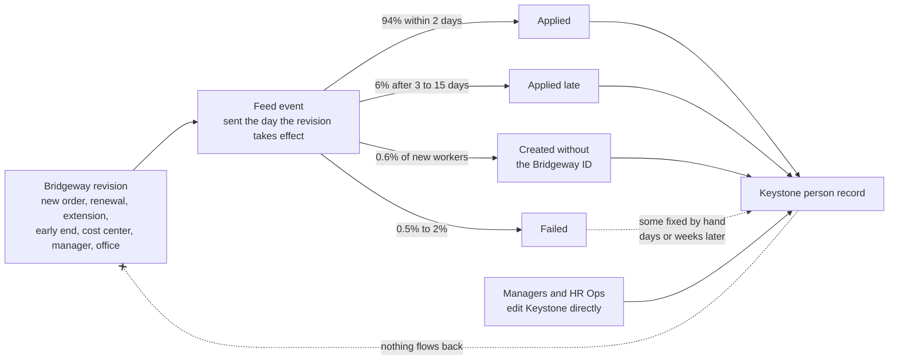

# Keystone HR and the feed: where the two systems disagree

Arcadia Systems, Keystone HR, Bridgeway VMS and every supplier and person here are fictional; all data is synthetic.

Release 3, phase 4. [`generator/keystone_feed.py`](../../../generator/keystone_feed.py) takes the clean Bridgeway program from [phase 3](bridgeway_simulation.md) and simulates three things:

- **The feed:** the one-way integration that carries Bridgeway's changes to Keystone HR.
- **Keystone:** the person record managers see.
- **The people:** managers and HR Ops editing that record by hand.

It writes four tables:

| Table | What it is |
|---|---|
| `feed_bridgeway_keystone_event` | Every change Bridgeway sent, and what happened to it |
| `ks_contingent_worker` | Keystone's effective-dated person record for each contingent worker |
| `gen_cw_discrepancy_truth` | **The answer key:** every discrepancy seeded, with its cause and the days it was true |
| `ref_cw_discrepancy_type` | The catalogue of 13 discrepancy types |

It also seeds three hygiene problems inside Bridgeway itself. Numbers below are as regenerated in phase 5, which added [conversions to employee](conversions_and_plan.md): a converted worker's Keystone record closes as *Converted to employee*, and a late feed change for that worker is rejected. Every parameter is in [`generator/reference_data.py`](../../../generator/reference_data.py) under *Keystone HR and the Bridgeway -> Keystone feed*. The module draws from its own random stream, so no employee number moves and every mart from case studies 1–5 is unchanged.

## How a change travels

- **One event per revision that Keystone cares about.**
  - *New Worker* and *Renewal* come from revision 0 of an approved order.
  - *Extension* and *Early End* change the end date.
  - *Attribute Change* covers cost center, manager and office.
  - Rate changes and closures are not sent, because Keystone holds no rates.
- **What each event carries.** The payload is the revision.
  - A *New Worker* event creates the record with the contract start and end and the attributes.
  - *Renewal*, *Extension* and *Early End* move the end date. Keystone's contract start stays the worker's first day.
  - *Attribute Change* carries the attributes only.
  - Any event that is applied leaves Keystone matching Bridgeway for what it carries, so most gaps heal at the next event.
- **Keystone finds the worker by the Bridgeway ID it stored.** If that is blank or mistyped, or the record was never created, every later event fails with *Worker not found*.
- **One queue per worker.** A worker's events are applied first in, first out: a late event holds up the ones behind it, so an older change never overwrites a newer one.
- **Keystone inactivates a contingent worker the day after the contract end date it holds.** If an extension never arrives, Keystone ends someone who is still working.

## What people do by hand

| Who | What | How often |
|---|---|---|
| Managers (60%) and HR Ops (40%) | Change a worker's cost center, manager or office in Keystone, never in Bridgeway | 0.12%, 0.16% and 0.06% of active workers a month. The next feed event for that worker puts Bridgeway's value back |
| HR Ops | Create the record by hand when the new-worker event failed | 65% of such cases, 7 to 60 days later; a quarter of them with the Bridgeway ID mistyped, half with the supplier typed their own way |
| HR Ops | Repair a blank or mistyped Bridgeway ID | 55%, 15 to 120 days later |
| HR Ops | Correct a worker after a failed extension, early end or attribute change | 60%, 50% and 30%, after days to weeks |
| HR Ops | Create a contingent worker in Keystone with no Bridgeway order at all | About one every two months from 2019; 40% are noticed and inactivated by hand |

A record HR Ops creates by hand often names the supplier its own way (*Quorlan Digital* rather than *Quorlan Digital Workforce*), which identity resolution will have to normalize. Keystone holds 59 spellings of 23 suppliers.

## Bridgeway's own hygiene

| Seeded | How |
|---|---|
| Orders closed late or never | 3% of ended orders are closed 17 to 400 days after the last day instead of within 15; if that falls after the extract, the order is still open |
| Time billed after the last day | 0.4% of ended orders bill 8 to 40 hours (or part of a month for BPO) in the month after; 139 timesheets, about $768K in billing currency |
| A renewal submitted as a new worker | 0.5% of renewals approved before their first day were submitted as a new worker: a second Bridgeway ID for the same person, a *New engagement* order with no link to the one it continues, and so a second Keystone person (61 people; 58 still in the history window) |

## The discrepancy catalogue

Each type is named after what happened in the systems, not after any internal label.

| Code | Discrepancy | What a manager in Keystone sees | Who can fix it | Severity | Periods | Open at extract |
|---|---|---|---|---|---:|---:|
| CW00 | Change in transit | Yesterday's values | Nobody: it clears itself | Expected | 21,136 | 0 |
| CW01 | Change arrived late | An old end date, cost center, manager or office for days | Integration support | Data hygiene | 3,039 | 26 |
| CW02 | Extension never arrived | Keystone ends the worker at the old end date while Bridgeway has them working | Integration support, then HR Ops | Access risk | 657 | 65 |
| CW03 | Early end never arrived | The worker is still active in Keystone after their last day | HR Ops | Access risk | 70 | 6 |
| CW04 | Ended but not closed in Bridgeway | Nothing: Bridgeway hygiene | Vendor management | Cost risk | 1,147 | 99 |
| CW05 | Changed in Keystone only | Values Bridgeway does not have; the supplier still bills Bridgeway's cost center | The manager, in Bridgeway | Cost risk | 2,148 | 219 |
| CW06 | Link ID missing or mistyped | Nothing, but later feed changes cannot find the worker | HR Ops | Data hygiene | 213 | 49 |
| CW07 | One person, two IDs | The same person twice | HR Ops and vendor management | Data hygiene | 58 | 30 |
| CW08 | Never reached Keystone | A worker missing from the team | Integration support, then HR Ops | Access risk | 115 | 25 |
| CW09 | Keystone-only contingent worker | A worker no supplier bills for | HR Ops | Access risk | 50 | 6 |
| CW10 | Over the duration cap | Nothing | Vendor management and the hiring manager | Compliance risk | 13 | 1 |
| CW11 | Billed after the assignment ended | Nothing: rates and timesheets are not in Keystone | Vendor management and Finance | Cost risk | 139 | 0 |
| CW12 | Attribute change never arrived | The old cost center, manager or office | Integration support, then HR Ops | Data hygiene | 168 | 16 |

Three changes from the plan's draft list:

- **Two codes split out.** *Change in transit* (CW00) is separated from *late*, so normal one-day lag is never mistaken for a problem. Attribute changes that fail get their own code (CW12).
- **Bill rates outside the card band are not seeded.** The ±7% scatter already puts some orders outside their band. That is a finding for the case study 6 analysis, not an injected defect.
- **Root causes.** When a broken link (CW06) or a missing record (CW08) makes a later extension fail, the row says *Extension never arrived* with root cause CW06 or CW08. Whoever fixes the link fixes both.

## The answer key

Most discrepancies are not single events but periods: a failed extension stays wrong until HR Ops fixes it or the next feed event overwrites it. So the key is built by replaying each Bridgeway worker's Keystone record twice:

1. **Ideal:** every event applied the day it is sent, nothing failing, nobody editing by hand. This is what Keystone would show if the integration were perfect.
2. **Real:** with lags, failures, broken links, hand edits and repairs.

Wherever the two disagree, that is a discrepancy. The key records it only on days when either side shows the worker working (active, and past the contract start): a stale cost center for someone who left a year ago is not anyone's problem. Each difference is attributed to the seeded action that made the two diverge: the failed event, the late event, the hand edit, the blank link. Bridgeway-only problems (CW04, CW10, CW11), the second-ID cases (CW07) and the Keystone-only workers (CW09) are recorded directly.

**No difference is left without a cause** (the generator counts unexplained days, and the count is zero). The key covers the warehouse history window: rows that ended before 30 June 2021 are left out.

**The key reconciles the two systems.** On 30 June 2026, 109 workers are working in Bridgeway but not active in Keystone under that Bridgeway ID, and 42 are active in Keystone but not working in Bridgeway under the ID it holds. Every one of the 151 has an open row in the key. The same holds on 30 June 2024 (75 and 26) and 31 December 2022 (64 and 18).

How they end (excluding changes in transit and late changes):

| Resolution | Periods |
|---|---:|
| Overwritten by a later feed event | 1,260 |
| Worker no longer active | 1,071 |
| Closed late in Bridgeway | 1,048 |
| Open at extract | 516 |
| Fixed by hand in Keystone | 513 |
| Bridgeway changed to match | 205 |
| Billed (CW11) / engagement ended (CW10) / other | 165 |

A hand edit in Keystone lasts a median of 140 days before something overwrites it, a failed extension 88, a worker missing from Keystone 69.

## What came out (extract of 30 June 2026)

| FY | Working in Bridgeway on June 30 | Active in Keystone | Feed events sent | Applied late | Failed | Workers with an open discrepancy |
|---|---:|---:|---:|---:|---:|---:|
| FY22 | 9,288 | 9,245 | 13,693 | 830 | 168 | 284 (3.1%) |
| FY23 | 10,228 | 10,170 | 14,958 | 897 | 208 | 320 (3.1%) |
| FY24 | 9,910 | 9,861 | 15,059 | 892 | 206 | 301 (3.0%) |
| FY25 | 10,707 | 10,644 | 16,397 | 960 | 222 | 325 (3.0%) |
| FY26 | **11,941** | **11,875** | 17,432 | 975 | 268 | **402 (3.4%)** |

(*Open discrepancy* excludes changes in transit.) About 3% of active contingent workers carry at least one open discrepancy on any June 30: noticeable, not alarming, as in a healthy program. The two headcounts differ by only 66, but that net hides 151 workers who are wrong in one direction or the other: it nets workers Keystone lost against workers it kept too long.

- **The feed:** 106,357 events (42,116 new workers, 14,708 renewals, 33,108 extensions, 3,645 early ends, 12,780 attribute changes). Of those, 98,341 were applied, 6,287 applied late, 261 partly applied, 1,433 failed (one of them rejected because the worker had already been converted to an employee), and 35 were still queued on the extract date.
- **Keystone:** 42,098 contingent worker records and 141,791 versions. 104,777 versions came from the feed, 32,314 from Keystone's own inactivations, 3,055 from HR Ops (1,180 of them conversions to employee) and 1,645 from managers. 492 versions hold no Bridgeway ID.

## Checks

| Test | Rule |
|---|---|
| 66 | (Amended) Billed time sits inside the assignment, except the timesheets the answer key lists as CW11 |
| 67 | Every feed event comes from a revision of the worker's own order, of the matching type, sent on the revision's date; outcomes agree with the dates; failures carry an error; events are applied first in, first out |
| 68 | Keystone's history chains without gaps or overlaps; every Feed version was applied that day, every System version is an inactivation the day after the contract end, hand edits carry no feed event; contingent person IDs never collide with employees |
| 69 | The answer key is sound: known codes, references that exist, dates inside the extract, the right evidence for each type |

Each was run against a deliberately broken copy of the data and caught the break: an unlisted after-end timesheet, a late event relabelled, a wrong event type, a failure without an error, a version shifted a day, a hand edit claiming a feed event, an ID colliding with an employee's, and an answer key row missing its feed event, carrying an unknown code, or claiming a resolution while still open.

Two problems were caught by these checks while building this phase:

- **Renewals moved Keystone's contract start forward.** About 1,500 workers, most of them BPO renewing on July 1, looked not yet started on June 30. Only a new worker sets the start now.
- **Seeded late closures that weren't late.** A few orders closed exactly on day 16, so they were never open past the 15-day grace. The seeded delay now starts at 17 days.

## What it sets up

Case study 6 (phase 7) builds the warehouse side: identity resolution, a month-end snapshot with both systems side by side, and rules that classify each discrepancy from the two systems alone. The answer key then scores those rules: what share of seeded discrepancies they find, and what they flag that was never seeded.
