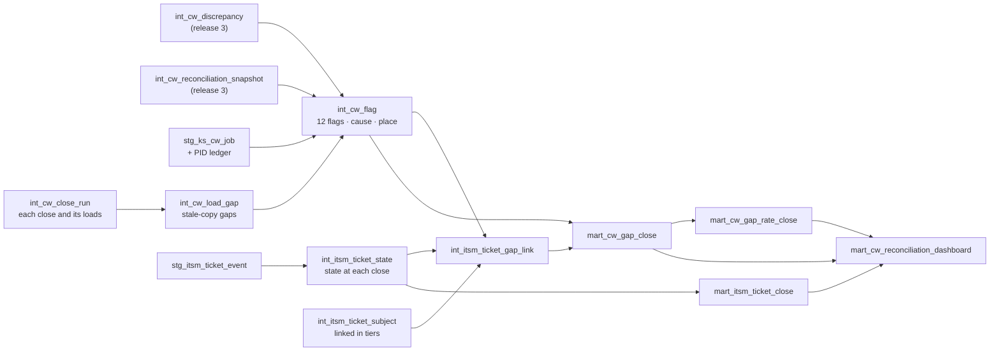

# Contingent Workforce Reconciliation: release plan

Case study 4 · Dashboard #4 · warehouse release 4. Arcadia Systems, Keystone HR, Bridgeway VMS, Helix Service Desk and every person and supplier here are fictional; all data is synthetic.

This page tracks the release from top to bottom, from the data the generator writes to the Custom SQL to the published dashboard. Each phase has an owner, a status and a "done when". The design behind it is the concept plan (project doc `dashboard_6_concept_plan.md`, agreed 2026-10-25). The release 3 reconciliation it builds on is described in [case study 4](case_study_4.md) and [Keystone and the feed](keystone_feed.md).

| Revision | Date | What changed |
|---|---|---|
| 1 | 2026-10-25 | Phases 1 to 6 done: generator, warehouse, SQL Server twin, Custom SQL, check tables, prototype. Phases 7 to 12 planned |
| 2 | 2026-10-25 | Prototype approved. Section 9 added: lessons from the three published dashboards (an outside review), what this build adopts and what it does not, the action contract and acceptance checks. Carryover is now one continuous gap episode (KPI 3: 315, was 319). KPI 4 reads "No linked ticket". The dashboard is **#4** and the case study **4**: the README now orders case studies by dashboard |

## Contents

1. Tracker
2. Changes from the concept
3. Phase 1: data creation
4. Phase 2: the warehouse
5. Phase 3: SQL Server
6. Phase 4: the Custom SQL
7. Phase 5: check tables
8. Phase 6: prototype
9. Lessons from the published dashboards
10. Phases 7 to 12: spikes, design, build, publish
11. Risks and open items

---

## 1. Tracker

| # | Phase | Owner | Status | Done when |
|---:|---|---|---|---|
| 1 | Data creation: times, Keystone job data, load log, Helix tickets | Claude | **Done** 2026-10-25 | Every pre-existing raw row identical (all 40 files checked by hash; only the three registry files gain rows); 9 new tables; generator deterministic (two runs, same hashes) |
| 2 | Warehouse (DuckDB): staging, flags and routing, ticket replay, 4 marts, tests 82 to 88 | Claude | **Done** 2026-10-25 | 88 of 88 tests pass; every mart of Dashboards #1 to #3 unchanged (all 31 published CSVs checked by hash) |
| 3 | SQL Server twin: `03d`, `04c`, `15_validate`, `build_all` | Claude, then Thiago on the Mac | **Done** (checker and Mac run, 2026-10-25) | `check_tsql_in_duckdb.py` matches every view and the Custom SQL row for row; on the Mac, `build_all.sql` runs and `15_validate` says PASS on every row |
| 4 | The Custom SQL | Claude | **Done** | `tableau/custom_sql_cw_reconciliation_dashboard.sql` returns the 62,808 rows of `mart_cw_reconciliation_dashboard` |
| 5 | Check tables (section 7) | Claude | **Done** | Numbers for Current (Jun 2026), May 2026, Jun 2025 and the Dec 2024 replay, from the marts |
| 6 | Prototype with real numbers | Claude, reviewed by Thiago | **Approved** 2026-10-25 | Thiago approves the layout, the wording and the numbers on the canvas |
| 7 | Spikes S1 to S6 on Tableau Public | Both | To do | Each passes or has its fallback chosen (section 9) |
| 8 | Multi-select design session (function, department, country) | Both | To do | Mechanics agreed: set actions, the empty-set rule, the dim rule |
| 9 | Figma: palette page and the mock | Thiago, with Claude | To do | Palette checked for colour blindness; the mock matches the prototype |
| 10 | Build plan, step by step (like `release_3_rebuild_dashboard_3.md`) | Claude | To do, after 7 and 8 | Every sheet, calculation, action and zone written down, with screenshots to compare |
| 11 | Build in Tableau | Thiago (Mac) | To do | Check tables and click tests pass; the saved .twb reviewed before publishing |
| 12 | Publish: Tableau Public, README, screenshot, profile row, project docs | Both | To do | Live link in the README; the case study 4 section shows the page |

---

## 2. Changes from the concept

Decisions made while building, with the reason for each. None changes the page the concept describes.

| # | Concept said | Built | Why |
|---:|---|---|---|
| C1 | F01 Department different; F02 Cost center different, same department | **F01 Function different; F02 Department different, same function** | Every cost center change in the data crosses a department inside one country, so "same department" never happens. Function is the level Finance reports at, so it is the better split anyway |
| C2 | F07 seeded as "one person, two active PIDs" in the PID ledger | **A new Keystone table, `ks_cw_job`**: the PID each contingent job record holds. F07 is two active records (two PIDs, or the same PID twice after a return); F08 is a record still in a PID the ledger shows they left | Seeding the PID ledger would change Dashboard #3's published numbers and test 81. The job data sits beside the ledger, the way a worker's job record and a position's incumbent are two tables in a real HR system |
| C3 | F05's second case (one CW ID on two EMPLIDs) as a new seed | **Found in the existing data**: a contractor converted to an employee whose contractor record never closed (the early end never arrived). One person, two active EMPLIDs; fixed in Keystone | It exists without seeding, and it is the realistic way it happens. Rare: 0 or 1 per close |
| C4 | Timing: "applied after the Keystone read, or within the last 2 hours" | **Knowable at the close**: a change still waiting is "Clears on its own" when it was sent in the 24 hours before the close run, otherwise "Feed stuck" | The close run cannot know when a pending change will land; it can only see how long it has waited |
| C5 | One failed load at random | **Three outages planted on close runs**: Bridgeway for 2 nights at the Sep 2023 close, Keystone for 3 nights at the Dec 2024 close, Helix for 2 nights at the Mar 2026 close; random failures skip close runs | A one-night failure creates almost no false gaps (few records flip status or cost center on the last day). The outages make the Integration "alert" shade visible on replay |
| C6 | About 5,000 tickets | **2,967 tickets**, 12,895 state changes | The ticket rules apply to the gaps that matter to Finance; manager and office differences get no tickets. Gaps nobody raised at first are noticed later (a review, an audit) if they last |
| C7 | Name in text as a second link tier | **Kept, and it mostly fails**: 449 of 608 name-only tickets match more than one contractor working at the time | Names repeat. That is the finding: a ticket without an ID cannot be trusted to point at one person |
| C8 | Ticket dots jittered | **Packed 20 to a line, oldest first** (`dot_seq`, `dot_x`, `dot_y`), up to 160 per cell | The fullest cell holds 144 tickets; jitter overlaps at that density, a packed grid reads as a count |
| C9 | KPI 1 hover "a net 66 hiding 151 wrong" | **79 working in Bridgeway but not active in Keystone, 13 the other way** | Recomputed from the snapshot; 151 counted other differences |
| C10 | Gap rate target 3% to be confirmed | **Confirmed**: 41 of the 61 closes are above it, every June close below it (2.72% to 2.99%) | The June dip is real: the population peaks at the June close (BPO orders run to Jun 30 and renew on Jul 1), and the July renewals bring a spike of new gaps |

---

## 3. Phase 1: data creation

New modules: [`generator/cw_operations.py`](../../../generator/cw_operations.py) (times, job data, load log) and [`generator/helix_service_desk.py`](../../../generator/helix_service_desk.py) (tickets). Parameters: the release 4 block at the end of [`generator/reference_data.py`](../../../generator/reference_data.py). Each piece draws from its own random stream (`feed_times`, `keystone_times`, `ks_job`, `load_log`, `helix`) after everything else, so no earlier draw moves.

| Raw table | System | Rows | What it holds |
|---|---|---:|---|
| `feed_event_delivery` | Integration | 106,357 | The hour each feed change was sent (the hourly batch) and applied, on the release 3 dates |
| `ks_contingent_worker_audit` | Keystone | 141,791 | When each Keystone contingent version was written and by whom: the feed, the nightly job (00:05 GMT), a manager in office hours, HR Ops in Bangalore |
| `ks_cw_job` | Keystone | 76,247 | Job records (EMPLID × record number) and the PID each holds |
| `gen_cw_job_defect` | Generator | 337 | Answer key for the job data: 114 F07 periods (111 seeded, 3 from the ledger itself) and 223 F08 periods; 42 open at the extract |
| `etl_load_run` | Load log | 7,428 | Every scheduled read, Jun 1, 2021 to Jul 1, 2026: 27 failed, 105 late |
| `itsm_ticket` | Helix | 2,967 | Ticket number, title, description, category, priority, group, opened, resolved, closed, close code |
| `itsm_ticket_event` | Helix | 12,895 | Every state change: New, In progress, Pending, Resolved, Reopened, Closed; reassignments |
| `itsm_ticket_link` | Helix | 2,967 | What each ticket is about: IDs (2,056), a name in the text (608) or nothing (303) |
| `ref_ticket_category` | Helix | 14 | One category per flag and two for Integration |

The registry (`ref_source_system`, `ref_raw_table_lineage`, `ref_raw_column`) gains the two new systems (`HLX` Helix Service Desk, `ETL` the load log) and the nine tables; test 61 now covers every table from release 3 on.

**How tickets are made.** From the answer keys: each gap period may get a ticket, by risk (access lost 90% within 1 to 3 days; access kept 60%; wrong cost center 40%, mostly 1 to 5 days after the next close; paying after the end 50%; headcount and PID 30%; a stuck feed 15%, by data engineering's monitoring). A gap nobody raised at first is noticed later if it lasts (150 days on average). One in 10 lands with the wrong group first; 8% are resolved while the gap is still there, and most of those reopen. A gap fixed in Bridgeway is often resolved a day or two before the feed brings the fix to Keystone ("fix pending next run"); a gap that ends by itself is closed as "No longer reproducible" 10 to 60 days later. Each failed load gets a P1 ticket for data engineering.

---

## 4. Phase 2: the warehouse



| Model | Grain | What it does |
|---|---|---|
| `int_cw_close_run` | close | The 00:00 GMT run on the 1st: each source's run and status, how fresh each source was, the note the page shows |
| `int_cw_flag_type` | flag | The 12 flags, their risk (fixed order) and default place, and the next step |
| `int_cw_load_gap` | close × contractor × flag | Gaps that exist only in a stale copy after a failed load (8 in all: 6 at Dec 2024, 2 at Sep 2023) |
| `int_cw_flag` | close × contractor × flag | Every gap: release 3 discrepancies as comparisons, conversions (F05), job data (F07, F08), load gaps; the routing rule |
| `int_itsm_ticket_state` | close × ticket | State at the close's Helix read, rebuilt from events; group, age, band |
| `int_itsm_ticket_subject` | ticket | The contractor a ticket is about: by ID, else one name working at the time |
| `int_itsm_ticket_gap_link` | close × gap | The ticket working on it, and its status: No ticket, Open, Fix pending next run, Closed with the gap still open |
| `mart_cw_gap_close` | close × gap (19,850) | The Sankey, the gap list and KPIs 3 to 5 |
| `mart_cw_gap_rate_close` | close × cost center (27,348) | The gap rate, KPI 1, the timeline |
| `mart_itsm_ticket_close` | close × open ticket (15,610) | The ticket card |
| `mart_cw_reconciliation_dashboard` | row type × grain (62,808) | The three in one, the page's one data source |

**The routing rule** (one `CASE` in `int_cw_flag`):

1. A feed change still waiting at the close (CW00, CW01) goes to **Integration**: "Clears on its own" if it was sent in the 24 hours before the close run, "Alert data engineering" if it has waited longer.
2. A gap that exists only because a load failed goes to **Integration**, "Alert data engineering".
3. Otherwise by flag: F01 to F05 to **Bridgeway** (F05 to Keystone when it is a conversion), F06 to F12 to **Keystone**.

Only "Clears on its own" is left out of the gap rate (`is_counted`): it is gone by the next run.

**Tests 82 to 88** (all pass): job data flags match their answer key on every close, both ways (82); one flag, risk and place per gap (83); the gap rate ties to the Bridgeway working count, 11,941 on Jun 30, 2026 (84); ticket histories chain (85); ticket IDs point at real subjects (86); load and timing gaps route to Integration and only there (87); the release 4 times agree with the release 3 dates, and the load log is consistent (88). Exports: four new CSVs, the largest 24.9 MB.

---

## 5. Phase 3: SQL Server

| File | What it does |
|---|---|
| [`sqlserver/03d_build_dw_cw_reconciliation.sql`](../../../sqlserver/03d_build_dw_cw_reconciliation.sql) | The nine raw tables typed into `dw`, then `CwCloseRun`, `CwFlagType`, `CwLoadGap`, `CwFlag`, `ItsmTicketState`, `ItsmTicketSubject`, `ItsmTicketGapLink` and the three marts (`CwGapClose`, `CwGapRateClose`, `ItsmTicketClose`). DuckDB's `QUALIFY`, `ARG_MAX` and `FILTER` become `ROW_NUMBER`, `TOP 1` and `CASE` |
| [`sqlserver/04c_create_reporting_views_reconciliation.sql`](../../../sqlserver/04c_create_reporting_views_reconciliation.sql) | `rpt.vw_cw_gap_close`, `rpt.vw_cw_gap_rate_close`, `rpt.vw_itsm_ticket_close`, in the marts' column names |
| [`sqlserver/15_validate_cw_reconciliation.sql`](../../../sqlserver/15_validate_cw_reconciliation.sql) | Runs the Custom SQL exactly as Tableau does and checks 35 values: row counts, the June close's KPIs and places, the December 2024 outage, the job data against its answer key |
| `build_all.sql`, `02_load_raw.sql` | 03d and 04c added to the build, 15 to the validation; the load script regenerated for the nine tables |

**Checked without SQL Server.** [`check_tsql_in_duckdb.py`](../../../sqlserver/check_tsql_in_duckdb.py) now builds 03d and 04c too and compares the three views and the Custom SQL with the marts, row for row. On a mismatch it names the columns that differ (that found the one difference during the build: DuckDB turns `DATEADD` on a date into a timestamp, so dates that end up in text are wrapped in `CONVERT(DATE, …)`).

**On the Mac** (Thiago), after pulling the branch:

```bash
docker compose up -d          # or the local setup in docs/setup/sql_server_local_setup.md
sqlcmd -S localhost -U sa -P "<password>" -C -i /repo/sqlserver/build_all.sql
sqlcmd -S localhost -U sa -P "<password>" -C -i /repo/sqlserver/15_validate_cw_reconciliation.sql
```

Every row of 15 should say PASS. Record the run time of 03d and of the Custom SQL in a run note, as for release 3.

**Mac run, 2026-10-25:** done. The first build stopped at 04c with `Msg 113 Missing end comment mark` (a header comment held `data/marts/*.csv`, and T-SQL nests block comments); fixed in the comment, and the checker now flags any `/*` inside a block comment. After the fix, every script passes: 05, 08, 12 and all 35 checks of 15 (KPI 3 315, KPI 4 176, KPI 5 247, places 196 / 181 / 2, 330 open tickets, Dec 2024 358 gaps with 6 sent to Integration). The Dashboard #4 Custom SQL returned 62,808 rows in 1 second (the workforce cost bridge takes 25). A full `build_all.sql` run takes about 40 to 45 minutes under emulation (the first, partly interrupted run; Thiago's estimate).

---

## 6. Phase 4: the Custom SQL

[`tableau/custom_sql_cw_reconciliation_dashboard.sql`](../../../tableau/custom_sql_cw_reconciliation_dashboard.sql): one `SELECT`, three `UNION ALL` branches, no CTEs, no `ORDER BY`. One data source for the whole page, because the multi-select sets (function, department, country) work only inside one.

| Row type | Rows | Feeds | Count with |
|---|---:|---|---|
| Gap | 19,850 | Sankey, gap list, KPIs 3 to 5 | `gaps` (1 per row) |
| Population | 27,348 | KPI 1, KPI 2, the timeline | `contractors_working`, `contractors_with_gap` |
| Ticket | 15,610 | Ticket card | `tickets` (1 per row), at `dot_x`, `dot_y` |

Every row carries `month_end_date`, `is_latest_close` and the group (`function_name`, `department_name`, `country_name`), so one **In Scope** calculation filters every card. The row types are never summed together: every calculation filters `row_type`.

Calculations the build plan will spell out (phase 10), named here so the data source is checked against them in the spikes:

| Calculation | Idea |
|---|---|
| Selected Close | Parameter (date): Current is the latest close; the Period popover lists the 61 closes |
| Is Selected Close | `month_end_date = [Selected Close]` |
| In Scope | In the function set (or the set is empty) and in the department set (or empty) and in the country set (or empty) |
| Gap Rate | `SUM(IF row_type = 'Population' THEN contractors_with_gap END) / SUM(IF row_type = 'Population' THEN contractors_working END)` |
| Report Status | "Report with low risk" when Gap Rate ≤ 3%, else "Report with known risk" |
| Flag Label | `flag_rank_label` (rank at the selected close, then name), so the Sankey's left side sorts by rank |
| Ribbon Colour | `place_key`: Bridgeway, Keystone, Integration clears on its own, Integration alert data engineering |

---

## 7. Phase 5: check tables

Every number below comes from the marts (`data/marts/mart_cw_*.csv`). The build in phase 11 is checked against them, with no group selected.

### KPIs and the cards

| | Current (Jun 2026) | May 2026 | Jun 2025 | Dec 2024 (replay) |
|---|---:|---:|---:|---:|
| KPI 1 working in Bridgeway | 11,941 | 11,489 | 10,707 | 10,011 |
| KPI 1 active in Keystone | 11,875 | 11,430 | 10,644 | 9,954 |
| Bridgeway only / Keystone only | 79 / 13 | 74 / 15 | 69 / 6 | 62 / 5 |
| KPI 2 contractors with a gap | 357 | 359 | 291 | 340 |
| KPI 2 gap rate | **2.99%** | 3.12% | 2.72% | 3.40% |
| KPI 2 status | Report with low risk | Report with known risk | Report with low risk | Report with known risk |
| Gaps (Sankey total) | 379 | 381 | 313 | 358 |
| Of which clear on their own | 0 | 1 | 3 | 0 |
| KPI 3 open since the prior close (same episode) | 315 | 321 | 264 | 298 |
| KPI 4 no linked ticket | 176 | 174 | 143 | 185 |
| KPI 5 open over 90 days | 247 | 255 | 208 | 231 |
| Oldest gap, days | 3,235 | 3,205 | 2,870 | 2,689 |
| Load note | Loaded on time | Loaded on time | Loaded on time | Keystone load failed: the close used Keystone as of Dec 28 |

### The Sankey

| | Current (Jun 2026) | May 2026 | Jun 2025 | Dec 2024 |
|---|---:|---:|---:|---:|
| **Places** Bridgeway / Keystone | 196 / 181 | 204 / 173 | 167 / 139 | 214 / 135 |
| Integration: clears on its own / alert | 0 / 2 | 1 / 3 | 3 / 4 | 0 / 9 |
| **Risks** Wrong cost center | 69 | 80 | 59 | 66 |
| Paying after the end | 100 | 99 | 85 | 127 |
| Wrong headcount | 77 | 74 | 64 | 58 |
| Wrong PID | 42 | 40 | 30 | 34 |
| Access kept | 12 | 14 | 6 | 5 |
| Access lost | 79 | 74 | 69 | 68 |

Flags, count and rank (the left side):

| Flag | Jun 2026 | May 2026 | Jun 2025 | Dec 2024 |
|---|---|---|---|---|
| F03 Order open after the end date | 99 · 1 | 97 · 1 | 85 · 1 | 124 · 1 |
| F01 Function different | 54 · 2 | 64 · 2 | 52 · 2 | 56 · 2 |
| F11 Working in Bridgeway, ended in Keystone | 54 · 3 | 51 · 3 | 41 · 3 | 50 · 3 |
| F06 Bridgeway ID missing or wrong | 49 · 4 | 47 · 4 | 40 · 4 | 36 · 4 |
| F08 PID still filled after the contract ended | 32 · 5 | 32 · 5 | 23 · 7 | 26 · 5 |
| F05 One person, two IDs | 28 · 6 | 27 · 6 | 24 · 6 | 22 · 6 |
| F12 In Bridgeway, missing in Keystone | 25 · 7 | 23 · 7 | 28 · 5 | 18 · 7 |
| F02 Department different, same function | 15 · 8 | 16 · 8 | 7 · 8 | 10 · 8 |
| F07 One person, two active PID records | 10 · 9 | 8 · 9 | 7 · 9 | 8 · 9 |
| F09 Ended in Bridgeway, still active in Keystone | 6 · 10 | 7 · 10 | 2 · 11 | 3 · 11 |
| F10 In Keystone only | 6 · 11 | 7 · 11 | 4 · 10 | 2 · 12 |
| F04 Billed after the end date | 1 · 12 | 2 · 12 | none | 3 · 10 |

### The ticket card (open tickets)

| | Current (Jun 2026) | May 2026 | Jun 2025 | Dec 2024 |
|---|---:|---:|---:|---:|
| Open tickets | 330 | 334 | 280 | 269 |
| Bridgeway / Keystone / Integration | 147 / 168 / 15 | 154 / 159 / 21 | 123 / 138 / 19 | 132 / 127 / 10 |
| 0 to 5 days / 6 to 30 / over 30 | 5 / 42 / 283 | 10 / 59 / 265 | 5 / 32 / 243 | 9 / 25 / 235 |

### The timeline (gap rate at each close, last 13 to Current)

Jun 25 2.72% · Jul 3.41% · Aug 3.32% · Sep 3.34% · Oct 3.39% · Nov 3.25% · Dec 3.31% · Jan 26 3.36% · Feb 3.27% · Mar 3.17% · Apr 3.20% · May 3.12% · **Jun 26 2.99%**. Over all 61 closes: 2.72% to 3.60%, 41 above the target.

---

## 8. Phase 6: prototype

A Design canvas with three 1400 × 850 boards, built from the marts: **Current (June close)**, the **Gap list** view of it, and the **Dec 2024 replay**. The Point in time capsule and the Overview · Gap list toggle are linked in Play. Hovering a ribbon or a ticket dot shows its numbers or the ticket number and title, as the page will.

What it settles for review: the funnel order (flags ranked, risks and places fixed), place colours on ribbons and dots, the five KPI cards with their sub-lines, the headline and the movement line, the timeline with the target and the selected close, and the gap list's columns.

---

## 9. Lessons from the published dashboards

An outside review of the three published dashboards (Headcount & FTE Walk, Compensation Walk, Workforce Planning) turned their strengths and weak spots into requirements for this one. It also proposed its own prototype. This section records what the build adopts, what it does not and why. The published dashboards are not being reworked.

### Adopted

| # | Lesson (from) | What this build does | Status |
|---:|---|---|---|
| L1 | Keep the unit visible without hover (Workforce Planning) | Every KPI and card names its unit on its face: contractors (KPIs 1, 2), gaps (Sankey, KPIs 3 to 5), tickets (ticket card). Hover adds evidence, never the meaning | In the prototype; build rule |
| L2 | Make the arithmetic visible (Headcount Walk) | Gap conservation at every close and every filter: 12 flag totals = 6 risk totals = 3 place totals = gap list rows = Sankey total. Contractors and gaps are never mixed (357 contractors, 379 gaps) | Test 83 and the check tables; acceptance check A2 |
| L3 | Generate text from the same measures (Headcount Walk) | Headline, movement line, KPI sub-lines and tooltips are calculations on the data source, never typed sentences; rechecked after every filter and close change | Build rule (phase 10) |
| L4 | Composition is not improvement (Compensation Walk) | A falling rate can come from a larger population: the June dip is mostly the population peaking at the close. The movement line names the numerator and the denominator and never says "fixed" unless the gap count fell | Build rule |
| L5 | Keep gap age and ticket age apart (Headcount Walk) | KPI 5 and the gap list use gap age (days since the gap began, strictly over 90); the ticket card uses ticket age. A gap can be older than its ticket; the gap list shows both | Built (`days_open`, `age_days`) |
| L6 | Don't overclaim from a missing link | KPI 4 is "No linked ticket", not "nobody is working on these": a ticket may exist without an ID the warehouse can link | Prototype updated |
| L7 | Carryover means one continuous episode | KPI 3 counts a gap open at the prior close **and** begun on or before it. A flag that cleared and came back between closes is a new episode | Built: Jun 2026 315 (was 319) |
| L8 | Correction place and assigned team are different facts | The Sankey routes a gap to where it should be fixed; the ticket card places a ticket by the group working it now (a misrouted ticket sits in the wrong row until reassigned). The gap list shows both | Built (`place` vs `current_group`) |
| L9 | Replay must not leak current values | A past close shows ticket states, groups and links as they were at that close's Helix read, rebuilt from events | Built (`int_itsm_ticket_state`); acceptance check A9 |
| L10 | A target is not a certificate | KPI 2 keeps "Report with low risk / known risk", and its hover states the distance in percentage points from a provisional 3% target ("0.01 pts below") and that it does not certify the report | Build rule |
| L11 | Say what a flag does and does not prove | "Access kept" means Keystone shows the contractor active after Bridgeway ended them, not that they used any access. The detection score is synthetic recall (every planted case found), with false flags reported beside it | Info popover text |
| L12 | Empty and missing states | "No gaps in this selection" for zero gaps; N/A, not 0%, for a zero denominator; a failed load is a freshness note, never a zero | Build rule |
| L13 | Prove the extension before the build plan | The Sankey spike passes only on Tableau Public: proportional widths, place colours, small paths, order by rank, click to the gap list. A failure is recorded with its fallback, never by quietly changing the story | Phase 7 |

### Not adopted, and why

| Proposal | Decision |
|---|---|
| One dot per open **gap**, aged by gap age, with a "no ticket" row | Kept the agreed design: one dot per open **ticket**, by the group working it and its age. Gap age is already KPI 5 and the gap list; the card answers who is working and for how long, which nothing else on the page does |
| Six risk colours on the left ribbons, place colours on the right | Kept one colour story: colour means where to fix, everywhere on the page. Risks are labelled in the middle column, and a second nine-colour palette would compete with the places |
| KPI 3 as the total number of gaps | The total is the Sankey's headline; KPI 3 stays "open since the prior close" because Finance asks whether the same problems keep coming back |
| Drop the go / no-go wording | Kept for Finance (agreed), with the hover in L10 |

### Action contract

| Interaction | Effect |
|---|---|
| Point in time, Function, Department, Country | Every card: KPIs, Sankey, timeline (history kept, the selected close highlighted), ticket card, gap list |
| Click a flag, risk or place in the Sankey | Filters the gap list to those gaps; the KPIs keep the overview |
| Hover a ribbon or node | Count, rank at this close, the prior close and a year ago |
| Hover a ticket dot | Ticket number and title |
| Overview · Gap list | Swaps the main card (dynamic zone visibility) |
| Reset | Current, all groups, Overview, popovers closed, selections cleared |

### Acceptance checks for the build

| # | Check | Expected (Current) | Where it is proven now |
|---|---|---|---|
| A1 | Gap rate = contractors with a counted gap / working in Bridgeway | 357 / 11,941 = 2.99% | Test 84 |
| A2 | Gap conservation across flags, risks, places and the gap list | 379 everywhere | Test 83 |
| A3 | Linked plus not linked = all counted gaps | 203 + 176 = 379 | Mart |
| A4 | Over 90 days is strictly more than 90 | 247 | `is_over_90_days` |
| A5 | Open tickets by group add up | 147 + 168 + 15 = 330 | Mart |
| A6 | Carryover is one continuous episode | 315 | Mart |
| A7 | No typed sentence survives a change of close or group | Headline and movement line change with Dec 2024 | Build |
| A8 | One function, several departments, a country intersection tie to SQL totals | Additive cells in `mart_cw_gap_rate_close` | Build |
| A9 | Replay: June 2026, May 2026, Dec 2024 | Section 7 | Tests 85, 15_validate |
| A10 | A misrouted ticket sits under the group working it | Ticket card rows by `current_group` | Mart |
| A11 | Every open ticket renders once; no clipping | 330 dots, at most 144 in a cell | Packed `dot_seq` |
| A12 | Sankey widths proportional; small paths visible | F04 with 1 gap still drawn | Spike S1 to S3 |
| A13 | Selected timeline point equals KPI 2 | 2.99% | Build |
| A14 | Published interactions on Tableau Public at 1400 × 850 | All of the action contract | Phase 11 |
| A15 | Failed loads, stale sources, ambiguous links have documented outputs | Dec 2024 outage note; 449 ambiguous name-only tickets unlinked | Tests 86, 87 |

---

## 10. Phases 7 to 12: spikes, design, build, publish

### Phase 7: spikes on Tableau Public

Step-by-step: [spikes_guide.md](spikes_guide.md).

Run on a small workbook on the dashboard's Custom SQL (local SQL Server, extracted) before any page is built.

| # | Spike | Pass when | Fallback |
|---|---|---|---|
| S1 | Sankey extension: node order by a field | The flags sort by `flag_rank_label` at the selected close | The label already sorts by rank; sort alphabetically on it |
| S2 | Sankey extension: a click drives a filter or set action | Clicking a flag, risk or place filters the gap list | KPI cards and the ticket card's rows drive the gap list |
| S3 | Sankey extension: colour by `place_key` across levels; tooltip | Ribbons coloured by place; tooltip shows rank and prior close | Colour by level; movement only in the subtitle |
| S4 | Set-action multi-select popover on the web | Adding and removing members is quick, the tick shows | Native multi-value filters styled close to the capsules |
| S5 | Ticket dots at 144 per cell | Readable at 2.5 px dots on the packed grid; hover hits the right dot | Smaller cells, or a count per cell with dots on hover |
| S6 | Extract size and speed | The 62,808-row extract publishes under Tableau Public's limits and the page loads in under 5 seconds | Drop the Gap rows of closes older than 25 months from the extract (the replay keeps two years) |

### Phase 8: multi-select design session

Three sets on the one data source; an empty set means All; a click adds or removes a member; departments outside the chosen functions are dimmed, never hidden; the capsule reads "Function · All", "Function · Commercial" or "Function · 3 selected". Settle the exact actions and calculations, then add them to the build plan.

### Phase 9: Figma

An "Arcadia D6" palette page (3 places × 4 stops, the status chips, navy) and the mock, matching the prototype. Check the palette for colour blindness (amber, violet and teal stay apart).

### Phase 10: build plan

Written after phases 7 and 8, in the format of `release_3_rebuild_dashboard_3.md`: build phases, every sheet with its marks and fields, every calculation with its formula, every action, the zone layout with coordinates, the popovers, and the check after each phase.

### Phase 11: build in Tableau (outline)

| Step | What | Check |
|---|---|---|
| B1 | Data source from the Custom SQL (or the CSV), parameters, sets, In Scope | Row counts by row type: 19,850 / 27,348 / 15,610 |
| B2 | KPI band, five cards | Section 7, KPIs, for Current and Dec 2024 |
| B3 | Sankey | Places, risks and flag ranks for Current and Dec 2024 |
| B4 | Timeline | 13 points to Current; the selected close highlighted |
| B5 | Ticket card | 330 dots for Current, by place and band |
| B6 | Gap list and the Overview · Gap list toggle | The 379 rows of Current, grouped by place |
| B7 | Point in time, Function, Department, Country popovers | Picking Dec 2024 shows the outage note and 9 Integration alerts |
| B8 | Info popover: definitions, the run schedule, the detection score | Text fits with 15% spare height on the web |
| B9 | Polish with the lessons from Dashboards #1 to #3 | Tooltip command buttons off on every sheet; no glyphs in viewer text; deselect actions; stray legends deleted; the .twb reviewed |

### Phase 12: publish

Tableau Public, a README update (case study 4's Tableau section and a screenshot), the Figma file, the profile row, the project docs, and a session handoff.

---

## 11. Risks and open items

| # | Item | Plan |
|---:|---|---|
| 1 | Integration is small (0 to 9 gaps a close): a thin node | Correct by design ("few for integration"). The Dec 2024 replay shows it at its largest. If it reads as empty, label it with its count and keep the node a minimum height |
| 2 | Most tickets are over 30 days old | It is the story (old gaps, old tickets). Spike S5 decides the dot size |
| 3 | 128 of the 330 open tickets at the June close (39%) work on no current gap: the gap is already gone, or the ticket carries no ID, or its name is shared | Shown as dots; the info popover explains the link tiers |
| 4 | Name-only tickets mostly cannot be linked | A finding for the case study write-up |
| 5 | The 3% target sits just above June 2026 (2.99%) | A real close-call: the KPI says low risk by one hundredth. Worth one line in the hover |
| 6 | Supplier as a fourth multi-select | Open (concept item 4); decide in phase 8 |
| 7 | Timeline range | Last 13 closes by default; all 61 on the axis decided in phase 8 |
| 8 | Employee and position tickets in Helix | Later; the tables are ready |
