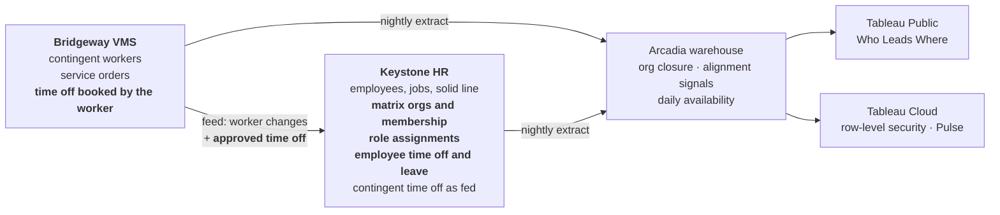

# Who Leads Where: release plan

Case study 7 · Dashboard #7 · warehouse release 7. Arcadia Systems, Keystone HR, Bridgeway VMS and every person here are fictional; all data is synthetic.

This page tracks the release from the data the generator writes to the published dashboard. The page design was agreed on the design canvas (project docs `case_study_7_concept.md` and `case_study_7_design_round2.md`, 2026-11-07).

| Revision | Date | What changed |
|---|---|---|
| 1 | 2026-11-07 | Plan written: decisions, data model, how gaps are seeded, alignment signals, time off, tests, phases |
| 2 | 2026-11-07 | **Phases 1 and 2 done.** Generator (`org_design.py`, `time_off.py`, driver `leadership_scope.py`), 9 staging models, 8 intermediate models, 5 marts, tests 93 to 100; 100 of 100 tests pass. Results in section 12. Public holidays added (`ref_public_holiday`), so a US holiday reads as a holiday, not as a working day |
| 3 | 2026-11-07 | **Phase 3 (SQL Server) and the Custom SQL done in the repository.** `03g` builds the release 7 tables (the closure one level at a time, 12 levels; the tree layout for every focus leader), `04d` the views, `18_validate` 35 checks; `check_tsql_in_duckdb.py` matches every view and the page's Custom SQL row for row. New mart `mart_org_tree_layout` (test 101). One Custom SQL for the page, `tableau/custom_sql_who_leads_where.sql`, row types Node, Tree, Day, Signal, R1 (646,673 rows). Run guide: `sql_server_release_7_run.md`. `05_validate` now expects 1,048,292 reporting-chain rows (borrowed reporting lines) |
| 4 | 2026-11-07 | **Phase 7: the workbook.** `tableau/builder/d7` writes it from a base workbook (connection only): 196 calculations, 80 sheets, light and dark, 168 actions. One context filter per sheet (Leaders, Days, Tree) keeps every FIXED read to the rows that sheet needs: a click went from 20 to 30 seconds to a few. Names centered under each circle (the gap slice split around 12 o'clock). Numbers checked in Tableau Desktop against `check_values.py`. Guide: `who_leads_where_build.md` |
| 5 | 2026-11-08 | **The tree becomes one company tree** (after The Information Lab's dynamic drill-down). `mart_org_tree_layout` Dynamic: every leader once at a fixed place (depth below the CEO; a team one unit apart, centered under its leader), 63,091 rows instead of 129,542; Static unchanged. `03g` builds it one level at a time; test 101 and `18_validate` (37 checks) rewritten; Custom SQL 580,222 rows, Tree rows carry the node's path. Workbook: one click opens a leader (tree, KPIs, rail and panel together; `p_Path` set with `p_Focus`), clicking anyone above goes back up, four-row window, animation on, `p_Open` and the two-click logic gone. Checked in Tableau Desktop on a test extract |

## Contents

1. Tracker
2. Decisions
3. What must not move
4. Data flow
5. Phase 1: data creation
6. Phase 2: the warehouse
7. Alignment signals
8. Time off and "at work"
9. Tests
10. Notes for the build
11. Risks and open items
12. Results (Jun 30, 2026)

---

## 1. Tracker

| # | Phase | Owner | Status | Done when |
|---:|---|---|---|---|
| 1 | Data creation: matrix orgs, matrix membership, role assignments, borrowed reporting lines, time off, answer key | Claude | **Done** 2026-11-07 | Every pre-release-7 raw table identical by hash except the documented `fact_job_history` manager splits; generator deterministic |
| 2 | Warehouse (DuckDB): staging, org closure, alignment signals, daily availability, marts, tests | Claude | **Done** 2026-11-07 | All tests pass; every mart of Dashboards #1 to #6 unchanged by hash; only the reporting-line marts move, as documented |
| 3 | SQL Server twin: `03g`, `04d`, `18_validate`, `build_all` | Claude, then Thiago on the Mac | **Done** 2026-11-07: every `18_validate` check passes on the Mac | `check_tsql_in_duckdb.py` matches; `18_validate` passes on the Mac |
| 4 | Custom SQL and tree coordinates | Claude | **Done** 2026-11-07, in SQL (no Python needed): `mart_org_tree_layout` and `dw.OrgTreeLayout`, every leader as the focus; x runs 0 to 1, so the normal and expanded cards use the same rows | Dynamic and static layouts for every leader, at normal and expanded widths |
| 5 | Check tables with real numbers; refresh the design canvas | Claude, reviewed by Thiago | To do | Canvas shows generated values |
| 6 | Figma spec | Thiago, with Claude | To do | Spec matches the approved canvas |
| 7 | Build guide and workbook, light and dark | Claude, then Thiago | Workbook built by `tableau/builder/d7` and checked in Tableau Desktop 2026.2; guide `who_leads_where_build.md`. Publish to do | Check tables and click tests pass on Tableau Public |
| 8 | Publish; Tableau Cloud with row-level security and Pulse | Both | To do | Live link; Pulse metrics followed per L1 |

---

## 2. Decisions

| # | Decision | Why |
|---:|---|---|
| D1 | **L0 = Executive Leadership** (the CEO and the eight function heads, 9 people). **L1** = the 20 org leaders who report to a function head (sub-function heads and the department heads directly under a function). **L2** = the people managers who report to an L1 (189 on Jun 30, 2026) | Keeps the L1 / L2 names the portfolio already uses and adds one level on top. The executive officers lead, but stay out of every count, as on #1–#6 |
| D2 | **Everyone counts: employees and contingent workers.** A toggle All / Employees / Contingent | A leader leads both. Contingent workers count from **Bridgeway** (the source of truth, 11,941 on Jun 30, 2026, the same number as #1 and #4); their manager comes from their **Keystone** profile (matched through the case study 4 identity resolution), or from the Bridgeway hiring manager when Keystone has no record |
| D3 | **Gaps are flags, never errors.** One word, "alignment gap", for every signal; no fix / review split | A leader can have a good business reason for every one of them |
| D4 | **Geography is never a flag at L0–L2.** It belongs to the matrix line | L0–L2 leaders lead across regions by design |
| D5 | **The solid line drifts only where Arcadia's own history gives a reason:** the FY25 reorganization and department transfers. The new manager split rows are written into `fact_job_history`; nothing else in it changes | A reorg that moves a department but leaves some people reporting to their old manager is how this happens in real HR systems. Headcount, departments, pay and cost stay exactly as they are |
| D6 | **Time off is a request table, not a day table.** Days are expanded in the warehouse | One row per request keeps the raw files small; the expansion is a few lines of SQL |
| D7 | **Contingent workers book time off in Bridgeway.** Bridgeway sends approved time off through the existing feed; Keystone stores it beside employee time off | Matches how a vendor system and an HR system share absences. Leaders see one "off" number |
| D8 | **"At work" is anchored on the report date** (Jun 30, 2026 today) and looks 30 days forward. No year is hard-coded: a yearly refresh moves it | Same rule as #5 and How-To #2 |
| D9 | **The matrix line goes live in Keystone on Jul 1, 2023 (start of FY24).** History before that has no matrix | Gives three fiscal years of matrix history without inventing a decade of it |

## 3. What must not move

| Number | Value | Checked by |
|---|---|---|
| Employees, Jun 30, 2026 (executive officers excluded) | 30,005 | `05_validate.sql`, test 92 |
| Contingent workers, Jun 30, 2026 (Bridgeway) | 11,941 | test 70 |
| Every pre-release-7 raw table except `fact_job_history` | identical by hash | release check |
| `fact_job_history`: rows, departments, offices, levels, dates | only `manager_worker_id` changes, on split rows marked in the answer key | test 93 |
| Every mart behind Dashboards #1 to #6 | identical by hash | release check |

## 4. Data flow

Employees request time off and leave in Keystone. Contingent workers book time off in Bridgeway, and the feed carries every approved booking to Keystone, where leaders and HR read one absence calendar. The warehouse reads Bridgeway for who is a contingent worker and Keystone for everything else.

## 5. Phase 1: data creation

A new generator module, `generator/org_design.py`, and a time-off module, `generator/time_off.py`, run after the existing simulation on their own random streams, so no earlier draw moves.

### New raw tables

| Table | System | Grain | What it holds |
|---|---|---|---|
| `ks_matrix_org` | KS | matrix org × effective-dated record | 5 region matrices and 14 country or cluster matrices; manager (can be vacant); parent region; active / inactive |
| `ks_matrix_membership` | KS | person × matrix org × effective dates | Employees and contingent workers (Keystone person IDs) in their country matrix |
| `ks_role_assignment` | KS | role × assignee × target org unit × effective dates | HR Partner and Finance Partner on every org unit; `assigned_via` Direct or Inherited; the target's name carries its leader at the time |
| `ref_job_family_home` | WH | job family | The function that usually hires each family; Data and Operations are shared |
| `ks_time_off_request` | KS | time-off request | Employees (Keystone) and contingent workers (as fed from Bridgeway): type, first and last day, units, status, corrections |
| `ks_leave_of_absence` | KS | leave request | Employees: leave type, last day of work, estimated and actual return, first day back |
| `bw_time_off` | BW | booking | Contingent workers' bookings in Bridgeway |
| `gen_org_drift_truth` | GEN | seeded gap | Every seeded gap with its cause and dates (a test fixture) |

`fact_job_history` gains split rows (action reason `Manager Change`) where a person keeps reporting to a manager in another department.

### How gaps are seeded

| Signal | Cause in the simulation |
|---|---|
| Budgeted in another org | After the FY25 reorganization, some people moved to a new department kept their old manager; after some department transfers the manager change lags. Most are cleaned up within weeks, some never |
| Role from another function | Not seeded: it comes from the job families Arcadia already hires outside their home function |
| Country leader for another country | After an international move, the matrix change lags; some never happen |
| In two country matrices | After a move, the new membership is added and the old one is never ended |
| Matrix inactive | A cluster split in FY26 ends two matrices; some members are never moved |
| Matrix without a leader | A matrix leader leaves; the seat stays open until a successor is named |
| Still naming a former leader | After a leadership change, inherited role assignments are not re-issued |

## 6. Phase 2: the warehouse

| Layer | Model | Grain |
|---|---|---|
| Staging | `stg_matrix_org`, `stg_matrix_membership`, `stg_role_assignment`, `stg_job_family_home`, `stg_time_off_request`, `stg_leave_of_absence`, `stg_bw_time_off`, `stg_gen_org_drift_truth` | as raw |
| Intermediate | `int_person_month_end` | person (employee or contingent) × month-end: department, office, country, job family, manager |
| Intermediate | `int_org_closure` | ancestor × descendant × depth × month-end |
| Intermediate | `int_alignment_signal` | person × signal × month-end |
| Intermediate | `int_time_off_day` | person × day off (weekdays), PTO and leave together |
| Mart | `mart_leader_org` | leader × month-end: people, directs, indirects, layers, spans, gaps by signal, by worker type |
| Mart | `mart_leader_tree` | leader × node: the tree nodes and tooltips |
| Mart | `mart_leader_availability` | leader × day (report date + 30): at work, off, by worker type |
| Mart | `mart_alignment_detail` | person × signal: the roster behind every gap |
| Mart | `mart_org_entitlement` | viewer × person they may see (row-level security on Tableau Cloud) |

## 7. Alignment signals

A leader's org design is the org units they lead and the job families their function hires; the matrix line follows where people sit. A person has an alignment gap when at least one signal shows.

| Line | Signal | Rule |
|---|---|---|
| Solid | Budgeted in another org | The manager's department is outside the org unit the person's department belongs to (people leaders who lead a unit are exempt) |
| Solid | Role from another function | The job family's home function differs from the department's function (shared families never show) |
| Matrix | Country leader for another country | The person's country matrix does not cover the country of their office |
| Matrix | In two country matrices, or none | Not exactly one active country matrix |
| Matrix | Matrix inactive or without a leader | The matrix has ended, or its manager seat is open |
| Role assignments | Still naming a former leader | An assignment whose org-unit name carries a leader who no longer leads it (counted per assignment, shown on the leader) |
| Context | Leads people in other regions | Countries led; never a gap |

## 8. Time off and "at work"

- Employee time off types follow the country (US PTO in hours, India casual and sick leave in days, and so on); half days and corrections (negative units) exist, as in a real absence log.
- Leave of absence: parental, medical, personal and other leaves, with estimated and actual return dates.
- History covers FY26 (Jul 1, 2025) to the report date; approved future requests run to 60 days past it, created no later than the data-through date.
- **At work on a day** = people in the org that day (scheduled weekdays) minus anyone with approved time off or on leave. Weekends show no count. Public holidays are not modeled (a limitation the methodology page states).

## 9. Tests

| # | Rule |
|---:|---|
| 93 | `fact_job_history` differs from release 6 only in manager splits listed in the answer key; test 25 allows exactly those |
| 94 | Every person has at most one active membership per matrix, and every gap the answer key seeds is found (detection = 100%, no false positives) |
| 95 | Matrix orgs: one manager at a time; vacancies only where the answer key says |
| 96 | Role assignments: dates in order; stale rows match the answer key |
| 97 | The org closure gives every leader's directs + indirects = people under them, and every chain ends at the CEO |
| 98 | Time off sits inside employment; no overlapping requests; contingent time off in Keystone equals what Bridgeway sent |
| 99 | Availability: at work + off = people, for every leader and day |
| 100 | Leader totals tie to the month-end snapshot (employees) and the Bridgeway snapshot (contingent) |

## 10. Notes for the build (from the design review, 2026-11-07)

- **Headline:** name, people, countries and gaps only, e.g. "Maya Okafor leads 4,812 people in 11 countries. 262 (5.4%) show an alignment gap." No cause in the headline.
- **Dynamic tree navigation:** clicking a child opens their team (down); clicking the top circle or a breadcrumb goes up one level; the rail jumps straight to any L0, L1 or L2 leader. Below L2 the tree still opens a manager's team, but the rail lists only L0–L2.
- **Tooltips on every node:** name, title, level, office, people (employees / contingent), directs and indirects, at work on the chosen day, gaps by signal.
- **Directs and indirects** on every node label (e.g. "11 directs · 4,801 indirect").
- **Worker type toggle:** All / Employees / Contingent.
- **Rail spacing:** spread the controls down the full height of the rail; don't stack them at the top.

## 11. Risks and open items

| # | Item | Status |
|---:|---|---|
| 1 | Manager splits touch the reporting-line marts (`mart_reporting_line`, `mart_org_leader_summary`, the org chart doc). None feeds a published dashboard | Check by hash |
| 2 | "Consol Classic" one-button filter: design assumes one button that opens a popover | Thiago to confirm |
| 3 | Real Arcadia logo file for the rail | Thiago |
| 4 | Pulse Q&A needs Tableau+; site `thiagotc26` (developer site) | Check at phase 8 |
| 5 | Role assignments naming a former leader are rare (2): Arcadia's org units changed leader only six times since the matrix went live | Keep (honest), or add role assignments on L2 teams, whose leaders change more often. Thiago to decide |
| 6 | "Matrix without a leader" flags everyone in Australia and Korea (open seats) | It is the signal working; the methodology page explains it |

## 12. Results (Jun 30, 2026)

**Ties.** 30,005 employees and 11,941 contingent workers, the numbers every published dashboard shows (test 100). 94 contingent workers take their manager from the Bridgeway hiring manager (no active Keystone record); 12 have no manager employed that day and sit outside every tree. Every mart behind Dashboards #1 to #6 is byte-identical; only `mart_reporting_line`, `mart_org_leader_summary` and the org chart page move (open item 1). The data is reproducible: running the generator again gives identical files.

**Seeded and found.** 999 seeded gaps (S1 531 borrowed reporting lines over 631 job records; M1 358; M2 24; M3 76 left in the ended cluster and 8 open leader seats; R1 2). Test 94: every seeded person gap is found on every month-end, and nothing unseeded is (S1 employees, M1, M2).

**Signals on the report date** (people, executive officers excluded):

| Line | Signal | People |
|---|---|---:|
| Solid | Budgeted in another org | 258 (255 seeded employees; 3 contingent workers whose Keystone manager sits in another department, found in the data as it is) |
| Solid | Role from another function | 958 (not seeded: Software Engineering roles in Commercial, Product roles in Commercial and Technology, Design roles in Technology) |
| Matrix | Country leader for another country | 42 |
| Matrix | In two country matrices, or none | 19 |
| Matrix | Matrix inactive or without a leader | 817 (Australia and Korea leader seats open; members left in Southern Europe) |
| | **People with at least one gap** | **2,057 of 41,934 (4.9%)** |
| Role assignments | Still naming a former leader | 2 assignments |

**A leader, for the headline.** Isaac Holland, L1, Senior Vice President, Software Engineering: 13,248 people (8,101 employees, 5,147 contingent) in 22 countries, 12 directs and 13,236 indirect, 6 layers below, median span 12. 866 (6.5%) show an alignment gap: 112 budgeted in another org, 584 roles from another function, 183 matrix gaps. At work on Jun 30: 12,004.

**At work, the whole company** (people / at work / off):

| Day | People | At work | Off (time off, leave, holiday) | Left the team |
|---|---:|---:|---|---:|
| Tue, Jun 30 | 41,934 | 37,972 | 3,962 (3,718, 244, 0) | 0 |
| Wed, Jul 1 | 40,091 | 34,953 | 5,138 (3,622, 231, 1,285 Canada Day) | 1,843 |
| Fri, Jul 3 | 40,046 | 26,721 | 13,325 (2,867, 158, 10,300 US Independence Day observed) | 1,888 |
| Thu, Jul 30 | 39,439 | 36,653 | 2,786 | 2,495 |

1,843 contingent assignments end on Jun 30 with no extension on file yet (the fiscal year-end renewals Dashboard #1 shows as lapses): the calendar says so under the count. Days further out show fewer people off because requests are known only once they are made.

**Size.** Raw: `ks_time_off_request` 59 MB (363,620 rows), the largest new file; every file is under GitHub's 100 MB limit. Warehouse build 165 s.
