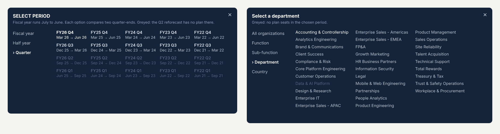

# Release 3 build plan: Dashboard #3, Workforce Planning

This is the complete plan for the third Arcadia dashboard, from the data to the published page. It replaces the step-by-step build in [dashboard_3_build.md](dashboard_3_build.md), which stays only as history. The plan reuses what already works on Dashboard #1 (Headcount & FTE Walk: the top bar, popovers, KPI hovers, info panel, grid and type rules) and Dashboard #2 (Compensation Walk: the period grid and the title rules). The only new pieces are the ones this page needs. Arcadia Systems is fictional and all data is synthetic.

Companion guides, referred to as **G1** and **G2**: [Dashboard #1 rebuild](../headcount-fte-walk/release_3_rebuild_dashboard_1.md) and [Dashboard #2 rebuild](../compensation-walk/release_3_rebuild_dashboard_2.md). Method and definitions: [workforce_planning.md](workforce_planning.md).


*Design mock at the default state (FY26 · Budget · All organizations). Every number on it comes from the release 3 data. File: `docs/brand/build/d3_page_preview.html`.*

## Contents

0. What changes and why (decisions)
1. The story: one question, five cards, four panels
2. Data: what changes in the SQL, and how it is checked
3. Shapes
4. Workbook and data sources
5. Parameters
6. Calculations
7. Top bar
8. Popovers (Period, View, Info)
9. KPI band and hovers
10. The four panels
11. Dashboard layout
12. Actions (complete list)
13. Check tables
14. Click tests
15. Publish and document
16. Who does what, in what order

---

## 0. What changes and why

| | First build (stopped 2026-10-23) | This plan |
|---|---|---|
| Controls | Left rail with lists, then capsules added one by one | **Top bar like Dashboard #1**: Period and View capsules with popovers, a Version toggle, Reset, info button |
| Period | Two lists (FY, then FY/H1/H2/Q1–Q4), then a grid without a span list | **Popover like #1 and #2**: span list (Fiscal year, Half year, Quarter) on the left, and a grid of real date pairs (`FY26 Q3` over `Dec 25 → Mar 26`) on the right |
| Version | A list reading Budget, RF1, RF2, RF3 | **Image toggle**: Budget · Q1 reforecast · Q2 reforecast · Q3 reforecast. The labels explain themselves, and a plan that has nothing for the period is drawn dim |
| KPI cards | Five cards, no hovers; card 5 contingent workers | Five cards, **each above the panel that explains it**, with hover tooltips (G1 8.2c). Card 5 becomes **Seats standing empty** |
| Body | Map at full height on the left, three small panels on the right | **#1's grid**: two rows, left 797 wide and right 526 wide. Plan by quarter, empty seats, map, refilled seats |
| Titles | Mixed | Every title is a statement with the number in it, and stays true for every selection (G2 title rules) |
| Workbook | Actions lost when sheets moved; leftovers | **A new workbook**. The proven calcs are pasted in, and the old file is archived |

### Decisions

| # | Decision | Why |
|---|---|---|
| D1 | Executive officers excluded (department `D-901`) | Same people on every Arcadia dashboard: FY26 year-end employees are **30,005** on #1, #2 and #3 |
| D2 | Periods are quarter-end pairs inside one fiscal year: Fiscal year (5), Half year (10), Quarter (20). No month, year-to-date or trailing-12-month pairs | The plan is quarterly and each fiscal year has its own plan versions. A pair that crosses a fiscal year would have no single plan to compare with |
| D3 | **The selected plan sets the dates.** A reforecast plans only the quarters still ahead, so every flow on the page (fills, net-new, backfills, map, refilled seats) covers the quarters both the period and the plan cover. The header states those dates. Levels (employees, empty seats) are read on the period's last quarter-end | Plan and actual always cover the same dates, and the whole page agrees with itself |
| D4 | **No click leads to an empty page.** An option with no plan for the current choices is drawn dim and clicking it changes nothing. This covers period cells, version segments and groups | As agreed in the first build; kept |
| D5 | **A View pick lands on the view's first group alphabetically** (Australia, Accounting & Controllership, Commercial, Client Services), as on #1 and #2 | You asked for it; checked: each of these has a plan in every fiscal year, period and version a plan covers |
| D6 | Version labels: **Budget · Q1 reforecast · Q2 reforecast · Q3 reforecast**. The heading over the toggle is **COMPARE WITH**. The stored values stay `Budget`, `RF1`, `RF2`, `RF3` | "Q2 reforecast" says when it was made, and the panel subtitle says what it covers. No tooltip needed |
| D7 | Card 5 is **Seats standing empty**, not contingent workers | Every KPI card now has a panel under it that explains it. Contingent workers vs plan moves to card 1's hover, and case study 3 covers contingent work |
| D8 | Colour: navy is the measure the title is about, slate `#8C9BB0` is the comparator, the light bar `#D5DBE4` is the plan, and teal `#00938D` appears only on the map. Never blue with orange | Same quiet page you liked; one accent |
| D9 | Card titles are **sheet titles** built from FIXED calcs (one value for the whole sheet), not separate title sheets | Fewer sheets and fewer deselect actions. A FIXED value is the same on every mark, so the title never shows `*` |
| D10 | A new workbook, `Arcadia Workforce Planning.twb`. The first one is archived | Actions are tied to sheets and dashboards; starting clean is faster than auditing 40 actions |

---

## 1. The story

**Page question:** *Did hiring follow the plan, and what happened to the seats?*

The page reads top to bottom, left to right. Each KPI card sits above the panel that explains it.

| Where | Question it answers | Default headline (FY26 · Budget · All organizations) |
|---|---|---|
| Header | What is compared, over which dates? | **Workforce Planning** · "Actual vs Budget · Jun 25 → Jun 26" |
| KPI 1 | Did we end where the plan said? | **30,005** Employees vs plan · −332 vs plan 30,337 · cost −1.1% |
| KPI 2 | Did we add the growth seats? | **79.0%** Net-new seats filled · 2,181 of 2,762 planned |
| KPI 3 | Did we replace the people who left? | **92.8%** Backfills filled · 4,668 of 5,031 · median 42 days to fill |
| KPI 4 | Did we add seats we could have reused? | **628** Net-new while a match stood empty · 28.8% of net-new · $55.4M base pay |
| KPI 5 | What is still empty? | **977** Seats standing empty · 213 empty over 90 days · 252 frozen |
| Panel A, under KPI 1–3 | When did hiring fall short? | "Net-new hiring reached 79.0% of plan; backfills 92.8%". Planned vs filled per quarter, and employees vs plan at each quarter-end |
| Panel B, under KPI 4–5 | How old are the empty seats, and are they recruiting? | "977 seats stand empty; 213 for over 90 days". By age, frozen vs open; "136 of the 213 stale seats are frozen: check them before approving a net-new seat." |
| Panel C, map | Where did refilled seats move? | "467 refilled seats moved to another office" · 280 to an office with a lower pay range |
| Panel D | Did a refill change the seat? | "1,208 of 4,668 refilled seats changed level or office" · new people earn $7.0M a year less than those they replaced |

**How Version enters the story.** The plan is the yardstick. The Budget is the promise made in May. Each reforecast is the expectation after a quarter closed, so it plans only what is still ahead. Switching from Budget to the Q3 reforecast shows how much of a miss was hiring falling short, and how much was the plan moving. FY26 net-new goes from 79.0% against the Budget to 92.9% against the Q3 reforecast. The header dates move with it ("Actual vs Q3 reforecast · Mar 26 → Jun 26"), so a reader always sees which quarters are compared.

**Why these four panels.** A and B answer the KPIs directly (attainment, and the empty-seat backlog). C and D go one level deeper into backfills, the part of hiring this case study models. A seat can come back one level down, in a cheaper office, or after being frozen, and that is where the money moves. Contingent workers and the plan-vs-actual cost appear in hovers only, so the page keeps one thread.

---

## 2. Data

### 2.1 Sources

| Data source in Tableau | File (`tableau/`) | Rows | Feeds | Change |
|---|---|---:|---|---|
| **WFP Summary** | `custom_sql_wfp_summary.sql` | 10,080 | KPI band and hovers, header, Period / Version / View / Group pickers, Reset | **Edited** (2.2) |
| **WFP Quarters** | `custom_sql_wfp_quarters.sql` | 10,560 | Panel A | **New** (2.3) |
| **Position Fill** | `custom_sql_position_fill.sql` | 30,575 | Panel C (map) and panel D | none |
| **Vacancy Pool** | `custom_sql_vacancy_pool.sql` | 62,055 | Panel B | none |

`Plan vs Actual` and `Seat Corridors` are no longer used by the workbook. The marts and views stay in the warehouse.

### 2.2 WFP Summary, new columns (same 10,080 rows)

| Column | Example | Used by |
|---|---|---|
| `version_label` | `Q2 reforecast` (Budget stays `Budget`) | Header, tooltips, panel A subtitle |
| `version_date` | 2026-01-15 | Version tooltip ("Made Jan 15, 2026, after Q2 closed") |
| `version_plans` | `Q3–Q4` (the quarters the version plans, whatever the period) | Why Off, Version tooltip |
| `span_name`, `span_order` | `Quarter`, 3 | Period popover span list |
| `period_short` | `FY26 Q3` | Period grid, line 1 |
| `period_dates` | `Dec 25 → Mar 26` | Period grid, line 2 |
| `eff_dates` | `Dec 25 → Jun 26` (NULL when not covered) | Header subtitle |
| `empty_seats`, `empty_open`, `empty_frozen` | 977, 725, 252 | KPI 5 and its hover |
| `empty_stale`, `empty_stale_frozen` | 213, 136 | KPI 5, panel B caption |
| `is_view_default` | **changed**: the view's first group alphabetically | View list (D5) |

The empty-seat columns are a snapshot on `to_date` for the group, from `rpt.vw_vacancy_pool`. They are the same for every version. Stale means empty for over 90 days (`is_stale`), the same threshold as card 4.

### 2.3 WFP Quarters (new)

One row per fiscal year × plan version × quarter the version plans × view × group × measure. Measures:

| `measure_name` | `measure_order` | `planned` | `actual` |
|---|---:|---|---|
| Net-new seats | 1 | `planned_net_new` | `actual_net_new` |
| Backfills | 2 | `planned_backfills` | `actual_backfills` |
| Employees | 3 | `planned_ending_headcount` | `actual_ending_headcount` (quarter-end level) |

Other columns: `fiscal_year`, `fiscal_quarter`, `quarter_label` (`Q3`), `quarter_end_date`, `version_type`, `view_name`, `group_name`. Executive officers excluded. Expected **10,560 rows** (3,520 version × quarter × group combinations × 3 measures). Same view and group names as the summary, so `p_View` and `p_Group` filter it directly.

### 2.4 How it is checked (Claude, before you open Tableau)

| Check | Pass when |
|---|---|
| DuckDB marts `mart_wfp_summary` (edited) and `mart_wfp_quarters` (new) | `python pipeline/run_pipeline.py` passes all tests. Test 80 is extended (empty seats = vacancy pool on `to_date`, view defaults alphabetical and always planned), and a new test 81 checks that quarters add up to the summary for every period, version and group |
| T-SQL equals DuckDB | `python sqlserver/check_tsql_in_duckdb.py`: both Custom SQLs equal their marts row for row |
| SQL Server (your Mac) | `14_validate_workforce_planning_dashboard.sql` extended with the new columns and the WFP Quarters row count. Every line PASS |

Expected values for the whole page are in section 13. They were computed from the base marts by an independent script, and they tie to the current summary in every state.

### 2.5 On the Mac (after Claude pushes the branch)

```bash
cd ~/GitHub/people-analytics-warehouse
git fetch origin
git checkout dashboard-3-rebuild
git pull
export MSSQL_SA_PASSWORD="$(docker exec arcadia-sql printenv MSSQL_SA_PASSWORD)"
docker exec -it arcadia-sql /opt/mssql-tools18/bin/sqlcmd -S localhost -U sa -P "$MSSQL_SA_PASSWORD" -C -i /repo/sqlserver/14_validate_workforce_planning_dashboard.sql | grep -E "FAIL|Msg|returned"
```

Expected: three `returned` lines (`WFP summary Custom SQL returned 10080 rows`, `WFP quarters Custom SQL returned 10560 rows`, `Position fill Custom SQL returned 30575 rows`) and no `FAIL` or `Msg` line.

```bash
D="$HOME/Documents/Tableau/Tableau Public/ArcadiaHR/Custom SQL - Release 3/03 Workforce Planning"
cp tableau/custom_sql_wfp_summary.sql tableau/custom_sql_wfp_quarters.sql tableau/custom_sql_position_fill.sql tableau/custom_sql_vacancy_pool.sql "$D/"
ls "$D"
```

Expected: the four files (plus the two old ones, which you can leave).

---

## 3. Shapes

New palette **Arcadia D3** (`docs/brand/shapes/by_dashboard/d3/`, 14 files; picture: `docs/brand/shapes/index/d3.png`). Generator: `docs/brand/build/make_d3_shapes.py`, then `organize_shapes.py`.


| File | Size on the page | Sheet |
|---|---|---|
| `d3_field_capsule` | 180 × 36 | Period Field, Group Field (the same image as `d1_field_capsule`) |
| `d3_version_{budget,q1,q2,q3}_{on,off,na}` | 98 × 32 each | Version Toggle. on = white pill, off = mist words, na = dim words (nothing to compare) |
| `d3_reset` | 32 × 32 | Reset (a ring like the info button, so the two sit as a pair) |

From **Arcadia Shared**: `shared_info_open`, `shared_info_close` (Info Button), `shared_close_light` (every ✕).

Install (Mac):

```bash
cd ~/GitHub/people-analytics-warehouse/docs/brand/shapes/by_dashboard
mkdir -p ~/Documents/My\ Tableau\ Repository/Shapes/Arcadia\ D3
cp d3/*.png ~/Documents/My\ Tableau\ Repository/Shapes/Arcadia\ D3/
ls ~/Documents/My\ Tableau\ Repository/Shapes/Arcadia\ D3 | wc -l
```

Expected `14`. In Tableau, on any sheet: Marks > Shape > More Shapes > **Reload Shapes**.

**Why Reset is a circle here.** The top bar has to hold three controls and a 392 px toggle, so #1's 184 px "Reset to default view" capsule does not fit. The circle matches the info button beside it, and its tooltip says "Reset to default view".

---

## 4. Workbook and data sources

1. Close Tableau. In Finder, move `Arcadia Workforce Planning.twb` to `_archive/2026-10-23/Arcadia Workforce Planning - first build.twb` (in the `Arcadia Workforce Planning` folder; create the folders).
2. Open Tableau > **File > New**. Save as `Arcadia Workforce Planning.twb` in the same folder.
3. Connect to SQL Server as before (server `localhost, 1433`, database `ArcadiaHR`, user `sa`, Require SSL off). **New Custom SQL**, paste `custom_sql_wfp_summary.sql` (`pbcopy < tableau/custom_sql_wfp_summary.sql`). Rename the source **WFP Summary**.
4. Data > New Data Source for the other three: **WFP Quarters**, **Position Fill**, **Vacancy Pool**.
5. **Extract** all four (Data Source tab > Extract > Edit > defaults).

**Checkpoint 1:** row counts 10,080 · 10,560 · 30,575 · 62,055.

**Types.** Convert to Dimension: on WFP Summary `fiscal_year`, `pair_order`, `version_order`, `view_order`, `span_order`, `eff_first_quarter`, `eff_last_quarter`; on WFP Quarters `fiscal_year`, `fiscal_quarter`, `measure_order`. Leave every measure (`actual_*`, `planned_*`, `empty_*`, `planned`, `actual`) as a measure. Default number format, Number (Custom) `#,##0`: `planned`, `actual`. Geographic role **None** on every latitude and longitude field of Position Fill.

**Paste what is proven** (Data pane > select > right-click Copy, then right-click the target source > Paste):

| From | What | Into |
|---|---|---|
| Dashboard #1 workbook, Headcount Walk source | the `kpi_` layout calcs (`kpi_lat …`, `kpi_lon …`, `kpi_pt …`, `kpi_Corner …`). Their 16 `kpi_` parameters come along | WFP Summary |
| Dashboard #1 workbook | `zzTrue`, `zzFalse`, `Close Panel`, `Pick Rows`, `Pick Col`, `Pick Row` | WFP Summary |
| First #3 workbook (archived) | the `K …` number and string calcs of the old KPI band (3.5 of the first guide: `K Close HC` … `K Reuse Pay Str`) | WFP Summary |

If a pasted calc shows a red **!**, open it: the field it names is the one to fix (all summary columns kept their names). Delete `K CW …` and `KPI 5 …` if they came along: card 5 changes (9.1).

---

## 5. Parameters

| Name | Type | Allowable values | Current | Display as |
|---|---|---|---|---|
| `p_FY` | Integer | List 2022–2026 | 2026 | FY22 … FY26 |
| `p_Period` | String | List FY, H1, H2, Q1, Q2, Q3, Q4 | FY | same |
| `p_Span` | String | List `Fiscal year`, `Half year`, `Quarter` | Fiscal year | same |
| `p_Version` | String | List Budget, RF1, RF2, RF3 | Budget | Budget, Q1 reforecast, Q2 reforecast, Q3 reforecast |
| `p_View` | String | List Company, Function, Sub-function, Department, Country | Company | same |
| `p_Group` | String | **All** | Arcadia Systems | |
| `p_PeriodOpen`, `p_GroupOpen`, `p_InfoOpen` | Boolean | | False | |

Spelling matters: `Company` and `Arcadia Systems` exactly (G1 section 3). `p_Group` is **All**, because a list would reject a group it does not hold.

---

## 6. Calculations

### 6.1 WFP Summary: context and pickers

```
// Row Is Current            (exactly one summary row: KPI band, header, Period Field, Group Field, Reset, Info)
[fiscal_year] = [p_FY] AND [pair_code] = [p_Period] AND [version_type] = [p_Version]
AND [view_name] = [p_View] AND [group_name] = [p_Group]

// Period Grid Rows          (Period Panel: every fiscal year and period of the chosen span, for the current plan and group)
[version_type] = [p_Version] AND [view_name] = [p_View] AND [group_name] = [p_Group] AND [span_name] = [p_Span]

// Span Rows                 (Span List: one row per span)
[fiscal_year] = [p_FY] AND [version_type] = [p_Version] AND [view_name] = [p_View] AND [group_name] = [p_Group]

// Version Rows              (Version Toggle: the four plans for the current period and group)
[fiscal_year] = [p_FY] AND [pair_code] = [p_Period] AND [view_name] = [p_View] AND [group_name] = [p_Group]

// View Rows                 (View List: one row per view, its default group)
[fiscal_year] = [p_FY] AND [pair_code] = [p_Period] AND [version_type] = [p_Version] AND [is_view_default]

// Group Grid Rows           (Group Panel: every group of the current view; empty for All organizations)
[fiscal_year] = [p_FY] AND [pair_code] = [p_Period] AND [version_type] = [p_Version]
AND [view_name] = [p_View] AND [view_name] <> "Company"
```

```
// Why Off                   (tooltip of a dim option; empty when the option works)
IF [has_plan] THEN ""
ELSEIF NOT [is_covered] THEN "The " + [version_label] + " plans " + [version_plans] + " only, so it has nothing for " + [pair_name] + "."
ELSE [group_name] + " had no plan seats in " + [pair_name] + "."
END
```

Period grid:

```
// FY Pick           IF [has_plan] THEN [fiscal_year] ELSE [p_FY] END          (dimension)
// Period Pick       IF [has_plan] THEN [pair_code] ELSE [p_Period] END
// Period Keep Open  NOT [has_plan]                                            (a dim cell keeps the popover open)
// Cell Is Current   [fiscal_year] = [p_FY] AND [pair_code] = [p_Period]
// Cell State        IF [Cell Is Current] THEN "current" ELSEIF [has_plan] THEN "on" ELSE "off" END
// Cell Title        IF [Cell Is Current] THEN "› " + [period_short] ELSE [period_short] END
// Span Display      IF [span_name] = [p_Span] THEN "› " + [span_name] ELSE [span_name] END
// Toggle Period Panel   NOT [p_PeriodOpen]
```

Version toggle:

```
// Version Key    CASE [version_type] WHEN "Budget" THEN "budget" WHEN "RF1" THEN "q1" WHEN "RF2" THEN "q2" ELSE "q3" END
// Version State  IF [version_type] = [p_Version] THEN "on" ELSEIF [has_plan] THEN "off" ELSE "na" END
// Version Shape  "d3_version_" + [Version Key] + "_" + [Version State]
// Version Pick   IF [has_plan] THEN [version_type] ELSE [p_Version] END
// Version Date Text   LEFT(DATENAME('month', [version_date]), 3) + " " + STR(DAY([version_date])) + ", " + STR(YEAR([version_date]))
// Version Tip
IF NOT [has_plan] THEN [Why Off]
ELSEIF [version_type] = "Budget"
THEN "Budget" + CHAR(10) + "Set " + [Version Date Text] + ", before " + [fiscal_year_label] + " began · plans Q1–Q4"
ELSE [version_label] + CHAR(10) + "Made " + [Version Date Text] + ", after Q" + STR([version_order] - 1) + " closed · plans " + [version_plans]
END
```

View and group:

```
// View Label        IF [view_name] = "Company" THEN "All organizations" ELSE [view_name] END
// View Display      IF [view_name] = [p_View] THEN "› " + [View Label] ELSE [View Label] END
// Keep Group Panel Open   [view_name] <> "Company"
// Group Pick        IF [has_plan] THEN [group_name] ELSE [p_Group] END
// Group Keep Open   NOT [has_plan]
// Group State       IF [group_name] = [p_Group] THEN "current" ELSEIF [has_plan] THEN "on" ELSE "off" END
// Panel Title
"Select " + CASE [p_View] WHEN "Function" THEN "a function" WHEN "Sub-function" THEN "a sub-function"
                          WHEN "Department" THEN "a department" WHEN "Country" THEN "a country" ELSE "a view" END
// Group Field Text
IF [p_View] = "Company" THEN "All organizations"
ELSEIF LEN([p_Group]) > 22 THEN LEFT([p_Group], 21) + "…" ELSE [p_Group] END
// Toggle Group Panel   NOT [p_GroupOpen]
// Toggle Info          NOT [p_InfoOpen]
// Info Shape           IF [p_InfoOpen] THEN "shared_info_close" ELSE "shared_info_open" END
```

Reset defaults: `Default FY` = `2026`, `Default Period` = `"FY"`, `Default Span` = `"Fiscal year"`, `Default Version` = `"Budget"`, `Default View` = `"Company"`, `Default Group` = `"Arcadia Systems"`.

Header:

```
// Page Subtitle   ("Actual vs Budget · Jun 25 → Jun 26"; the fiscal year is in the Period field)
"Actual vs " + [version_label] + " · " + [eff_dates]
// To Day          LEFT(DATENAME('month', [to_date]), 3) + " " + STR(DAY([to_date])) + ", " + STR(YEAR([to_date]))
// Eff From Day    the same pattern on [eff_from_date]
// Title Tip
"Showing: " + (IF [p_View] = "Company" THEN "all of Arcadia" ELSE [view_name] + " · " + [group_name] END) + CHAR(10) +
"Actual hiring compared with the " + [fiscal_year_label] + " " + [version_label] + ", which plans " + [version_plans] + "." + CHAR(10) +
"Flows count " + [Eff From Day] + " to " + [To Day] + "; employees and empty seats are counted on " + [To Day] + "." + CHAR(10) +
"Executive officers excluded."
```

### 6.2 WFP Summary: KPI numbers

Keep the pasted `K Close HC`, `K Plan HC`, `K HC Gap`, `K Cost Gap Pct`, `K NN Done`, `K NN Plan`, `K NN Pct`, `K BF Done`, `K BF Plan`, `K BF Pct`, `K Days`, `K Reuse`, `K NN Fills`, `K Reuse Pct`, `K Reuse Pay` and their `… Str` twins, which use the comma, percent and money patterns of the first guide (3.5). Add:

```
// K Empty          SUM([empty_seats])
// K Empty Open     SUM([empty_open])
// K Empty Frozen   SUM([empty_frozen])
// K Stale          SUM([empty_stale])
// K Stale Frozen   SUM([empty_stale_frozen])
// K CW Done        SUM([actual_cw_headcount])      (card 1 hover only)
// K CW Plan        SUM([planned_cw_headcount])
```

and their `Str` twins with the plain comma pattern (`K Empty Str`, `K Empty Open Str`, `K Empty Frozen Str`, `K Stale Str`, `K Stale Frozen Str`, `K CW Done Str`, `K CW Plan Str`).

### 6.3 Shared window calcs (create on WFP Quarters, Position Fill and Vacancy Pool)

They read only parameters, so the formula is the same in all three sources.

```
// Period First Q   CASE [p_Period] WHEN "FY" THEN 1 WHEN "H1" THEN 1 WHEN "H2" THEN 3
//                  WHEN "Q1" THEN 1 WHEN "Q2" THEN 2 WHEN "Q3" THEN 3 ELSE 4 END
// Period Last Q    CASE [p_Period] WHEN "FY" THEN 4 WHEN "H1" THEN 2 WHEN "H2" THEN 4
//                  WHEN "Q1" THEN 1 WHEN "Q2" THEN 2 WHEN "Q3" THEN 3 ELSE 4 END
// Version First Q  CASE [p_Version] WHEN "Budget" THEN 1 WHEN "RF1" THEN 2 WHEN "RF2" THEN 3 ELSE 4 END
// Eff First Q      IF [Period First Q] > [Version First Q] THEN [Period First Q] ELSE [Version First Q] END
// Period To Date   DATEADD('day', -1, DATEADD('month', 3 * [Period Last Q], MAKEDATE([p_FY] - 1, 7, 1)))
// Version Words    CASE [p_Version] WHEN "Budget" THEN "Budget" WHEN "RF1" THEN "Q1 reforecast"
//                  WHEN "RF2" THEN "Q2 reforecast" ELSE "Q3 reforecast" END
// FY Words         "FY" + RIGHT(STR([p_FY]), 2)
```

On Position Fill and Vacancy Pool (the group comes from the seat's own department and country):

```
// In Group
CASE [p_View]
    WHEN "Company"      THEN TRUE
    WHEN "Function"     THEN [function_name] = [p_Group]
    WHEN "Sub-function" THEN [sub_function] = [p_Group]
    WHEN "Department"   THEN [department_name] = [p_Group]
    WHEN "Country"      THEN [country_name] = [p_Group]
END
```

**Checkpoint 2** (a scratch sheet `CHK`, deleted later). Put `Row Is Current` on Filters (True) on WFP Summary and drag `K Close HC`, `K Plan HC`, `K NN Done`, `K NN Plan`, `K BF Done`, `K BF Plan`, `K Reuse`, `K Empty`, `K Stale` to Text. Default state: **30,005 · 30,337 · 2,181 · 2,762 · 4,668 · 5,031 · 628 · 977 · 213**. Then set `p_Version` to RF2: **30,005 · 30,142 · 981 · 1,097 · 2,408 · 2,524 · 300 · 977 · 213**.

---

## 7. Top bar (1400 wide, band 76 high, every control 32 high on y 30)

Each control below is a sheet built as in G1 section 6. The rules from G1 0.4 hold: Shape marks, never a selectable text mark, `zzTrue`/`zzFalse` on Detail, and one deselect action per sheet (12.2).

| Sheet | Source | Build |
|---|---|---|
| `Page Title` | WFP Summary | Filter `Row Is Current`. Text mark: line 1 `Workforce Planning` Tableau Bold 18 white; line 2 `<Page Subtitle>` Tableau Book 8 `#C9D1DC`. Detail `Title Tip`, `zzTrue`, `zzFalse`. Tooltip: **How to read this page** (Semibold 10 navy), `<Title Tip>`, then "Click ⓘ for the full definitions." (Book 9 slate). Shading None |
| `Period Field` | WFP Summary | Shape `d3_field_capsule`, size max. Label `<pair_name>  ▾` Semibold 9 navy, centre, allow overlap. Filter `Row Is Current`. Detail `Toggle Period Panel`, `Close Panel`, `span_name`, `zzTrue`, `zzFalse`. Tooltip `Choose the period` |
| `Group Field` | WFP Summary | Same as Period Field; label `<Group Field Text>  ▾`; Detail `Toggle Group Panel`, `Close Panel`, `zzTrue`, `zzFalse`. Tooltip `<p_Group>` then `Choose who to look at` |
| `Version Toggle` | WFP Summary | Filter `Version Rows` = True (4 marks). Columns `version_order` (discrete, header hidden). Mark Shape, `Version Shape` on Shape; assign the 12 values by hand (palette Arcadia D3; the name matches the file). Size max. Detail `Version Pick`, `Version Tip`, `zzTrue`, `zzFalse`. Tooltip `<Version Tip>` (first line Semibold 10 navy, the rest Book 9 slate). Shading None, borders None |
| `Reset` | WFP Summary | Shape `d3_reset`, size max, filter `Row Is Current`. Detail the six `Default …`, `Close Panel`, `zzTrue`, `zzFalse`. Tooltip `Reset to default view` |
| `Info Button` | WFP Summary | Shape `Info Shape` (assign `shared_info_open`, `shared_info_close`), filter `Row Is Current`. Detail `Toggle Info`, `Close Panel`, `zzTrue`, `zzFalse`. Tooltip `Click here for more information on how to read this page` |

Headings are dashboard **Text** objects, Tableau Bold 10, `#B8C4D6`: `SELECT PERIOD`, `SELECT VIEW`, `COMPARE WITH`.

| Object | x | y | w | h |
|---|---:|---:|---:|---:|
| Header band (Blank `#13233A`) | 0 | 0 | 1400 | 76 |
| Logo (`arcadia_logo_horizontal_reverse.png`) | 30 | 14 | 177 | 48 |
| Page Title | 223 | 9 | 275 | 58 |
| SELECT PERIOD / Period Field | 506 | 12 / 30 | 180 | 14 / 32 |
| SELECT VIEW / Group Field | 698 | 12 / 30 | 180 | 14 / 32 |
| COMPARE WITH / Version Toggle | 890 | 12 / 30 | 392 | 14 / 32 |
| Reset | 1294 | 30 | 32 | 32 |
| Info Button | 1338 | 30 | 32 | 32 |

Version Toggle item: background `#243A57`, corner radius 16, padding 0, border the same thin light line as #1's Workforce toggle. All other controls: background None, border None (G1 6.8).

**Checkpoint 3** (dashboard with the band only, before popovers): the toggle reads `Budget` on white and three mist labels. Set `p_Period` to H1 by hand: `Q2 reforecast` and `Q3 reforecast` turn dim, and hovering `Q2 reforecast` reads "The Q2 reforecast plans Q3–Q4 only, so it has nothing for FY26 H1 · Jun 25 → Dec 25." Set `p_Period` back to FY.

---

## 8. Popovers (G1 0.5 style: navy `#13233A`, radius 10, inner padding 16, front, one open at a time)

### 8.1 Period popover



*Left: the period popover with the Q2 reforecast selected (Q1 and Q2 are dim because that plan starts at Q3). Right: the view popover, showing how a dim group looks (Data & AI Platform has no plan before FY25).*

| Sheet | Build |
|---|---|
| `Span List` | WFP Summary. Filter `Span Rows`. Rows `span_order`, `span_name` (headers hidden). Text `Span Display`, Book 10 `#B8C0CC` set in the Label editor, **no Color pill** (G1 7.2). Detail `span_name`, `zzTrue`, `zzFalse`. Expect 3 rows |
| `Period Panel` | WFP Summary. Filter `Period Grid Rows`. Columns `fiscal_year` sorted **descending** (FY26 left), Rows `pair_order` sorted **descending** (Q4 on top), both headers hidden. Mark Text: line 1 `<Cell Title>` Semibold 10, line 2 `<period_dates>` Book 9. Color `Cell State`: current `#FFFFFF`, on `#B8C0CC`, off `#56657E`. Detail `FY Pick`, `Period Pick`, `Period Keep Open`, `Why Off`, `zzTrue`, `zzFalse`. Tooltip `<Why Off>` only (empty for working cells, so nothing pops up). No table calcs, so Color as a dimension is safe here |
| `Period Close` | Shape `shared_close_light`, 16 × 16, Detail `Close Panel`, `zzTrue`, `zzFalse`, tooltip `Close` |

Container `Period Popover`, floating, **x 506, y 76, w 708, h 254**, visibility `p_PeriodOpen`. Inside: a header row (Text "Select a period", Bold 12 white, and `Period Close`), the note (Book 9 `#8FA0B8`: "Fiscal year runs July to June. Each option compares two quarter-ends. A dim option has no plan in the plan you compare with."), then a horizontal container: `Span List` (120 wide) and `Period Panel` (540 wide).

Expected: Quarter span in the default state shows 20 cells, FY26 Q4 top left. With the Q2 reforecast, Q1 and Q2 rows are dim in every year. Opening the popover lands on the current period's span (action 2 in 12.1).

### 8.2 View popover (G1 7.2, on WFP Summary)

| Sheet | Build |
|---|---|
| `View List` | Filter `View Rows` (5 rows). Rows `view_order`, `view_name` (hidden). Text `View Display`, Book 10 `#B8C0CC` in the Label editor, no Color. Detail `view_name`, `group_name` (the default group: the filter leaves exactly that row), `Keep Group Panel Open`, `zzTrue`, `zzFalse` |
| `Group Panel` | Filter `Group Grid Rows`. Columns `Pick Col`, Rows `Pick Row` (both **Discrete**, headers hidden). Text `group_name`, Book 10. Color `Group State`: current white, on `#B8C0CC`, off `#56657E`. Detail, **in this order**: `group_name`, `Group Pick`, `Group State`, `Group Keep Open`, `Why Off`, `zzTrue`, `zzFalse`. **Every table calc** (`Pick Col`, `Pick Row` and, inside them, `Pick Rows`): Specific Dimensions, **all fields ticked, `group_name` at the top**, so the grid fills column by column in alphabetical order. `group_name` goes first, not `Group Pick`: a dim group's `Group Pick` is the current group, so two marks share it and the order breaks. Tooltip `<Why Off>` |
| `Group Heading` | Text `<Panel Title>` Bold 12 white, filter `Row Is Current` |
| `Group Close` | Copy of `Period Close` |

Container `Group Popover`, **x 610, y 76, w 760, h 330** (right edge 1370), visibility `p_GroupOpen`. Header row (`Group Heading` + `Group Close`), then a horizontal container: `View List` (140 wide) and `Group Panel`.

Expected: Department shows 31 names in 3 columns of 11, starting with Accounting & Controllership. With FY24 selected, Data & AI Platform is dim and its tooltip reads "Data & AI Platform had no plan seats in FY24 · Jun 23 → Jun 24." Picking All organizations closes the popover at once.

### 8.3 Info popover

Container `Info Popover`, **x 960, y 76, w 410**, height to fit (about 560), visibility `p_InfoOpen`. Header "How to read this page" + `Info Close` (copy of `Period Close`). Body: one Text object, Book 10 `#B8C0CC`, lead-in words Semibold 10 white:

> **Period.** Every option compares two quarter-ends inside one fiscal year, because the plan is quarterly. Arcadia's fiscal year runs July to June.
>
> **Who is counted.** Employees active at quarter-end. The CEO and the eight function heads are left out on every Arcadia dashboard, so all three count the same people.
>
> **The plan.** Each year has a Budget, set in May before the year starts, and three reforecasts made after Q1, Q2 and Q3. A reforecast plans only the quarters still ahead, so the page compares plan and actual over those quarters; the dates under the title show which.
>
> **Seats.** Hiring fills seats. A net-new seat is growth the plan added. A backfill refills a seat someone left: they resigned, were let go, or moved to another seat. A promotion re-grades the seat with the same person in it and is not a fill.
>
> **Empty seats.** Open seats are being recruited. Frozen seats are on hold. A seat empty for over 90 days is stale. A net-new seat approved while a stale seat with the same department, job family and country, within one grade, stood empty is counted in card 4.
>
> **Refilled seats.** A backfill can come back one level down or up, or in another office. Pay changes compare the new person's annual base pay with the person before, in constant USD.
>
> **Data.** Arcadia Systems is a fictional company. All data is synthetic. In this simulation the plan is written around what happened, with an error that shrinks from the Budget to the Q3 reforecast; attainment and variances are real calculations on that data.

---

## 9. KPI band and hovers

### 9.1 Band (one sheet `KPI Cards`, WFP Summary)

Geometry from #1 (G1 8.2a): background `arcadia_kpi_cards_bg_wide.png` at x 0, y 78, 1400 × 110; parameters `kpi_GridLeft` 30, `kpi_CardW` 255, `kpi_GapX` 16, `kpi_GridTop` 12, `kpi_CardH` 86. Filter `Row Is Current`. The 15 layers as in the [KPI cards guide](../headcount-fte-walk/tableau_kpi_cards_guide.md) section 5, centred like #1.

| Card | `KPI n Title` | `KPI n Value` | `KPI n Note` |
|---|---|---|---|
| 1 | `"Employees vs plan"` | `K Close HC Str` | `[K HC Gap Str] + " vs plan " + [K Plan HC Str] + " · cost " + [K Cost Gap Str]` |
| 2 | `"Net-new seats filled"` | `K NN Pct Str` | `[K NN Done Str] + " of " + [K NN Plan Str] + " planned"` |
| 3 | `"Backfills filled"` | `K BF Pct Str` | `[K BF Done Str] + " of " + [K BF Plan Str] + " · median " + (IF ISNULL([K Days]) THEN "—" ELSE STR(INT(ROUND([K Days], 0))) END) + " days to fill"` |
| 4 | `"Net-new while a match stood empty"` | `K Reuse Str` | `[K Reuse Pct Str] + " of net-new · " + [K Reuse Pay Str] + " base pay"` |
| 5 | `"Seats standing empty"` | `K Empty Str` | `[K Stale Str] + " empty over 90 days · " + [K Empty Frozen Str] + " frozen"` |

### 9.2 Hovers (G1 8.2c, built the same way)

Five sheets `KPI Hover 1`–`5` on WFP Summary (`Hover Cell` = `"."` on Columns and Rows, Square at 0% opacity, filter `Row Is Current`), floating over the cards at **x 30, 301, 572, 843, 1114 · y 90 · 255 × 86**, corner radius 5, deselect action each. Tooltip: line 1 `<KPI n Title>` Semibold 10 navy, line 2 `<KPI n Tip>` Book 9 `#4A5A73`.

```
// KPI 1 Tip
"Employees on " + [To Day] + ": " + [K Close HC Str] + ", against " + [K Plan HC Str] + " in the " + MIN([fiscal_year_label]) + " " + MIN([version_label]) + "."
+ CHAR(10) + "Loaded cost at the plan's exchange rates: " + [K Cost Str] + " vs " + [K Cost Plan Str] + " (" + [K Cost Gap Str] + ")."
+ CHAR(10) + "Contingent workers: " + [K CW Done Str] + " vs " + [K CW Plan Str] + " planned. Executive officers are not included."

// KPI 2 Tip
"Net-new seats are growth the plan added. " + [K NN Done Str] + " were filled between " + [Eff From Day] + " and " + [To Day]
+ ", against " + [K NN Plan Str] + " planned: " + [K NN Pct Str] + "." + CHAR(10) + "A seat counts once it is filled, by an external hire or an internal move."

// KPI 3 Tip
"A backfill refills a seat someone left: they resigned, were let go, or moved to another seat. " + [K BF Done Str] + " were refilled against "
+ [K BF Plan Str] + " planned: " + [K BF Pct Str] + "." + CHAR(10) + "Median days from approval to fill; leader seats refilled the same day by a successor are left out of the median."

// KPI 4 Tip
"A net-new seat counts here when, on the day it was approved, a seat it could have reused had stood empty for over 90 days: same department and job family, same country, grade within one."
+ CHAR(10) + [K Reuse Str] + " of " + [K NN Fills Str] + " net-new seats (" + [K Reuse Pct Str] + "); their starting base pay is " + [K Reuse Pay Str] + " a year."

// KPI 5 Tip
"Seats with no one in them on " + [To Day] + ": " + [K Empty Str] + ". " + [K Empty Open Str] + " are open (being recruited) and " + [K Empty Frozen Str] + " are frozen (on hold)."
+ CHAR(10) + [K Stale Str] + " have been empty for over 90 days. The count is the same whichever plan you compare with."
```

(`To Day` and `Eff From Day` use `MIN([to_date])` and `MIN([eff_from_date])` here, because these tips are aggregates. Create `K NN Fills Str` with the comma pattern if it is missing.)

---

## 10. The four panels

Card style for all four: the sheet item itself is the card, as with #1's Waterfall. Background `#FBFBF8`, corner radius 10, inner padding 16 left and right, 12 top. Title Semibold 12 navy, subtitle Book 9 slate `#5A6170`, caption Book 8 slate (G1 type rule). Each title and subtitle is inserted into the sheet title from a FIXED calc (D9).

### 10.A Plan by quarter (WFP Quarters) · "When did hiring fall short?"

```
// In Panel A       [fiscal_year] = [p_FY] AND [version_type] = [p_Version] AND [view_name] = [p_View]
//                  AND [group_name] = [p_Group] AND [fiscal_quarter] >= [Eff First Q] AND [fiscal_quarter] <= [Period Last Q]
// A NN Done        { FIXED : SUM(IF [In Panel A] AND [measure_order] = 1 THEN [actual] END) }
// A NN Plan        { FIXED : SUM(IF [In Panel A] AND [measure_order] = 1 THEN [planned] END) }
// A BF Done / A BF Plan    the same with [measure_order] = 2
// A NN Pct Str     IF ZN([A NN Plan]) = 0 THEN "—" ELSE <percent pattern on [A NN Done] / [A NN Plan]> END
// A BF Pct Str     the same for backfills
// A Title
IF ZN([A NN Plan]) = 0 AND ZN([A BF Plan]) = 0 THEN "No seats were planned for this period"
ELSEIF ZN([A NN Plan]) = 0 THEN "No net-new seats were planned; backfills reached " + [A BF Pct Str] + " of plan"
ELSE "Net-new hiring reached " + [A NN Pct Str] + " of plan; backfills " + [A BF Pct Str] END
// A Subtitle
"Seats filled against the " + [FY Words] + " " + [Version Words] + ", by quarter"
+ (IF [Eff First Q] > [Period First Q] THEN " · it plans Q" + STR([Eff First Q]) + " onward only" ELSE "" END)
+ " · light bar = planned · dark bar = filled"
// A Gap Qn (n = 1 to 4, four calcs)   { FIXED : SUM(IF [In Panel A] AND [measure_order] = 3 AND [fiscal_quarter] = n THEN [actual] - [planned] END) }
// A Gap Text Qn    IF ISNULL([A Gap Qn]) THEN "" ELSE "Q" + "n" + " " + <signed comma pattern on [A Gap Qn]> + " · " END
// A Caption
"Employees vs plan at each quarter-end: " + LEFT([A Gap Text Q1] + [A Gap Text Q2] + [A Gap Text Q3] + [A Gap Text Q4],
     LEN([A Gap Text Q1] + [A Gap Text Q2] + [A Gap Text Q3] + [A Gap Text Q4]) - 3)
// A Pct            SUM([actual]) / SUM([planned])     (format Percentage, 1 decimal; NULL when planned is 0)
```

Sheet `Plan by Quarter`:
1. Filters: `In Panel A` = True, `measure_order` ≤ 2.
2. Rows: `measure_name` (sorted by `measure_order`), `quarter_label`. Columns: `SUM(planned)`, then `SUM(actual)`. Dual Axis, Synchronize Axis, hide the top axis.
3. `SUM(planned)` card: Bar, colour `#D5DBE4`, size about 60%. `SUM(actual)` card: Bar, navy, size about 30%, no label. Label on the **planned** card, so it sits where the plan bar ends: `<SUM(actual)> of <SUM(planned)> · <AGG(A Pct)>`, the first number Semibold 9 navy, the rest Book 9 navy. When filled is above plan (India FY26 Q1 backfills, 249 of 240), the navy bar runs a few pixels past the label's start. That is acceptable, and it shows the overshoot.
4. Axis hidden, grid lines none, row dividers none. `measure_name` header Semibold 10 navy; `quarter_label` header Book 9 slate.
5. Title: `<A Title>` / `<A Subtitle>`. Caption (Worksheet > Show Caption, shown on the dashboard): `<A Caption>`.
6. Tooltip: `<measure_name>, <quarter_label>` Semibold 10; `<SUM(actual)> filled of <SUM(planned)> planned (<AGG(A Pct)>)` Book 9.

Expected default: 8 rows; Net-new Q1 649 of 832 · 78.0% … Q4 510 of 624 · 81.7%; Backfills Q1 1,029 of 1,046 · 98.4% … Q4 1,207 of 1,310 · 92.1%; caption "Employees vs plan at each quarter-end: Q1 −214 · Q2 −438 · Q3 −428 · Q4 −332".

### 10.B Empty seats (Vacancy Pool) · "How old is the backlog?"

```
// In Pool          [month_end_date] = [Period To Date] AND [In Group]
// Band             CASE [vacancy_age_band] WHEN "0-30 days" THEN "0–30 days" WHEN "31-90 days" THEN "31–90 days"
//                  WHEN "91-180 days" THEN "91–180 days" ELSE "Over 180 days" END
// Band Order       CASE [vacancy_age_band] WHEN "0-30 days" THEN 1 WHEN "31-90 days" THEN 2 WHEN "91-180 days" THEN 3 ELSE 4 END
// B Seats          { FIXED : SUM(IF [In Pool] THEN 1 END) }
// B Stale          { FIXED : SUM(IF [In Pool] AND [is_stale] THEN 1 END) }
// B Stale Frozen   { FIXED : SUM(IF [In Pool] AND [is_stale] AND [status] = "Frozen" THEN 1 END) }
// B Title
IF ZN([B Seats]) = 0 THEN "No seat stood empty on " + <To Day pattern on [Period To Date]>
ELSE <comma [B Seats]> + " seats stand empty; " + <comma ZN([B Stale])> + " for over 90 days" END
// B Subtitle       "On " + <To Day on [Period To Date]> + ", by time empty · Frozen = on hold · Open = recruiting"
// B Caption
IF ZN([B Stale]) = 0 THEN "No seat has been empty for over 90 days."
ELSE <comma ZN([B Stale Frozen])> + " of the " + <comma [B Stale]> + " stale seats are frozen: check them before approving a net-new seat." END
```

Sheet `Empty Seats`: filter `In Pool` = True. Rows `Band` (sorted by `Band Order`). Columns `CNT(position_id)`. Colour `status`: Frozen navy, Open `#8C9BB0` (stacked; Frozen first). Labels inside the segments (white, Book 9) and the total at the end (Semibold 9 navy, a reference line per cell or a second axis like G2's AVG(0) recipe). In the subtitle, colour the words: **Frozen** navy Semibold, **Open** `#8C9BB0` Semibold, so the panel needs no legend. A dotted line between 31–90 and 91–180 with "stale: empty over 90 days" in Book 8 `#8C8A84` (a reference band or a text annotation). Tooltip: `<Band>`, `<status>`: `<CNT(position_id)>` seats; "Open seats have a requisition recruiting. Frozen seats are on hold."

Expected default: 0–30 days 43 frozen + 353 open = 396; 31–90 73 + 295 = 368; 91–180 80 + 46 = 126; over 180 56 + 31 = 87; total 977; caption "136 of the 213 stale seats are frozen: …".

### 10.C Map (Position Fill) · "Where did refilled seats move?"

```
// Fill Quarter       INT(RIGHT([fiscal_quarter_label], 1))
// In Fill Window     [fiscal_year] = [p_FY] AND [Fill Quarter] >= [Eff First Q] AND [Fill Quarter] <= [Period Last Q]
// Backfill In Scope  [In Fill Window] AND [In Group] AND [seat_type] = "Backfill"
// Map In Scope       [Backfill In Scope] AND [location_change] <> "Same office"
// Corridor           [prior_office_name] + " to " + [office_name]
// Route Line         MAKELINE(MAKEPOINT(MIN([prior_latitude]), MIN([prior_longitude])), MAKEPOINT(MIN([latitude]), MIN([longitude])))
// Arrival Point      MAKEPOINT(MIN([latitude]), MIN([longitude]))
// C Seats            { FIXED : SUM(IF [Map In Scope] THEN 1 END) }
// C Lower            { FIXED : SUM(IF [Map In Scope] AND [location_effect_usd_constant] < 0 THEN 1 END) }
// C Routes           { FIXED : COUNTD(IF [Map In Scope] THEN [Corridor] END) }
// C Offices          { FIXED : COUNTD(IF [Map In Scope] THEN [office_name] END) }
// C Title
IF ZN([C Seats]) = 0 THEN "No refilled seat moved to another office in this period"
ELSEIF [C Seats] = 1 THEN "One refilled seat moved to another office"
ELSE <comma [C Seats]> + " refilled seats moved to another office" END
// C Subtitle
IF ZN([C Seats]) = 0 THEN "Lines would run from the old office to the new"
ELSE STR(ZN([C Lower])) + " to an office with a lower pay range · " + STR([C Routes]) + " routes into " + STR([C Offices])
   + IIF([C Offices] = 1, " office", " offices") + " · line = old office to new · dot = seats arriving" END
```

Sheet `Seat Map`: filter `Map In Scope` = True. Layer 1 `Route Line`: Automatic mark, `Corridor` on Detail, teal `#00938D` at 55% opacity, thin, **no size** (every route the same weight; the dots carry the volume). Layer 2 `Arrival Point`: Circle, `office_name` on Detail, `CNT(fill_id)` on Size (smallest about 5 px, largest about 18 px), teal 85%, white border. Map Layers: Base off, Coastline and Country borders on, worksheet shading None (G2 map guide, step 6); map search and toolbar off; framing Vancouver to Sydney. Title `<C Title>` / `<C Subtitle>`. Tooltips:
- Route: `<Corridor>` Semibold 10; `<CNT(fill_id)> seats refilled here instead of <prior_office_name>`; `Pay range: <AGG(Route Pay Words)>`, where `Route Pay Words` = `IF SUM([location_effect_usd_constant]) < 0 THEN "lower" ELSEIF SUM([location_effect_usd_constant]) > 0 THEN "higher" ELSE "the same" END`.
- Office: `<office_name>` Semibold 10; `<CNT(fill_id)> refilled seats arrived from other offices`.

Expected default: 467 seats, 280 to a lower pay range, 101 routes into 30 offices; the biggest dots are Pune and Austin HQ (53 each), Hyderabad (43), Bengaluru (39) and Chicago (34).

### 10.D Refilled seats (Position Fill) · "Did a refill change the seat?"

```
// Change Kind    IF [location_change] <> "Same office" THEN "Moved to another office"
//                ELSEIF [level_change] = "Down" THEN "One level down"
//                ELSEIF [level_change] = "Up" THEN "One level up" ELSE "Same level, same office" END
// Change Order   CASE [Change Kind] WHEN "Same level, same office" THEN 1 WHEN "One level down" THEN 2
//                WHEN "One level up" THEN 3 ELSE 4 END
// Changed        [Change Kind] <> "Same level, same office"
// D Backfills    { FIXED : SUM(IF [Backfill In Scope] THEN 1 END) }
// D Changed      { FIXED : SUM(IF [Backfill In Scope] AND [Changed] THEN 1 END) }
// D Pay          { FIXED : SUM(IF [Backfill In Scope] THEN [pay_change_usd_constant] END) }
// Pay Words      (any amount as "$7.0M", "$412K" or "$950"; write it once, used three times)
IF ABS(x) >= 999950 THEN "$" + STR(ROUND(ABS(x) / 1000000, 1)) + "M"
ELSEIF ABS(x) >= 999.5 THEN "$" + STR(INT(ROUND(ABS(x) / 1000, 0))) + "K"
ELSE "$" + STR(INT(ROUND(ABS(x), 0))) END
// D Title
IF ZN([D Backfills]) = 0 THEN "No seat was refilled in this period"
ELSE <comma ZN([D Changed])> + " of " + <comma [D Backfills]> + " refilled seats changed level or office" END
// D Subtitle
IF ZN([D Backfills]) = 0 THEN ""
ELSEIF ABS([D Pay]) < 500 THEN "New people earn about the same as those they replaced"
ELSE "New people earn " + <Pay Words on [D Pay]> + " a year " + IIF([D Pay] < 0, "less", "more") + " than those they replaced · label = pay change" END
// Row Pay Str    (IF SUM([pay_change_usd_constant]) < 0 THEN "−" ELSE "+" END) + <Pay Words on SUM([pay_change_usd_constant])>
```

Sheet `Refilled Seats`: filter `Backfill In Scope` = True. Rows `Change Kind` (sorted by `Change Order`, header Book 10; Semibold navy for changed rows is not possible per row, so keep one style). Columns `CNT(fill_id)`. Colour `Changed`: False `#8C9BB0`, True navy. Label `<CNT(fill_id)> · <AGG(Row Pay Str)>`. Title `<D Title>` / `<D Subtitle>`. Tooltip: `<Change Kind>` Semibold 10; `<CNT(fill_id)> seats · <AGG(Row Pay Str)> a year in base pay`; one line of meaning per kind (calc `Change Meaning`: "Refilled one grade lower, often a manager seat refilled as an individual contributor", "Refilled one grade higher", "Refilled in another office; most moves stay inside the country", "Refilled as it was").

Expected default: 3,460 · +$0.7M; 556 · −$9.5M; 185 · +$3.0M; 467 · −$1.2M; title "1,208 of 4,668 refilled seats changed level or office"; subtitle "New people earn $7.0M a year less than those they replaced · label = pay change".

The map's 467 and panel D's "Moved to another office" are the same seats, by construction (`Map In Scope` = `Backfill In Scope` and moved).

---

## 11. Dashboard layout (1400 × 850, every object floating)

| # | Object | x | y | w | h |
|---|---|---:|---:|---:|---:|
| 1–10 | Top bar (section 7) | | | | |
| 11 | KPI background image | 0 | 78 | 1400 | 110 |
| 12 | KPI Cards | 0 | 78 | 1400 | 110 |
| 13–17 | KPI Hover 1–5 | 30 / 301 / 572 / 843 / 1114 | 90 | 255 | 86 |
| 18 | Plan by Quarter (A) | 30 | 188 | 797 | 300 |
| 19 | Empty Seats (B) | 843 | 188 | 526 | 300 |
| 20 | Seat Map (C) | 30 | 504 | 797 | 308 |
| 21 | Refilled Seats (D) | 843 | 504 | 526 | 308 |
| 22 | Footnote (Text) | 30 | 822 | 700 | 16 |
| 23 | Period, Group, Info popovers | 8.1–8.3 | | | |

Footnote: "Arcadia Systems is a fictional company. All data is synthetic and covers Jul 2021 to Jun 2026." Book 8 `#8C8A84`.

Item order, bottom to top: background, KPI image, KPI Cards, panels, KPI hovers, band, header controls, popovers. Delete any parameter control or legend Tableau adds to the dashboard.

---

## 12. Actions (complete list)

All parameter actions: Run on **Select**, Aggregation **None**, Clearing **Keep current value**. Build them on the dashboard `Workforce Planning`, after every sheet is on it.

### 12.1 Change Parameter (32)

| # | Name | Source | Target | Field |
|---:|---|---|---|---|
| 1 | Open period panel | Period Field | `p_PeriodOpen` | `Toggle Period Panel` |
| 2 | Open period on its span | Period Field | `p_Span` | `span_name` |
| 3 | Period opens, group closes | Period Field | `p_GroupOpen` | `Close Panel` |
| 4 | Period opens, info closes | Period Field | `p_InfoOpen` | `Close Panel` |
| 5 | Set span | Span List | `p_Span` | `span_name` |
| 6 | Set FY | Period Panel | `p_FY` | `FY Pick` |
| 7 | Set period | Period Panel | `p_Period` | `Period Pick` |
| 8 | Close period on pick | Period Panel | `p_PeriodOpen` | `Period Keep Open` |
| 9 | Close period on ✕ | Period Close | `p_PeriodOpen` | `Close Panel` |
| 10 | Open group panel | Group Field | `p_GroupOpen` | `Toggle Group Panel` |
| 11 | Group opens, period closes | Group Field | `p_PeriodOpen` | `Close Panel` |
| 12 | Group opens, info closes | Group Field | `p_InfoOpen` | `Close Panel` |
| 13 | Set view | View List | `p_View` | `view_name` |
| 14 | Set group from view | View List | `p_Group` | `group_name` |
| 15 | Keep group panel open | View List | `p_GroupOpen` | `Keep Group Panel Open` |
| 16 | Set group | Group Panel | `p_Group` | `Group Pick` |
| 17 | Close group on pick | Group Panel | `p_GroupOpen` | `Group Keep Open` |
| 18 | Close group on ✕ | Group Close | `p_GroupOpen` | `Close Panel` |
| 19 | Set version | Version Toggle | `p_Version` | `Version Pick` |
| 20–25 | Reset FY / period / span / version / view / group | Reset | `p_FY`, `p_Period`, `p_Span`, `p_Version`, `p_View`, `p_Group` | the six `Default …` |
| 26–28 | Reset closes period / group / info | Reset | `p_PeriodOpen`, `p_GroupOpen`, `p_InfoOpen` | `Close Panel` |
| 29 | Open info | Info Button | `p_InfoOpen` | `Toggle Info` |
| 30–31 | Info opens, period / group closes | Info Button | `p_PeriodOpen`, `p_GroupOpen` | `Close Panel` |
| 32 | Close info on ✕ | Info Close | `p_InfoOpen` | `Close Panel` |

### 12.2 Deselect (20 Filter actions)

Source and target the same worksheet, Run on Select, Clearing **Show all values**, Selected fields `zzTrue` → `zzFalse` (G1 7.4): `Page Title`, `Period Field`, `Group Field`, `Version Toggle`, `Reset`, `Info Button`, `Span List`, `Period Panel`, `Period Close`, `View List`, `Group Panel`, `Group Heading`, `Group Close`, `Info Close`, `KPI Cards`, `KPI Hover 1`–`5`. Add `zzTrue`/`zzFalse` to each sheet's Detail first. The four panels keep normal selection.

**Total: 52 actions.** The audit at the end compares Dashboard > Actions with this table, row by row.

---

## 13. Check tables

Computed from the base marts (fills, vacancy pool, plan vs actual) by a script independent of the summary. Every state ties to the current summary.

### 13.1 Header and KPI band

| State | Header subtitle | 1 Employees vs plan | 2 Net-new | 3 Backfills | 4 Match stood empty | 5 Empty seats |
|---|---|---|---|---|---|---|
| T1 FY26 · FY · Budget · All | Actual vs Budget · Jun 25 → Jun 26 | 30,005 · −332 vs plan 30,337 · cost −1.1% | 79.0% · 2,181 of 2,762 | 92.8% · 4,668 of 5,031 · median 42 | 628 · 28.8% · $55.4M | 977 · 213 over 90 days · 252 frozen |
| T2 FY26 · FY · Q2 reforecast | Actual vs Q2 reforecast · Dec 25 → Jun 26 | 30,005 · −137 vs plan 30,142 · cost −0.6% | 89.4% · 981 of 1,097 | 95.4% · 2,408 of 2,524 · median 42 | 300 · 30.6% · $25.8M | 977 · 213 · 252 |
| T3 FY26 · FY · Q3 reforecast | Actual vs Q3 reforecast · Mar 26 → Jun 26 | 30,005 · −81 vs plan 30,086 · cost −0.3% | 92.9% · 510 of 549 | **100.4%** · 1,207 of 1,202 · median 42 | 165 · 32.4% · $14.2M | 977 · 213 · 252 |
| T4 FY26 · Q3 · Budget | Actual vs Budget · Dec 25 → Mar 26 | 29,618 · −428 vs plan 30,046 · cost −0.9% | 83.8% · 471 of 562 | 88.6% · 1,201 of 1,356 · median 43 | 135 · 28.7% · $11.6M | 1,189 · 219 · 264 |
| T5 FY26 · FY · Budget · Function Finance | Actual vs Budget · Jun 25 → Jun 26 | 1,271 · −37 vs plan 1,308 · cost −3.4% | 68.0% · 83 of 122 | 78.7% · 181 of 230 · median 42 | 13 · 15.7% · $1.6M | 43 · 14 · 17 |
| T6 FY26 · FY · Budget · Country India | Actual vs Budget · Jun 25 → Jun 26 | 6,967 · −89 vs plan 7,056 · cost −1.0% | 74.4% · 418 of 562 | 93.9% · 1,047 of 1,115 · median 44 | 191 · 45.7% · $5.8M | 228 · 58 · 64 |
| T7 FY24 · FY · Budget (restructuring) | Actual vs Budget · Jun 23 → Jun 24 | 27,208 · −1,381 vs plan 28,589 · cost −4.1% | 32.1% · 910 of 2,833 | 91.2% · 4,105 of 4,503 · median 47 | 228 · 25.1% · $19.7M | 976 · 248 · 245 |
| T8 FY26 · H1 · Budget · Dept Accounting & Controllership | Actual vs Budget · Jun 25 → Dec 25 | 547 · −3 vs plan 550 · cost −0.5% | 60.0% · 18 of 30 | 77.3% · 34 of 44 · median 42 | 5 · 27.8% · $0.7M | 24 · 5 · 4 |
| T9 FY26 · Q3 · Budget · Country Switzerland | Actual vs Budget · Dec 25 → Mar 26 | 145 · +1 vs plan 144 · cost +0.8% | **—** · 1 of 0 | 60.0% · 3 of 5 · median 32 | 0 · 0.0% · $0.0M | 5 · 0 · 1 |

### 13.2 Panels

| State | A title | A quarters (net-new filled/planned · backfills) | B (by age: frozen + open) | C map | D refilled seats |
|---|---|---|---|---|---|
| T1 | Net-new hiring reached 79.0% of plan; backfills 92.8% | Q1 649/832 · 1,029/1,046; Q2 551/744 · 1,231/1,319; Q3 471/562 · 1,201/1,356; Q4 510/624 · 1,207/1,310; caption Q1 −214 · Q2 −438 · Q3 −428 · Q4 −332 | 43+353, 73+295, 80+46, 56+31; 136 of 213 stale frozen | 467 · 280 lower · 101 routes · 30 offices | 1,208 of 4,668; 3,460 +$0.7M · 556 −$9.5M · 185 +$3.0M · 467 −$1.2M; $7.0M less |
| T2 | …89.4% of plan; backfills 95.4% · "it plans Q3 onward only" | Q3 471/505 · 1,201/1,267; Q4 510/592 · 1,207/1,257; caption Q3 −70 · Q4 −137 | as T1 | 220 · 132 · 72 · 29 | 587 of 2,408; 1,821 −$0.9M · 275 −$4.9M · 92 +$1.5M · 220 −$1.3M; $5.6M less |
| T4 | …83.8% of plan; backfills 88.6% | Q3 471/562 · 1,201/1,356; caption Q3 −428 | 40+466, 70+395, 110+47, 44+17 | 102 · 59 · 48 · 24 | 281 of 1,201; $1.8M less |
| T6 | …74.4% of plan; backfills 93.9% | Q1 backfills 249/240 (above plan) | 11+77, 20+62, 20+15, 13+10 | 135 · 99 · 14 routes · 3 offices | 303 of 1,047; **$0.8M more** |
| T7 | …32.1% of plan; backfills 91.2% | Q3 net-new 547 of 1,530 | 27+374, 53+279, 135+57, 30+21 | 425 · 242 · 84 · 30 | 1,090 of 4,105; $10.3M less |
| T9 | **No net-new seats were planned; backfills reached 60.0% of plan** | Q3 net-new 1 of 0, backfills 3/5 | 0+1, 1+3 | **No refilled seat moved to another office in this period** | 0 of 3; about the same |

### 13.3 Dim options

| State | Must be dim | Tooltip |
|---|---|---|
| FY26 · H1 · Budget | Version: Q2 reforecast, Q3 reforecast | The Q2 reforecast plans Q3–Q4 only, so it has nothing for FY26 H1 · Jun 25 → Dec 25. |
| FY26 · FY · Q2 reforecast | Period grid: every H1, Q1, Q2 cell | The Q2 reforecast plans Q3–Q4 only, so it has nothing for FY25 Q1 · Jun 24 → Sep 24. (for that cell) |
| FY22 · FY · Budget · Country | Groups: Philippines, Portugal, South Korea | Portugal had no plan seats in FY22 · Jun 21 → Jun 22. |
| FY24 · FY · Budget · Department | Group: Data & AI Platform | Data & AI Platform had no plan seats in FY24 · Jun 23 → Jun 24. |
| Country Portugal, any FY24+ period | Period grid: every FY22 and FY23 cell | Portugal had no plan seats in … |

---

## 14. Click tests (Presentation mode)

| # | Do | Expect |
|---:|---|---|
| 1 | Hover every control | Outline only, never a square; tooltips on Period, View, every version, Reset, ⓘ, title |
| 2 | Click every control, title and KPI card | Nothing stays highlighted |
| 3 | Open Period, then View, then ⓘ | Only the last one is open |
| 4 | Period > Quarter > FY26 Q3 | Popover closes; field "FY26 Q3 · Dec 25 → Mar 26"; page = T4 |
| 5 | Click a dim period cell | Nothing changes; the popover stays open |
| 6 | Q2 reforecast (with FY26 · FY) | Page = T2; header "Actual vs Q2 reforecast · Dec 25 → Jun 26" |
| 7 | Period > Half year | H1 cells dim; click FY26 H1: nothing happens |
| 8 | Back to Budget, View > Function | Popover stays open on Commercial; pick Finance: closes, page = T5 |
| 9 | View > All organizations | Closes at once; field "All organizations" |
| 10 | View > Country, FY22 | Philippines, Portugal and South Korea dim; clicking one does nothing |
| 11 | Reset | FY26 · FY · Budget · All organizations, all popovers closed |
| 12 | Hover each KPI card | The five tips, numbers equal to the card |

---

## 15. Publish and document

1. Reset, close popovers, hide all sheets. **File > Save to Tableau Public As** `arcadia_workforce_planning`, extracts only.
2. Check the published page with sections 13 and 14 (T1, T2, T5, T9 at least).
3. Screenshot (same crop as #1) to `docs/images/workforce_planning_dashboard.png`; README case study 1 section and Tableau Public profile updated; link added to the portfolio site.
4. Claude: mark `dashboard_3_build.md` as superseded, record the as-built values here, update `claude/` project docs.

---

## 16. Who does what, in what order

| Phase | Who | What | Done when |
|---|---|---|---|
| 0 | Claude | This plan, the shapes, the mocks | You approve the story (section 1) and the look (mocks) |
| 1 | Claude | SQL: summary columns (2.2), WFP Quarters (2.3), marts, tests 80–81, T-SQL check, `14_validate`; branch `dashboard-3-rebuild` pushed | All checks in 2.4 pass |
| 2 | You (Mac) | 2.5 and section 3 | `returned` lines, no FAIL; 14 shapes installed |
| 3 | You (Tableau) | Sections 4–6 | Checkpoints 1 and 2 |
| 4 | You | Section 7, 8 and 12 (controls, popovers, their actions) on the dashboard | Checkpoint 3; click tests 3–11 |
| 5 | You | Section 9 (band and hovers) | 13.1 for T1, T2, T9 |
| 6 | You | Section 10 (panels) | 13.2 for T1, T2, T6, T9 |
| 7 | You | Section 11 layout, info text, action audit, 14 | All of section 14 |
| 8 | Both | Section 15 | Live on Tableau Public |

Send one screenshot per phase (not per step): the dashboard at T1, plus the state named in the "Done when" column. I check it against the tables and only come back with corrections.
