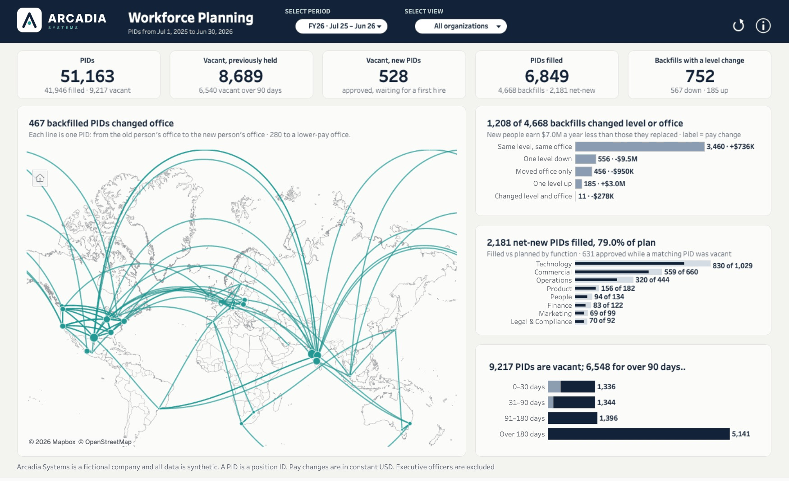
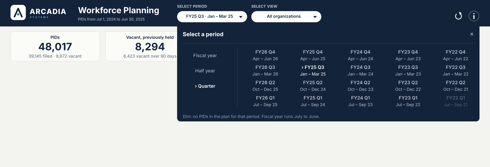
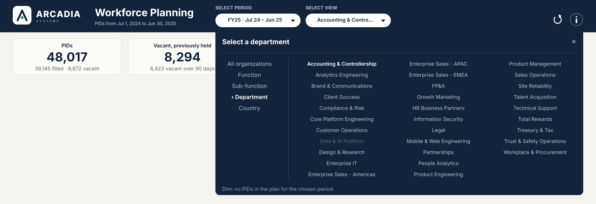
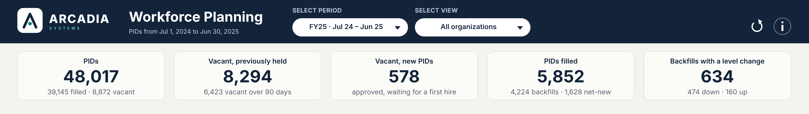
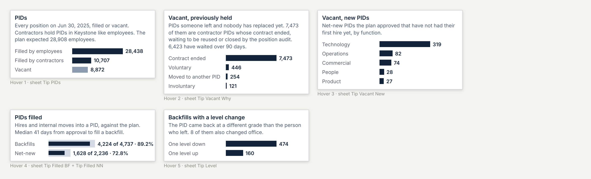

# Release 3 build plan: Dashboard #3, Workforce Planning (PIDs)

This is the complete plan for the third Arcadia dashboard, from the data to the published page. It replaces the step-by-step build in [dashboard_3_build.md](dashboard_3_build.md), which stays only as history. It reuses what already works on Dashboard #1 (Headcount & FTE Walk): the top bar, popovers, KPI hovers, info panel, grid and type rules. From Dashboard #2 (Compensation Walk) it takes the period grid, the map technique and the title rules. Arcadia Systems is fictional and all data is synthetic.

Companion guides: **G1** [Dashboard #1 rebuild](../headcount-fte-walk/release_3_rebuild_dashboard_1.md), **G2** [Dashboard #2 rebuild](../compensation-walk/release_3_rebuild_dashboard_2.md). Method and definitions: [workforce_planning.md](workforce_planning.md).

**Status: published 2026-10-23.** [Workforce Planning on Tableau Public](https://public.tableau.com/app/profile/thialp/viz/WorkforcePlanningArcadiaSystems/Dashboard) (release 3.1 data; four extracts). This plan is now the record of how it was built; the mock below is the design, the screenshot is the result.



*The published page at FY26 · All organizations. Every number ties to the check tables in section 14.*


*Design mock at FY25 · All organizations. FY26's closing date is the last day of the simulation, where no new PID is open yet; section 3.3 fixes that. Every number comes from the release 3 data. File: `docs/brand/build/d3_page_preview.html`.*


*The five KPI hovers, each a small chart inside the tooltip (Viz in Tooltip).*

| Revision | Date | What changed |
|---|---|---|
| 1 | 2026-10-23 | Top bar, popovers, version toggle |
| 2 | 2026-10-23 | No version toggle (plan = budget); the map is the main card; "vacant"; arrow-only reset |
| **3** | 2026-10-23 | **Everything counts PIDs.** KPI 1 is total PIDs, KPIs 2 and 3 split the vacant PIDs, KPI 5 is backfills with a level change, and the hovers are charts. The capsule has a drawn chevron. Routes are shown as From / To columns, not "A → B" text. Period labels name the months. A generator fix opens net-new PIDs at the end of the data |
| **3.1** | 2026-10-23 | **Contractors hold PIDs; new PIDs open at recruiting.** Data release 3.1: every contractor gets a PID in Keystone (filled contingent PIDs = contingent headcount), and the hiring pipeline runs past the extract, so Jun 30, 2026 has 528 new PIDs. KPI 1 counts both; D16 reversed; mock numbers refreshed |
| **3.2** | 2026-10-23 | **Checked against the first-build workbook, the Figma file and the data before building.** 5.1 corrected (the first build's `kpi_` values are the left-rail grid, so seven are reset to #1's; `Map Routes`, `Map Offices`, `Is Moved Seat` and the `K … Str` templates are not copied); Vacancy Pool extracted at quarter-ends; source row counts confirmed; map 350 high and type sizes from Figma; KPI 2's hover groups every contractor reason as "Contract ended"; vacant over 90 days is 6,430 (FY25), not 6,429; info text names contractors; `Info Close` built; Phase A commands in 5.2 |
| **3.3** | 2026-10-23 | **Top bar, popovers and KPI band written out in full (sections 4, 8, 9, 10, 12, 13).** Audit of the saved workbook (8.1: 14 fixes, including action 29 sourced from Info Close). One popover frame (x 506 to 1370) with header, line, body and footer; rows on fixed slots so short lists sit at the top; vertical divider images. KPI Cards, covers and the five tooltip sheets step by step with fonts, colours and expected FY25/FY26 values; `KPI 3 Tip` says so when there is no chart. Spec previews `docs/brand/build/d3_spec_*.png`. No Figma references in these sections |
| **3.4** | 2026-10-23 | **Built, checked and published.** Sections 10.5 to 11.4 written to the level of the build and corrected where the build taught something: tooltip sheets need `Row Is Current` = True, `maxheight` 200 and a context filter before a Top N; card 4 is a rate design (fixed 0 to 2 axes); the KPI band is calibrated (`kpi_FitX` 1.104, `kpi_ShiftX` 0); the map card is a title tile plus a taller map, and the busiest routes moved into the title's tooltip; the View popover browses first and applies on a click (`p_ViewTab`, 34 parameter actions + 19 deselects = 53); the four cards are floating containers with exact tile sizes; the right-top card ended with one colour; a stray colour legend must be deleted when a sheet with a colour field is dropped on the page; footnote added |

## Contents

0. Which dashboard this is, and the PID principle
1. The story
2. Decisions
3. Data
4. Shapes
5. Workbook and data sources
6. Parameters
7. Calculations
8. Top bar
9. Popovers
10. KPI band and hovers
11. The four cards
12. Dashboard layout
13. Actions
14. Check tables
15. Click tests
16. Publish
17. Who does what
18. Later: the PID forecast dashboard

---

## 0. Which dashboard this is, and the PID principle

**This is Workforce Planning:** *Are we hiring into the seats we planned, and what did each seat look like before?* It is not the Global Workforce Footprint (*Where are our people, where are we growing, and who moves between offices?*).

The two are easy to mix up because both have a map with lines between offices. The difference is what the line follows:

| | Global Workforce Footprint | Workforce Planning (this one) |
|---|---|---|
| Unit | People | **PIDs** (positions, seats) |
| A line on the map | A **person** changed office | A **PID** was refilled in another office than the person who left it |
| Answers | Where people are and where they go | Where the budgeted seats are, which are vacant, how fast and how well we fill them, and what changed in the seat when it was refilled |

**The PID ledger.** Workforce planning counts PIDs, not people ("seats vs butts"):

- **Total PIDs = filled + vacant.** Filled PIDs equal headcount (test 45: same people, every month).
- **A vacant PID is either previously held or new.** Previously held means someone left: they resigned, were let go, or moved to another PID. New means a net-new PID the plan approved that has not had its first hire yet.
- **Filling a PID.** Filling a previously held PID is a **backfill**; filling a new PID is a **net-new** fill.
- **A backfill can change the PID.** It can come back at another level or in another office.

  *Example:* a Senior Manager in Austin leaves. Their PID is refilled by a new hire in Chicago at Manager level. The PID moved from Austin to Chicago (the map) **and** went one level down (KPI 5 and the right-hand card).
- **Net-new PIDs have no "before",** so they never appear on the map.

**Contractors hold PIDs too (revision 3.1).** Bridgeway sends Keystone each contractor under a Bridgeway worker ID; Keystone converts it to an Arcadia ID and assigns a PID, like any employee. So a PID is filled by an employee, filled by a contractor, or vacant. A contingent PID is created (or a vacant one reused) when the request is approved, and stays vacant after the assignment ends until it is reused or the January / July position audit closes it. That is why most vacant PIDs are contingent ones: on Jun 30, 2025, 7,473 of the 8,294 previously held. KPIs 4 and 5, the map and the right-hand cards stay on employee fills, because those are what the plan and the pay walk cover.

---

## 1. The story

**Page question:** *How many PIDs do we have, how many are vacant, how fast and how well do we fill them, and what changes when we refill one?*

| Where | Question | FY25 · All organizations (the mock) |
|---|---|---|
| Header | Which dates? | **Workforce Planning** · "PIDs from Jul 1, 2024 to Jun 30, 2025" |
| KPI 1 | How many PIDs do we have? | **48,017** PIDs · 39,145 filled · 8,872 vacant. Hover: filled by employees 28,438 / filled by contractors 10,707 / vacant 8,872, and the plan |
| KPI 2 | How many vacant PIDs did someone leave? | **8,294** Vacant, previously held · 6,423 vacant over 90 days. Hover: why they became vacant (contract ended 7,473, voluntary 446, moved to another PID 254, involuntary 121) |
| KPI 3 | How many new PIDs wait for a first hire? | **578** Vacant, new PIDs (249 employee, 329 contingent) · approved, waiting for a first hire. Hover: by function |
| KPI 4 | How many PIDs did we fill, against the plan? | **5,852** PIDs filled · 4,224 backfills · 1,628 net-new. Hover: bar inside a bar, backfills 4,224 of 4,737 (89.2%) and net-new 1,628 of 2,236 (72.8%); median 41 days to fill a backfill |
| KPI 5 | Did refilled PIDs come back at another level? | **634** Backfills with a level change · 474 down · 160 up. Hover: down / up bars; 8 also changed office |
| **Main card** (left, full height) | Where did backfilled PIDs move? | "396 backfilled PIDs changed office". The map, then the five busiest routes as a **From / To** table |
| Right, top | What changed in each refilled PID? | "1,022 of 4,224 backfills changed level or office" · same 3,202 · one level down 466 · one level up 160 · moved office only 388 · changed level and office 8. New people earn $8.2M a year less than those they replaced |
| Right, middle | Where did growth PIDs go? | "1,628 net-new PIDs filled, 72.8% of plan". Bar inside a bar by function; 466 approved while a matching PID was vacant |
| Right, bottom | How long have vacant PIDs waited? | "8,872 PIDs are vacant; 6,430 for over 90 days" (6,423 previously held + 7 new, from `is_stale`). By time vacant, previously held vs new |

**How the numbers tie together on the page.** KPI 2 + KPI 3 = the vacant part of KPI 1 = the vacant card's total. KPI 4's backfills = the right-top card's total. KPI 5 = one level down + one level up + changed level and office (466 + 160 + 8 = 634). The map's 396 = moved office only + changed level and office (388 + 8). Every pair is the same population, by construction.

**The plan** is the budget, approved before each fiscal year. It appears only in KPI 1's hover, KPI 4's hover and the net-new card, as "of plan".

---

## 2. Decisions

| # | Decision | Why |
|---|---|---|
| D1 | Executive officers excluded (`D-901`) | The same people on every Arcadia dashboard |
| D2 | Periods are quarter-end pairs inside one fiscal year: Fiscal year (5), Half year (10), Quarter (20) | The plan is quarterly, per fiscal year |
| D3 | No version toggle; plan = Budget (data source filter) | Reads from a screenshot |
| D4 | No click leads to an empty page: a period or group with no plan is dim and does nothing | Groups not yet open: Philippines FY22; Portugal, South Korea FY22–23; Data & AI Platform FY22–24 |
| D5 | A View pick lands on the first group alphabetically | Same as #1 and #2; checked always planned |
| D6 | **PID** is the unit everywhere ("PIDs", "backfilled PIDs", "new PIDs"); "vacant", never "frozen" or "open" | Your rule |
| D7 | **KPI order: PIDs · Vacant, previously held · Vacant, new · PIDs filled · Backfills with a level change** | Stock first (what we have, what is vacant), then flow (what we filled and what changed) |
| D8 | **The hovers are charts** (Viz in Tooltip), one small sheet per KPI | The cards stay clean, and the breakdown is one hover away |
| D9 | Right-top card categories are **exclusive**: same; one level down; one level up; moved office only; changed level and office | So KPI 5 and the map are sums of its bars and never disagree |
| D10 | **Chevron drawn in the capsule image** (`d3_field_capsule`, 200 × 36); the label carries no ▾ | The ▾ character was too small to read |
| D11 | **No arrow glyph in text.** Routes are two columns (FROM, TO); periods are named by months ("FY26 Q3 · Jan – Mar 26"); tooltips say "from Austin HQ to Chicago" | "→" at 9 pt is unreadable |
| D12 | Reset is the arrow icon, 32 × 32, next to ⓘ | Your choice: different from #1 and cleaner |
| D13 | Colour: navy for the measure the title is about, slate `#8C9BB0` as comparator, `#D5DBE4` for plan, teal only on the main card | Quiet page, one accent |
| D14 | Titles are FIXED calcs in sheet titles | No `*`, no extra sheets |
| D15 | A new workbook; the first one is archived | Clean actions |
| D17 | KPI 2 counts every vacant previously held PID, contractors included; its hover says how many are contractor PIDs (7,473 of 8,294 at FY25, 7,712 of 8,689 at FY26) | Keep the number true and explain it, rather than tune the data to look smaller |
| D16 | ~~Contingent workers hold no PID~~ **Reversed in 3.1:** contractors hold PIDs in Keystone | Keystone converts every contractor to an Arcadia ID and a PID; the data now does the same (test 81) |

---

## 3. Data

### 3.1 Sources

| Data source | File (`tableau/`) | Rows (extract) | Data source filter | Feeds |
|---|---|---:|---|---|
| **WFP Summary** | `custom_sql_wfp_summary.sql` (**edited**) | 2,520 | `version_type` = Budget | KPI band, hovers 1 and 4, header, pickers, Reset |
| **Plan vs Actual** | `custom_sql_plan_vs_actual.sql` | 11,740 | `version_type` = Budget | Net-new card |
| **Position Fill** | `custom_sql_position_fill.sql` | 30,575 | none | Main card, right-top card, hover 5 |
| **Vacancy Pool** | `custom_sql_vacancy_pool.sql` | 149,615 (quarter-ends) | none; **extract filter** `month_end_date` Months = March, June, September, December (the view keeps every month-end, about 439,000 rows; the page reads quarter-ends only) | Vacant card, hovers 2 and 3 |

`custom_sql_seat_corridors.sql` (the Seat Corridors source of the first build) is **not used** by Dashboard #3: the map reads Position Fill, one line per backfilled PID.

### 3.2 WFP Summary: new columns (still one row per fiscal year × period × version × view × group)

| Column | Example (FY25 · All) | Used by |
|---|---|---|
| `span_name`, `span_order` | `Quarter`, 3 | Period popover |
| `period_short` | `FY25`, `FY26 Q3` | Grid line 1, capsule |
| `period_months` | `Jul 24 – Jun 25`, `Jan – Mar 26` | Grid line 2, capsule |
| `pids_total` | 48,017 | KPI 1 |
| `pids_filled_employee` | 28,438 (= `actual_ending_headcount`) | KPI 1, hover 1 |
| `pids_filled_contingent` | 10,707 (= `actual_cw_headcount`) | KPI 1, hover 1 |
| `vacant_previously_held`, `vacant_new` | 8,294, 578 (`…_contingent`: 7,473, 329) | KPIs 2 and 3, hover 1 |
| `vacant_previously_held_stale`, `vacant_new_stale` | 6,423, 7 (over 90 days) | KPI 2, vacant card |
| `level_down`, `level_up`, `level_and_office` | 474, 160, 8 | KPI 5, hover 5 |
| `moved_office` | 396 | Main card check |
| `is_view_default` | **changed**: first group alphabetically | View list |

The vacant columns read `rpt.vw_vacancy_pool` on `to_date` (`vacated_by` = 'Never filled' is a new PID). The level and office columns count backfills in the period from `rpt.vw_position_fill`. All of them are the same in every version row.

### 3.3 Data release 3.1: contingent PIDs and new PIDs at the extract (done)

- **New PIDs at the extract.** Net-new hires for the six months after Jun 30, 2026 are drawn at FY26's pace, on their own random stream; their PIDs and requisitions are created on the approval date, and those approved by Jun 30 stay Open with applicants. Jun 30, 2026: 291 new employee PIDs.
- **Contingent PIDs** (`generator/cw_positions.py`): created or reused on the service order's approval date, Filled while Bridgeway holds the assignment, vacant until reused (45% when a match waits) or closed by the audit (30% of those vacant 180+ days). Jun 30, 2026: 237 new contingent PIDs.
- Nothing that existed moved: every pre-existing raw row is identical; Dashboards #1 and #2 are unchanged.
- New marts `mart_pid_month_end` (the ledger) and `mart_cw_pid_fill`; tests 80 (extended) and 81.

**Jun 30, 2026:** 51,163 PIDs = 30,005 filled by employees + 11,941 by contractors + 8,689 vacant previously held (977 employee, 7,712 contingent) + 528 vacant new (291 + 237).

### 3.4 How it is checked (Claude, before you open Tableau)

| Check | Pass when |
|---|---|
| Generator | Every pre-existing row unchanged; added PIDs Open on Jun 30, 2026, approved before it |
| `python pipeline/run_pipeline.py` | All tests pass; test 80 extended: `pids_total` = filled + vacant; vacant = vacancy pool on `to_date`; level and office counts = position fill; defaults alphabetical and planned |
| `python sqlserver/check_tsql_in_duckdb.py` | T-SQL summary = DuckDB mart, row for row |
| `14_validate_workforce_planning_dashboard.sql` (your Mac) | Every line PASS |

### 3.5 On the Mac (after Claude pushes)

**Done on 2026-10-23.** Release 3.1 is merged into `main` (PR #53); the Mac is on `main`, SQL Server was rebuilt with `build_all.sql` and every line of 08, 12 and 14 passed (51,163 PIDs). The Custom SQL files and the D3 shapes are copied. For a later rebuild, use the [run guide](sql_server_release_3_1_run.md), then:

```bash
export MSSQL_SA_PASSWORD="$(docker exec arcadia-sql printenv MSSQL_SA_PASSWORD)"
docker exec -it arcadia-sql /opt/mssql-tools18/bin/sqlcmd -S localhost -U sa -P "$MSSQL_SA_PASSWORD" -C -i /repo/sqlserver/14_validate_workforce_planning_dashboard.sql | grep -E "FAIL|Msg|returned"
D="$HOME/Documents/Tableau/Tableau Public/ArcadiaHR/Custom SQL - Release 3/03 Workforce Planning"
cp tableau/custom_sql_wfp_summary.sql tableau/custom_sql_plan_vs_actual.sql tableau/custom_sql_position_fill.sql tableau/custom_sql_vacancy_pool.sql "$D/"
```

Expected: the three `returned` lines and no `FAIL` or `Msg`.

---

## 4. Shapes

Palette **Arcadia D3** (`docs/brand/shapes/by_dashboard/d3/`):

| File | Size | Sheet |
|---|---|---|
| `d3_field_capsule` | 200 × 36 | Period Field, Group Field: white capsule with a **navy chevron drawn in**, 18 px from the right |
| `d3_reset` | 32 × 32 | Reset (arrow icon) |

From **Arcadia Shared**: `shared_info_open`, `shared_info_close`, `shared_close_light`.

**Images** (dashboard Image objects, not shapes; all in `Images and Buttons` on your Mac and in `docs/brand/` in the repo):

| File | Pixels | Item size | Where |
|---|---|---|---|
| `arcadia_logo_horizontal_reverse.png` | 1200 × 326 | 177 × 48 | Logo, x 30, y 14 |
| `arcadia_kpi_cards_bg_wide.png` | 2800 × 220 | 1400 × 110 | KPI band, x 0, y 78 (section 10.1) |
| `d3_popover_line_wide.png` | 1728 × 18 | 864 × 9 | Line under the Period and View popover headers |
| `d3_popover_line_info.png` | 820 × 18 | 410 × 9 | Line under the Info popover header |
| `d3_popover_divider_period.png` | 48 × 384 | 24 × 192 | Between Span List and Period Panel |
| `d3_popover_divider_group.png` | 48 × 604 | 24 × 302 | Between View List and Group Panel |

The four popover lines are transparent with a 1 px line, white at 14% (the rail divider's style); drawn at 2x so **Fit Image** keeps them crisp. They are made by `docs/brand/build/make_d3_popover_lines.py`. Each image has the exact proportions of its item, so Fit Image fills it with no gap.


```bash
cd ~/GitHub/people-analytics-warehouse/docs/brand/shapes/by_dashboard
mkdir -p ~/Documents/My\ Tableau\ Repository/Shapes/Arcadia\ D3
cp d3/*.png ~/Documents/My\ Tableau\ Repository/Shapes/Arcadia\ D3/
ls ~/Documents/My\ Tableau\ Repository/Shapes/Arcadia\ D3
```

Expected: `d3_field_capsule.png  d3_reset.png`. In Tableau: Shape > More Shapes > **Reload Shapes**.

---

## 5. Workbook and data sources

1. Close Tableau. Move `Arcadia Workforce Planning.twb` to `_archive/2026-10-23/Arcadia Workforce Planning - first build.twb`.
2. **File > New**; save as `Arcadia Workforce Planning.twb` in the same folder.
3. Connect to SQL Server (`localhost, 1433`, `ArcadiaHR`, `sa`, Require SSL off). Add four Custom SQL sources named **WFP Summary**, **Plan vs Actual**, **Position Fill** and **Vacancy Pool**.
4. Data source filters: `version_type` = Budget on WFP Summary and Plan vs Actual.
5. Extract all four. On Vacancy Pool, Extract > Edit > Add > `month_end_date` > **Months** > March, June, September, December.

**Checkpoint 1** (sheet `CHK Rows`, each source's *Custom SQL Query (Count)*): WFP Summary **2,520**; Plan vs Actual **11,740**; Position Fill **30,575**; Vacancy Pool **149,615**. Parameters pane: exactly **19** at that point (16 `kpi_` + `p_Period`, `p_View`, `p_Group`); `p_ViewTab` is added later (section 6), so the final count is 20 plus the `p_` ones you add, none named "(copy)"; no pasted calc shows a red "!".

**Types.** Convert to Dimension: WFP Summary `fiscal_year`, `pair_order`, `view_order`, `span_order`; Plan vs Actual `fiscal_year`, `fiscal_quarter`; Position Fill and Vacancy Pool `fiscal_year`. Geographic role **None** on Position Fill `latitude`, `longitude`, `prior_latitude`, `prior_longitude`. Number format `#,##0` on counts.

**Paste what is proven** from the archived first build (the list is in 5.1; Data pane > select > Copy, then right-click the target source > Paste). Paste in this order so each parameter arrives once, with the calc that uses it: WFP Summary first (brings the 16 `kpi_` parameters), then Position Fill (brings `p_Period`, `p_View`, `p_Group`), then Plan vs Actual and Vacancy Pool (they reuse those parameters). Create `p_FY`, `p_Span` and the three open flags afterwards (section 6). The first build's `KPI 1–5 Title / Value / Note` calcs can arrive with the paste, carrying old definitions that point at fields this workbook does not have (they show red). Delete them: section 10.1 recreates them. The KPI background image is `docs/brand/arcadia_kpi_cards_bg_wide.png` (2800 × 220, 30 px margin); `arcadia_kpi_cards_bg.png` is the old 244-px grid.

### 5.1 What to take from the first build (inventoried 2026-10-23)

The first build (`Arcadia Workforce Planning.twb`, left rail, Version list, seat wording) has 6 data sources (WFP Summary 147 calcs, Position Fill 22, Plan vs Actual 14, Vacancy Pool 9, Seat Corridors 0, plus 23 parameters), 28 sheets and about 215 calcs. Its **design** is replaced, so nothing is reused as a sheet or a dashboard. Its **formulas** are proven, so copy these from the archived workbook (Data pane > select the fields > Copy; in the new workbook right-click the source > Paste), then rename to this plan's names:

| Take | From source | Fields | Change after pasting |
|---|---|---|---|
| Yes | Parameters + WFP Summary | `kpi_Scale`, `kpi_SheetW` … `kpi_SubDY` (16 parameters) and every `kpi_` calc (`kpi_lat …`, `kpi_lon C1–C5`, `kpi_pt Title/Value/Note 1–5`, `kpi_Corner TL/BR`, `kpi_Check`) | **Reset seven values** (the first build used the left-rail grid: GridLeft 246, CardW 212, GapX 14, PadX 16): `kpi_GridLeft` 30, `kpi_GridTop` 12, `kpi_CardW` 255, `kpi_GapX` 16, `kpi_PadX` 127.5, `kpi_FitX` 1.104, `kpi_ShiftX` 0 (final calibration, section 10.2). Keep SheetW 1400, SheetH 110, CardH 86, FitY 1.1, ShiftY 0, TitleDY 17, ValueDY 44, SubDY 71 (they match Figma) |
| Yes | WFP Summary | `zzTrue`, `zzFalse`, `Close Panel`, `Pick Rows`, `Pick Col`, `Pick Row` | Nothing |
| No | WFP Summary | `K Close HC Str`, `K NN Pct Str`, `K Cost Str` | `K Cost Str` needs `K Cost T` and would paste red; the comma and percent patterns are typed fresh in 7.2 |
| Yes | Plan vs Actual, Position Fill | `Period First Q`, `Period Last Q`, `In Group` | Nothing (they read `p_Period`, `p_View`, `p_Group` only) |
| Yes | Vacancy Pool | `Period Last Q`, `In Group` (the first build had no `Period First Q` here; `Period To Date` needs only the last quarter) | Nothing |
| Yes | Position Fill | `Seat Line`, `Arrival Point` | Rename to `Route Line` and `New Office Point` (11.1; same formulas) |
| No | Position Fill | `Is Moved Seat`, `Map Routes`, `Map Offices`, `Map In Scope`, `Fill In Pick` | `Moved` and `PID Moved` replace `Is Moved Seat`; the others depend on `Corridor` and `Version First Q` and would paste broken |
| No | WFP Summary | `Version Display/State/Pick`, `version_type filter`, `Default Version`, `Pick Context Version` | The version toggle is gone (D3) |
| No | WFP Summary | `KPI 1–5 Title/Value/Note`, `K CW …`, `K Cost …`, `K Reuse …`, `Page Subtitle`, `Fills Title`, `K Internal …` | The KPIs and cards are new (D7, section 11) |
| No | WFP Summary | `Cell Label`, `Period Field Text`, `Group Label` | They print "→" and "▾" (D10, D11) |
| No | Vacancy Pool | `Pool Title`, `Pool Seats …` | Open / Frozen becomes previously held / new |
| No | Position Fill | `Version First Q`, `Corridor` (built with " to ") | No version; routes are two columns (D11) |
| No | Seat Corridors (source) | the whole source | The map reads Position Fill |

The Custom SQL of every source is **pasted fresh** from `tableau/` on `main` (the WFP Summary and Vacancy Pool files changed in 3.1), and every extract is rebuilt. Never use `pair_name` from WFP Summary: it still prints "→"; the capsule reads `period_short` + " · " + `period_months`.

### 5.2 Phase A on the Mac (before opening Tableau)

```bash
cd ~/GitHub/people-analytics-warehouse
git checkout main && git pull && git log --oneline -1
```
Expected: `Already up to date.` or a fast-forward, then the latest squash commit on `main`.

```bash
D="$HOME/Documents/Tableau/Tableau Public/ArcadiaHR/Custom SQL - Release 3/03 Workforce Planning"
for f in wfp_summary plan_vs_actual position_fill vacancy_pool; do cmp -s "tableau/custom_sql_$f.sql" "$D/custom_sql_$f.sql" && echo "same  $f" || echo "DIFF  $f"; done
```
Expected: four `same` lines (re-run the `cp` in 3.5 on any `DIFF`).

```bash
docker start arcadia-sql
export MSSQL_SA_PASSWORD="$(docker exec arcadia-sql printenv MSSQL_SA_PASSWORD)"
docker exec arcadia-sql /opt/mssql-tools18/bin/sqlcmd -S localhost -U sa -P "$MSSQL_SA_PASSWORD" -C -d ArcadiaHR -h -1 -W -Q "SET NOCOUNT ON; SELECT 'position_fill', COUNT(*) FROM rpt.vw_position_fill WHERE department_id <> 'D-901'; SELECT 'vacancy_qe', COUNT(*) FROM rpt.vw_vacancy_pool WHERE MONTH(month_end_date) IN (3,6,9,12); SELECT 'plan_budget', COUNT(*) FROM rpt.vw_plan_vs_actual WHERE version_type = 'Budget' AND department_id <> 'D-901';"
```
Expected: `arcadia-sql`, `position_fill 30575`, `vacancy_qe 149615`, `plan_budget 11740`: the totals checkpoint 1 must reproduce.

```bash
find "$HOME/Documents/Tableau" -name "Arcadia Workforce Planning*.twb" 2>/dev/null
W="$HOME/Documents/Tableau/Tableau Public/ArcadiaHR"     # the folder find printed
mkdir -p "$W/_archive/2026-10-23"
mv "$W/Arcadia Workforce Planning.twb" "$W/_archive/2026-10-23/Arcadia Workforce Planning - first build.twb"
ls "$W/_archive/2026-10-23"
```
Expected: `Arcadia Workforce Planning - first build.twb`.

---

## 6. Parameters

| Name | Type | Allowable values | Current |
|---|---|---|---|
| `p_FY` | Integer | List 2022–2026 (FY22 … FY26) | 2026 |
| `p_Period` | String | List FY, H1, H2, Q1, Q2, Q3, Q4 | FY |
| `p_Span` | String | List `Fiscal year`, `Half year`, `Quarter` | Fiscal year |
| `p_View` | String | List Company, Function, Sub-function, Department, Country | Company |
| `p_ViewTab` | String | the same five values as `p_View` | Company (the tab the View popover is browsing, like `p_Span` for the Period popover; added 2026-10-23, 19:30) |
| `p_Group` | String | **All** | Arcadia Systems |
| `p_PeriodOpen`, `p_GroupOpen`, `p_InfoOpen` | Boolean | | False |

---

## 7. Calculations

### 7.1 WFP Summary: context and pickers

```
// Row Is Current       [fiscal_year] = [p_FY] AND [pair_code] = [p_Period] AND [view_name] = [p_View] AND [group_name] = [p_Group]
// Period Grid Rows     [view_name] = [p_View] AND [group_name] = [p_Group] AND [span_name] = [p_Span]
// Span Rows            [fiscal_year] = [p_FY] AND [view_name] = [p_View] AND [group_name] = [p_Group]
// View Rows            [fiscal_year] = [p_FY] AND [pair_code] = [p_Period] AND [is_view_default]
// Group Grid Rows      [fiscal_year] = [p_FY] AND [pair_code] = [p_Period] AND [view_name] = [p_ViewTab] AND [view_name] <> "Company"
// Why Off              IF [has_plan] THEN "" ELSE [group_name] + " had no PIDs in the plan for " + [period_short] + " (" + [period_months] + ")." END

// FY Pick              IF [has_plan] THEN [fiscal_year] ELSE [p_FY] END          (dimension)
// Period Pick          IF [has_plan] THEN [pair_code] ELSE [p_Period] END
// Period Keep Open     NOT [has_plan]
// Cell Is Current      [fiscal_year] = [p_FY] AND [pair_code] = [p_Period]
// Cell State           IF [Cell Is Current] THEN "current" ELSEIF [has_plan] THEN "on" ELSE "off" END
// Cell Title           IF [Cell Is Current] THEN "› " + [period_short] ELSE [period_short] END
// Span Display         IF [span_name] = [p_Span] THEN "› " + [span_name] ELSE [span_name] END
// Period Field Text    [period_short] + " · " + [period_months]
// View Label           IF [view_name] = "Company" THEN "All organizations" ELSE [view_name] END
// View Display         IF [view_name] = [p_ViewTab] THEN "› " + [View Label] ELSE [View Label] END
// Keep Group Panel Open   [view_name] <> "Company"
// Group Pick           IF [has_plan] THEN [group_name] ELSE [p_Group] END
// Group Keep Open      NOT [has_plan]
// Group State          IF [group_name] = [p_Group] AND [view_name] = [p_View] THEN "current" ELSEIF [has_plan] THEN "on" ELSE "off" END
// View Pick            IF [has_plan] THEN [view_name] ELSE [p_View] END                  (applied together with Group Pick)
// View Apply           IF [view_name] = "Company" THEN "Company" ELSE [p_View] END      (a click on All organizations applies at once; any other view only browses)
// Group Apply From View   IF [view_name] = "Company" THEN [group_name] ELSE [p_Group] END
// Panel Title          "Select " + CASE [p_ViewTab] WHEN "Function" THEN "a function" WHEN "Sub-function" THEN "a sub-function"
//                      WHEN "Department" THEN "a department" WHEN "Country" THEN "a country" ELSE "a view" END
// Group Field Text     IF [p_View] = "Company" THEN "All organizations"
//                      ELSEIF LEN([p_Group]) > 18 THEN LEFT([p_Group], 17) + "…" ELSE [p_Group] END
// Toggle Period Panel  NOT [p_PeriodOpen]
// Toggle Group Panel   NOT [p_GroupOpen]
// Toggle Info          NOT [p_InfoOpen]
// Info Shape           IF [p_InfoOpen] THEN "shared_info_close" ELSE "shared_info_open" END
// Default FY 2026 · Default Period "FY" · Default Span "Fiscal year" · Default View "Company" · Default Group "Arcadia Systems"  (Default View also resets p_ViewTab)
```

The capsule labels stay at 22 characters or fewer ("FY26 Q3 · Jan – Mar 26", "All organizations"); `Group Field Text` cuts a long name at 17 letters plus "…" ("Brand & Communic…"). The chevron takes the right 36 px, so the readable text area is about 150 px. Check with the widest names ("Enterprise Sales - Americas", "Mobile & Web Engineering"): the last letter must end at least 10 px before the chevron.

Header:

```
// Day Text (x)     LEFT(DATENAME('month', x), 3) + " " + STR(DAY(x)) + ", " + STR(YEAR(x))   (write it for DATEADD('day', 1, [from_date]) and for [to_date])
// Page Subtitle    "PIDs from " + <Day Text of from_date + 1> + " to " + <Day Text of to_date>
// Title Tip
"Showing: " + (IF [p_View] = "Company" THEN "all of Arcadia" ELSE [view_name] + " · " + [group_name] END) + CHAR(10) +
"A PID is a budgeted position, filled or vacant. A backfill refills a PID someone left; a net-new fill is a new PID's first hire." + CHAR(10) +
"The map follows PIDs, not people: the office of the person who left, and of the person who replaced them." + CHAR(10) +
"Plan = the budget approved before " + [fiscal_year_label] + ". Executive officers excluded."
```

### 7.2 WFP Summary: KPI numbers

```
// K PIDs        SUM([pids_total])
// K Filled      SUM([pids_filled_employee]) + SUM([pids_filled_contingent])
// K Plan Filled SUM([planned_ending_headcount])
// K Vac Prev    SUM([vacant_previously_held])
// K Vac New     SUM([vacant_new])
// K Vacant      [K Vac Prev] + [K Vac New]
// K Prev Stale  SUM([vacant_previously_held_stale])
// K Prev CW     SUM([vacant_previously_held_contingent])     (decision D17: KPI 2 keeps every PID; the hover names the contractor share)
// K BF          SUM([actual_backfills])         K BF Plan   SUM([planned_backfills])
// K NN          SUM([actual_net_new])           K NN Plan   SUM([planned_net_new])
// K Fills       [K BF] + [K NN]
// K Days        SUM([median_time_to_fill_days])
// K Down        SUM([level_down])               K Up   SUM([level_up])     K Both   SUM([level_and_office])
// K Level       [K Down] + [K Up]
```

Text twins, typed fresh. **Comma pattern** (`K PIDs Str`, `K Filled Str`, `K Plan Filled Str`, `K Vac Prev Str`, `K Vac New Str`, `K Vacant Str`, `K Prev Stale Str`, `K Prev CW Str`, `K BF Str`, `K BF Plan Str`, `K NN Str`, `K NN Plan Str`, `K Fills Str`, `K Days Str`, `K Down Str`, `K Up Str`, `K Both Str`, `K Level Str`), shown for `K PIDs Str`:

```
IF [K PIDs] >= 1000
THEN STR(DIV(INT([K PIDs]), 1000)) + "," + RIGHT("00" + STR(INT([K PIDs]) % 1000), 3)
ELSE STR(INT([K PIDs])) END
```

**Percent pattern** for the two ratios (`K BF Pct Str`, `K NN Pct Str`). Never use the comma pattern on a ratio: 0.892 becomes "0".

```
// K BF Pct Str   (K NN Pct Str: replace K BF with K NN and K BF Plan with K NN Plan)
IF ZN([K BF Plan]) = 0 THEN "—" ELSE
STR(DIV(INT(ROUND([K BF] / [K BF Plan] * 1000, 0)), 10)) + "." + STR(INT(ROUND([K BF] / [K BF Plan] * 1000, 0)) % 10) + "%" END
```

Checks: FY25 `K BF Pct Str` **89.2%**, `K NN Pct Str` **72.8%**; FY26 **92.8%** and **79.0%**.

`K Level` counts every backfill whose grade changed: `level_down` and `level_up` already include the PIDs that also moved office. `K Both` is that overlap.

### 7.3 Period window and group (on Plan vs Actual, Position Fill, Vacancy Pool)

```
// Period First Q   CASE [p_Period] WHEN "FY" THEN 1 WHEN "H1" THEN 1 WHEN "H2" THEN 3 WHEN "Q1" THEN 1 WHEN "Q2" THEN 2 WHEN "Q3" THEN 3 ELSE 4 END
// Period Last Q    CASE [p_Period] WHEN "FY" THEN 4 WHEN "H1" THEN 2 WHEN "H2" THEN 4 WHEN "Q1" THEN 1 WHEN "Q2" THEN 2 WHEN "Q3" THEN 3 ELSE 4 END
// Period To Date   DATEADD('day', -1, DATEADD('month', 3 * [Period Last Q], MAKEDATE([p_FY] - 1, 7, 1)))
// In Group         CASE [p_View] WHEN "Company" THEN TRUE WHEN "Function" THEN [function_name] = [p_Group]
//                  WHEN "Sub-function" THEN [sub_function] = [p_Group] WHEN "Department" THEN [department_name] = [p_Group]
//                  WHEN "Country" THEN [country_name] = [p_Group] END
```

The group is the PID's department and country **now** (where the new person sits).

**Checkpoint 2** (`CHK` sheet, filter `Row Is Current`), at FY25 (`p_FY` = 2025): `K PIDs` 48,017 · `K Filled` 39,145 · `K Vac Prev` 8,294 · `K Vac New` 578 · `K Prev Stale` 6,423 · `K BF` 4,224 · `K NN` 2,236 planned / 1,628 filled · `K Down` 474 · `K Up` 160 · `K Both` 8. **Passed 2026-10-23**: checkpoints 1 and 2 match, at FY25 and FY26.

---

## 8. Top bar

Everything you need for the top bar, the popovers and the KPI band is in sections 8 to 10. Each colour, font and size is written out where it is used, even when it repeats.

### 8.0 Palette and type (reference)

| Use | Colour | Font (Tableau Public embeds only Tableau fonts) |
|---|---|---|
| Page background (Dashboard > Format > Dashboard Shading) | `#F3F3EF` | |
| Header band, popover background | navy `#13233A` | |
| Page title | white `#FFFFFF` | Tableau Bold 18 |
| Page subtitle | `#C9D1DC` | Tableau Book 8 |
| `SELECT PERIOD`, `SELECT VIEW` labels | `#B8C4D6` | Tableau Bold 8 |
| Capsule label (Period Field, Group Field) | navy `#13233A` | Tableau Semibold 9 |
| Popover title, close icon | white `#FFFFFF` | Tableau Bold 12 |
| Popover list item and grid cell, clickable | `#B8C0CC` | Tableau Book 10 (list), Semibold 10 + Book 9 (period cell), Book 9 (group cell) |
| Popover current item (prefixed "› ") | white `#FFFFFF` | Semibold, same size |
| Popover dim item (no plan) | `#56657E` | same size |
| Popover footer note | `#8FA0B8` | Tableau Book 9 |
| Popover lines (header line, list/grid divider) | white at 14% (shows as about `#344256` on navy) | images, section 4 |
| Info body / lead-ins | `#B8C0CC` / white `#FFFFFF` | Tableau Book 10 / Tableau Semibold 10 |
| KPI card fill and border | `#FBFBF8`, border `#E4E3DD`, radius 10 | background image |
| KPI title | navy `#13233A` | Tableau Semibold 9 |
| KPI value | navy `#13233A` | Tableau Bold 22 |
| KPI note | slate `#5A6170` | Tableau Book 9 |
| Tooltip title / tooltip text | navy `#13233A` / `#4A5A73` | Tableau Semibold 10 / Tableau Book 9 |
| Tooltip chart: bar / comparator / plan / labels | navy `#13233A` / `#8C9BB0` / `#D5DBE4` / row names `#5A6170`, values `#13233A` | Book 9 / Semibold 9 |

Sizes in this plan are dashboard pixels at 1400 × 850. Enter them in the Layout pane (Position x, y; Size w, h).

### 8.1 Fixes from the audit of the saved workbook (2026-10-23, 13:32; rows 15 and 16 added at 16:02)

Do these before Phase D. They come from reading your `.twb` and the six screenshots.

| # | Where | What is wrong | Fix |
|---:|---|---|---|
| 1 | Action `group closes` | Its source is **Info Close**, so opening ⓘ while the View popover is open leaves both open, and closing ⓘ shuts the View popover | Dashboard > Actions > `group closes` > Edit: Source sheet **Info Button** (untick Info Close). Rename it `Info opens, group closes` |
| 2 | Action names | Lower-case or unclear names (`group closes`, `info closes` twice, `Group opens, period`), and `Close period on ✕` starts with a tab character | Rename to the names in section 13 (e.g. `Period opens, info closes`, `Group opens, info closes`, `Group opens, period closes`). Retype `Close period on ✕` without the leading tab |
| 3 | Header band and the three popover containers | Background `#13243A` (one digit off) | `#13233A` on all four |
| 4 | Dashboard | Page background is white | Format > Dashboard > Dashboard Shading `#F3F3EF` |
| 5 | Logo | 177 × 44 (Fit Image shrinks it to 162 wide) | 177 × 48 at x 30, y 14 |
| 6 | `SELECT PERIOD`, `SELECT VIEW` | Colour `#B9C4D6` | `#B8C4D6`, Tableau Bold 8 |
| 7 | Tooltips on `Span List`, `View List`, `Group Heading` | They show the ⓘ text ("Click here for more information …"), copied from Info Button | On each sheet: Worksheet > Tooltip, untick **Show tooltips** |
| 8 | `Page Title` tooltip | The last line has typed quotation marks | Line 3 reads `Click ⓘ for the full definitions.` with no quotes |
| 9 | Info body | Lead-ins (Period., PIDs., …) are `#B8C0CD` | Lead-ins white `#FFFFFF`, Tableau Semibold 10; body `#B8C0CC`, Tableau Book 10 |
| 10 | Popovers | Period row floats in the middle of the grid at Fiscal year; list items sit 75 px apart; no padding; no divider; Period and View popovers have different left edges and widths | Rebuild to section 9 (one frame for both, fixed row slots, lines) |
| 11 | KPI background image | `Images and Buttons/arcadia_kpi_cards_bg.png` is the **old** grid (cards at x 56, 244 wide) | Use `arcadia_kpi_cards_bg_wide.png` (cards at x 30, 255 wide, 16 apart). It is now in `Images and Buttons` |
| 12 | Sheets `KPI Hover 1`–`5` | They hold chart drafts (Measure Names bars, Vacated Why), which are the **tooltip charts**, not the hover covers | Rename them: `KPI Hover 1` > `Tip PIDs`, `KPI Hover 2` > `Tip Vacant Why`, `KPI Hover 3` > `Tip Vacant New`, `KPI Hover 4` > `Tip Filled BF`, `KPI Hover 5` > `Tip Level`. Then build the five transparent `KPI Hover N` sheets fresh (10.4) |
| 13 | `Hover Cell` | The calc does not exist yet | Create it in WFP Summary (10.4) |
| 14 | `CHK` at Department | Values show "964.0" | Number format only; CHK never goes on the published dashboard. Ignore |
| 15 | Item hierarchy order | With `KPI Cards` and the KPI background image added, the three popovers sit below them in the list, so an open popover hides behind the cards | Layout pane > Item hierarchy: the **top of the list is the front**. Drag `Period Popover`, `Group Popover`, `Info Popover` to the very top (above `KPI Cards`); the `KPI Hover` covers go between `KPI Cards` and the popovers. Open each popover to check it covers the cards |
| 16 | `kpi_Check` layer | Draws only a square at the midpoint (x 572, y 133) with Line and with Automatic; no line | Remove the layer (Marks card > Remove Marks Layer); text positions are verified on the dashboard (within about 2 px after the `kpi_FitX` 1.104 calibration) |

What passed: all 24 parameters (values per section 6 and 10.2); the 30 parameter actions other than #1; 13 deselect actions; every calc in sections 7 and 10.3; `Group Panel` shelves (`Pick Col` on Columns, `Pick Row` on Rows) and every nested table calc on Specific Dimensions; `Period Panel` sorted `fiscal_year` and `pair_order` descending; CHK at FY25 and FY26 equal to checkpoint 2.

### 8.2 Objects

| Object | Type | x | y | w | h | Build |
|---|---|---:|---:|---:|---:|---|
| Header band | Blank | 0 | 0 | 1400 | 76 | Background navy `#13233A`, border None |
| Logo | Image `arcadia_logo_horizontal_reverse.png` | 30 | 14 | 177 | 48 | Fit Image, no border |
| `Page Title` | Sheet | 223 | 9 | 275 | 58 | See below |
| `SELECT PERIOD` | Text | 506 | 12 | 200 | 14 | Tableau Bold 8 `#B8C4D6`, inner padding 0 |
| `Period Field` | Sheet | 506 | 28 | 200 | 36 | See below |
| `SELECT VIEW` | Text | 718 | 12 | 200 | 14 | Tableau Bold 8 `#B8C4D6`, inner padding 0 |
| `Group Field` | Sheet | 718 | 28 | 200 | 36 | See below |
| `Reset` | Sheet | 1294 | 30 | 32 | 32 | See below |
| `Info Button` | Sheet | 1338 | 30 | 32 | 32 | See below |

Every item: Floating, Show title off, background None, border None, inner and outer padding 0. Every sheet: Fit **Entire View**, Format > Shading > Worksheet **None**, no grid lines, no borders.

| Sheet | Filter | Marks | Text and fonts | Detail | Tooltip |
|---|---|---|---|---|---|
| `Page Title` | `Row Is Current` = True | Text | Line 1 `Workforce Planning` Tableau Bold 18 white `#FFFFFF`; line 2 `<Page Subtitle>` Tableau Book 8 `#C9D1DC`. Alignment Left, Middle | `Title Tip`, `zzTrue`, `zzFalse` | Line 1 **How to read this page** (Tableau Semibold 10 navy `#13233A`); line 2 `<Title Tip>` (Tableau Book 9 `#4A5A73`); line 3 `Click ⓘ for the full definitions.` (Tableau Book 9 `#8C8A84`) |
| `Period Field` | `Row Is Current` = True | Shape: Arcadia D3 > `d3_field_capsule`, Marks > Size slider **all the way right** (if it slips back, the capsule shrinks to about 178 px and the label reaches the chevron) | Label `<Period Field Text>` Tableau Semibold 9 navy `#13233A`, alignment Center, Middle, **Allow labels to overlap other marks** on. Never type ▾: the chevron is drawn in the shape, 18 px from its right edge | `Toggle Period Panel`, `Close Panel`, `span_name`, `zzTrue`, `zzFalse` | `Choose the period` |
| `Group Field` | `Row Is Current` = True | Same shape and size | Label `<Group Field Text>`, same font and alignment | `Toggle Group Panel`, `Close Panel`, `view_name`, `zzTrue`, `zzFalse` | `<p_Group>` / `Choose who to look at` |
| `Reset` | `Row Is Current` = True | Shape: Arcadia D3 > `d3_reset`, size at the right end | none | `Default FY`, `Default Period`, `Default Span`, `Default View`, `Default Group`, `Close Panel`, `zzTrue`, `zzFalse` | `Reset to default view` |
| `Info Button` | `Row Is Current` = True | Shape by `Info Shape` (Arcadia Shared > `shared_info_open` when closed, `shared_info_close` when open), size at the right end | none | `Toggle Info`, `Close Panel`, `zzTrue`, `zzFalse` | `Click here for more information on how to read this page` |

The capsule labels stay at 22 characters or fewer ("FY26 Q3 · Jan – Mar 26", "All organizations"; `Group Field Text` cuts longer names at 19 characters plus "…"), so they never reach the chevron.

---

## 9. Popovers

### 9.0 One frame for every popover




The screenshots above are the target (`Images and Buttons/Spec/d3_spec_period.png`, `d3_spec_group.png`, `d3_spec_info.png` on your Mac). Rules:

- A popover **hangs from the header band**: top edge at y 76, flush, the same navy `#13233A`. Corner radius: **top-left 0, top-right 0, bottom-left 10, bottom-right 10** (Layout pane > Corner Radius; the cards' radius is also 10), so it reads as the bar dropping down. It is an overlay: while open it covers the cards below it (Period and View: the right half of card 2 and cards 3–5; Info: cards 4–5), and closing it brings them back. Do not move the cards or the popover to avoid this.
- **Period and View share one frame**: x 506 (the left edge of `SELECT PERIOD`) to x 1370 (the page's right margin and the right edge of ⓘ), so w **864**. Switching from one to the other does not jump. The Info popover is right-aligned under ⓘ: x 960 to 1370, w 410.
- Every popover has the same four bands, top to bottom: **header** 44 (title Tableau Bold 12 white, 16 px from the left; close icon 16 × 16 centred in a 44 × 44 cell at the right), **line** 9 (1 px line, inset 16 px each side), **body**, **footer** 28 (note Tableau Book 9 `#8FA0B8`, 16 px from the left). Info has no footer.
- In the body, a **list** 160 wide sits left, a **divider** 24 wide (1 px vertical line, inset 8 px top and bottom) in the middle, and the **grid** 680 wide right.
- **Fixed row slots.** Rows sit on a fixed continuous axis, so a row is always the same height, starts at the top, and a short list never spreads out to fill the space. Period: 4 slots of 44 px. View: 11 slots of 26 px. That is what makes "Fiscal year" sit on the FY row instead of the middle, and Function's 8 names sit at the top in rows 26 px apart, the same as Department's 31.
- Text is centred in its column: list items in the 160 list; cells in each grid column (136 wide in Period, about 227 in View).
- Only one popover is open at a time (actions 3–4, 11–12, 28–29). A click on a choice closes the popover; a click on a list item (span or view) keeps it open.

```
x 506                                                                         x 1370
┌──────────────────────────────────────────────────────────────────────────────┐  y 76
│ Select a period                                                          ✕   │  header 44
│ ──────────────────────────────────────────────────────────────────────────── │  line 9
│  list 160      │  grid 680 (5 columns × 136)                                 │
│  Fiscal year   │  FY26 Q4     FY25 Q4     FY24 Q4     FY23 Q4     FY22 Q4    │  slot 1 (44)
│  Half year     │  › FY25 Q3 …                                                │  slot 2
│  › Quarter     │  …                                                          │  slot 3
│                │  …                                                          │  slot 4   body 192
│ Dim: no PIDs in the plan for that period. Fiscal year runs July to June.     │  footer 28
└──────────────────────────────────────────────────────────────────────────────┘  y 349
```

**Container hierarchy** (Layout pane > Item hierarchy). Drag a **Vertical** container onto the dashboard as Floating, then put the others inside it as tiled items. For each tiled item, set w and h in the Layout pane.

| Item | Type | w | h | Format |
|---|---|---:|---:|---|
| `Period Popover` | Vertical container, Floating, x 506, y 76 | 864 | 273 | Background `#13233A`, border None, corner radius bottom-left and bottom-right 10 (top 0), inner/outer padding 0, **Control visibility using value** `p_PeriodOpen` |
| └ `Period Popover Header` | Horizontal container | 864 | 44 | Background None, padding 0 |
| &nbsp;&nbsp;├ "Select a period" | Text | 820 | 44 | Tableau Bold 12 white `#FFFFFF`; inner padding **left 16, top 12**, right 0, bottom 0 |
| &nbsp;&nbsp;└ `Period Close` | Sheet | 44 | 44 | Inner padding **14** on all sides (the icon is then 16 × 16) |
| └ Header line | Image `d3_popover_line_wide.png` | 864 | 9 | **Fit Image**, no border, padding 0 |
| └ `Period Popover Panel` | Horizontal container | 864 | 192 | Background None, padding 0 |
| &nbsp;&nbsp;├ `Span List` | Sheet | 160 | 192 | Inner padding **top 8, bottom 8**, left 0, right 0 |
| &nbsp;&nbsp;├ Divider | Image `d3_popover_divider_period.png` | 24 | 192 | Fit Image, no border, padding 0 |
| &nbsp;&nbsp;└ `Period Panel` | Sheet | 680 | 192 | Inner padding **top 8, bottom 8**, left 0, right 0 |
| └ Footer | Text | 864 | 28 | "Dim: no PIDs in the plan for that period. Fiscal year runs July to June." Tableau Book 9 `#8FA0B8`; inner padding **left 16, top 6** |

Header 44 + line 9 + body 192 + footer 28 = **273**. With 8 px padding, the grid has 176 px = 4 slots of 44.

The `View` popover uses the same frame (x 506, y 76, w 864) with a body of 302 (8 + 11 × 26 + 8), so h = 44 + 9 + 302 + 28 = **383**. The Info popover: x 960, y 76, w 410, h 560.

**Close sheets** (`Period Close`, `Group Close`, `Info Close`): no filter except `Row Is Current`; Marks Shape, Arcadia Shared > `shared_close_light`, size slider at the right end; Detail `Close Panel`, `zzTrue`, `zzFalse`; tooltip `Close`; Entire View, Worksheet shading None. The 14 px inner padding on the 44 × 44 item makes the icon 16 × 16 with a 44 × 44 click target.

**How to put rows on fixed slots** (used on all four list and grid sheets): put the row number on Rows as a **continuous** measure, then fix its axis.
1. Right-click the pill on Rows > **Continuous** (for a dimension, first > Measure > Minimum).
2. Right-click the axis > Edit Axis: Range **Custom**, Fixed start and Fixed end as given per sheet; tick **Reversed** (slot 1 on top). Close. Tableau rejects decimals such as 0.5 in these boxes, so every slot is **2 units wide with its centre on an odd number** (1, 3, 5, …) and the axis runs from 0 to 2 × the number of slots.
3. Right-click the axis > untick **Show Header**.
4. Format > Lines: Grid lines None, Zero lines None, Axis rulers None, Axis ticks None. Format > Borders: Row and Column dividers None.
5. Marks type **Text** (not Automatic). The label sits on the slot centre.

### 9.1 Period popover

New calc (WFP Summary):

```
// Cell Slot   (row position in the period grid: 1, 3, 5, 7 from the top; every slot is 2 units)
CASE [span_name]
WHEN "Fiscal year" THEN 1
WHEN "Half year" THEN 7 - 2 * [pair_order]
ELSE 15 - 2 * [pair_order] END
```

`pair_order` is 1 for FY, 2–3 for H1–H2, 4–7 for Q1–Q4. Fiscal year is 1; H2 is 1 and H1 is 3; Q4 is 1, Q3 3, Q2 5, Q1 7 (the latest on top, like the columns: FY26 on the left). Eight units over the 176 px grid is 22 px per unit, so a slot is 44 px.

| Sheet | Build |
|---|---|
| `Span List` | Filter `Span Rows` = True, `Action (zzFalse)`. Rows: new calc `Span Slot` = `2 * [span_order] - 1` (1, 3, 5) > Measure > Minimum > **Continuous**; axis Custom, Fixed start **0**, Fixed end **8** (the same axis as Period Panel), Reversed, header hidden. Remove `span_name` from Rows; keep it on **Detail**. Marks **Text**: `<Span Display>` Tableau Book 10; alignment Center, Middle. Color `Span Is Current` (new calc `[span_name] = [p_Span]`): True white `#FFFFFF`, False `#B8C0CC`. `Span Display` already puts "› " in front of the current item. Detail `span_name`, `zzTrue`, `zzFalse`. Tooltip off. Entire View |
| `Period Panel` | Filter `Period Grid Rows` = True, `Action (zzFalse)`. Columns `fiscal_year` (Discrete, sort descending, header hidden). Rows: `Cell Slot` > Measure > Minimum > **Continuous**; axis Custom, Fixed start **0**, Fixed end **8**, Reversed, header hidden. Remove `pair_order` from Rows. Marks **Text**: line 1 `<Cell Title>` Tableau Semibold 10, line 2 `<period_months>` Tableau Book 9; alignment Center, Middle. Color `Cell State`: `current` white `#FFFFFF`, `on` `#B8C0CC`, `off` `#56657E`. Detail: **`pair_code`** (new, required: without it the dim cells, whose `Period Pick` is the same value, merge into one mark), `FY Pick`, `Period Pick`, `Period Keep Open`, `Why Off`, `zzTrue`, `zzFalse`. Tooltip `<Why Off>` (Book 9 `#4A5A73`; empty on clickable cells, so nothing shows). Entire View |

Expected: at Fiscal year, one row of five cells on the top slot, level with "Fiscal year". At Quarter, four rows 44 px apart, FY26 Q4 top left, "› FY25 Q3" white when it is the current period. Country Portugal: FY22 and FY23 cells `#56657E`.

### 9.2 View popover

| Item | Type | w | h | Format |
|---|---|---:|---:|---|
| `Group Popover` | Vertical container, Floating, x **506**, y 76 | 864 | 383 | Background `#13233A`, border None, corner radius bottom-left and bottom-right 10 (top 0), padding 0, visibility `p_GroupOpen` |
| └ `Group Popover Header` | Horizontal container | 864 | 44 | |
| &nbsp;&nbsp;├ `Group Heading` | Sheet | 820 | 44 | Inner padding **left 16**, others 0 |
| &nbsp;&nbsp;└ `Group Close` | Sheet | 44 | 44 | Inner padding 14 all sides |
| └ Header line | Image `d3_popover_line_wide.png` | 864 | 9 | Fit Image |
| └ `Group Popover Panel` | Horizontal container | 864 | 302 | |
| &nbsp;&nbsp;├ `View List` | Sheet | 160 | 302 | Inner padding top 8, bottom 8 |
| &nbsp;&nbsp;├ Divider | Image `d3_popover_divider_group.png` | 24 | 302 | Fit Image |
| &nbsp;&nbsp;└ `Group Panel` | Sheet | 680 | 302 | Inner padding top 8, bottom 8 |
| └ Footer | Text | 864 | 28 | "Dim: no PIDs in the plan for the chosen period." Tableau Book 9 `#8FA0B8`; inner padding left 16, top 6 |

| Sheet | Build |
|---|---|
| `Group Heading` | No filter needed beyond `Row Is Current`. Marks Text `<Panel Title>` Tableau Bold 12 white `#FFFFFF`; alignment **Left, Middle**. Detail `zzTrue`, `zzFalse` (and its deselect action). Tooltip **off**. Entire View |
| `View List` | Filter `View Rows` = True, `Action (zzFalse)`. Rows: new calc `View Slot` = `2 * [view_order] - 1` (1, 3, 5, 7, 9) > Measure > Minimum > **Continuous**; axis Custom, Fixed start **0**, Fixed end **22**, Reversed, header hidden (13 px per unit, 26 px per slot). Remove `view_name` from Rows; keep it on Detail. Marks Text `<View Display>` Tableau Book 10 `#B8C0CC`, Center, Middle. Color `View Is Current` (`[view_name] = [p_ViewTab]`): True `#FFFFFF`, False `#B8C0CC`. Detail `view_name`, `group_name`, `Keep Group Panel Open`, `View Apply`, `Group Apply From View`, `zzTrue`, `zzFalse`. Tooltip off |
| `Group Panel` | Filter `Group Grid Rows` = True, `Action (zzFalse)`. Columns `Pick Col` (Discrete, header hidden). Rows `Pick Row`: edit its formula to `2 * ((INDEX() - 1) - [Pick Col] * [Pick Rows]) + 1` (positions 1, 3, 5 … 21), right-click > **Continuous**; axis Custom, Fixed start **0**, Fixed end **22**, Reversed, header hidden (the same 13 px per unit as View List). Table calcs stay as they are (Specific Dimensions, all ticked, `group_name` on top, every nested calc the same). Marks Text `<group_name>` Tableau Book 9, Center, Middle. Color `Group State`: `current` white `#FFFFFF`, `on` `#B8C0CC`, `off` `#56657E`. Detail in order: `group_name`, `view_name`, `Group Pick`, `View Pick`, `Group State`, `Group Keep Open`, `Why Off`, `zzTrue`, `zzFalse`. Tooltip `<Why Off>` |

Expected (fixed 26 px pitch, always three columns): Function 8 names in rows 1–3 (3, 3, 2), Sub-function 10 in rows 1–4, Country 22 in rows 1–8, Department 31 in rows 1–11 (11, 11, 9). The view list items sit level with group rows 1–5.

**How the View popover behaves (same as the Period popover).** Clicking a view in `View List` only **browses**: it sets `p_ViewTab`, so the grid on the right shows that view's groups, and the dashboard does not change. Clicking a group applies the choice (sets `p_View` and `p_Group` together) and closes the popover. The one exception is **All organizations**: it has no groups, so a click applies it at once (company view) and closes the popover. Opening the popover starts on the tab of the view in use (`Group Field` sets `p_ViewTab`). Reset sets `p_ViewTab` back to Company. In the grid, the current group is white only when both its view and its name are the ones in use (`Group State` tests `[group_name] = [p_Group] AND [view_name] = [p_View]`). The view test matters because six names exist in two views (Finance, Legal & Compliance, Marketing, Operations, People, Product are both functions and sub-functions): with Function · Marketing applied, browsing the Sub-function tab must not light up Marketing there.

**Testing `Group Panel`.** `Group Grid Rows` is False on every row while `p_ViewTab` = Company (Company has no group list), so the sheet is empty there: correct. To test, show `p_ViewTab` (right-click > Show Parameter), set Function, check, then set it back to Company.

### 9.3 Info popover

| Item | Type | w | h | Format |
|---|---|---:|---:|---|
| `Info Popover` | Vertical container, Floating, x 960, y 76 | 410 | 560 | Background `#13233A`, border None, corner radius bottom-left and bottom-right 10 (top 0), padding 0, visibility `p_InfoOpen` |
| └ `Info Popover Header` | Horizontal container | 410 | 44 | |
| &nbsp;&nbsp;├ "How to read this page" | Text | 366 | 44 | Tableau Bold 12 white; inner padding left 16, top 12 |
| &nbsp;&nbsp;└ `Info Close` | Sheet | 44 | 44 | Inner padding 14 all sides |
| └ Header line | Image `d3_popover_line_info.png` | 410 | 9 | Fit Image |
| └ Body | Text | 410 | 507 | Inner padding **left 16, right 16, top 4**. Lead-ins Tableau Semibold 10 white `#FFFFFF`; body Tableau Book 10 `#B8C0CC`; one empty line between paragraphs |

Body text (unchanged):

> **Period.** Every option compares two quarter-ends inside one fiscal year. Arcadia's fiscal year runs July to June.
>
> **PIDs.** A PID is a position in Keystone, Arcadia's HR system. It is filled by an employee, filled by a contractor, or vacant. Contractors come from the supplier system and get an Arcadia ID and a PID like anyone else.
>
> **Vacant PIDs.** Previously held: someone left by resigning, being let go or moving to another PID. New: a net-new PID approved by the plan that has not had its first hire yet. Over 90 days counts as stale.
>
> **Filling PIDs.** A backfill refills a previously held PID; a net-new fill is a new PID's first hire. A promotion re-grades a PID with the same person in it, so it is not a fill.
>
> **What changed.** A backfill can come back at another level, in another office, or both. The map draws one line per PID that changed office, from the office of the person who left to the office of the person who replaced them.
>
> **Who and plan.** Employees and contractors at quarter-end, without the CEO and the eight function heads. The plan is the budget approved before each fiscal year.
>
> **Data.** Arcadia Systems is a fictional company. All data is synthetic.

### 9.4 Popover checks (Presentation mode)

1. Open Period: its left edge lines up with `SELECT PERIOD`, its right edge with ⓘ; the title sits 16 px in; the line under the header stops 16 px short of each side.
2. Fiscal year: one row of cells, level with "Fiscal year". Half year: two rows. Quarter: four rows, 44 px apart.
3. Open View: same frame as Period. Function: 8 names, top three rows. Department: 31 names, no name cut off.
4. Open ⓘ while View is open: View closes (fix 8.1 #1). Close ⓘ: nothing else opens.
5. Click anything: no blue box remains.
6. The popover's bottom corners are rounded (radius 10) and its top corners are square against the band.

---

## 10. KPI band and hovers



The band is five cards, each **255 × 86**, 16 apart, from x 30 to x 1370, top at y 90. Three pieces stack, bottom to top:

1. **Background image**: draws the five cards (fill `#FBFBF8`, 1 px border `#E4E3DD`, corner radius 10).
2. **`KPI Cards`** (one map sheet): draws all 15 texts (title, value, note per card) as map labels at exact pixel positions, centred in each card.
3. **`KPI Hover 1`–`5`**: five transparent sheets, one over each card, that show a tooltip with a small chart when you hover.

| Card | x | Title (Tableau Semibold 9 navy `#13233A`) | Value (Tableau Bold 22 navy `#13233A`) | Note (Tableau Book 9 slate `#5A6170`) | FY25 · All | FY26 · All |
|---:|---:|---|---|---|---|---|
| 1 | 30 | PIDs | `KPI 1 Value` | `KPI 1 Note` | 48,017 · "39,145 filled · 8,872 vacant" | 51,163 · "41,946 filled · 9,217 vacant" |
| 2 | 301 | Vacant, previously held | `KPI 2 Value` | `KPI 2 Note` | 8,294 · "6,423 vacant over 90 days" | 8,689 · "6,540 vacant over 90 days" |
| 3 | 572 | Vacant, new PIDs | `KPI 3 Value` | `KPI 3 Note` | 578 · "approved, waiting for a first hire" | 528 · same |
| 4 | 843 | PIDs filled | `KPI 4 Value` | `KPI 4 Note` | 5,852 · "4,224 backfills · 1,628 net-new" | 6,849 · "4,668 backfills · 2,181 net-new" |
| 5 | 1114 | Backfills with a level change | `KPI 5 Value` | `KPI 5 Note` | 634 · "474 down · 160 up" | 752 · "567 down · 185 up" |

Inside a card (card top = y 90): title centre 17 px down (y 107), value centre 44 px down (y 134), note centre 71 px down (y 161). All three centred on the card's centre line (x 157.5, 428.5, 699.5, 970.5, 1241.5).

### 10.1 Background image

| Item | x | y | w | h | Format |
|---|---:|---:|---:|---:|---|
| Image `arcadia_kpi_cards_bg_wide.png` (2800 × 220) | 0 | 78 | 1400 | 110 | Floating, **Fit Image**, no border, padding 0 |

The PNG is drawn at 2x: its cards start 12 px below its top (78 + 12 = y 90) and 30 px from its left.

### 10.2 `KPI Cards` sheet (WFP Summary)

The texts are drawn as map labels because a map lets each label sit at an exact pixel: the sheet is 1400 × 110 pixels, and the calcs turn each pixel position into a latitude and longitude (`kpi_Scale` = 0.010986328125 degrees per pixel).

**Parameters** (already in the workbook; the values were checked):

| Parameter | Value | Meaning |
|---|---:|---|
| `kpi_Scale` | 0.010986328125 | degrees per pixel |
| `kpi_SheetW` / `kpi_SheetH` | 1400 / 110 | sheet size in pixels |
| `kpi_GridLeft` / `kpi_GridTop` | 30 / 12 | card 1's left and top inside the sheet |
| `kpi_CardW` / `kpi_CardH` / `kpi_GapX` | 255 / 86 / 16 | card size and gap |
| `kpi_PadX` | 127.5 | half a card: the anchor is the card's centre line |
| `kpi_TitleDY` / `kpi_ValueDY` / `kpi_SubDY` | 17 / 44 / 71 | text centres below the card top |
| `kpi_FitX` / `kpi_FitY` | 1.104 / 1.1 | stretch for Tableau's map padding (calibrated 16:08 from the dashboard screenshot: texts were 2% too narrow with 1.082) |
| `kpi_ShiftX` / `kpi_ShiftY` | 0 / 0 | constant nudge in pixels (calibrated 16:08; −12 only hid the drift of the old stretch). Final (16:10 screenshot): all five texts within about 2 px of their card centres, so these values stay. Remove the `kpi_FitX` and `kpi_ShiftX` parameter controls from the dashboard before publishing |

**Calcs** (already in the workbook): `kpi_lat Title`, `kpi_lat Value`, `kpi_lat Sub`; `kpi_lon C1`–`C5`; `kpi_pt Title 1`–`5`, `kpi_pt Value 1`–`5`, `kpi_pt Note 1`–`5`; `kpi_Corner TL`, `kpi_Corner BR`; `kpi_Check`. For reference:

```
// kpi_lat Title   -([kpi_GridTop] + [kpi_TitleDY] + [kpi_ShiftY] - [kpi_SheetH] / 2) * [kpi_Scale] * [kpi_FitY]      (Value: kpi_ValueDY; Sub: kpi_SubDY)
// kpi_lon C1      ([kpi_GridLeft] + 0 * ([kpi_CardW] + [kpi_GapX]) + [kpi_PadX] + [kpi_ShiftX] - [kpi_SheetW] / 2) * [kpi_Scale] * [kpi_FitX]   (C2 uses 1 … C5 uses 4)
// kpi_pt Title 1  MAKEPOINT([kpi_lat Title], [kpi_lon C1])     (Value n: kpi_lat Value; Note n: kpi_lat Sub)
// kpi_Corner TL   MAKEPOINT([kpi_SheetH] / 2 * [kpi_Scale], -[kpi_SheetW] / 2 * [kpi_Scale])        (BR: the negatives; no Fit: they mark the sheet's true extent)
```

One fix: the comment in `kpi_lon C5` says "C4"; the formula (4 ×) is right. Retype the comment as `// kpi_lon C5` so the next reader is not confused.

**Build, step by step.**
1. New sheet `KPI Cards`. Filter `Row Is Current` = True (drag it to Filters, tick True). This also fixes the sheet to one row, so every layer is one mark.
2. Double-click `kpi_Corner TL`: Tableau makes a map. Marks: Circle, size smallest, Color opacity **0%**.
3. Drag `kpi_Corner BR` onto the map, drop on **Add a Marks Layer**. Circle, smallest, opacity 0%. The two corners pin the map to exactly 1400 × 110.
4. Map > Background Maps > **None**. Map > Map Options: untick Show Map Search, Show View Toolbar, Allow Pan and Zoom, Show Map Scale. Map > Map Layers: untick everything. Fit **Entire View**. Format > Shading > Worksheet **None**. Worksheet > Tooltip: untick **Show tooltips**. Right-click the "unknown / null" indicator (bottom right) > Hide Indicator.
5. Add 15 text layers, one at a time: drag `kpi_pt Title 1` onto the map > Add a Marks Layer. In that layer's Marks card: type **Circle**, size smallest, Color opacity **0%**; drag `KPI 1 Title` onto **Label**. Label > Text (…): only `<KPI 1 Title>`, font **Tableau Semibold 9**, colour **navy `#13233A`**. Label > Alignment: Horizontal **Center**, Vertical **Middle**. Tick **Allow labels to overlap other marks**. No other field on this layer (a second field splits the layer into several marks).
6. Repeat:

| Layer | Point | Label field | Font | Colour |
|---|---|---|---|---|
| Title 1–5 | `kpi_pt Title n` | `KPI n Title` | Tableau Semibold 9 | navy `#13233A` |
| Value 1–5 | `kpi_pt Value n` | `KPI n Value` | Tableau Bold 22 | navy `#13233A` |
| Note 1–5 | `kpi_pt Note n` | `KPI n Note` | Tableau Book 9 | slate `#5A6170` |

   Every layer: Circle, smallest, opacity 0%, alignment Center / Middle, allow overlap.
7. Skip the `kpi_Check` layer. Tested at 16:06: with mark type Line or Automatic it draws one square at the midpoint (x 572, y 133) and no line. Text positions are verified on the dashboard instead (within about 2 px after the `kpi_FitX` 1.104 calibration). If the layer exists, right-click its Marks card and choose Remove Marks Layer.
8. Deselect action `Deselect KPI Cards` (section 13).

**Dashboard:** `KPI Cards` Floating, x **0**, y **78**, w **1400**, h **110**, Show title off, background None, border None, padding 0, above the background image in the item list.

**Calibrate** (in the dashboard, about 10 minutes):
1. The magenta line must end exactly on card 1's bottom-left corner (x 30, y 176) and card 5's top-left corner (x 1114, y 90).
2. Too short or too long left-to-right: change `kpi_FitX` in steps of 0.01. Too short or too tall: `kpi_FitY`.
3. Line correct but all texts a few pixels off: `kpi_ShiftX` (right is +) or `kpi_ShiftY` (down is +).
4. Check each card: title, value and note centred left-to-right; title 17 px, value 44 px, note 71 px below the card top (adjust `kpi_TitleDY`, `kpi_ValueDY`, `kpi_SubDY` by 1–2 if a row looks low or high).
5. Remove the `kpi_Check` layer (right-click its Marks card > Remove Marks Layer).

**Expected:** at FY25 · All and FY26 · All, the 15 texts read as in the table at the top of section 10. At Function Finance FY26: 2,107 · 439 · 27 · 264 · 21.

### 10.3 KPI text calcs (WFP Summary, already built)

```
KPI 1 Title "PIDs"                          KPI 1 Value [K PIDs Str]      KPI 1 Note [K Filled Str] + " filled · " + [K Vacant Str] + " vacant"
KPI 2 Title "Vacant, previously held"       KPI 2 Value [K Vac Prev Str]  KPI 2 Note [K Prev Stale Str] + " vacant over 90 days"
KPI 3 Title "Vacant, new PIDs"              KPI 3 Value [K Vac New Str]   KPI 3 Note "approved, waiting for a first hire"
KPI 4 Title "PIDs filled"                   KPI 4 Value [K Fills Str]     KPI 4 Note [K BF Str] + " backfills · " + [K NN Str] + " net-new"
KPI 5 Title "Backfills with a level change" KPI 5 Value [K Level Str]     KPI 5 Note [K Down Str] + " down · " + [K Up Str] + " up"
```

Tooltip texts (`KPI n Tip`):

```
// KPI 1 Tip
"Every position on " + LEFT(DATENAME('month', MAX([to_date])), 3) + " " + STR(DAY(MAX([to_date]))) + ", " + STR(YEAR(MAX([to_date])))
+ ", filled or vacant. Contractors hold PIDs in Keystone like employees. The plan expected " + [K Plan Filled Str] + " employees."

// KPI 2 Tip
"PIDs someone left and nobody has replaced yet. " + [K Prev CW Str] + " of them are contractor PIDs whose contract ended, waiting to be reused or closed by the position audit. " + [K Prev Stale Str] + " have waited over 90 days."

// KPI 3 Tip   (changed: says so when there is nothing to chart, so the tooltip never shows an empty box)
IF ZN([K Vac New]) = 0 THEN "No net-new PID was waiting for a first hire on this date."
ELSE "Net-new PIDs the plan approved that have not had their first hire yet, by function (the five largest)." END

// KPI 4 Tip
"Hires and internal moves into a PID, against the plan. Median " + [K Days Str] + " days from approval to fill a backfill."

// KPI 5 Tip
"The PID came back at a different grade than the person who left. " + [K Both Str] + " of them also changed office."
```

`KPI 1 Tip` is the only one with a date. `to_date` is a date field, so it is written as aggregated text with `MAX()` inside the calc.

### 10.4 `KPI Hover 1`–`5`: the transparent covers

**Why separate sheets.** Tooltips set on map layers do not show (tested on Dashboards #1 and #2), so each card gets an ordinary, invisible sheet on top that carries the tooltip.

1. New calc in WFP Summary: `Hover Cell` = `"."`.
2. New sheet `KPI Hover 1`. Filter `Row Is Current` = True.
3. `Hover Cell` on Columns and a second copy on Rows. Right-click each pill > untick Show Header.
4. Marks type **Square**; Size slider all the way right (the square fills the sheet); Color opacity **0%**; Border None; Halo None.
5. Drag `KPI 1 Title` and `KPI 1 Tip` onto **Tooltip**. Drag `zzTrue` and `zzFalse` onto **Detail**.
6. Format: Shading > Worksheet **None**; Borders None; Lines: grid, zero lines, axis rulers None. Fit **Entire View**. Show Title off.
7. Worksheet > Tooltip: tick **Show tooltips** with **Responsive**; untick **Include command buttons** and **Allow selection by category**. Write the tooltip (10.5 has each one).
8. Duplicate four times as `KPI Hover 2`–`5`; swap the two fields (`KPI n Title`, `KPI n Tip`) and the tooltip text.

**Tooltip layout** (shown for card 1):

```
<ATTR(KPI 1 Title)>                                                         Tableau Semibold 10, navy #13233A
<AGG(KPI 1 Tip)>                                                            Tableau Book 9, #4A5A73
<empty line>                                                                Size 6 (space between the sentence and the chart)
<Sheet name="Tip PIDs" maxwidth="320" maxheight="200" filter="<All Fields>">
```

Keep `filter="<All Fields>"` (the default when you use Insert > Sheets). Every field on the cover sheet is a constant (`Hover Cell` = ".", the title, `zzTrue`, `zzFalse`), so it filters nothing; the tooltip sheets read the parameters themselves. Insert the sheet with **Insert > Sheets > Tip PIDs**, then edit `maxwidth` and `maxheight` to the values in 10.5.

**Dashboard placement.** Each cover: Floating, Show title off, background None, border None, padding 0, **Corner Radius 5**, above `KPI Cards` in the item list.

| Item | x | y | w | h |
|---|---:|---:|---:|---:|
| `KPI Hover 1` | 30 | 90 | 255 | 86 |
| `KPI Hover 2` | 301 | 90 | 255 | 86 |
| `KPI Hover 3` | 572 | 90 | 255 | 86 |
| `KPI Hover 4` | 843 | 90 | 255 | 86 |
| `KPI Hover 5` | 1114 | 90 | 255 | 86 |

**How it behaves.**
- **Hover:** the pointer anywhere on a card shows its tooltip at once (Responsive). Tableau draws a thin grey outline around the hovered mark: here the mark is the whole cover, so the outline traces the card.
- **Corners:** the cards in the image have radius 10. The cover's **Corner Radius 5** rounds the hover outline just enough to look clean; at 10 Tableau clips the outline and the corners look cut; at 0 it is a plain rectangle.
- **Click:** the deselect action (`Deselect KPI Hover n`) clears the selection at once, so no blue cover or Keep Only / Exclude toolbar stays.
- **Tooltip box:** Tableau draws it (white, thin grey border, square corners) and places it next to the pointer; its width follows the content, at most about 340 px with the 320 px chart.
- **With a popover open:** the Period and View popovers cover x 506 to 1370 (the right half of card 2 and cards 3–5); the Info popover covers x 960 to 1370 (cards 4–5). Hovers under a popover do not fire. That is expected: close the popover first.

### 10.5 Tooltip sheets (never placed on the dashboard)

All five: Show Title off; Format > Shading Worksheet **None**; Lines: grid, zero lines, axis rulers, ticks **None**; Borders: row and column dividers **None**; the value axis hidden (right-click > untick Show Header); Field labels for rows hidden (right-click the row header area > Hide Field Labels for Rows); row names Tableau Book 9 `#5A6170`, left-aligned, header about 136 px wide (drag the header edge); bar labels Tableau Semibold 9 navy `#13233A`, at the end of the bar; Marks **Bar**, Size about 45% (bars about 14 px thick); Fit **Entire View**; Worksheet > Tooltip **off** (a tooltip inside a tooltip is noise).



**Two mistakes seen on the first test (17:01), and how to avoid them.**
1. *Numbers many times too large* (hovers 1, 4, 5: 1,759,475 instead of 11,941): the four WFP Summary tooltip sheets (`Tip PIDs`, `Tip Filled BF`, `Tip Filled NN`, `Tip Level`) had no `Row Is Current` = True filter, so they added up every period, view and group. The two Vacancy Pool sheets use `month_end_date filter` instead and were right. Every WFP Summary tooltip sheet needs `Row Is Current` = True on its Filters shelf.
2. *"View is too large to show" and a cut-off last row*: the value axis and its title were still visible, which adds about 40 px, so the chart no longer fitted `maxheight`. On every tooltip sheet untick Show Header on the value axis, remove the axis title and hide the row field labels. Then no axis, title or scrollbar is visible on the sheet. If the message still shows, raise that tooltip's `maxheight` by 10 px. Tested 17:14: `maxheight="200"` works for every sheet with several bars, and the box shrinks to the content, so the extra height costs nothing. Use 200 for all of them, and 60 for each `Tip Filled` sheet.
3. *Label unreadable on card 4*: the axis ended exactly at the longest bar, so Tableau placed the label inside the bar (navy on navy). Fixed by the rate design under `Tip Filled BF` below: a fixed axis from 0 to 2 leaves the right half free for the label.

#### `Tip PIDs` (card 1, WFP Summary)

- Filter `Row Is Current` = True. Filter `Measure Names`: keep only `pids_filled_employee`, `pids_filled_contingent`, `Vacant PIDs` (calc `vacant_previously_held + vacant_new`, already built).
- Rows `Measure Names`; Columns `Measure Values`. Right-click each Measure Names header > Edit Alias: "Filled by employees", "Filled by contractors", "Vacant". Order by drag: employees, contractors, vacant.
- Color `Measure Names`: Filled by employees navy `#13233A`, Filled by contractors navy `#13233A`, Vacant `#8C9BB0`.
- Label: Measure Values. Right-click the Measure Values pill on Label > Format > Pane > Numbers > **Number (Custom)**, Decimal places **0**, thousands separators on (Measure Values defaults to decimals, and a PID count cannot have any). If one bar still shows a decimal, set that measure's Default Properties > Number Format the same way.
- In the tooltip: `maxwidth="320" maxheight="200"`.
- Expected FY25: 28,438 · 10,707 · 8,872. FY26: 30,005 · 11,941 · 9,217.

#### `Tip Vacant Why` (card 2, Vacancy Pool)

- Filters: `month_end_date filter` (your calc `[month_end_date] = [Period To Date]`) = True; `In Group` = True; `vacated_by`: exclude "Never filled".
- Rows `Vacated Why` (calc already built: `IF [worker_type] = "Contingent" THEN "Contract ended" ELSEIF [vacated_by] = "Internal Move Out" THEN "Moved to another PID" ELSE [vacated_by] END`), sorted by Field `position_id`, Count, **Descending**.
- Columns `CNT(position_id)`; Color navy `#13233A`; Label `CNT(position_id)`, `#,##0`.
- In the tooltip: `maxwidth="320" maxheight="200"`.
- Expected FY25: Contract ended 7,473 · Voluntary 446 · Moved to another PID 254 · Involuntary 121. FY26: 7,712 · 522 · 320 · 135. The first bar equals the contractor count in the text (`K Prev CW`).

#### `Tip Vacant New` (card 3, Vacancy Pool)

- Filters: `month_end_date filter` = True; `In Group` = True; `vacated_by` = "Never filled" only; `function_name`: Top tab > By field > **Top 5** by `position_id` Count. Right-click the first three pills and choose **Add to Context** (they turn grey). A Top N filter runs before ordinary filters, so without context it picks the five biggest functions over all vacancy rows, and a small function in the chosen group (Marketing, 1 PID, in Brazil) disappears.
- Rows `function_name`, sorted by Count of `position_id` descending. Columns `CNT(position_id)`; navy `#13233A`; label `#,##0`.
- In the tooltip: `maxwidth="320" maxheight="200"`.
- Expected FY25: Technology 319 · Operations 82 · Commercial 74 · People 28 · Product 27. FY26: Technology 241 · Commercial 84 · Operations 63 · Product 45 · Finance 27. When the group has no new PID, the sheet is empty and `KPI 3 Tip` says so (10.3).

#### `Tip Filled BF` and `Tip Filled NN` (card 4, WFP Summary)

Each row is measured against its own plan: the planned bar is always the same pale length (100%), and the filled bar is a navy bar inside it, so the two rows line up. The counts are in the label. (First try, 17:21: a shared scale with a reference line on `Fill Scale` made the pale bars end at different places, because the two plans differ. Replaced by a fixed 0 to 2 axis on a rate.)

New calcs (WFP Summary):

```
// BF Label        "Backfills"
// NN Label        "Net-new"
// Plan 100        MIN(1)
// BF Rate         ZN(SUM([actual_backfills]) / SUM([planned_backfills]))
// NN Rate         ZN(SUM([actual_net_new]) / SUM([planned_net_new]))
// BF Bar Label    [K BF Str] + " of " + [K BF Plan Str] + " · " + [K BF Pct Str]
// NN Bar Label    [K NN Str] + " of " + [K NN Plan Str] + " · " + [K NN Pct Str]
```

`Tip Filled BF`:
1. Filter `Row Is Current` = **True** (the pill must read `Row Is Current: True`; a pill without ": True" lets every period through). Rows `BF Label` (header shown, about 80 px wide, Book 9 `#5A6170`).
2. Columns `Plan 100`, then `BF Rate`. Right-click the second > **Dual Axis**; Synchronize Axis. Edit Axis on both: Fixed start 0, end **2**. Hide both axes (untick Show Header).
3. Marks: `Plan 100` card: Bar, Color `#D5DBE4`, Size about 70%, Label `BF Bar Label` (Tableau Semibold 9 navy `#13233A`; the pale bar ends at 1 of 2, so the label sits in the free right half). `BF Rate` card: Bar, Color navy `#13233A`, Size about 35%, no label. No `Measure Names` on Color and no reference line.
4. Duplicate as `Tip Filled NN`: swap in `NN Label`, `NN Rate`, `NN Bar Label`.

In the tooltip, two sheet lines one after the other (width 450, tested 17:33: the label is about 120 px wide and sits in the right half of the plot): `<Sheet name="Tip Filled BF" maxwidth="450" maxheight="60" filter="<All Fields>">` and the same for `Tip Filled NN`.

Expected FY25: "4,224 of 4,737 · 89.2%" and "1,628 of 2,236 · 72.8%"; median 41 days. FY26: "4,668 of 5,031 · 92.8%" and "2,181 of 2,762 · 79.0%"; median 42 days.

#### `Tip Level` (card 5, WFP Summary)

- Filter `Row Is Current` = True; Measure Names: keep `level_down`, `level_up`, aliased "One level down", "One level up".
- Rows `Measure Names`, Columns `Measure Values`; navy `#13233A` for both; label Measure Values formatted Number (Custom), 0 decimals, thousands separators (as in `Tip PIDs`).
- In the tooltip: `maxwidth="320" maxheight="200"`.
- Expected FY25: 474 · 160 (8 also changed office). FY26: 567 · 185 (11).

### 10.6 Checks (Presentation mode)

1. The magenta check line is gone; every text centred in its card, at FY25, FY26 and Function Finance.
2. Hover each card: title, sentence, chart. Every number in the sentence is on the card or in the chart (card 2: contractor count = the "Contract ended" bar; card 4: bars equal the note's backfills and net-new).
3. Hover outline follows the card with small round corners; a click leaves nothing blue.
4. Country Portugal, Q-level periods: no tooltip shows an empty box (card 3 says so in words).
5. Country Brazil, FY26 (checked against the marts, 17:36): card 1 chart 1,188 employees · 368 contractors · 291 vacant; card 2 236 · 21 · 11 · 6 (adds to 274); card 3 Technology 7 · Commercial 7 · Operations 2 · Marketing 1 (adds to 17); card 4 "202 of 208 · 97.1%" and "74 of 79 · 93.7%", median 44 days; card 5 23 down · 13 up. A chart that does not match its card means a tooltip sheet is not filtered by `Row Is Current: True` or its `maxheight` is too low.

---

## 11. The four cards

Card style for all four cards (title Semibold 12 navy, subtitle Book 9 slate, background `#FBFBF8`, radius 10). Position Fill helpers:

```
// Fill Quarter       INT(RIGHT([fiscal_quarter_label], 1))
// In Period          [fiscal_year] = [p_FY] AND [Fill Quarter] >= [Period First Q] AND [Fill Quarter] <= [Period Last Q]
// Backfill In Scope  [In Period] AND [In Group] AND [seat_type] = "Backfill"
// Moved              [location_change] <> "Same office"
// Change Kind        IF NOT [Moved] AND [level_change] = "Same" THEN "Same level, same office"
//                    ELSEIF NOT [Moved] AND [level_change] = "Down" THEN "One level down"
//                    ELSEIF NOT [Moved] AND [level_change] = "Up" THEN "One level up"
//                    ELSEIF [level_change] = "Same" THEN "Moved office only" ELSE "Changed level and office" END
// Change Order       sort key for the five bars: IF [Change Kind] = "Same level, same office" THEN 1 ELSEIF [Change Kind] = "One level down" THEN 2
//                    ELSEIF [Change Kind] = "One level up" THEN 3 ELSEIF [Change Kind] = "Moved office only" THEN 4 ELSE 5 END
//                    Used on Backfill Changes: right-click Change Kind > Sort > Field `Change Order`, Minimum, Ascending
```

### 11.1 Main card: where backfilled PIDs moved (`Card: PID Moves`, x 30, y 188, w 797, h 624)

```
// PID Moved        [Backfill In Scope] AND [Moved]
// Route Line       MAKELINE(MAKEPOINT(MIN([prior_latitude]), MIN([prior_longitude])), MAKEPOINT(MIN([latitude]), MIN([longitude])))
// New Office Point MAKEPOINT(MIN([latitude]), MIN([longitude]))
// Route Key        [prior_office_name] + "|" + [office_name]
// M PIDs           { FIXED : SUM(IF [PID Moved] THEN 1 END) }
// M Lower          { FIXED : SUM(IF [PID Moved] AND [location_effect_usd_constant] < 0 THEN 1 END) }
// M Same Country   { FIXED : SUM(IF [PID Moved] AND [location_change] = "Other office, same country" THEN 1 END) }
// M Border         { FIXED : SUM(IF [PID Moved] AND [location_change] = "Other country" THEN 1 END) }
// M PIDs Str       IF ZN([M PIDs]) >= 1000 THEN STR(DIV(INT([M PIDs]), 1000)) + "," + RIGHT("00" + STR(INT([M PIDs]) % 1000), 3) ELSE STR(INT(ZN([M PIDs]))) END
// M Title          IF ZN([M PIDs]) = 0 THEN "No backfilled PID changed office in this period"
//                  ELSEIF [M PIDs] = 1 THEN "One backfilled PID changed office"
//                  ELSE [M PIDs Str] + " backfilled PIDs changed office" END
// M Subtitle       "Each line is one PID: from the office of the person who left to the office of the person who replaced them"
//                  + IF ZN([M PIDs]) = 0 THEN "" ELSE " · " + STR(ZN([M Lower])) + " to a lower-pay office" END
// Route Pay Words  "Combined pay change: " + [Row Pay Str] + " a year"          (needs Row Pay Str from 11.2; create that first)
// From Label       [prior_office_name]       (name the calc exactly: FROM (PERSON WHO LEFT))
// To Label         [office_name]             (name the calc exactly: TO (NEW PERSON))
// Route Rank       RANK_UNIQUE(COUNT([fill_id]))     (table calc; Compute Using the two office fields)
// R Subtitle       "PIDs by office before and after the backfill" + IF ZN([M PIDs]) = 0 THEN "" ELSE
//                  " · " + STR(ZN([M Same Country])) + " stayed in the same country, " + STR(ZN([M Border])) + " crossed a border" END
```

**What changed on 2026-10-23, 18:59.** The routes table no longer sits on the card: with it, the map was only 350 px tall and left blank bands at its sides. The card is now a title and a map. The five busiest routes are a **tooltip on the title** (Viz in Tooltip, the same technique as the KPI hovers), so nothing is lost and the map gets the full height.

**Build order.** (1) Create the calcs in this order in Position Fill: `Fill Quarter`, `In Period`, `Backfill In Scope`, `Moved`, `Change Kind`, `Change Order` (the block above 11.1), then `Row Pay Str` (from 11.2), then the 11.1 block top to bottom, naming the two label calcs `FROM (PERSON WHO LEFT)` and `TO (NEW PERSON)`. `Route Line` and `New Office Point` are the renamed `Seat Line` and `Arrival Point` you pasted. Then add these two (singular and plural wording): `Route Count Label` = `STR(COUNT([fill_id])) + IF COUNT([fill_id]) = 1 THEN " PID" ELSE " PIDs" END` and `Arrivals Words` = `STR(COUNT([fill_id])) + IF COUNT([fill_id]) = 1 THEN " backfilled PID arrived from another office" ELSE " backfilled PIDs arrived from another office" END`. (2) Build the three sheets below. (3) Check against the table. Nothing goes on the dashboard until the card container.

**Expected values** (Position Fill, backfills that changed office; checked against the marts):

| State | PIDs changed office | To a lower-pay office | Same country | Crossed a border | Routes | Busiest five routes |
|---|---:|---:|---:|---:|---:|---|
| FY25 · All | 396 | 238 | 360 | 36 | 82 | Bengaluru to Hyderabad 41 · Hyderabad to Bengaluru 30 · Bengaluru to Pune 21 · Hyderabad to Pune 19 · Austin HQ to Atlanta 18 |
| FY26 · All | 467 | 280 | 410 | 57 | 101 | Bengaluru to Hyderabad 37 · Hyderabad to Bengaluru 32 · Bengaluru to Pune 27 · Hyderabad to Pune 26 · Mexico City to Guadalajara 22 |
| FY26 · Country Brazil | 3 | 1 | | | 3 | |

FY26 · All text: title "467 backfilled PIDs changed office"; subtitle ends "· 280 to a lower-pay office"; routes subtitle "PIDs by office before and after the backfill · 410 stayed in the same country, 57 crossed a border".

#### Sheet `PID Moves Title` (Position Fill, two text lines and a tooltip)

1. New sheet. Mark type Text. Drag `M Title`, `M Subtitle` and `R Subtitle` onto **Label** (Tableau shows them as ATTR or AGG; that is fine). Click **Label** and edit the text to two lines: line 1 `<M Title>` in **Tableau Semibold 12, navy `#13233A`**, then three spaces and the typed words `hover for the busiest routes` in **Tableau Book 9, `#8C9BB0`**; line 2 `<M Subtitle>` in **Tableau Book 9, slate `#5A6170`**. Alignment left, middle. Remove `R Subtitle` from the Label text but keep it on the card (drag it to **Detail**) so the tooltip can use it. No arrow or special character anywhere.
2. Format > Shading: Worksheet **None**. Show Title off. Fit **Entire View**.
3. **Tooltip** (Marks card > Tooltip): untick *Include command buttons* and *Allow selection by category*; Responsive. Text, three lines then the sheet:

```
Busiest routes                                                        Tableau Semibold 10, navy #13233A
<AGG(R Subtitle)>                                                     Tableau Book 9, #4A5A73
<empty line>                                                          Size 6
<Sheet name="PID Routes" maxwidth="560" maxheight="200" filter="<All Fields>">
```

   Insert the sheet with Insert > Sheets > PID Routes, then edit `maxwidth` and `maxheight`. Every field on this sheet is a constant text, so `<All Fields>` filters nothing; `PID Routes` reads the parameters itself.
4. Expected hover, FY26 · All: "Busiest routes" / "PIDs by office before and after the backfill · 410 stayed in the same country, 57 crossed a border" / five bars, 37 to 22. Brazil: three bars of "1 PID" and "0 stayed in the same country, 3 crossed a border".
5. Delete the sheets `PID Moves Subtitle` and `PID Routes Heading` (they are not used any more).

#### Sheet `PID Map` (Position Fill)

1. New sheet. Double-click **Route Line**. Tableau draws a map with lines and adds Longitude and Latitude (generated) to Columns and Rows.
2. Drag `PID Moved` to **Filters**, select **True**. (`PID Moved` already carries the period, the group and "Backfill", so the sheet follows Period and View with no other filter.)
3. **Layer 1, `Route Line`** (Marks card tab): mark type **Automatic** (the Line type joins all marks into one path and zigzags). Drag `Route Key` to **Detail**; also drag `prior_office_name`, `office_name` and `Route Count Label` to Detail (they feed the tooltip and do not split a route). Color: teal `#00938D`, Opacity **50%**. Size slider all the way left (thinnest), no size field.
4. Drag `New Office Point` onto **Add a Marks Layer**. **Layer 2:** mark type **Circle**. `office_name` to **Detail**; drag `Arrivals Words` to Detail as well. `CNT(fill_id)` to **Size**: legend Edit Size, smallest dot about 5 px, largest about 20 px. Color teal `#00938D`, Opacity **85%**, Border **white**. No labels. Layer order on the Marks card: `New Office Point` on top.
5. **Background** (as on Dashboard #2): Map > Map Layers: untick **Base**, tick **Coastline** and **Country/Region Borders**. Format > Shading > Worksheet **None** (the card fill `#FBFBF8` shows through).
6. Map > Map Options: untick Show Map Search and Show View Toolbar. Hide the Latitude and Longitude axes and headers.
7. **Framing:** the tile is now 765 × 542, nearly square for a world map, so the whole world fits. Pan and zoom until Vancouver (west) and Sydney (east) sit just inside the left and right edges, with the long arcs still inside the top. Judge it in Presentation mode.
8. **Tooltips** (Marks card > Tooltip, one per layer; untick Include command buttons; **Tableau Semibold 10 navy `#13233A`** for the first line, **Tableau Book 9 `#4A5A73`** for the rest):
   - Layer 1 (route), three lines: `From <prior_office_name> to <office_name>` / `<AGG(Route Count Label)>: the person who left sat in <prior_office_name>; the person who replaced them sits in <office_name>` / `<AGG(Route Pay Words)>`. The words "From" and "to" are typed text between the inserted fields. Drag `Route Pay Words` to Detail first so it can be inserted. (At 18:59 the middle line was missing: insert it.)
   - Layer 2 (office), two lines: `<office_name>` / `<AGG(Arrivals Words)>`.
9. Check, FY26 · All: 101 lines; 30 dots, the biggest at Pune (53 arrivals), Austin HQ (53), Hyderabad (43), Bengaluru (39) and Chicago (34). Hover the Bengaluru to Hyderabad line: "From Bengaluru to Hyderabad" / "37 PIDs: the person who left sat in Bengaluru; the person who replaced them sits in Hyderabad" / "Combined pay change: +$24K a year". Hover the Hyderabad dot: "43 backfilled PIDs arrived from another office". Brazil: three lines, one dot, "3 backfilled PIDs arrived from another office".
10. The small "© Mapbox © OpenStreetMap" line at the bottom of the map is required by the map provider and stays.

#### Sheet `PID Routes` (Position Fill, a small table with bars; used only inside the title tooltip)

1. New sheet. Mark type **Bar**. Drag `PID Moved` to **Filters**, True.
2. Drag `Route Rank` to **Rows**, far left. Right-click it > **Discrete**. Right-click > **Compute Using > Specific Dimensions**, tick `FROM (PERSON WHO LEFT)` and `TO (NEW PERSON)`. Then drag `FROM (PERSON WHO LEFT)` and `TO (NEW PERSON)` to Rows after it, in that order.
3. Drag a second copy of `Route Rank` (hold Ctrl or Option while dragging the pill) to **Filters**, choose **Range of values**, **1 to 5**, with the same Compute Using as in step 2.
4. Columns: `CNT(fill_id)`. Marks Color teal `#00938D`. Label: drag `Route Count Label` onto **Label** (it reads "37 PIDs", and "1 PID" for a single one), **Tableau Semibold 9 navy `#13233A`**, at the end of the bar. Bar size about 45%.
5. Hide the `Route Rank` header (right-click the pill on Rows, untick **Show Header**) so the table starts at FROM. The rows run 1 to 5 by count, strictly descending.
6. Hide the CNT axis (untick Show Header). Format > Lines: grid, zero lines and row dividers **None**. Worksheet shading None. Show Title off. Worksheet > Tooltip: off (a tooltip inside a tooltip is noise).
7. Headers: `FROM (PERSON WHO LEFT)` text **Tableau Book 10 `#5A6170`**, `TO (NEW PERSON)` text **Tableau Semibold 10 navy `#13233A`**. Field labels (Format > Fields > Field Labels): **Tableau Book 8, `#8C8A84`**. Drag the FROM header to about 120 px wide and the TO header to about 120 px wide, so the bars start at about x 250 of the 560 px tooltip sheet. Entire View; rows about 27 px apart.
8. Check, FY26 · All: the five routes from the table above, in that order. FY25: the FY25 five. Brazil: three rows "1 PID" each, no blank rows.
9. **Why a rank pill instead of sorting the two office pills:** sorting by origin groups the table by origin (37, 27, 32, 26, 22), not by count. A rank pill puts the five in strict order whatever the group.

#### The card container `Card: PID Moves` (do this after the sheets exist)

One floating vertical container holds the two sheets. Settings (Layout pane): **Floating**, Position **x 30, y 188**, Size **797 × 624** (bottom edge y 812, level with the three right cards), Background **`#FBFBF8`**, Border solid 1 px **`#E4E3DD`**, Corner Radius **10** on all four corners, Inner Padding **16** on all four sides, Outer Padding 0. Rename it `Card: PID Moves` (right-click it in the Item hierarchy). The inner area is 765 × 592.

| Order | Sheet | Tile size (w × h) | Card x, y | Dashboard x, y | Notes |
|---:|---|---|---|---|---|
| 1 | `PID Moves Title` | 765 × 44 | 16, 16 | 46, 204 | two text lines; the tooltip holds the routes |
| 2 | `PID Map` | 765 × 548 | 16, 60 | 46, 248 | Outer Padding **top 6**, so the drawn map is 765 × 542 from dashboard y 254 to 796 |

44 + 548 = 592, so nothing is left over; the map ends 16 px above the card bottom.

Build: (1) Dashboard pane > Objects: drag a **Vertical** container onto empty space with **Floating** selected; enter the settings above. (2) Drag `PID Moves Title` into it, then `PID Map` below it (a grey drop guide shows where each lands). (3) On each sheet: Show Title off, Fit Entire View, background None, Inner Padding 0, Outer Padding 0 (`PID Map`: Outer Padding top 6); then type each Size from the table. (4) **Front-to-back order:** a new container lands at the top of the Item hierarchy, in front of the popovers. Drag `Card: PID Moves` to just below `Info Popover`. The Period and View popovers reach dashboard y 349 and 459 and the Info popover y 636, so they must stay in front of the card. (5) No deselect action is needed: clicking a route or a dot highlights it and dims the rest, and without command buttons the tooltips show no Keep Only. (6) Check in Presentation mode: the card's four corners are rounded, the map fills its tile edge to edge, the title and subtitle stay on one line each, and hovering the title shows the routes chart.

### 11.2 Right top: what changed in each refilled PID (`Backfill Changes`, x 843, y 188, w 526, h 196)

```
// C Backfills   { FIXED : SUM(IF [Backfill In Scope] THEN 1 END) }
// C Changed     { FIXED : SUM(IF [Backfill In Scope] AND [Change Kind] <> "Same level, same office" THEN 1 END) }
// C Pay         { FIXED : SUM(IF [Backfill In Scope] THEN [pay_change_usd_constant] END) }
// C Changed Str    comma pattern (as M PIDs Str) on [C Changed]:  IF ZN([C Changed]) >= 1000 THEN STR(DIV(INT([C Changed]), 1000)) + "," + RIGHT("00" + STR(INT([C Changed]) % 1000), 3) ELSE STR(INT(ZN([C Changed]))) END
// C Backfills Str  the same with [C Backfills] in place of [C Changed]
// C Title          IF ZN([C Backfills]) = 0 THEN "No PID was backfilled in this period"
//                  ELSE [C Changed Str] + " of " + [C Backfills Str] + " backfills changed level or office" END
// C Pay Words      money words for the size of [C Pay]; $7.0M / $412K / $950:
//                  IF ABS(ZN([C Pay])) >= 999950 THEN "$" + STR(DIV(INT(ROUND(ABS([C Pay]) / 100000, 0)), 10)) + "." + STR(INT(ROUND(ABS([C Pay]) / 100000, 0)) % 10) + "M"
//                  ELSEIF ABS(ZN([C Pay])) >= 999.5 THEN "$" + STR(INT(ROUND(ABS([C Pay]) / 1000, 0))) + "K"
//                  ELSE "$" + STR(INT(ROUND(ABS(ZN([C Pay])), 0))) END
// C Subtitle       IF ABS(ZN([C Pay])) < 500 THEN "New people earn about the same as those they replaced"
//                  ELSE "New people earn " + [C Pay Words] + " a year " + IIF([C Pay] < 0, "less", "more") + " than those they replaced · label = pay change" END
// Row Pay Str      the same money words on SUM([pay_change_usd_constant]) with a sign in front (used in the bar labels and the route tooltip):
//                  IF SUM([pay_change_usd_constant]) < 0 THEN "-" ELSEIF SUM([pay_change_usd_constant]) > 0 THEN "+" ELSE "" END
//                  + IF ABS(SUM([pay_change_usd_constant])) >= 999950 THEN "$" + STR(DIV(INT(ROUND(ABS(SUM([pay_change_usd_constant])) / 100000, 0)), 10)) + "." + STR(INT(ROUND(ABS(SUM([pay_change_usd_constant])) / 100000, 0)) % 10) + "M"
//                    ELSEIF ABS(SUM([pay_change_usd_constant])) >= 999.5 THEN "$" + STR(INT(ROUND(ABS(SUM([pay_change_usd_constant])) / 1000, 0))) + "K"
//                    ELSE "$" + STR(INT(ROUND(ABS(SUM([pay_change_usd_constant])), 0))) END
```

Two more calcs (Position Fill):

```
// Is Same Kind   [Change Kind] = "Same level, same office"
// Kind Meaning   CASE [Change Kind]
//                WHEN "Same level, same office" THEN "The new person took the same level in the same office."
//                WHEN "One level down" THEN "The new person is one level below the person who left, in the same office."
//                WHEN "One level up" THEN "The new person is one level above the person who left, in the same office."
//                WHEN "Moved office only" THEN "Same level, but the PID now sits in another office."
//                ELSE "The level changed and the PID moved to another office." END
```

(Every level change is exactly one grade: 2,450 down, 792 up, all backfills FY22 to FY26.)

**As published:** the bars are one colour (slate `#8C9BB0`), because navy against slate said nothing the numbers did not, so `Is Same Kind` is not used, and the rows are sorted by PID count, largest first (FY26 · All: same level, one level down, moved office only, one level up, changed level and office; the order can differ in another state, so read the values by row name, not by position).

**Build order.** (1) Make the calcs above and `Row Pay Str` (it exists from 11.1), `Change Kind` and `Change Order` (the block above 11.1), in Position Fill. (2) Build the two sheets below. (3) Check against the table. (4) Build the card container.

**Expected values** (Position Fill, `Backfill In Scope`; checked against the marts):

| State | Backfills | Changed | `C Title` | `C Subtitle` |
|---|---:|---:|---|---|
| FY25 · All | 4,224 | 1,022 | 1,022 of 4,224 backfills changed level or office | New people earn $8.2M a year less than those they replaced · label = pay change |
| FY26 · All | 4,668 | 1,208 | 1,208 of 4,668 backfills changed level or office | New people earn $7.0M a year less than those they replaced · label = pay change |
| FY26 · Brazil | 202 | 39 | 39 of 202 backfills changed level or office | New people earn $190K a year more than those they replaced · label = pay change |

| Bar (in this order) | FY25 · All | FY26 · All | FY26 · Brazil |
|---|---|---|---|
| Same level, same office | 3,202 · -$1.2M | 3,460 · +$736K | 163 · +$300K |
| One level down | 466 · -$8.5M | 556 · -$9.5M | 23 · -$175K |
| One level up | 160 · +$2.7M | 185 · +$3.0M | 13 · +$122K |
| Moved office only | 388 · -$1.0M | 456 · -$950K | 3 · -$57K |
| Changed level and office | 8 · -$201K | 11 · -$278K | (no bar) |

Ties to the KPI band: levels down plus up in the KPI (567 down, 185 up in FY26) are the bars "One level down" 556 plus "Changed level and office" 11 = 567 down, and "One level up" 185. Brazil has four bars because a bar with no PIDs does not draw.

#### Sheet `Backfill Changes Title` (Position Fill, two text lines)

1. New sheet. Mark type Text. Drag `C Title` and `C Subtitle` onto **Label**. Click **Label** and edit the text to two lines: line 1 `<C Title>` in **Tableau Semibold 12, navy `#13233A`**; line 2 `<C Subtitle>` in **Tableau Book 9, slate `#5A6170`**. Alignment left, middle.
2. Format > Shading: Worksheet **None**. Show Title off. Fit **Entire View**. Tooltip off.

#### Sheet `Backfill Changes` (Position Fill, five bars)

1. New sheet. Drag `Backfill In Scope` to **Filters**, select **True**.
2. Rows: `Change Kind`. Right-click it > **Sort** > Sort by **Field**: `Change Order`, aggregation **Minimum**, **Ascending**. Columns: `CNT(fill_id)`. Mark type **Bar**.
3. Color: drag `Is Same Kind` onto **Color**: True **slate `#8C9BB0`**, False **navy `#13233A`**. Size: slider to about **55%** (bars about 13 px in rows 24 px apart).
4. Label: drag `CNT(fill_id)` onto **Label**, then `Row Pay Str` onto Label. Click **Label**, edit the text to `<CNT(fill_id)> · <AGG(Row Pay Str)>` in **Tableau Semibold 9, navy `#13233A`**, alignment **Left, Middle**, at the end of the bar. Number format of `CNT(fill_id)`: **Number (Custom), 0 decimals, thousands separators** (it reads "3,460").
5. Hide the CNT axis (right-click it, untick **Show Header**). Right-click the row header area > **Hide Field Labels for Rows**. Format > Lines: grid lines, zero lines, row dividers **None**. Worksheet shading **None**. Show Title off. Fit **Entire View**.
6. Row names: **Tableau Book 9, `#5A6170`**, left aligned. Drag the header's right edge so the names (the longest is "Changed level and office") end at about 150 px and the bars start at about x 160 of the 494 px tile.
7. Tooltip (Marks > Tooltip; untick *Include command buttons* and *Allow selection by category*; drag `Route Count Label`, `Row Pay Str` and `Kind Meaning` to Detail first): three lines. Line 1 `<Change Kind>` **Tableau Semibold 10, navy `#13233A`**. Line 2 `<AGG(Route Count Label)> · combined pay change <AGG(Row Pay Str)> a year`. Line 3 `<ATTR(Kind Meaning)>`. Lines 2 and 3 **Tableau Book 9, `#4A5A73`**.
8. Check against the table above at FY25, FY26 and Brazil.

#### The card container `Card: Backfill Changes`

Floating vertical container, Position **x 843, y 188**, Size **526 × 196**, Background **`#FBFBF8`**, Border solid 1 px **`#E4E3DD`**, Corner Radius **10** on all four corners, Inner Padding **16** on all four sides, Outer Padding 0. Inner area 494 × 164.

| Order | Sheet | Tile size (w × h) | Card x, y | Dashboard x, y |
|---:|---|---|---|---|
| 1 | `Backfill Changes Title` | 494 × 44 | 16, 16 | 859, 204 |
| 2 | `Backfill Changes` | 494 × 120 | 16, 60 | 859, 248 |

44 + 120 = 164, so nothing is left over; the last bar ends 16 px above the card bottom (dashboard y 368 to 384). On both sheets: Show Title off, Fit Entire View, background None, Inner and Outer Padding 0. Rename the container `Card: Backfill Changes`. Front-to-back: drag it to just below `Info Popover` (the Info popover covers x 960 to 1370, y 76 to 636, so it must stay in front). No deselect action is needed. Check in Presentation mode: rounded corners, five rows with equal spacing, no label cut off at the right edge (the longest, "3,460 · +$736K", must end inside the tile).

### 11.3 Right middle: net-new PIDs against the plan (`Net-new by Group`, x 843, y 400, w 526, h 196, Plan vs Actual)

Plan vs Actual keeps only `version_type` = Budget (data source filter), so every row is one budget quarter and sums are safe. Calcs, all on Plan vs Actual:

```
// In Plan Period   [fiscal_year] = [p_FY] AND [fiscal_quarter] >= [Period First Q] AND [fiscal_quarter] <= [Period Last Q] AND [In Group]
// NN Uses Sub      { FIXED [function_name] : COUNTD([sub_function]) } > 1
// NN Dim           CASE [p_View] WHEN "Company" THEN [function_name]
//                  WHEN "Function" THEN IIF([NN Uses Sub], [sub_function], [department_name])
//                  WHEN "Sub-function" THEN [department_name] WHEN "Department" THEN [country_name] ELSE [function_name] END
// N Done / N Plan / N Reuse   three calcs, each { FIXED : SUM(IF [In Plan Period] THEN [actual_net_new] END) }
//                  (N Plan uses [planned_net_new]; N Reuse uses [actual_net_new_reuse_candidates])
// N Done Str       comma pattern on [N Done]:  IF ZN([N Done]) >= 1000 THEN STR(DIV(INT([N Done]), 1000)) + "," + RIGHT("00" + STR(INT([N Done]) % 1000), 3) ELSE STR(INT(ZN([N Done]))) END
// N Pct Str        only reached when N Plan > 0:
//                  STR(DIV(INT(ROUND([N Done] / [N Plan] * 1000, 0)), 10)) + "." + STR(INT(ROUND([N Done] / [N Plan] * 1000, 0)) % 10) + "%"
// N Title          IF ZN([N Plan]) = 0 AND ZN([N Done]) = 0 THEN "No net-new PIDs in this period"
//                  ELSEIF ZN([N Plan]) = 0 THEN [N Done Str] + " net-new PIDs filled; none were planned"
//                  ELSE [N Done Str] + " net-new PIDs filled, " + [N Pct Str] + " of plan" END
// N Level Word     CASE [p_View] WHEN "Company" THEN "function"
//                  WHEN "Function" THEN IF { FIXED : MAX(IF [In Group] AND [NN Uses Sub] THEN 1 END) } = 1 THEN "sub-function" ELSE "department" END
//                  WHEN "Sub-function" THEN "department" WHEN "Department" THEN "country" ELSE "function" END
// N Subtitle       "Filled vs planned by " + [N Level Word] + " · " + STR(ZN([N Reuse])) + " approved while a matching PID was vacant"
```

Two more calcs for the bars (new):

```
// N Activity Row   [planned_net_new] + [actual_net_new]
// N Row Pct Str    IF SUM([planned_net_new]) = 0 THEN "none planned"
//                  ELSE STR(DIV(INT(ROUND(SUM([actual_net_new]) / SUM([planned_net_new]) * 1000, 0)), 10)) + "." + STR(INT(ROUND(SUM([actual_net_new]) / SUM([planned_net_new]) * 1000, 0)) % 10) + "% of plan" END
```

**Expected values** (Plan vs Actual, Budget; checked against the marts; they tie to the KPI band, where FY26 net-new filled is 2,181 and Brazil is 74 of 79):

| State | `N Title` | `N Subtitle` |
|---|---|---|
| FY25 · All | 1,628 net-new PIDs filled, 72.8% of plan | Filled vs planned by function · 466 approved while a matching PID was vacant |
| FY26 · All | 2,181 net-new PIDs filled, 79.0% of plan | Filled vs planned by function · 631 approved while a matching PID was vacant |
| FY26 · Brazil | 74 net-new PIDs filled, 93.7% of plan | Filled vs planned by function · 5 approved while a matching PID was vacant |

| Row (largest plan first) | FY25 · All (filled of planned) | FY26 · All | FY26 · Brazil |
|---|---|---|---|
| Technology | 642 of 870 | 830 of 1,029 | 31 of 27 (second) |
| Commercial | 372 of 514 | 559 of 660 | 28 of 32 (first) |
| Operations | 210 of 285 | 320 of 444 | 7 of 8 |
| Product | 126 of 180 | 156 of 182 | 2 of 0 (last) |
| People | 82 of 111 | 94 of 134 | 0 of 1 |
| Finance | 72 of 107 | 83 of 122 | 3 of 5 |
| Marketing | 59 of 87 | 69 of 99 | 2 of 5 |
| Legal & Compliance | 65 of 82 | 70 of 92 | 1 of 1 |

Brazil: Finance and Marketing tie on plan (5), and People and Legal tie (1), so each pair can swap places. Eight rows in every state above; Executive has no plan and no filled PIDs, so it is filtered out (rule: executive officers excluded).

#### Sheet `Net-new by Group Title` (Plan vs Actual, two text lines)

Same recipe as `Backfill Changes Title`: **Label** text two lines, line 1 `<N Title>` in **Tableau Semibold 12, navy `#13233A`**, line 2 `<N Subtitle>` in **Tableau Book 9, slate `#5A6170`**, left, middle. Format > Shading Worksheet **None**, Show Title off, Fit **Entire View**, Tooltip off.

#### Sheet `Net-new by Group` (Plan vs Actual, bar inside a bar)

1. **Filters.** (a) `In Plan Period` = **True**, then right-click the pill > **Add to Context**. (b) `NN Dim` > Filter > **Top** tab > By field: **Top 8** by **Sum of `N Activity Row`**. (c) Drag `N Activity Row` to Filters, choose **Sum**, **At least 1** (this hides rows with no plan and nothing filled, such as Executive). Context first is required: a Top N runs before ordinary filters, so without it the eight rows would be picked from the whole company and the group would lose rows.
2. **Rows:** `NN Dim`. Right-click > **Sort** > Field **`planned_net_new`**, Sum, **Descending**.
3. **Columns:** `SUM(planned_net_new)`, then drag `SUM(actual_net_new)` next to it. Right-click the second pill > **Dual Axis**. Right-click the top axis > **Synchronize Axis**. Hide both axes (untick **Show Header**). Tableau needs both on the same scale, otherwise the filled bar misreads.
4. **Marks, planned card:** Bar, colour **`#D5DBE4`**, Size slider to about **70%**. **Marks, filled card:** Bar, colour **navy `#13233A`**, Size about **35%**. Filled draws in front of planned.
5. **Labels.** Make four calcs first (Plan vs Actual), so each row shows one label after its longest bar and the "of" text keeps its thousands comma:
   ```
   // N Row Done Str   IF SUM([actual_net_new]) >= 1000 THEN STR(DIV(INT(SUM([actual_net_new])), 1000)) + "," + RIGHT("00" + STR(INT(SUM([actual_net_new])) % 1000), 3) ELSE STR(INT(SUM([actual_net_new]))) END
   // N Row Plan Str   the same with SUM([planned_net_new])
   // N Label Plan     IF SUM([actual_net_new]) <= SUM([planned_net_new]) THEN [N Row Done Str] + " of " + [N Row Plan Str] ELSE "" END
   // N Label Fill     IF SUM([actual_net_new]) > SUM([planned_net_new]) THEN [N Row Done Str] + " of " + [N Row Plan Str] ELSE "" END
   ```
   Click the `SUM(planned_net_new)` card and drag `N Label Plan` onto its **Label**; click the `SUM(actual_net_new)` card and drag `N Label Fill` onto its **Label** (never on the All card). On both: **Tableau Semibold 9, navy `#13233A`**, Alignment Horizontal **Automatic** (Left pins the text to the start of the bar and draws it across the bar), Vertical **Middle**, and tick **Allow labels to overlap other marks** (without it Tableau drops every other label in 15 px rows).
6. **Row names:** **Tableau Book 9, `#5A6170`**, left. Drag the header right edge so "Legal & Compliance" ends at about 120 px. Hide field labels for rows, grid lines, zero lines, row dividers **None**, Worksheet shading **None**, Show Title off, Fit **Entire View**.
7. **Tooltip** (on both cards; untick *Include command buttons* and *Allow selection by category*; first drag `NN Dim`, `N Row Pct Str` and `SUM(actual_net_new_reuse_candidates)` to Detail on the All card; the two measures in the text are inserted with the **Insert** menu of the tooltip editor, not typed, and both `SUM(planned_net_new)` and `SUM(actual_net_new)` must be on Detail of each card or they print blank): line 1 `<NN Dim>` **Tableau Semibold 10, navy `#13233A`**; line 2 `<SUM(actual_net_new)> filled of <SUM(planned_net_new)> planned net-new PIDs · <AGG(N Row Pct Str)>`; line 3 `<SUM(actual_net_new_reuse_candidates)> approved while a matching PID was vacant`. Lines 2 and 3 **Tableau Book 9, `#4A5A73`**. Number format of the three measures as in step 5.
8. Check against the two tables above at FY25, FY26 and Brazil. At Brazil, Technology (31 of 27) and Product (2 of 0) have a filled bar longer than the planned bar; their labels come from `N Label Fill` and sit after the filled bar.

#### The card container `Card: Net-new by Group`

Floating vertical container, Position **x 843, y 400**, Size **526 × 196**, Background **`#FBFBF8`**, Border solid 1 px **`#E4E3DD`**, Corner Radius **10**, Inner Padding **16**, Outer Padding 0. Inner area 494 × 164.

| Order | Sheet | Tile size (w × h) | Card x, y | Dashboard x, y |
|---:|---|---|---|---|
| 1 | `Net-new by Group Title` | 494 × 44 | 16, 16 | 859, 416 |
| 2 | `Net-new by Group` | 494 × 120 | 16, 60 | 859, 460 |

Eight rows in 120 px give 15 px per row. Show Title off, Fit Entire View on both. Front-to-back: just below `Info Popover`, same as the other cards. No deselect action needed. Check in Presentation mode: eight rows, even spacing, no label cut off at the right edge.

### 11.4 Right bottom: how long vacant PIDs have waited (`Vacant PIDs`, x 843, y 612, w 526, h 200, Vacancy Pool)

```
// In Vacant      [month_end_date] = [Period To Date] AND [In Group]
// Vacant Kind    IF [vacated_by] = "Never filled" THEN "New PID" ELSE "Previously held" END
// Band             CASE [vacancy_age_band] WHEN "0-30 days" THEN "0–30 days" WHEN "31-90 days" THEN "31–90 days" WHEN "91-180 days" THEN "91–180 days" ELSE "Over 180 days" END   (the source uses a hyphen; type the en dash – in the calc)
// Band Order       CASE [vacancy_age_band] WHEN "0-30 days" THEN 1 WHEN "31-90 days" THEN 2 WHEN "91-180 days" THEN 3 ELSE 4 END   (sort Band by field Band Order, Minimum, Ascending)
// V PIDs         { FIXED : SUM(IF [In Vacant] THEN 1 END) }
// V Stale        { FIXED : SUM(IF [In Vacant] AND [is_stale] THEN 1 END) }   (is_stale = 90 days or more: FY25 6,430 = KPI 2's 6,423 + 7 new; nine PIDs at exactly 90 days sit in the 31–90 band)
// V Day Text     LEFT(DATENAME('month', [Period To Date]), 3) + " " + STR(DAY([Period To Date])) + ", " + STR(YEAR([Period To Date]))
// V PIDs Str     IF ZN([V PIDs]) >= 1000 THEN STR(DIV(INT([V PIDs]), 1000)) + "," + RIGHT("00" + STR(INT([V PIDs]) % 1000), 3) ELSE STR(INT(ZN([V PIDs]))) END
// V Stale Str    IF ZN([V Stale]) >= 1000 THEN STR(DIV(INT([V Stale]), 1000)) + "," + RIGHT("00" + STR(INT([V Stale]) % 1000), 3) ELSE STR(INT(ZN([V Stale]))) END
// V Title        IF ZN([V PIDs]) = 0 THEN "No PID was vacant on " + [V Day Text] ELSE [V PIDs Str] + " PIDs are vacant; " + [V Stale Str] + " for over 90 days" END
// V Subtitle     "On " + [V Day Text] + ", by time vacant · previously held · new PID"   (a calc cannot colour part of its own text: on the sheet, edit the title, insert `V Title` as line 1, and type line 2 as `On <V Day Text>, by time vacant · previously held · new PID` with "previously held" navy `#13233A` and "new PID" slate `#8C9BB0`, matching the bars; keep this calc as the plain text for tooltips)
```

Two more calcs (Vacancy Pool), plain aggregates so they never split a bar:

```
// V Held Band   SUM(IF [Vacant Kind] = "Previously held" THEN 1 END)
// V New Band    SUM(IF [Vacant Kind] = "New PID" THEN 1 END)
```

**Expected values** (Vacancy Pool on `Period To Date`; no executive rows exist in this source; they tie to the KPI band, where vacant is 9,217 = 8,689 previously held + 528 new, and Brazil is 291):

| State | `V Title` | `V Subtitle` |
|---|---|---|
| FY25 · All | 8,872 PIDs are vacant; 6,430 for over 90 days | On Jun 30, 2025, by time vacant · previously held · new PID |
| FY26 · All | 9,217 PIDs are vacant; 6,548 for over 90 days | On Jun 30, 2026, by time vacant · previously held · new PID |
| FY26 · Brazil | 291 PIDs are vacant; 192 for over 90 days | On Jun 30, 2026, by time vacant · previously held · new PID |

| Bar (top to bottom) | FY25 · All (held + new = total) | FY26 · All | FY26 · Brazil |
|---|---|---|---|
| 0–30 days | 816 + 407 = 1,223 | 977 + 359 = 1,336 | 40 + 11 = 51 |
| 31–90 days | 1,063 + 165 = 1,228 | 1,183 + 161 = 1,344 | 43 + 5 = 48 |
| 91–180 days | 1,280 + 6 = 1,286 | 1,390 + 6 = 1,396 | 33 + 0 = 33 |
| Over 180 days | 5,135 + 0 = 5,135 | 5,139 + 2 = 5,141 | 158 + 1 = 159 |

The two bars over 90 days add to 6,537 (FY26 · All), 11 fewer than the title's 6,548, because the 11 PIDs at exactly 90 days are counted as stale but sit in the 31–90 band (FY25: 6,421 and 6,430, nine at exactly 90). Brazil ties exactly (33 + 159 = 192). This is a wording boundary, not an error; the title says "for over 90 days" to match KPI 2.

#### Sheet `Vacant PIDs Title` (Vacancy Pool, two text lines)

1. New sheet, mark type Text. Drag `V Title` and `V Day Text` onto **Label**. Edit the label to two lines: line 1 `<V Title>` in **Tableau Semibold 12, navy `#13233A`**; line 2 the text `On <V Day Text>, by time vacant · ` in **Tableau Book 9, slate `#5A6170`**, then `previously held` in **Tableau Book 9, navy `#13233A`**, then ` · ` in slate, then `new PID` in **Tableau Book 9, `#8C9BB0`**. (The words are coloured like the bars they name. `V Subtitle` stays as the plain-text version.) Alignment left, middle.
2. No filter is needed (the LOD calcs carry `In Vacant`). Format > Shading Worksheet **None**, Show Title off, Fit **Entire View**, Tooltip off.

#### Sheet `Vacant PIDs` (Vacancy Pool, stacked bars with a total)

1. New sheet. Drag `In Vacant` to **Filters**, select **True**.
2. Rows: `Band`, sorted by field `Band Order`, Minimum, Ascending (0–30 days on top). Columns: `CNT(position_id)`. Mark type **Bar**.
3. Color: drag `Vacant Kind` onto **Color**: Previously held **navy `#13233A`**, New PID **slate `#8C9BB0`**. Sort `Vacant Kind` manually (right-click the pill on Color > Sort > Manual): Previously held first, New PID second, so navy is the base of each bar. Size about **60%**.
4. Total label: drag a second `CNT(position_id)` to Columns, right-click it > **Dual Axis**, right-click the top axis > **Synchronize Axis**. On the second card (`CNT(position_id) (2)`) set mark type **Bar**, keep `Vacant Kind` and any other dimension **off** Color and Detail there (a dimension on that card splits the total bar into one label per kind), Color opacity **0%**, drag `CNT(position_id)` onto its **Label**: **Tableau Semibold 9, navy `#13233A`**, Alignment Horizontal **Automatic**, Vertical **Middle**, tick **Allow labels to overlap other marks**. Number format **Number (Custom), 0 decimals, thousands separators** (reads "5,141"). Label on the first card: off. Hide both axes.
5. Row names: **Tableau Book 9, `#5A6170`**, left; Rows header about 80 px wide ("Over 180 days" is the longest). Hide field labels for rows, grid lines, zero lines, row dividers **None**, Worksheet shading **None**, Show Title off, Fit **Entire View**.
6. Tooltip on the **second card** (the transparent total bar is on top, so it receives the hover; the first card's tooltip can be the same text or off; untick *Include command buttons* and *Allow selection by category*; drag `V Held Band` and `V New Band` to Detail first): line 1 `<Band>` **Tableau Semibold 10, navy `#13233A`**; line 2 `<CNT(position_id)> PIDs vacant`; line 3 `<AGG(V Held Band)> previously held · <AGG(V New Band)> new PIDs`. Lines 2 and 3 **Tableau Book 9, `#4A5A73`**. Insert the fields with the Insert menu; format the counts Number (Custom), 0 decimals, thousands separators.
7. Check against the two tables above at FY25, FY26 and Brazil (at Brazil the "91–180 days" bar is all previously held, and "Over 180 days" shows a thin slate piece for the one new PID).

**Colour legend.** Dropping `Vacant PIDs` on the page also drops its `Vacant Kind` colour legend, floating at the top right of the header band. Delete it (click it, then its X); the subtitle already names the two colours.

#### The card container `Card: Vacant PIDs`

Floating vertical container, Position **x 843, y 612**, Size **526 × 200**, Background **`#FBFBF8`**, Border solid 1 px **`#E4E3DD`**, Corner Radius **10**, Inner Padding **16**, Outer Padding 0. Inner area 494 × 168.

| Order | Sheet | Tile size (w × h) | Card x, y | Dashboard x, y |
|---:|---|---|---|---|
| 1 | `Vacant PIDs Title` | 494 × 44 | 16, 16 | 859, 628 |
| 2 | `Vacant PIDs` | 494 × 124 | 16, 60 | 859, 672 |

44 + 124 = 168, so nothing is left over; the card ends at y 812, the same bottom as the map card. Show Title off, Fit Entire View on both. Front-to-back: below `Info Popover` and the popovers (the other cards sit at the bottom of the Item hierarchy, which also works). Check in Presentation mode: four rows, each total ends inside the tile, "5,141" not cut off.

---

## 12. Dashboard layout (1400 × 850, all floating)

| # | Object | x | y | w | h |
|---|---|---:|---:|---:|---:|
| 1–9 | Top bar (section 8.2) | | | | |
| 10 | KPI background image `arcadia_kpi_cards_bg_wide.png` | 0 | 78 | 1400 | 110 |
| 11 | `KPI Cards` | 0 | 78 | 1400 | 110 |
| 12–16 | `KPI Hover 1`–`5` (corner radius 5) | 30 / 301 / 572 / 843 / 1114 | 90 | 255 | 86 |
| 16 | Card: PID Moves (`PID Moves Title` + `PID Map`; routes are a tooltip) | 30 | 188 | 797 | 624 |
| 17 | Backfill Changes | 843 | 188 | 526 | 196 |
| 18 | Net-new by Group | 843 | 400 | 526 | 196 |
| 19 | Vacant PIDs | 843 | 612 | 526 | 200 |
| 20 | Footnote (Text object, Tableau Book 9, slate `#5A6170`): "Arcadia Systems is a fictional company and all data is synthetic. A PID is a position ID. Pay changes are in constant USD. Executive officers are excluded." | 30 | 822 | 700 | 16 |
| 22 | `Period Popover` (visibility `p_PeriodOpen`) | 506 | 76 | 864 | 273 |
| 23 | `Group Popover` (visibility `p_GroupOpen`) | 506 | 76 | 864 | 383 |
| 24 | `Info Popover` (visibility `p_InfoOpen`) | 960 | 76 | 410 | 560 |

**Front-to-back order** (Layout pane > Item hierarchy, top of the list is in front): the three popovers; `KPI Hover 1`–`5`; `KPI Cards`; KPI background image; the four cards; the top-bar items; the header band; the footnote. A popover must be in front of the hovers, or a hover cover would sit on top of the open popover and steal its clicks.

---

## 13. Actions (34 Change Parameter + 19 Deselect = 53)

| # | Name | Source | Target | Field |
|---:|---|---|---|---|
| 1 | Open period panel | Period Field | `p_PeriodOpen` | `Toggle Period Panel` |
| 2 | Open period on its span | Period Field | `p_Span` | `span_name` |
| 3–4 | `Period opens, group closes` / `Period opens, info closes` | Period Field | `p_GroupOpen`, `p_InfoOpen` | `Close Panel` |
| 5 | Set span | Span List | `p_Span` | `span_name` |
| 6 | Set FY | Period Panel | `p_FY` | `FY Pick` |
| 7 | Set period | Period Panel | `p_Period` | `Period Pick` |
| 8 | Close period on pick | Period Panel | `p_PeriodOpen` | `Period Keep Open` |
| 9 | Close period on ✕ | Period Close | `p_PeriodOpen` | `Close Panel` |
| 10 | Open group panel | Group Field | `p_GroupOpen` | `Toggle Group Panel` |
| 11–12 | `Group opens, period closes` / `Group opens, info closes` | Group Field | `p_PeriodOpen`, `p_InfoOpen` | `Close Panel` |
| 13 | Browse view | View List | `p_ViewTab` | `view_name` |
| 14 | Apply group for All organizations | View List | `p_Group` | `Group Apply From View` |
| 15 | Keep group panel open | View List | `p_GroupOpen` | `Keep Group Panel Open` |
| 16 | Set group | Group Panel | `p_Group` | `Group Pick` |
| 17 | Close group on pick | Group Panel | `p_GroupOpen` | `Group Keep Open` |
| 18 | Close group on ✕ | Group Close | `p_GroupOpen` | `Close Panel` |
| 19–23 | Reset FY / period / span / view / group | Reset | the five parameters | the five `Default …` |
| 23b | Reset view tab | Reset | `p_ViewTab` | `Default View` |
| 24–26 | Reset closes the three popovers | Reset | `p_PeriodOpen`, `p_GroupOpen`, `p_InfoOpen` | `Close Panel` |
| 27 | Open info | Info Button | `p_InfoOpen` | `Toggle Info` |
| 28–29 | `Info opens, period closes` / `Info opens, group closes` | **Info Button** (both) | `p_PeriodOpen`, `p_GroupOpen` | `Close Panel` |
| 30 | Close info on ✕ | Info Close | `p_InfoOpen` | `Close Panel` |
| 31 | Open group on its view | Group Field | `p_ViewTab` | `view_name` |
| 32 | Apply view for All organizations | View List | `p_View` | `View Apply` |
| 33 | Apply view on group pick | Group Panel | `p_View` | `View Pick` |

Actions 13, 14, 23b, 31, 32 and 33 are the change of 2026-10-23, 19:30 (the View popover browses first, applies on the group pick). The old actions 13 and 14 changed target; the other four are new. That makes 34 parameter actions: the 30 numbered 1 to 30, plus 23b, 31, 32 and 33.

Deselect (Filter, same sheet, `zzTrue` → `zzFalse`, Show all values): `Page Title`, `Period Field`, `Group Field`, `Reset`, `Info Button`, `Span List`, `Period Panel`, `Period Close`, `View List`, `Group Panel`, `Group Heading`, `Group Close`, `Info Close`, `KPI Cards`, `KPI Hover 1`–`5`. The tooltip sheets need none (they are never on the dashboard). Status 2026-10-23: 30 parameter actions and 13 deselects built; action 29 had Info Close as its source (fix 8.1 #1); the six deselects for `KPI Cards` and `KPI Hover 1`–`5` come with section 10.

---

## 14. Check tables (independent script on the raw seat tables and marts; ties to the summary)

### 14.1 KPI band

| State | 1 PIDs (employee + contractor filled + prev + new) | 2 Prev · over 90 | 3 New | 4 Filled (BF of plan · NN of plan) | 5 Level change (down · up · also moved) |
|---|---|---|---|---|---|
| FY25 · FY · All | 48,017 = 28,438 + 10,707 + 8,294 + 578 | 8,294 · 6,423 | 578 | 5,852 (4,224 of 4,737 · 1,628 of 2,236) | 634 (474 · 160 · 8) |
| FY26 · Q3 · All | 49,463 = 29,618 + 11,277 + 7,953 + 615 | 7,953 · 5,872 | 615 | 1,672 (1,201 of 1,356 · 471 of 562) | 181 (139 · 42 · 2) |
| FY24 · FY · All | 45,299 = 27,208 + 9,910 + 7,737 + 444 | 7,737 · 5,913 | 444 | 5,015 (4,105 of 4,503 · 910 of 2,833) | 672 (511 · 161 · 7) |
| FY26 · FY · All | 51,163 = 30,005 + 11,941 + 8,689 + 528 | 8,689 · 6,540 | 528 | 6,849 (4,668 of 5,031 · 2,181 of 2,762) | 752 (567 · 185 · 11) |
| FY26 · FY · Function Finance | 2,107 = 1,271 + 370 + 439 + 27 | 439 · 342 | 27 | 264 (181 of 230 · 83 of 122) | 21 (17 · 4 · 0) |
| FY26 · FY · Country India | 15,620 = 6,967 + 4,883 + 3,617 + 153 | 3,617 · 2,812 | 153 | 1,465 (1,047 of 1,115 · 418 of 562) | 170 (136 · 34 · 2) |

### 14.2 Cards, FY25 · All

| Card | Expected |
|---|---|
| Main | 396 backfilled PIDs changed office · 238 to a lower-pay office · 360 same country, 36 crossed a border · routes: Bengaluru / Hyderabad 41, Hyderabad / Bengaluru 30, Bengaluru / Pune 21, Hyderabad / Pune 19, Austin HQ / Atlanta 18 |
| Backfill changes | 1,022 of 4,224 · same 3,202 (−$1.2M) · down 466 (−$8.5M) · up 160 (+$2.7M) · moved office only 388 (−$1.0M) · changed level and office 8 (−$201K) · $8.2M less |
| Net-new by function | 1,628, 72.8% of plan · Technology 642 of 870 · Commercial 372 of 514 · Operations 210 of 285 · Product 126 of 180 · People 82 of 111 · Finance 72 of 107 · Marketing 59 of 87 · Legal & Compliance 65 of 82 · 466 with a vacant match |
| Vacant | 8,872 vacant; **6,430** over 90 days · 0–30: 816 + 407 new · 31–90: 1,063 + 165 · 91–180: 1,280 + 6 · over 180: 5,135 + 0 |

FY26 · All: map 467 (280 lower; 410 / 57; routes Bengaluru / Hyderabad 37, Hyderabad / Bengaluru 32, Bengaluru / Pune 27, Hyderabad / Pune 26, Mexico City / Guadalajara 22); changes 4,668 = 3,460 + 556 + 185 + 456 + 11, $7.0M less; net-new 2,181, 79.0%, Technology 830 of 1,029, 631 with a vacant match; vacant 9,217, 6,548 over 90 days (0–30: 977 + 359 · 31–90: 1,183 + 161 · 91–180: 1,390 + 6 · over 180: 5,139 + 2).

### 14.3 Ties to check on every state

KPI 2 + KPI 3 = vacant in KPI 1 = vacant card total · KPI 4 backfills = right-top total · KPI 5 = down + up + changed level and office · map PIDs = moved office only + changed level and office.

---

## 15. Click tests

| # | Do | Expect |
|---:|---|---|
| 1 | Hover every KPI card | A tooltip with its chart; numbers equal the card |
| 2 | Hover each control | Outline only; tooltips; the chevron is part of the capsule |
| 3 | Click every control, title, KPI band | Nothing stays highlighted |
| 4 | Open Period, View, ⓘ in turn | One open at a time |
| 5 | Period > Quarter > FY26 Q3 | Closes; capsule "FY26 Q3 · Jan – Mar 26"; KPI row as 14.1 |
| 6 | View > Function > Finance | Popover stays open after Function, closes on Finance |
| 7 | Country > Portugal, then Period | FY22 and FY23 cells dim; clicking one does nothing |
| 8 | Hover a route and a dot | "From … to …", PIDs, pay range |
| 9 | Reset | FY26 · All organizations, popovers closed |

---

## 16. Publish

**Done 2026-10-23.** Reset, close the popovers, hide the sheets, **Save to Tableau Public As** `arcadia_workforce_planning`; the page is [https://public.tableau.com/app/profile/thialp/viz/WorkforcePlanningArcadiaSystems/Dashboard](https://public.tableau.com/app/profile/thialp/viz/WorkforcePlanningArcadiaSystems/Dashboard). Before saving, a review of the saved `.twb` (parameters, 53 actions, no calc pointing at a missing field, extracts on, no arrow or "frozen" in anything a viewer sees) found four things to fix: the stray `Vacant PIDs` colour legend, the missing footnote, the clipped map subtitle and a "1 PIDs" tooltip. Then the repo: screenshot to `docs/images/workforce_planning_dashboard.png`, README and profile, section 0 in `workforce_planning.md` (the PID ledger and the map definition), the popover-line generator and shapes, the spec previews, and the published link in the case-study table.

---

## 17. Who does what

| Phase | Who | What | Done when |
|---|---|---|---|
| 0 | Claude | This plan, shapes, mocks | You approve sections 0–2 and the mocks |
| 1 | Claude | Generator fix (3.3), summary columns (3.2), tests, T-SQL check, `14_validate`, run guide | **Done** (PR #53, merged) |
| 2 | You (Mac) | Rebuild, validate, copy files, shapes | **Done** 2026-10-23, no FAIL |
| 3 | You | Sections 5–7 (Mac steps in 5.2) | Checkpoints 1 and 2 |
| 4 | You | Sections 8, 9, 13 | Click tests 2–7 and 9 |
| 5 | You | Section 10 | 14.1 and click test 1 |
| 6 | You | Section 11 | 14.2 and 14.3 |
| 7 | You | Section 12, info, action audit, 15 | All pass |
| 8 | Both | Section 16 | Live |

One screenshot per phase; I check it against the tables.

---

## 17b. Reminder: carry the slot calcs back to Dashboards #1 and #2

**Also carry the browse-then-apply behaviour** of the View popover (section 9.2: `p_ViewTab`, `View Apply`, `View Pick`, `Group Apply From View`) to any picker in #1 and #2 that applies on the first click, so every popover works like the Period one.

Once #3 is published, update the popovers of Dashboard #1 (Headcount & FTE Walk) and Dashboard #2 (Compensation Walk) with the technique from 9.0 to 9.2: rows on fixed slots (a continuous row position on odd numbers, a fixed axis from 0 to 2 × the slot count, reversed, header hidden), the shared popover frame, the header line and the vertical divider image. Their rail popovers and period grids float in the middle and space rows unevenly in the same way. Files to touch: `release_3_rebuild_dashboard_1.md` and `release_3_rebuild_dashboard_2.md`, plus both workbooks.

---

## 18. Later: the PID forecast dashboard (not this one)

The next step after this page is a forecast built on the same PID ledger:

1. **History.** How fast vacant PIDs have been filled, by level, function and country: time to fill, and the share filled within 30, 60 and 90 days.
2. **Prediction.** Given planned growth and expected attrition, how many PIDs will need filling each quarter, and how many will still be vacant at quarter-end.

Plan it as its own dashboard once this one is published. The inputs already exist: `fact_requisition` (approval, fill, cancel dates), the vacancy pool, the plan, and the attrition rates from Dashboard #1.
