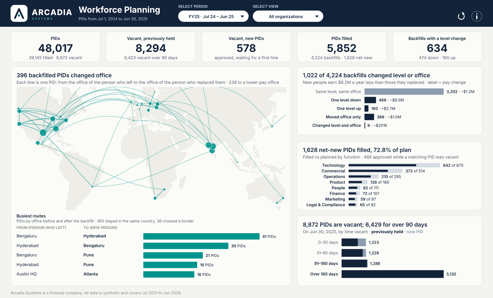
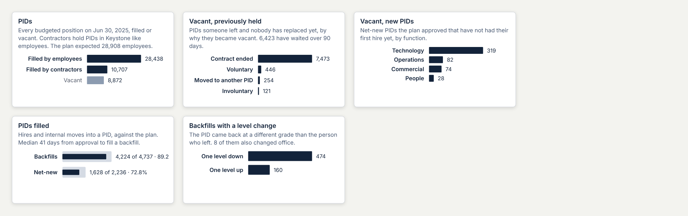

# Release 3 build plan: Dashboard #3, Workforce Planning (PIDs)

This is the complete plan for the third Arcadia dashboard, from the data to the published page. It replaces the step-by-step build in [dashboard_3_build.md](dashboard_3_build.md), which stays only as history. It reuses what already works on Dashboard #1 (Headcount & FTE Walk): the top bar, popovers, KPI hovers, info panel, grid and type rules. From Dashboard #2 (Compensation Walk) it takes the period grid, the map technique and the title rules. Arcadia Systems is fictional and all data is synthetic.

Companion guides: **G1** [Dashboard #1 rebuild](../headcount-fte-walk/release_3_rebuild_dashboard_1.md), **G2** [Dashboard #2 rebuild](../compensation-walk/release_3_rebuild_dashboard_2.md). Method and definitions: [workforce_planning.md](workforce_planning.md).



*Design mock at FY25 · All organizations. FY26's closing date is the last day of the simulation, where no new PID is open yet; section 3.3 fixes that. Every number comes from the release 3 data. File: `docs/brand/build/d3_page_preview.html`.*



*The five KPI hovers, each a small chart inside the tooltip (Viz in Tooltip).*

| Revision | Date | What changed |
|---|---|---|
| 1 | 2026-10-23 | Top bar, popovers, version toggle |
| 2 | 2026-10-23 | No version toggle (plan = budget); the map is the main card; "vacant"; arrow-only reset |
| **3** | 2026-10-23 | **Everything counts PIDs.** KPI 1 is total PIDs, KPIs 2 and 3 split the vacant PIDs, KPI 5 is backfills with a level change, and the hovers are charts. The capsule has a drawn chevron. Routes are shown as From / To columns, not "A → B" text. Period labels name the months. A generator fix opens net-new PIDs at the end of the data |
| **3.1** | 2026-10-23 | **Contractors hold PIDs; new PIDs open at recruiting.** Data release 3.1: every contractor gets a PID in Keystone (filled contingent PIDs = contingent headcount), and the hiring pipeline runs past the extract, so Jun 30, 2026 has 528 new PIDs. KPI 1 counts both; D16 reversed; mock numbers refreshed |

## Contents

0. Which dashboard this is, and the PID principle
1. The story
2. Decisions
3. Data
4. Shapes
5. Workbook and data sources
6. Parameters
7. Calculations
8. Top bar
9. Popovers
10. KPI band and hovers
11. The four cards
12. Dashboard layout
13. Actions
14. Check tables
15. Click tests
16. Publish
17. Who does what
18. Later: the PID forecast dashboard

---

## 0. Which dashboard this is, and the PID principle

**This is Workforce Planning:** *Are we hiring into the seats we planned, and what did each seat look like before?* It is not the Global Workforce Footprint (*Where are our people, where are we growing, and who moves between offices?*).

The two are easy to mix up because both have a map with lines between offices. The difference is what the line follows:

| | Global Workforce Footprint | Workforce Planning (this one) |
|---|---|---|
| Unit | People | **PIDs** (positions, seats) |
| A line on the map | A **person** changed office | A **PID** was refilled in another office than the person who left it |
| Answers | Where people are and where they go | Where the budgeted seats are, which are vacant, how fast and how well we fill them, and what changed in the seat when it was refilled |

**The PID ledger.** Workforce planning counts PIDs, not people ("seats vs butts"):

- **Total PIDs = filled + vacant.** Filled PIDs equal headcount (test 45: same people, every month).
- **A vacant PID is either previously held or new.** Previously held means someone left: they resigned, were let go, or moved to another PID. New means a net-new PID the plan approved that has not had its first hire yet.
- **Filling a PID.** Filling a previously held PID is a **backfill**; filling a new PID is a **net-new** fill.
- **A backfill can change the PID.** It can come back at another level or in another office.

  *Example:* a Senior Manager in Austin leaves. Their PID is refilled by a new hire in Chicago at Manager level. The PID moved from Austin to Chicago (the map) **and** went one level down (KPI 5 and the right-hand card).
- **Net-new PIDs have no "before",** so they never appear on the map.

**Contractors hold PIDs too (revision 3.1).** Bridgeway sends Keystone each contractor under a Bridgeway worker ID; Keystone converts it to an Arcadia ID and assigns a PID, like any employee. So a PID is filled by an employee, filled by a contractor, or vacant. A contingent PID is created (or a vacant one reused) when the request is approved, and stays vacant after the assignment ends until it is reused or the January / July position audit closes it. That is why most vacant PIDs are contingent ones: on Jun 30, 2025, 7,473 of the 8,294 previously held. KPIs 4 and 5, the map and the right-hand cards stay on employee fills, because those are what the plan and the pay walk cover.

---

## 1. The story

**Page question:** *How many PIDs do we have, how many are vacant, how fast and how well do we fill them, and what changes when we refill one?*

| Where | Question | FY25 · All organizations (the mock) |
|---|---|---|
| Header | Which dates? | **Workforce Planning** · "PIDs from Jul 1, 2024 to Jun 30, 2025" |
| KPI 1 | How many PIDs do we have? | **48,017** PIDs · 39,145 filled · 8,872 vacant. Hover: filled by employees 28,438 / filled by contractors 10,707 / vacant 8,872, and the plan |
| KPI 2 | How many vacant PIDs did someone leave? | **8,294** Vacant, previously held · 6,423 vacant over 90 days. Hover: why they became vacant (contract ended 7,473, voluntary 446, moved to another PID 254, involuntary 121) |
| KPI 3 | How many new PIDs wait for a first hire? | **578** Vacant, new PIDs (249 employee, 329 contingent) · approved, waiting for a first hire. Hover: by function |
| KPI 4 | How many PIDs did we fill, against the plan? | **5,852** PIDs filled · 4,224 backfills · 1,628 net-new. Hover: bar inside a bar, backfills 4,224 of 4,737 (89.2%) and net-new 1,628 of 2,236 (72.8%); median 41 days to fill a backfill |
| KPI 5 | Did refilled PIDs come back at another level? | **634** Backfills with a level change · 474 down · 160 up. Hover: down / up bars; 8 also changed office |
| **Main card** (left, full height) | Where did backfilled PIDs move? | "396 backfilled PIDs changed office". The map, then the five busiest routes as a **From / To** table |
| Right, top | What changed in each refilled PID? | "1,022 of 4,224 backfills changed level or office" · same 3,202 · one level down 466 · one level up 160 · moved office only 388 · changed level and office 8. New people earn $8.2M a year less than those they replaced |
| Right, middle | Where did growth PIDs go? | "1,628 net-new PIDs filled, 72.8% of plan". Bar inside a bar by function; 466 approved while a matching PID was vacant |
| Right, bottom | How long have vacant PIDs waited? | "8,872 PIDs are vacant; 6,429 for over 90 days". By time vacant, previously held vs new |

**How the numbers tie together on the page.** KPI 2 + KPI 3 = the vacant part of KPI 1 = the vacant card's total. KPI 4's backfills = the right-top card's total. KPI 5 = one level down + one level up + changed level and office (466 + 160 + 8 = 634). The map's 396 = moved office only + changed level and office (388 + 8). Every pair is the same population, by construction.

**The plan** is the budget, approved before each fiscal year. It appears only in KPI 1's hover, KPI 4's hover and the net-new card, as "of plan".

---

## 2. Decisions

| # | Decision | Why |
|---|---|---|
| D1 | Executive officers excluded (`D-901`) | The same people on every Arcadia dashboard |
| D2 | Periods are quarter-end pairs inside one fiscal year: Fiscal year (5), Half year (10), Quarter (20) | The plan is quarterly, per fiscal year |
| D3 | No version toggle; plan = Budget (data source filter) | Reads from a screenshot |
| D4 | No click leads to an empty page: a period or group with no plan is dim and does nothing | Groups not yet open: Philippines FY22; Portugal, South Korea FY22–23; Data & AI Platform FY22–24 |
| D5 | A View pick lands on the first group alphabetically | Same as #1 and #2; checked always planned |
| D6 | **PID** is the unit everywhere ("PIDs", "backfilled PIDs", "new PIDs"); "vacant", never "frozen" or "open" | Your rule |
| D7 | **KPI order: PIDs · Vacant, previously held · Vacant, new · PIDs filled · Backfills with a level change** | Stock first (what we have, what is vacant), then flow (what we filled and what changed) |
| D8 | **The hovers are charts** (Viz in Tooltip), one small sheet per KPI | The cards stay clean, and the breakdown is one hover away |
| D9 | Right-top card categories are **exclusive**: same; one level down; one level up; moved office only; changed level and office | So KPI 5 and the map are sums of its bars and never disagree |
| D10 | **Chevron drawn in the capsule image** (`d3_field_capsule`, 200 × 36); the label carries no ▾ | The ▾ character was too small to read |
| D11 | **No arrow glyph in text.** Routes are two columns (FROM, TO); periods are named by months ("FY26 Q3 · Jan – Mar 26"); tooltips say "from Austin HQ to Chicago" | "→" at 9 pt is unreadable |
| D12 | Reset is the arrow icon, 32 × 32, next to ⓘ | Your choice: different from #1 and cleaner |
| D13 | Colour: navy for the measure the title is about, slate `#8C9BB0` as comparator, `#D5DBE4` for plan, teal only on the main card | Quiet page, one accent |
| D14 | Titles are FIXED calcs in sheet titles | No `*`, no extra sheets |
| D15 | A new workbook; the first one is archived | Clean actions |
| D16 | ~~Contingent workers hold no PID~~ **Reversed in 3.1:** contractors hold PIDs in Keystone | Keystone converts every contractor to an Arcadia ID and a PID; the data now does the same (test 81) |

---

## 3. Data

### 3.1 Sources

| Data source | File (`tableau/`) | Rows (extract) | Data source filter | Feeds |
|---|---|---:|---|---|
| **WFP Summary** | `custom_sql_wfp_summary.sql` (**edited**) | 2,520 | `version_type` = Budget | KPI band, hovers 1 and 4, header, pickers, Reset |
| **Plan vs Actual** | `custom_sql_plan_vs_actual.sql` | 11,740 | `version_type` = Budget | Net-new card |
| **Position Fill** | `custom_sql_position_fill.sql` | about 30,800 after 3.3 | none | Main card, right-top card, hover 5 |
| **Vacancy Pool** | `custom_sql_vacancy_pool.sql` | about 62,300 after 3.3 | none | Vacant card, hovers 2 and 3 |

### 3.2 WFP Summary: new columns (still one row per fiscal year × period × version × view × group)

| Column | Example (FY25 · All) | Used by |
|---|---|---|
| `span_name`, `span_order` | `Quarter`, 3 | Period popover |
| `period_short` | `FY25`, `FY26 Q3` | Grid line 1, capsule |
| `period_months` | `Jul 24 – Jun 25`, `Jan – Mar 26` | Grid line 2, capsule |
| `pids_total` | 48,017 | KPI 1 |
| `pids_filled_employee` | 28,438 (= `actual_ending_headcount`) | KPI 1, hover 1 |
| `pids_filled_contingent` | 10,707 (= `actual_cw_headcount`) | KPI 1, hover 1 |
| `vacant_previously_held`, `vacant_new` | 8,294, 578 (`…_contingent`: 7,473, 329) | KPIs 2 and 3, hover 1 |
| `vacant_previously_held_stale`, `vacant_new_stale` | 6,423, 7 (over 90 days) | KPI 2, vacant card |
| `level_down`, `level_up`, `level_and_office` | 474, 160, 8 | KPI 5, hover 5 |
| `moved_office` | 396 | Main card check |
| `is_view_default` | **changed**: first group alphabetically | View list |

The vacant columns read `rpt.vw_vacancy_pool` on `to_date` (`vacated_by` = 'Never filled' is a new PID). The level and office columns count backfills in the period from `rpt.vw_position_fill`. All of them are the same in every version row.

### 3.3 Data release 3.1: contingent PIDs and new PIDs at the extract (done)

- **New PIDs at the extract.** Net-new hires for the six months after Jun 30, 2026 are drawn at FY26's pace, on their own random stream; their PIDs and requisitions are created on the approval date, and those approved by Jun 30 stay Open with applicants. Jun 30, 2026: 291 new employee PIDs.
- **Contingent PIDs** (`generator/cw_positions.py`): created or reused on the service order's approval date, Filled while Bridgeway holds the assignment, vacant until reused (45% when a match waits) or closed by the audit (30% of those vacant 180+ days). Jun 30, 2026: 237 new contingent PIDs.
- Nothing that existed moved: every pre-existing raw row is identical; Dashboards #1 and #2 are unchanged.
- New marts `mart_pid_month_end` (the ledger) and `mart_cw_pid_fill`; tests 80 (extended) and 81.

**Jun 30, 2026:** 51,163 PIDs = 30,005 filled by employees + 11,941 by contractors + 8,689 vacant previously held (977 employee, 7,712 contingent) + 528 vacant new (291 + 237).

### 3.4 How it is checked (Claude, before you open Tableau)

| Check | Pass when |
|---|---|
| Generator | Every pre-existing row unchanged; added PIDs Open on Jun 30, 2026, approved before it |
| `python pipeline/run_pipeline.py` | All tests pass; test 80 extended: `pids_total` = filled + vacant; vacant = vacancy pool on `to_date`; level and office counts = position fill; defaults alphabetical and planned |
| `python sqlserver/check_tsql_in_duckdb.py` | T-SQL summary = DuckDB mart, row for row |
| `14_validate_workforce_planning_dashboard.sql` (your Mac) | Every line PASS |

### 3.5 On the Mac (after Claude pushes)

```bash
cd ~/GitHub/people-analytics-warehouse
git fetch origin
git checkout dashboard-3-rebuild
git pull
```

The generator fix adds rows, so the SQL Server warehouse is rebuilt the usual way (the run guide that comes with the branch lists the commands and every expected count). Then:

```bash
export MSSQL_SA_PASSWORD="$(docker exec arcadia-sql printenv MSSQL_SA_PASSWORD)"
docker exec -it arcadia-sql /opt/mssql-tools18/bin/sqlcmd -S localhost -U sa -P "$MSSQL_SA_PASSWORD" -C -i /repo/sqlserver/14_validate_workforce_planning_dashboard.sql | grep -E "FAIL|Msg|returned"
D="$HOME/Documents/Tableau/Tableau Public/ArcadiaHR/Custom SQL - Release 3/03 Workforce Planning"
cp tableau/custom_sql_wfp_summary.sql tableau/custom_sql_plan_vs_actual.sql tableau/custom_sql_position_fill.sql tableau/custom_sql_vacancy_pool.sql "$D/"
```

Expected: the three `returned` lines and no `FAIL` or `Msg`.

---

## 4. Shapes

Palette **Arcadia D3** (`docs/brand/shapes/by_dashboard/d3/`):

| File | Size | Sheet |
|---|---|---|
| `d3_field_capsule` | 200 × 36 | Period Field, Group Field: white capsule with a **navy chevron drawn in**, 18 px from the right |
| `d3_reset` | 32 × 32 | Reset (arrow icon) |

From **Arcadia Shared**: `shared_info_open`, `shared_info_close`, `shared_close_light`.


```bash
cd ~/GitHub/people-analytics-warehouse/docs/brand/shapes/by_dashboard
mkdir -p ~/Documents/My\ Tableau\ Repository/Shapes/Arcadia\ D3
cp d3/*.png ~/Documents/My\ Tableau\ Repository/Shapes/Arcadia\ D3/
ls ~/Documents/My\ Tableau\ Repository/Shapes/Arcadia\ D3
```

Expected: `d3_field_capsule.png  d3_reset.png`. In Tableau: Shape > More Shapes > **Reload Shapes**.

---

## 5. Workbook and data sources

1. Close Tableau. Move `Arcadia Workforce Planning.twb` to `_archive/2026-10-23/Arcadia Workforce Planning - first build.twb`.
2. **File > New**; save as `Arcadia Workforce Planning.twb` in the same folder.
3. Connect to SQL Server (`localhost, 1433`, `ArcadiaHR`, `sa`, Require SSL off). Add four Custom SQL sources named **WFP Summary**, **Plan vs Actual**, **Position Fill** and **Vacancy Pool**.
4. Data source filters: `version_type` = Budget on WFP Summary and Plan vs Actual.
5. Extract all four.

**Checkpoint 1:** WFP Summary 2,520 rows; Plan vs Actual 11,740; the other two as section 14 states after the rebuild.

**Types.** Convert to Dimension: WFP Summary `fiscal_year`, `pair_order`, `view_order`, `span_order`; Plan vs Actual `fiscal_year`, `fiscal_quarter`. Geographic role **None** on every latitude and longitude. Number format `#,##0` on counts.

**Paste what is proven** (Data pane > Copy, then right-click the target source > Paste): from #1, the `kpi_` layout calcs (their 16 parameters come along), plus `zzTrue`, `zzFalse`, `Close Panel`, `Pick Rows`, `Pick Col`, `Pick Row`. From the archived #3 workbook: the comma and percent pattern calcs you already wrote (`K … Str`), as templates.

---

## 6. Parameters

| Name | Type | Allowable values | Current |
|---|---|---|---|
| `p_FY` | Integer | List 2022–2026 (FY22 … FY26) | 2026 |
| `p_Period` | String | List FY, H1, H2, Q1, Q2, Q3, Q4 | FY |
| `p_Span` | String | List `Fiscal year`, `Half year`, `Quarter` | Fiscal year |
| `p_View` | String | List Company, Function, Sub-function, Department, Country | Company |
| `p_Group` | String | **All** | Arcadia Systems |
| `p_PeriodOpen`, `p_GroupOpen`, `p_InfoOpen` | Boolean | | False |

---

## 7. Calculations

### 7.1 WFP Summary: context and pickers

```
// Row Is Current       [fiscal_year] = [p_FY] AND [pair_code] = [p_Period] AND [view_name] = [p_View] AND [group_name] = [p_Group]
// Period Grid Rows     [view_name] = [p_View] AND [group_name] = [p_Group] AND [span_name] = [p_Span]
// Span Rows            [fiscal_year] = [p_FY] AND [view_name] = [p_View] AND [group_name] = [p_Group]
// View Rows            [fiscal_year] = [p_FY] AND [pair_code] = [p_Period] AND [is_view_default]
// Group Grid Rows      [fiscal_year] = [p_FY] AND [pair_code] = [p_Period] AND [view_name] = [p_View] AND [view_name] <> "Company"
// Why Off              IF [has_plan] THEN "" ELSE [group_name] + " had no PIDs in the plan for " + [period_short] + " (" + [period_months] + ")." END

// FY Pick              IF [has_plan] THEN [fiscal_year] ELSE [p_FY] END          (dimension)
// Period Pick          IF [has_plan] THEN [pair_code] ELSE [p_Period] END
// Period Keep Open     NOT [has_plan]
// Cell Is Current      [fiscal_year] = [p_FY] AND [pair_code] = [p_Period]
// Cell State           IF [Cell Is Current] THEN "current" ELSEIF [has_plan] THEN "on" ELSE "off" END
// Cell Title           IF [Cell Is Current] THEN "› " + [period_short] ELSE [period_short] END
// Span Display         IF [span_name] = [p_Span] THEN "› " + [span_name] ELSE [span_name] END
// Period Field Text    [period_short] + " · " + [period_months]
// View Label           IF [view_name] = "Company" THEN "All organizations" ELSE [view_name] END
// View Display         IF [view_name] = [p_View] THEN "› " + [View Label] ELSE [View Label] END
// Keep Group Panel Open   [view_name] <> "Company"
// Group Pick           IF [has_plan] THEN [group_name] ELSE [p_Group] END
// Group Keep Open      NOT [has_plan]
// Group State          IF [group_name] = [p_Group] THEN "current" ELSEIF [has_plan] THEN "on" ELSE "off" END
// Panel Title          "Select " + CASE [p_View] WHEN "Function" THEN "a function" WHEN "Sub-function" THEN "a sub-function"
//                      WHEN "Department" THEN "a department" WHEN "Country" THEN "a country" ELSE "a view" END
// Group Field Text     IF [p_View] = "Company" THEN "All organizations"
//                      ELSEIF LEN([p_Group]) > 20 THEN LEFT([p_Group], 19) + "…" ELSE [p_Group] END
// Toggle Period Panel  NOT [p_PeriodOpen]
// Toggle Group Panel   NOT [p_GroupOpen]
// Toggle Info          NOT [p_InfoOpen]
// Info Shape           IF [p_InfoOpen] THEN "shared_info_close" ELSE "shared_info_open" END
// Default FY 2026 · Default Period "FY" · Default Span "Fiscal year" · Default View "Company" · Default Group "Arcadia Systems"
```

The capsule labels stay at 22 characters or fewer ("FY26 Q3 · Jan – Mar 26", "All organizations"), so they never reach the chevron.

Header:

```
// Day Text (x)     LEFT(DATENAME('month', x), 3) + " " + STR(DAY(x)) + ", " + STR(YEAR(x))   (write it for DATEADD('day', 1, [from_date]) and for [to_date])
// Page Subtitle    "PIDs from " + <Day Text of from_date + 1> + " to " + <Day Text of to_date>
// Title Tip
"Showing: " + (IF [p_View] = "Company" THEN "all of Arcadia" ELSE [view_name] + " · " + [group_name] END) + CHAR(10) +
"A PID is a budgeted position, filled or vacant. A backfill refills a PID someone left; a net-new fill is a new PID's first hire." + CHAR(10) +
"The map follows PIDs, not people: the office of the person who left, and of the person who replaced them." + CHAR(10) +
"Plan = the budget approved before " + [fiscal_year_label] + ". Executive officers excluded."
```

### 7.2 WFP Summary: KPI numbers

```
// K PIDs        SUM([pids_total])
// K Filled      SUM([pids_filled_employee]) + SUM([pids_filled_contingent])
// K Plan Filled SUM([planned_ending_headcount])
// K Vac Prev    SUM([vacant_previously_held])
// K Vac New     SUM([vacant_new])
// K Vacant      [K Vac Prev] + [K Vac New]
// K Prev Stale  SUM([vacant_previously_held_stale])
// K BF          SUM([actual_backfills])         K BF Plan   SUM([planned_backfills])
// K NN          SUM([actual_net_new])           K NN Plan   SUM([planned_net_new])
// K Fills       [K BF] + [K NN]
// K Days        SUM([median_time_to_fill_days])
// K Down        SUM([level_down])               K Up   SUM([level_up])     K Both   SUM([level_and_office])
// K Level       [K Down] + [K Up]
```

Text twins with the comma pattern (`K PIDs Str`, `K Filled Str` …) and the percent pattern (`K BF Pct Str` = `K BF` / `K BF Plan`, `K NN Pct Str`).

`K Level` counts every backfill whose grade changed: `level_down` and `level_up` already include the PIDs that also moved office. `K Both` is that overlap.

### 7.3 Period window and group (on Plan vs Actual, Position Fill, Vacancy Pool)

```
// Period First Q   CASE [p_Period] WHEN "FY" THEN 1 WHEN "H1" THEN 1 WHEN "H2" THEN 3 WHEN "Q1" THEN 1 WHEN "Q2" THEN 2 WHEN "Q3" THEN 3 ELSE 4 END
// Period Last Q    CASE [p_Period] WHEN "FY" THEN 4 WHEN "H1" THEN 2 WHEN "H2" THEN 4 WHEN "Q1" THEN 1 WHEN "Q2" THEN 2 WHEN "Q3" THEN 3 ELSE 4 END
// Period To Date   DATEADD('day', -1, DATEADD('month', 3 * [Period Last Q], MAKEDATE([p_FY] - 1, 7, 1)))
// In Group         CASE [p_View] WHEN "Company" THEN TRUE WHEN "Function" THEN [function_name] = [p_Group]
//                  WHEN "Sub-function" THEN [sub_function] = [p_Group] WHEN "Department" THEN [department_name] = [p_Group]
//                  WHEN "Country" THEN [country_name] = [p_Group] END
```

The group is the PID's department and country **now** (where the new person sits).

**Checkpoint 2** (`CHK` sheet, filter `Row Is Current`), at FY25 (`p_FY` = 2025): `K PIDs` 48,017 · `K Filled` 39,145 · `K Vac Prev` 8,294 · `K Vac New` 578 · `K Prev Stale` 6,423 · `K BF` 4,224 · `K NN` 2,236 planned / 1,628 filled · `K Down` 474 · `K Up` 160 · `K Both` 8.

---

## 8. Top bar (G1 section 6)

| Sheet | Build |
|---|---|
| `Page Title` | Filter `Row Is Current`. Line 1 `Workforce Planning` Bold 18 white; line 2 `<Page Subtitle>` Book 8 `#C9D1DC`. Detail `Title Tip`, `zzTrue`, `zzFalse`. Tooltip **How to read this page** / `<Title Tip>` / "Click ⓘ for the full definitions." |
| `Period Field` | Shape `d3_field_capsule`, size max. Label `<Period Field Text>` Semibold 9 navy, centre, allow overlap, **no ▾**. Filter `Row Is Current`. Detail `Toggle Period Panel`, `Close Panel`, `span_name`, `zzTrue`, `zzFalse`. Tooltip `Choose the period` |
| `Group Field` | Same, label `<Group Field Text>`. Detail `Toggle Group Panel`, `Close Panel`, `zzTrue`, `zzFalse`. Tooltip `<p_Group>` / `Choose who to look at` |
| `Reset` | Shape `d3_reset`, filter `Row Is Current`, Detail the five `Default …`, `Close Panel`, `zzTrue`, `zzFalse`. Tooltip `Reset to default view` |
| `Info Button` | Shape `Info Shape` (two shared files), filter `Row Is Current`, Detail `Toggle Info`, `Close Panel`, `zzTrue`, `zzFalse`. Tooltip `Click here for more information on how to read this page` |

| Object | x | y | w | h |
|---|---:|---:|---:|---:|
| Header band (Blank `#13233A`) | 0 | 0 | 1400 | 76 |
| Logo | 30 | 14 | 177 | 48 |
| Page Title | 223 | 9 | 275 | 58 |
| `SELECT PERIOD` (Text, Bold 10 `#B8C4D6`) / Period Field | 506 | 12 / 28 | 200 | 14 / 36 |
| `SELECT VIEW` / Group Field | 718 | 12 / 28 | 200 | 14 / 36 |
| Reset | 1294 | 30 | 32 | 32 |
| Info Button | 1338 | 30 | 32 | 32 |

Controls: background None, border None, padding 0.

---

## 9. Popovers (G1 0.5 style)

### 9.1 Period popover

| Sheet | Build |
|---|---|
| `Span List` | Filter `Span Rows`; Rows `span_order`, `span_name` (hidden); Text `Span Display` Book 10 `#B8C0CC`; no Color; Detail `span_name`, `zzTrue`, `zzFalse` |
| `Period Panel` | Filter `Period Grid Rows`; Columns `fiscal_year` descending, Rows `pair_order` descending, headers hidden; Text line 1 `<Cell Title>` Semibold 10, line 2 `<period_months>` Book 9; Color `Cell State` (white / `#B8C0CC` / `#56657E`); Detail `FY Pick`, `Period Pick`, `Period Keep Open`, `Why Off`, `zzTrue`, `zzFalse`; tooltip `<Why Off>` |
| `Period Close` | `shared_close_light` 16 × 16, Detail `Close Panel`, `zzTrue`, `zzFalse` |

Container `Period Popover` **x 506, y 76, w 708, h 254**, visibility `p_PeriodOpen`: header ("Select a period" Bold 12 white + `Period Close`), note (Book 9 `#8FA0B8`: "Fiscal year runs July to June."), then `Span List` (120) + `Period Panel` (540). Quarter cells read "FY26 Q3" over "Jan – Mar 26".

### 9.2 View popover

| Sheet | Build |
|---|---|
| `View List` | Filter `View Rows`; Rows `view_order`, `view_name` (hidden); Text `View Display`; Detail `view_name`, `group_name`, `Keep Group Panel Open`, `zzTrue`, `zzFalse` |
| `Group Panel` | Filter `Group Grid Rows`; Columns `Pick Col`, Rows `Pick Row` (Discrete, hidden); Text `group_name`; Color `Group State`. Detail in order: `group_name`, `Group Pick`, `Group State`, `Group Keep Open`, `Why Off`, `zzTrue`, `zzFalse`. Every table calc: Specific Dimensions, all ticked, **`group_name` on top** (a dim group's `Group Pick` repeats the current group, so it cannot lead) |
| `Group Heading` | `<Panel Title>` Bold 12 white |
| `Group Close` | Copy of `Period Close` |

Container `Group Popover` **x 610, y 76, w 760, h 330**, visibility `p_GroupOpen`.

### 9.3 Info popover

Container **x 960, y 76, w 410**, visibility `p_InfoOpen`. Body (Book 10 `#B8C0CC`, lead-ins Semibold white):

> **Period.** Every option compares two quarter-ends inside one fiscal year. Arcadia's fiscal year runs July to June.
>
> **PIDs.** A PID is a position in Keystone, Arcadia's HR system. It is filled by an employee, filled by a contractor, or vacant. Contractors come from the supplier system and get an Arcadia ID and a PID like anyone else.
>
> **Vacant PIDs.** Previously held: someone left by resigning, being let go or moving to another PID. New: a net-new PID approved by the plan that has not had its first hire yet. Over 90 days counts as stale.
>
> **Filling PIDs.** A backfill refills a previously held PID; a net-new fill is a new PID's first hire. A promotion re-grades a PID with the same person in it, so it is not a fill.
>
> **What changed.** A backfill can come back at another level, in another office, or both. The map draws one line per PID that changed office, from the office of the person who left to the office of the person who replaced them.
>
> **Who and plan.** Employees at quarter-end, without the CEO and the eight function heads. The plan is the budget approved before each fiscal year.
>
> **Data.** Arcadia Systems is a fictional company. All data is synthetic.

---

## 10. KPI band and hovers

### 10.1 Band (`KPI Cards`, WFP Summary; geometry as G1 8.2a, centred text)

| Card | Title | Value | Note |
|---|---|---|---|
| 1 | `PIDs` | `K PIDs Str` (`pids_total`) | `[K Filled Str] + " filled · " + [K Vacant Str] + " vacant"` (filled = `pids_filled_employee` + `pids_filled_contingent`) |
| 2 | `Vacant, previously held` | `K Vac Prev Str` | `[K Prev Stale Str] + " vacant over 90 days"` |
| 3 | `Vacant, new PIDs` | `K Vac New Str` | `"approved, waiting for a first hire"` |
| 4 | `PIDs filled` | `K Fills Str` | `[K BF Str] + " backfills · " + [K NN Str] + " net-new"` |
| 5 | `Backfills with a level change` | `K Level Str` | `[K Down Str] + " down · " + [K Up Str] + " up"` |

### 10.2 Hovers: a chart inside each tooltip

The five transparent `KPI Hover N` sheets (G1 8.2c: `Hover Cell` square at 0% opacity, filter `Row Is Current`, x 30 / 301 / 572 / 843 / 1114, y 90, 255 × 86, radius 5, deselect action) each show a **tooltip sheet** with **Insert > Sheets**. Use `filter="<None>"`: the tooltip sheets read the parameters, so they need no filter passed in. Example:

```
<KPI 5 Title>                                           (Semibold 10 navy)
<KPI 5 Tip>                                             (Book 9 #4A5A73)
<Sheet name="Tip Level" maxwidth="320" maxheight="120" filter="<None>">
```

| Hover | Text (`KPI n Tip`) | Tooltip sheet | Build |
|---|---|---|---|
| 1 | "Every position on <to_date>, filled or vacant. Contractors hold PIDs in Keystone like employees. The plan expected <K Plan Filled Str> employees." | `Tip PIDs` (WFP Summary) | Filter `Row Is Current`; Rows Measure Names (`pids_filled_employee`, `pids_filled_contingent`, `Vacant PIDs` = `vacant_previously_held` + `vacant_new`, aliased "Filled by employees", "Filled by contractors", "Vacant"); Columns Measure Values; bars navy for the two filled, slate for vacant; label the value |
| 2 | "PIDs someone left and nobody has replaced yet, by why they became vacant. <K Prev Stale Str> have waited over 90 days." | `Tip Vacant Why` (Vacancy Pool) | Filter `[month_end_date] = [Period To Date] AND [In Group] AND [vacated_by] <> "Never filled"`; Rows `vacated_by` (alias Internal Move Out → "Moved to another PID"); Columns `CNT(position_id)`; navy |
| 3 | "Net-new PIDs the plan approved that have not had their first hire yet, by function." | `Tip Vacant New` (Vacancy Pool) | Same date and group filter, `[vacated_by] = "Never filled"`; Rows `function_name` (top 5 by count); navy. Empty: "No new PID was waiting on this date." |
| 4 | "Hires and internal moves into a PID, against the plan. Median <K Days> days from approval to fill a backfill." | `Tip Filled BF` and `Tip Filled NN` (WFP Summary), stacked | Each: one bar inside a bar, planned `#D5DBE4` wide and filled navy narrow (dual axis, synchronized), label "4,224 of 4,737 · 89.2%" |
| 5 | "The PID came back at a different grade than the person who left. <K Both Str> of them also changed office." | `Tip Level` (WFP Summary) | Rows Measure Names (`level_down`, `level_up`, aliased "One level down", "One level up"); navy bars, labels |

Tooltip sheets: no title, no axes or gridlines, Fit Entire View, worksheet shading None, size about 300 × 90. They never go on the dashboard.

---

## 11. The four cards

Card style as G1 (title Semibold 12 navy, subtitle Book 9 slate, background `#FBFBF8`, radius 10). Position Fill helpers:

```
// Fill Quarter       INT(RIGHT([fiscal_quarter_label], 1))
// In Period          [fiscal_year] = [p_FY] AND [Fill Quarter] >= [Period First Q] AND [Fill Quarter] <= [Period Last Q]
// Backfill In Scope  [In Period] AND [In Group] AND [seat_type] = "Backfill"
// Moved              [location_change] <> "Same office"
// Change Kind        IF NOT [Moved] AND [level_change] = "Same" THEN "Same level, same office"
//                    ELSEIF NOT [Moved] AND [level_change] = "Down" THEN "One level down"
//                    ELSEIF NOT [Moved] AND [level_change] = "Up" THEN "One level up"
//                    ELSEIF [level_change] = "Same" THEN "Moved office only" ELSE "Changed level and office" END
// Change Order       1 to 5 in that order
```

### 11.1 Main card: where backfilled PIDs moved (`Card: PID Moves`, x 30, y 188, w 797, h 624)

```
// PID Moved        [Backfill In Scope] AND [Moved]
// Route Line       MAKELINE(MAKEPOINT(MIN([prior_latitude]), MIN([prior_longitude])), MAKEPOINT(MIN([latitude]), MIN([longitude])))
// New Office Point MAKEPOINT(MIN([latitude]), MIN([longitude]))
// Route Key        [prior_office_name] + "|" + [office_name]
// M PIDs           { FIXED : SUM(IF [PID Moved] THEN 1 END) }
// M Lower          { FIXED : SUM(IF [PID Moved] AND [location_effect_usd_constant] < 0 THEN 1 END) }
// M Same Country   { FIXED : SUM(IF [PID Moved] AND [location_change] = "Other office, same country" THEN 1 END) }
// M Border         { FIXED : SUM(IF [PID Moved] AND [location_change] = "Other country" THEN 1 END) }
// M Title          IF ZN([M PIDs]) = 0 THEN "No backfilled PID changed office in this period"
//                  ELSEIF [M PIDs] = 1 THEN "One backfilled PID changed office"
//                  ELSE <comma [M PIDs]> + " backfilled PIDs changed office" END
// M Subtitle       "Each line is one PID: from the office of the person who left to the office of the person who replaced them"
//                  + IF ZN([M PIDs]) = 0 THEN "" ELSE " · " + STR(ZN([M Lower])) + " to a lower-pay office" END
// R Subtitle       "PIDs by office before and after the backfill" + IF ZN([M PIDs]) = 0 THEN "" ELSE
//                  " · " + STR(ZN([M Same Country])) + " stayed in the same country, " + STR(ZN([M Border])) + " crossed a border" END
```

- **`PID Map`** (fixed 420 high): filter `PID Moved`. Layer 1 `Route Line`: Automatic, `Route Key` on Detail, teal 50%, thinnest, no size. Layer 2 `New Office Point`: Circle, `office_name` on Detail, `CNT(fill_id)` on Size (5 to 20 px), teal 85%, white border. Base map off, coastline and borders on, no toolbar, framed Vancouver to Sydney (G2 map guide, step 6). Title `<M Title>` / `<M Subtitle>`. Route tooltip: "**From <prior_office_name> to <office_name>**" / "<CNT(fill_id)> PIDs: the person who left sat in <prior_office_name>; the person who replaced them sits in <office_name>" / `<Route Pay Words>`. Dot tooltip: "**<office_name>**" / "<CNT(fill_id)> backfilled PIDs arrived from another office".
- **`PID Routes`** (about 190 high): filter `PID Moved` and `Route Rank` (`INDEX()` ≤ 5, Compute Using both office fields). Rows `prior_office_name` then `office_name`, **both headers shown** with the field labels renamed **FROM (PERSON WHO LEFT)** and **TO (NEW PERSON)** (Book 8 `#8C8A84` caps; Format > Field Labels), row text Book 10 / Semibold 10 navy. Columns `CNT(fill_id)`, sorted descending, teal, label "<CNT> PIDs". Title "Busiest routes" / `<R Subtitle>`. Readable in any font, and no arrow needed.

### 11.2 Right top: what changed in each refilled PID (`Backfill Changes`, x 843, y 188, w 526, h 196)

```
// C Backfills   { FIXED : SUM(IF [Backfill In Scope] THEN 1 END) }
// C Changed     { FIXED : SUM(IF [Backfill In Scope] AND [Change Kind] <> "Same level, same office" THEN 1 END) }
// C Pay         { FIXED : SUM(IF [Backfill In Scope] THEN [pay_change_usd_constant] END) }
// C Title       IF ZN([C Backfills]) = 0 THEN "No PID was backfilled in this period"
//               ELSE <comma ZN([C Changed])> + " of " + <comma [C Backfills]> + " backfills changed level or office" END
// C Subtitle    IF ABS(ZN([C Pay])) < 500 THEN "New people earn about the same as those they replaced"
//               ELSE "New people earn " + <Pay Words on [C Pay]> + " a year " + IIF([C Pay] < 0, "less", "more") + " than those they replaced · label = pay change" END
// Pay Words     $7.0M / $412K / $950 (G-pattern: ≥ 999,950 in M with one decimal, ≥ 999.5 in K, else dollars)
// Row Pay Str   sign + <Pay Words on SUM([pay_change_usd_constant])>
```

Rows `Change Kind` (by `Change Order`); Columns `CNT(fill_id)`; Color: "Same level, same office" slate, the rest navy; Label `<CNT(fill_id)> · <AGG(Row Pay Str)>`. Tooltip: kind, PIDs, pay, one line of meaning.

### 11.3 Right middle: net-new PIDs against the plan (`Net-new by Group`, x 843, y 400, w 526, h 196, Plan vs Actual)

```
// In Plan Period   [fiscal_year] = [p_FY] AND [fiscal_quarter] >= [Period First Q] AND [fiscal_quarter] <= [Period Last Q] AND [In Group]
// NN Dim           CASE [p_View] WHEN "Company" THEN [function_name]
//                  WHEN "Function" THEN IIF({ FIXED [function_name] : COUNTD([sub_function]) } > 1, [sub_function], [department_name])
//                  WHEN "Sub-function" THEN [department_name] WHEN "Department" THEN [country_name] ELSE [function_name] END
// N Done / N Plan / N Reuse   { FIXED : SUM(IF [In Plan Period] THEN [actual_net_new] / [planned_net_new] / [actual_net_new_reuse_candidates] END) }
// N Title          IF ZN([N Plan]) = 0 AND ZN([N Done]) = 0 THEN "No net-new PIDs in this period"
//                  ELSEIF ZN([N Plan]) = 0 THEN <comma [N Done]> + " net-new PIDs filled; none were planned"
//                  ELSE <comma [N Done]> + " net-new PIDs filled, " + <percent> + " of plan" END
// N Subtitle       "Filled vs planned by " + <level word> + " · " + STR(ZN([N Reuse])) + " approved while a matching PID was vacant"
```

A bar inside a bar: planned `#D5DBE4` (size 60%) and filled navy (size 30%), dual axis, synchronized, axis hidden. Label on the planned card: "<filled> of <planned>". At most 8 rows (top by planned), each about 16 px. Rows with neither planned nor filled are hidden.

### 11.4 Right bottom: how long vacant PIDs have waited (`Vacant PIDs`, x 843, y 612, w 526, h 200, Vacancy Pool)

```
// In Vacant      [month_end_date] = [Period To Date] AND [In Group]
// Vacant Kind    IF [vacated_by] = "Never filled" THEN "New PID" ELSE "Previously held" END
// Band, Band Order   0–30 · 31–90 · 91–180 · Over 180 days
// V PIDs         { FIXED : SUM(IF [In Vacant] THEN 1 END) }
// V Stale        { FIXED : SUM(IF [In Vacant] AND [is_stale] THEN 1 END) }
// V Title        IF ZN([V PIDs]) = 0 THEN "No PID was vacant on " + <day> ELSE <comma [V PIDs]> + " PIDs are vacant; " + <comma ZN([V Stale])> + " for over 90 days" END
// V Subtitle     "On " + <day of Period To Date> + ", by time vacant · previously held · new PID"   (colour the two words: navy, slate)
```

Rows `Band`; Columns `CNT(position_id)`; Color `Vacant Kind` (Previously held navy, New PID `#8C9BB0`), stacked; total label at the end.

---

## 12. Dashboard layout (1400 × 850, all floating)

| # | Object | x | y | w | h |
|---|---|---:|---:|---:|---:|
| 1–8 | Top bar (section 8) | | | | |
| 9–10 | KPI background image, KPI Cards | 0 | 78 | 1400 | 110 |
| 11–15 | KPI Hover 1–5 | 30 / 301 / 572 / 843 / 1114 | 90 | 255 | 86 |
| 16 | Card: PID Moves (`PID Map` + `PID Routes`) | 30 | 188 | 797 | 624 |
| 17 | Backfill Changes | 843 | 188 | 526 | 196 |
| 18 | Net-new by Group | 843 | 400 | 526 | 196 |
| 19 | Vacant PIDs | 843 | 612 | 526 | 200 |
| 20 | Footnote | 30 | 822 | 700 | 16 |
| 21 | Popovers | 9.1–9.3 | | | |

---

## 13. Actions (30 Change Parameter + 19 Deselect = 49)

| # | Name | Source | Target | Field |
|---:|---|---|---|---|
| 1 | Open period panel | Period Field | `p_PeriodOpen` | `Toggle Period Panel` |
| 2 | Open period on its span | Period Field | `p_Span` | `span_name` |
| 3–4 | Period opens, group / info closes | Period Field | `p_GroupOpen`, `p_InfoOpen` | `Close Panel` |
| 5 | Set span | Span List | `p_Span` | `span_name` |
| 6 | Set FY | Period Panel | `p_FY` | `FY Pick` |
| 7 | Set period | Period Panel | `p_Period` | `Period Pick` |
| 8 | Close period on pick | Period Panel | `p_PeriodOpen` | `Period Keep Open` |
| 9 | Close period on ✕ | Period Close | `p_PeriodOpen` | `Close Panel` |
| 10 | Open group panel | Group Field | `p_GroupOpen` | `Toggle Group Panel` |
| 11–12 | Group opens, period / info closes | Group Field | `p_PeriodOpen`, `p_InfoOpen` | `Close Panel` |
| 13 | Set view | View List | `p_View` | `view_name` |
| 14 | Set group from view | View List | `p_Group` | `group_name` |
| 15 | Keep group panel open | View List | `p_GroupOpen` | `Keep Group Panel Open` |
| 16 | Set group | Group Panel | `p_Group` | `Group Pick` |
| 17 | Close group on pick | Group Panel | `p_GroupOpen` | `Group Keep Open` |
| 18 | Close group on ✕ | Group Close | `p_GroupOpen` | `Close Panel` |
| 19–23 | Reset FY / period / span / view / group | Reset | the five parameters | the five `Default …` |
| 24–26 | Reset closes the three popovers | Reset | `p_PeriodOpen`, `p_GroupOpen`, `p_InfoOpen` | `Close Panel` |
| 27 | Open info | Info Button | `p_InfoOpen` | `Toggle Info` |
| 28–29 | Info opens, period / group closes | Info Button | `p_PeriodOpen`, `p_GroupOpen` | `Close Panel` |
| 30 | Close info on ✕ | Info Close | `p_InfoOpen` | `Close Panel` |

Deselect (Filter, same sheet, `zzTrue` → `zzFalse`, Show all values): `Page Title`, `Period Field`, `Group Field`, `Reset`, `Info Button`, `Span List`, `Period Panel`, `Period Close`, `View List`, `Group Panel`, `Group Heading`, `Group Close`, `Info Close`, `KPI Cards`, `KPI Hover 1`–`5`. The tooltip sheets need none (they are never on the dashboard).

---

## 14. Check tables (independent script on the raw seat tables and marts; ties to the summary)

### 14.1 KPI band

| State | 1 PIDs (employee + contractor filled + prev + new) | 2 Prev · over 90 | 3 New | 4 Filled (BF of plan · NN of plan) | 5 Level change (down · up · also moved) |
|---|---|---|---|---|---|
| FY25 · FY · All | 48,017 = 28,438 + 10,707 + 8,294 + 578 | 8,294 · 6,423 | 578 | 5,852 (4,224 of 4,737 · 1,628 of 2,236) | 634 (474 · 160 · 8) |
| FY26 · Q3 · All | 49,463 = 29,618 + 11,277 + 7,953 + 615 | 7,953 · 5,872 | 615 | 1,672 (1,201 of 1,356 · 471 of 562) | 181 (139 · 42 · 2) |
| FY24 · FY · All | 45,299 = 27,208 + 9,910 + 7,737 + 444 | 7,737 · 5,913 | 444 | 5,015 (4,105 of 4,503 · 910 of 2,833) | 672 (511 · 161 · 7) |
| FY26 · FY · All | 51,163 = 30,005 + 11,941 + 8,689 + 528 | 8,689 · 6,540 | 528 | 6,849 (4,668 of 5,031 · 2,181 of 2,762) | 752 (567 · 185 · 11) |
| FY26 · FY · Function Finance | 2,107 = 1,271 + 370 + 439 + 27 | 439 · 342 | 27 | 264 (181 of 230 · 83 of 122) | 21 (17 · 4 · 0) |
| FY26 · FY · Country India | 15,620 = 6,967 + 4,883 + 3,617 + 153 | 3,617 · 2,812 | 153 | 1,465 (1,047 of 1,115 · 418 of 562) | 170 (136 · 34 · 2) |

### 14.2 Cards, FY25 · All

| Card | Expected |
|---|---|
| Main | 396 backfilled PIDs changed office · 238 to a lower-pay office · 360 same country, 36 crossed a border · routes: Bengaluru / Hyderabad 41, Hyderabad / Bengaluru 30, Bengaluru / Pune 21, Hyderabad / Pune 19, Austin HQ / Atlanta 18 |
| Backfill changes | 1,022 of 4,224 · same 3,202 (−$1.2M) · down 466 (−$8.5M) · up 160 (+$2.7M) · moved office only 388 (−$1.0M) · changed level and office 8 (−$201K) · $8.2M less |
| Net-new by function | 1,628, 72.8% of plan · Technology 642 of 870 · Commercial 372 of 514 · Operations 210 of 285 · Product 126 of 180 · People 82 of 111 · Finance 72 of 107 · Marketing 59 of 87 · Legal & Compliance 65 of 82 · 466 with a vacant match |
| Vacant | 8,872 vacant · 0–30: 816 + 407 new · 31–90: 1,063 + 165 · 91–180: 1,280 + 6 · over 180: 5,135 + 0 |

FY26 · All: map 467 (280 lower; 410 / 57); changes 4,668 = 3,460 + 556 + 185 + 456 + 11, $7.0M less; net-new 2,181, 79.0%.

### 14.3 Ties to check on every state

KPI 2 + KPI 3 = vacant in KPI 1 = vacant card total · KPI 4 backfills = right-top total · KPI 5 = down + up + changed level and office · map PIDs = moved office only + changed level and office.

---

## 15. Click tests

| # | Do | Expect |
|---:|---|---|
| 1 | Hover every KPI card | A tooltip with its chart; numbers equal the card |
| 2 | Hover each control | Outline only; tooltips; the chevron is part of the capsule |
| 3 | Click every control, title, KPI band | Nothing stays highlighted |
| 4 | Open Period, View, ⓘ in turn | One open at a time |
| 5 | Period > Quarter > FY26 Q3 | Closes; capsule "FY26 Q3 · Jan – Mar 26"; KPI row as 14.1 |
| 6 | View > Function > Finance | Popover stays open after Function, closes on Finance |
| 7 | Country > Portugal, then Period | FY22 and FY23 cells dim; clicking one does nothing |
| 8 | Hover a route and a dot | "From … to …", PIDs, pay range |
| 9 | Reset | FY26 · All organizations, popovers closed |

---

## 16. Publish

Reset, close popovers, hide sheets, **Save to Tableau Public As** `arcadia_workforce_planning`. Check the live page against 14 and 15. Then: screenshot to `docs/images/workforce_planning_dashboard.png`, README and profile, and add section 0 to `workforce_planning.md` (the PID ledger and the map definition).

---

## 17. Who does what

| Phase | Who | What | Done when |
|---|---|---|---|
| 0 | Claude | This plan, shapes, mocks | You approve sections 0–2 and the mocks |
| 1 | Claude | Generator fix (3.3), summary columns (3.2), tests, T-SQL check, `14_validate`, run guide; branch `dashboard-3-rebuild` | 3.4 passes; 14.1 filled in for FY26 |
| 2 | You (Mac) | Rebuild, validate, copy files, shapes | No FAIL |
| 3 | You | Sections 5–7 | Checkpoints 1 and 2 |
| 4 | You | Sections 8, 9, 13 | Click tests 2–7 and 9 |
| 5 | You | Section 10 | 14.1 and click test 1 |
| 6 | You | Section 11 | 14.2 and 14.3 |
| 7 | You | Section 12, info, action audit, 15 | All pass |
| 8 | Both | Section 16 | Live |

One screenshot per phase; I check it against the tables.

---

## 18. Later: the PID forecast dashboard (not this one)

The next step after this page is a forecast built on the same PID ledger:

1. **History.** How fast vacant PIDs have been filled, by level, function and country: time to fill, and the share filled within 30, 60 and 90 days.
2. **Prediction.** Given planned growth and expected attrition, how many PIDs will need filling each quarter, and how many will still be vacant at quarter-end.

Plan it as its own dashboard once this one is published. The inputs already exist: `fact_requisition` (approval, fill, cancel dates), the vacancy pool, the plan, and the attrition rates from Dashboard #1.
