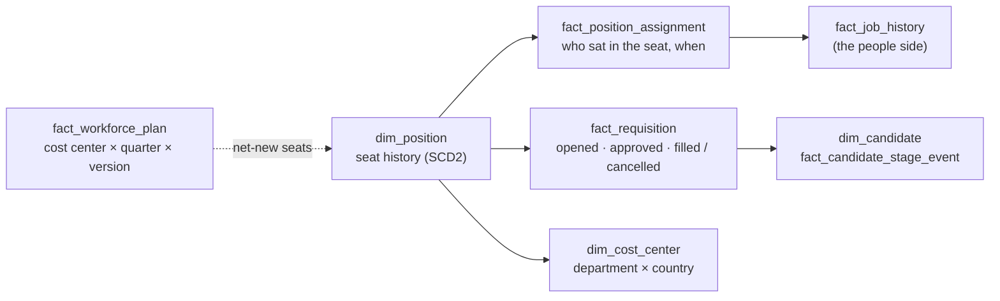

# Workforce Planning: are we hiring into the seats we planned?

Case study 3 of the warehouse. Arcadia Systems is a fictional company and all data is synthetic: the seats, requisitions, applicants and plan were generated by Claude Code from rules I designed with it (`generator/`). No employer data, logic or naming is used.

## 0. Which dashboard this is, and the PID principle

**Published:** [Workforce Planning on Tableau Public](https://public.tableau.com/app/profile/thialp/viz/WorkforcePlanningArcadiaSystems/Dashboard). The page question is *Are we hiring into the seats we planned, and what did each seat look like before?* It is not the Global Workforce Footprint (*Where are our people, and who moves between offices?*).

Both have a map with lines between offices; what the line follows is different:

| | Global Workforce Footprint | Workforce Planning |
|---|---|---|
| Unit | People | **PIDs** (positions, seats) |
| A line on the map | A **person** changed office | A **PID** was refilled in another office than the person who left it |
| Answers | Where people are and where they go | Where the budgeted seats are, which are vacant, how fast and how well they are filled, and what changed in the seat on refill |

**The PID ledger.** Workforce planning counts PIDs, not people ("seats vs butts"):

- **Total PIDs = filled + vacant.** Filled PIDs equal headcount (test 45: same people, every month; test 81 for contractors).
- **A vacant PID is previously held or new.** Previously held: someone left it (resigned, was let go, moved to another PID, or a contractor's assignment ended). New: a net-new PID the plan approved that has not had its first hire yet.
- **Filling a previously held PID is a backfill; filling a new PID is a net-new fill.**
- **A backfill can change the PID.** It can come back at another level or in another office. Example: a Senior Manager in Austin leaves; the PID is refilled by a new hire in Chicago at Manager level. The PID moved (the map) **and** went one level down (the level-change KPI and the right-hand card).
- **Net-new PIDs have no "before",** so they never appear on the map.

**The map definition.** One line per backfilled PID whose new office differs from the office of the person who left it, drawn from the prior office to the new office; a dot per new office, sized by the number of PIDs that arrived. FY26: 467 of the 4,668 backfills changed office (410 within the same country, 57 across a border); 280 of them went to a lower-pay office. Net-new PIDs and contractor PIDs are not on the map.

**Reading the page.** The five KPI cards, the map and the three cards on the right are tied by construction: KPI 5 (752 backfills with a level change) is the "one level down" and "one level up" bars plus "changed level and office" (556 + 11 + 185); the map's 467 is "moved office only" plus "changed level and office" (456 + 11); the vacant card's 9,217 is KPI 2 plus KPI 3 (8,689 + 528). Build plan and every calculation: [release_3_rebuild_dashboard_3.md](release_3_rebuild_dashboard_3.md).

## 1. The question

A hiring plan is approved as numbers per cost center and quarter: so many net-new seats, so many backfills, an ending headcount and a cost. A year later, leaders ask whether hiring followed it. "We hired 5,235 people" doesn't answer that. They need to know:

- **What seat did each hire fill?** Was it a net-new seat, growth the plan paid for, or a backfill of someone who left?
- **For a backfill, who sat there before?** At what level, in which office, at what pay, and did they leave by choice, involuntarily, or by moving to another seat inside the company?
- **Did a backfill change the seat?** Refilled one level down, or moved to a cheaper office in the same country?
- **Was a net-new seat needed?** Or did a matching seat stand empty while it was approved?
- **Did hiring match the plan?** By quarter and year, against the budget or any reforecast.

Answering these needs a **position** (seat) layer that the HR history usually doesn't have. Hires are worker events, but the plan counts seats. This case study builds the seat layer and ties it back to the people walk, so the two agree on every month-end.

## 2. The seat model

| Concept | How it is held |
|---|---|
| **Seat** (`dim_position`) | One position id with an effective-dated history (SCD2, inclusive end dates). Each record carries status (Filled, Open, Frozen, Eliminated), department, cost center, office, job profile, grade and FTE, and why it changed. Every worker sits in a seat from the first day of history, the CEO included. |
| **Assignment** (`fact_position_assignment`) | Who held which seat, from when to when, how they arrived (Initial, External Hire, Internal Move) and why they left (Voluntary, Involuntary, Internal Move Out). |
| **Requisition** (`fact_requisition`) | The request to fill an open seat: Backfill or Net-new, opened, approved, target start, filled or cancelled, and who filled it, internal or external. |
| **Applicants** (`dim_candidate`, `fact_candidate_stage_event`) | Everyone who applied to a requisition, and each stage they reached (Applied, Screen, Interview, Offer, then Accepted, Declined, Rejected or Withdrawn). |
| **Cost center** (`dim_cost_center`) | Department × country (`CC-1010-US`), so a plan line and a seat meet on one key. |
| **Plan** (`fact_workforce_plan`) | Per cost center and fiscal quarter: a **Budget** before the year and reforecasts **RF1–RF3** after each quarter, each covering only the quarters still ahead. Versions sit side by side and are never overwritten. |

**Contractors hold PIDs too (release 3.1).** Bridgeway sends Keystone each contractor under a Bridgeway worker ID; Keystone converts it to an Arcadia person ID (`W5…`) and assigns a PID, exactly as for an employee. The PID is created, or a vacant contingent PID with the same department, office, type and role reused, on the day the request (service order) is approved. It is Filled for the days Bridgeway holds the assignment, then vacant until the next contractor reuses it or the January / July position audit closes it. A contractor who returns goes back to their own PID. So filled contingent PIDs equal the contingent headcount every month-end (test 81), and the PID count covers the whole workforce: 51,163 PIDs on 30 Jun 2026.

**A PID is created at recruiting, not at hiring.** A net-new PID exists from the day its requisition is approved; until the first hire it is *vacant, new*. The data runs the hiring pipeline six months past the extract at FY26's pace, so the requisitions open on 30 Jun 2026 have their PIDs and applicants.

**Promotions and demotions happen in place.** The seat is reclassified one grade with the same person in it. That is a new seat record, not a vacancy.

## 3. What happens when a seat empties

Every exit and every internal move out triggers a decision on the seat:

| Decision | Share | Notes |
|---|---:|---|
| Backfill as is | 60% | Same grade, same office |
| Backfill re-levelled | 15% | 80% go one grade down (a manager seat often becomes an individual contributor seat) |
| Backfill relocated | 10% | Another office **in the same country**, weighted toward lower pay zones (San Francisco to Austin, Bengaluru to Hyderabad) |
| Freeze | 10% | Resolved after 60 to 300 days: half reopen for hiring, half are eliminated |
| Eliminate | 5% | During the FY24 restructuring, 75% of vacated seats in the affected areas are eliminated and the rest frozen |

**Requisitions are approved with a lag** (0 to 14 days; 8% are late, 30 to 75 days). Time to fill depends on grade (median 35 days at grades 1–2, 80 at Director, 100 at the top grades). An approved requisition still open after 210 days is cancelled, and its seat is frozen or eliminated.

**Who fills it.** A new hire takes a ready open seat when one fits, otherwise a net-new seat is created. An internal mover takes an approved open seat 85% of the time when one fits. When a leader leaves, a successor or team backfill refills the seat the same day (*Immediate refill*).

## 4. Fills, backfills and vacancy chains

[`int_seat_fill`](../../../sql/02_intermediate/int_seat_fill.sql) has one row per fill, external or internal:

- **Net-new** when the seat had no earlier incumbent. Otherwise **Backfill**, linked to the prior incumbent's assignment: their exit reason, grade, office and pay.
- **`seat_decision`**: what happened to the seat between the exit and the fill (Backfill as is, Re-levelled, Relocated, Frozen then reopened, Immediate refill).
- **`level_change`** (up, same, down) and **`location_change`** (same office, other office in the same country, other country).
- **`vacancy_days`** (exit to fill) and **`time_to_fill_days`** (approval to fill).

**An internal fill empties another seat**, which is filled in turn: a vacancy chain. [`int_seat_vacancy_chain`](../../../sql/02_intermediate/int_seat_vacancy_chain.sql) links each fill to the internal move that emptied its seat, so a whole chain carries one `chain_id`, a `chain_depth`, a `chain_length` and the `chain_trigger` that started it (Voluntary exit, Involuntary exit or Net-new seat).

**Example, a real chain from the data (Technology, India, across three departments):**

| Step | Date | Seat | What happened |
|---:|---|---|---|
| 1 | 23 Jan 2025 | P206994, Principal Software Engineer, Site Reliability, Hyderabad | `W106994` resigned. 33 days later `W108416` moved in from Enterprise IT: **Backfill as is**, filled internally |
| 2 | 11 Mar 2025 | P208416, Principal Software Engineer, Enterprise IT, Hyderabad | `W108416`'s old seat. 47 days later `W102745` moved in from Product Engineering: **Backfill as is**, filled internally |
| 3 | 15 Jul 2025 | P202745, Principal Software Engineer, Product Engineering | `W102745`'s old seat, in **Bengaluru**, was **relocated to Hyderabad** and filled by an external hire 126 days later |

One resignation produced three fills and one external hire. Step 3's pay walk: prior pay $38,784.82, new pay $49,607.68 (+$10,822.86) = location −$1,400.57 (Hyderabad's lower pay zone) + market +$3,169.43 (the July 1 range increase between exit and hire) + positioning +$9,054.00.

## 5. Could a net-new seat have reused an empty one?

A net-new seat is a **reuse candidate** when, on the day its requisition was approved, a seat it could have taken stood vacant:

| Rule | |
|---|---|
| Same department and job family | The work is the same |
| Grade within one | A seat can be re-levelled one grade on refill |
| **Same country** | Seats move between offices within a country, rarely across borders |
| Open or Frozen for **90 days or more** | A stale vacancy, not one still being recruited for |

The 90-day threshold was a deliberate choice. At 30 days, half of all net-new seats matched a seat that was still actively being recruited, which isn't waste. At 90 days the share is about 25 to 30% in most years (14% in FY22, the first year of history), and four in five matches are frozen seats: budget that exists but isn't being used. The oldest matching seat is named (`reuse_candidate_position_id`) so an analyst can open it. The threshold is one line in `int_seat_fill.sql` and test 54.

## 6. Pay walk, prior incumbent to new incumbent

For every backfill, the change from the prior incumbent's pay (at exit) to the new incumbent's (at fill) is split into four steps, in constant USD at the annual base rate. With `mid(grade, office, FY)` = salary range midpoint × office pay zone:

| Step | Formula | Reads as |
|---|---|---|
| Level | `mid(new grade, old office, exit FY) − mid(old grade, old office, exit FY)` | The seat was re-levelled |
| Location | `mid(new grade, new office, exit FY) − mid(new grade, old office, exit FY)` | The seat moved to another pay zone |
| Market | `mid(new grade, new office, hire FY) − mid(new grade, new office, exit FY)` | Ranges moved between exit and hire (every July 1) |
| Positioning | the rest: `(new pay − prior pay) − level − location − market` | Where in the range each person is paid |

Pay, level, location and market are rounded to the cent; positioning absorbs the rounding, so the four steps add up exactly (test 53). The order is level, then location, then market; a Shapley split that removes the order effect belongs to case study 6.

## 7. Plan versus actual

[`mart_plan_vs_actual`](../../../sql/03_marts/mart_plan_vs_actual.sql) has one row per plan version × cost center × quarter. The planned values sit beside actuals from the seat fills and the month-end snapshot:

- net-new seats filled, backfills, external hires and internal moves;
- **net-new seats that were reuse candidates**;
- ending headcount and FTE;
- loaded cost: at the plan's FX date (comparable with the plan) and at constant FX.

Attainment is actual ÷ planned, against the budget or any reforecast. A reforecast covers only the quarters still ahead, so FY26 RF2 compares Q3 and Q4 only. Plan rows stay at quarter grain; the dashboard relates them to the actuals rather than repeating targets on worker rows.

**A simulation shortcut, stated plainly.** In a real company the plan drives hiring. Here the generator writes each plan version around what actually happened, with an error that shrinks from the budget to RF3, and budgets lean high on net-new seats (as real budgets do). The FY24 budget was set before the February 2024 restructuring, so it overshoots most. The version mechanics, variances and attainment are real calculations on that data; the plan's causal role is not simulated.

## 8. Validation

Eighteen tests (41 to 56, 80 and 81) guard the PID layer; the build stops if any returns a row. Each one was also run against a deliberately broken copy of the data, to confirm it fails.

| # | Test | Guards against |
|---|---|---|
| 41 | Seat history is one continuous chain per seat | Gaps or overlaps that drop or double a seat |
| 42 | A seat never has two incumbents at once | Two people in one seat |
| 43 | Every job record names the seat the worker holds | The people and seat histories drifting apart |
| 44 | A seat is Filled exactly when someone holds it; an Open seat has an open requisition | Status that contradicts occupancy |
| 45 | **Filled seats = the month-end headcount, same people, every month** | The seat view and the people view disagreeing |
| 46 | Every worker's first seat starts on their hire date | Hires without a seat |
| 47 | Every seat exit is a termination that day or an internal move the next day | Unexplained vacancies |
| 48 | A filled requisition has exactly one fill, same day, same person; dates in order | Fills without a requisition |
| 49 | Plan versions are unique, dated in order, never overwritten; reforecasts cover only quarters ahead | A plan rewritten after the fact |
| 50 | A filled requisition has exactly one accepted applicant, the person who filled it; stages run in order | An applicant pipeline that disagrees with the hire |
| 51 | Cost center = department × country on every seat and requisition | Plan lines that can't meet their seats |
| 52 | Salary ranges move once a year by the structure increase | A market effect with nothing behind it |
| 53 | **The pay walk adds up for every backfill, to the cent**; no level effect at the same grade, no location effect in the same office | A walk that doesn't reconcile |
| 54 | Every reuse candidate meets the rule on its approval date | A flag that can't be defended |
| 55 | Vacancy chains link correctly; every seat left by an internal move is accounted for | Lost seats, broken chains |
| 56 | **Plan vs actual ties to the company headcount and the seat fills every quarter** | Two versions of the actuals |
| 80 | Dashboard #3's summary: every choice has a row; filled PIDs equal the headcounts; filled + vacant = total; groups add up | KPIs that disagree with each other |
| 81 | **Every contractor holds a PID**: filled contingent PIDs = contingent headcount by month, department, country; one holder at a time; no gaps | Contractors outside the position model |

The same seat layer is built in T-SQL ([`03b_build_dw_workforce_planning.sql`](../../../sqlserver/03b_build_dw_workforce_planning.sql)). [`08_validate_workforce_planning.sql`](../../../sqlserver/08_validate_workforce_planning.sql) checks it on SQL Server against the DuckDB values; all checks pass ([run guide](sql_server_release_2_run.md)).

## 9. Results

### FY26 (Jul 2025 to Jun 2026)

| Measure | Value |
|---|---:|
| Seat fills (external hires + internal moves) | 6,849 |
| Backfills / net-new | 4,668 / 2,181 |
| Filled by internal moves | 1,614 (24%; 42% for manager seats) |
| Backfills by why the seat emptied: voluntary / internal move out / involuntary | 2,612 / 1,397 / 659 |
| Backfills by level change: same / down / up | 3,916 / 567 / 185 |
| Backfills filled in another office of the same country (348 of them a seat relocation) | 410 |
| Net-new seats approved while a matching seat stood vacant 90+ days | 631 (29% of net-new), $55.7M of starting base pay |
| Median days from approval to fill (backfills) | 42 |
| PIDs at 30 Jun 2026 | 51,163 |
| Filled by employees / by contractors | 30,005 / 11,941 |
| Vacant, previously held: employee (open + frozen) / contingent | 977 (725 + 252) / 7,712 |
| Vacant, new (never filled): employee / contingent | 291 / 237 |

**Backfills save money, mostly by re-levelling.** Across the 4,668 FY26 backfills, the new incumbents earn $7.0M a year less than the people they replaced: level −$6.8M, location −$0.7M, market +$2.2M, positioning −$1.8M. Re-levelling a seat on refill saves far more than moving it to a cheaper office.

**Reuse candidates concentrate in Operations.** 44% of its net-new seats were approved while a matching seat stood empty, against 28% in Technology and Commercial and 11% in People and Legal & Compliance.

**Most vacancies don't chain.** 83% of chains end with the first fill; 941 of the 5,452 chains started in FY26 had two or more steps, and the longest had six.

### Five years against the budget

| FY | Fills | Net-new (budget) | Net-new attainment | Backfills (budget) | Backfill attainment | Jun 30 headcount (budget) |
|---|---:|---:|---:|---:|---:|---:|
| FY22 | 5,934 | 2,637 (3,531) | 75% | 3,297 (3,691) | 89% | 25,061 (25,467) |
| FY23 | 6,925 | 2,484 (3,201) | 78% | 4,441 (4,753) | 93% | 26,941 (27,412) |
| FY24 | 5,015 | 910 (2,834) | **32%** | 4,105 (4,503) | 91% | 27,217 (28,599) |
| FY25 | 5,852 | 1,628 (2,236) | 73% | 4,224 (4,737) | 89% | 28,447 (28,918) |
| FY26 | 6,849 | 2,181 (2,762) | 79% | 4,668 (5,031) | 93% | 30,014 (30,347) |

The FY24 budget was set before the restructuring: net-new hiring stopped and only 32% of the planned growth seats were filled, while backfills stayed near plan. Each reforecast closes the gap. FY26 net-new attainment is 79% against the budget, 83% against RF1 and 93% against RF3 (for the quarters each covers).

## 10. Tables to use

| Table | Grain | Use it for |
|---|---|---|
| [`mart_position_fill`](../../../sql/03_marts/mart_position_fill.sql) | fill | Hires by seat type; prior incumbent's exit, grade, office and pay; level and location change; pay walk; reuse; chains |
| [`mart_vacancy_pool`](../../../sql/03_marts/mart_vacancy_pool.sql) | month-end × vacant PID | Open and frozen PIDs, employee and contingent, how long they've been empty, age bands, open requisitions |
| [`mart_pid_month_end`](../../../sql/03_marts/mart_pid_month_end.sql) | month-end × worker type × PID kind × department × country | The PID ledger: filled, vacant previously held, vacant new |
| [`mart_plan_vs_actual`](../../../sql/03_marts/mart_plan_vs_actual.sql) | plan version × cost center × quarter | Attainment by version, quarter, year, cost center |
| [`mart_seat_corridors`](../../../sql/03_marts/mart_seat_corridors.sql) | quarter × from office × to office | Where backfilled seats moved (map lines), with pay and location effects |

Column definitions: [data dictionary](../../warehouse/data_dictionary.md#workforce-planning). SQL Server views with the same columns: `rpt.vw_position_fill`, `rpt.vw_vacancy_pool`, `rpt.vw_plan_vs_actual`, `rpt.vw_seat_corridors`.

## 11. Limits and choices

- **The plan is written around the actuals** (section 7). Variance and attainment are real calculations; the plan does not drive hiring.
- **Grade creep.** A backfill hires at the leaver's grade, while net-new hires follow a junior-leaning mix, so the average grade drifts from 3.62 to 3.71 over five years and FY26 cost is 4.5% higher than before seats were modelled. It is kept because it is real, and it feeds case study 6.
- **Contingent PIDs are kept simple:** no job profile or grade (Bridgeway roles are not on Arcadia's grade structure), FTE 1.0, and only reuse and the twice-yearly audit decide what happens to a vacant one. The parameters (45% reuse, audit closes 30% of PIDs vacant 180+ days) are set in `reference_data.py`.
- **Not modelled:** short overlaps (two incumbents during a handover) and rehires. Test 42 holds strictly.
- **Seats cross borders rarely**, by design (decision D8 in the [release plan](release_2_plan.md)): the 57 FY26 backfills in another country are all leader seats refilled the same day by a successor based there.
- **The pay walk is ordered** (level, location, market). Changing the order moves amounts between steps but not the total.

Build history, decisions and phase log: [release_2_plan.md](release_2_plan.md). Expected values for the dashboard: [headline_values.md](headline_values.md).
