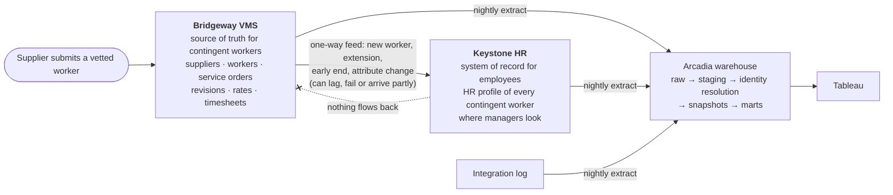

# Source systems and lineage

Arcadia Systems, Keystone HR and Bridgeway VMS are fictional; all data is synthetic.

Arcadia's workforce lives in two operational systems that were never designed to agree. Since release 3 the warehouse loads both, says on every raw table which one it came from, and joins them into one picture of the workforce: **employees** from Keystone HR and **contingent workers** from Bridgeway VMS, with Keystone's view of those contingent workers kept beside Bridgeway's so the differences can be seen.

## The systems

| Code | System | System of record for | Who works in it |
|---|---|---|---|
| `KS` | **Keystone HR** | Employees, jobs, pay, seats, requisitions, applicants, the workforce plan; the HR profile of every contingent worker | Managers, employees, HR Operations, Talent Acquisition, Finance planning |
| `BW` | **Bridgeway VMS** | Suppliers, contingent workers, service orders and their revisions, bill rates, timesheets | Vendor Management, hiring managers raising requests, suppliers |
| `INT` | **Bridgeway to Keystone integration** | Every change Bridgeway sent to Keystone, when it was applied, whether it failed | Integration support |
| `PUB` | **Public reference data** | ECB euro reference rates; employer fringe rates from OECD, BLS and national sources | Finance, the warehouse |
| `WH` | **Arcadia warehouse metadata** | Which system every raw table comes from; the column contract of every release 3 extract; the catalogue of contingent workforce discrepancies | The build and its tests |
| `GEN` | **Synthetic data generator** | The answer key: every discrepancy seeded between the systems, with its cause and dates. A test fixture, never a business source | The tests and the detection score |

The same list is a raw table, `ref_source_system`, written from [`generator/source_systems.py`](../../generator/source_systems.py).

## How a contingent worker enters, and where each fact lives

1. A manager raises a request in **Bridgeway**. A supplier submits a vetted worker; Bridgeway creates a **worker** (`bw_worker_id`) and a **service order** with its first **revision**: role, seniority, office, cost center, start, end, bill rate.
2. Once approved, Bridgeway sends a **New Worker** event. **Keystone** creates a person ID (`W…`, the same key space as employees), sets the department, cost center, office and manager, and **stores the Bridgeway worker ID**.
3. Every later change in Bridgeway is a **new revision** of the order (extension, rate change with an extension, early end, cost center, manager or office change) and, for the changes Keystone cares about, a new feed event. Rate changes and closures are not sent: Keystone holds no rates. A renewal or extension moves Keystone's contract end, never its start. A worker's events are applied first in, first out.
4. **Keystone inactivates a contingent worker the day after the contract end date it holds.** If an extension never arrives, Keystone ends a worker Bridgeway still has active.
5. **Some are hired as employees.** HR closes the contingent record on the hire date as *Converted to employee*, naming the new employee ID; the hire fills a requisition with an applicant whose source is *Contingent conversion*. Bridgeway is not told: its order simply ended. See [conversions and the plan](../projects/contingent-workforce/conversions_and_plan.md).

| Fact | Bridgeway | Keystone | Flows on the feed |
|---|:-:|:-:|:-:|
| Who the worker is (name, supplier, type) | ✓ | ✓ (as fed) | ✓ |
| Bridgeway worker ID | ✓ | ✓ (stored from the feed) | ✓ |
| Keystone person ID | ✗ | ✓ | ✗ (never sent back) |
| Assignment start and end | ✓ (every revision) | ✓ (the last one that arrived) | ✓ |
| Department, cost center, office, manager | ✓ (as typed on the order) | ✓ (can be edited in Keystone) | ✓ |
| Bill rate, hours, spend | ✓ | ✗ | ✗ |
| Employees | ✗ | ✓ | n/a |

Two consequences shape the warehouse design:

- **Identity has to be resolved.** Keystone's stored Bridgeway ID is the main key, but it can be blank or mistyped, and a renewal can create a second Bridgeway ID for the same person. The warehouse matches on the stored ID first, then on name, supplier and start date, and records how confident each match is. Unmatched records on either side are kept, never dropped.
- **Cost is only in Bridgeway.** A manager in Keystone cannot see what a contingent worker costs. The warehouse is the first place where employee pay and contingent spend sit side by side.

## Raw tables by source system

| System | Raw tables |
|---|---|
| Keystone HR | `dim_worker`, `fact_job_history`, `fact_compensation_history`, `fact_performance_review`, `fact_bonus_payout`, `dim_org_unit`, `dim_department`, `dim_cost_center`, `dim_location`, `dim_country`, `dim_job_level`, `dim_job_profile`, `ref_job_level_base_salary`, `ref_salary_range`, `ref_tenure_increase`, `ref_performance_bonus`, `dim_position`, `fact_position_assignment`, `fact_requisition`, `dim_candidate`, `fact_candidate_stage_event`, `fact_workforce_plan`, **`ks_contingent_worker`** |
| Bridgeway VMS | **`bw_supplier`**, **`bw_rate_card`**, **`bw_contingent_worker`**, **`bw_service_order`**, **`bw_service_order_revision`**, **`bw_timesheet_month`** |
| Integration log | **`feed_bridgeway_keystone_event`** |
| Public reference data | `ref_fx_rate_daily`, `ref_fx_rate_monthly`, `ref_fx_rate_constant`, `ref_fringe_rate`, `ref_fringe_source` |
| Warehouse metadata | `ref_source_system`, `ref_raw_table_lineage`, `ref_raw_column`, **`ref_cw_discrepancy_type`** |
| Synthetic data generator | **`gen_cw_discrepancy_truth`** (the answer key; a test fixture) |

In **bold**, the tables release 3 adds. Each new table carries a **system prefix** (`bw_`, `ks_`, `feed_`) so a reviewer sees at a glance which system a fact came from; the release 1 and 2 tables keep their names so nothing built on them breaks. Their columns are in the [data dictionary](data_dictionary.md#contingent-workforce-release-3).

## How lineage is enforced

The registry is data, so the build can test it:

| Test | Rule | Catches |
|---|---|---|
| 60 | Every raw table has exactly one lineage row with a known system, and every lineage row names a table that is loaded | A new extract nobody documented; lineage left behind for a dropped table |
| 61 | Every release 3 table carries exactly the documented columns, in order | An extract that gained, lost, renamed or reordered a column, before any model reads it |

How the feed and Keystone are simulated, what goes wrong between them and how the answer key is built: [Keystone and the feed](../projects/contingent-workforce/keystone_feed.md).
